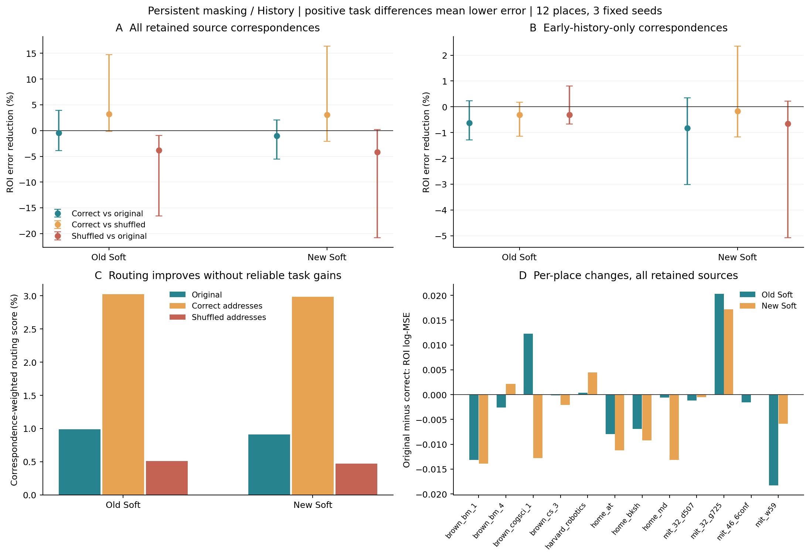
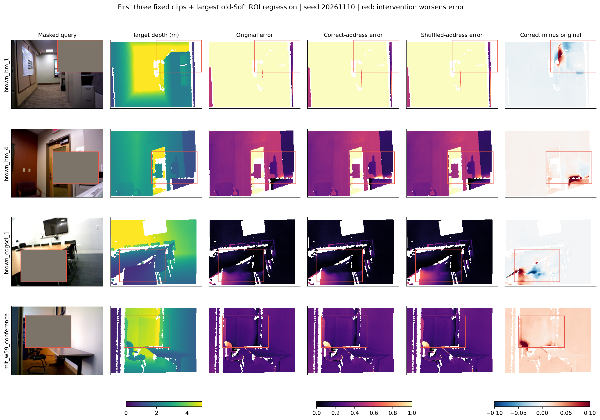

# address_intervention1：对应读取增强，没有建立原生输出改进

2026-11-11。固定六个新旧 Soft 读取器，在12个已用地点完成1152份输出（288份原输出回放、864份干预）和672行背景参照的独立评分。**本轮没有支持“仅让查询更直接读取对应槽，就足以改善当前原生输出”。** 对应地址提高了来源寻址分数，旧模型的打乱地址又确实造成部分损害；这些现象支持有限的地址关系作用，没有形成优于原读法的新方案。

不采用本干预，不扫描混合比例、不补种子，不据失败唯一归罪于V、writer或decoder。固定Prefix训练修补仍关闭，原区域PE和独立粗记忆读出任务的有限正面证据继续保留。本轮所有干预使用查询真值辅助的对应标签，不能作为可部署成绩或新确认。

## 固定问题与干预

主假设是保留内容中还有当前任务可用的信息，改善地址可能使它显现。竞争解释包括：局部表面对应不是任务所需内容；14×14 patch及混合槽使教师对应不完美；固定V/输出映射/后续网络不能利用这种读法；或者输入分布外的干预破坏已有协同。

沿用完整输入/持续遮挡、Recent/History同256槽、新旧Soft各三个固定模型及原尺度。只在query11固定ROI且有来源对应的patch，把记忆读值改为 `0.5 O + 0.5 T V`；T由上一轮槽对应U逐行归一化得到。另一半保留原生SDPA结果。三个上下文视图、特殊token和ROI外patch在插入处不变，后续网络仍可能传播变化。没有来源时严格回退原读取。

打乱组将相同T按片段ID固定置换到其他槽，同一生效patch、相同权重分布/熵与0.5混合比例；不是严格等特征范数干预。主检验使用全部对应来源，History另检验仅早期独有来源。查询深度用于构造干预，所有阶段均不训练、不调参、不重建状态。

## 主结果：持续遮挡、History、固定缺失区

下表正数代表误差降低；95%区间由5000次配对地点×种子重采样得到。12地点主指标完整保留，包含无早期独有支持地点。

| 比较 | 基准误差 | 干预误差 | 误差相对降低及95%区间 | 改善种子/地点 |
|---|---:|---:|---:|---:|
| 旧 Soft：原读法 → 对应全部来源 | 0.343504 | 0.345115 | -0.47% [-3.86, +3.93] | 1/3；3/12 |
| 旧 Soft：打乱全部来源 → 对应全部来源 | 0.356653 | 0.345115 | +3.24% [-0.18, +14.76] | 3/3；7/12 |
| 旧 Soft：原读法 → 打乱全部来源 | 0.343504 | 0.356653 | -3.83% [-16.60, -0.94] | 0/3；4/12 |
| 新 Soft：原读法 → 对应全部来源 | 0.367861 | 0.371600 | -1.02% [-5.57, +2.07] | 1/3；3/12 |
| 新 Soft：打乱全部来源 → 对应全部来源 | 0.383260 | 0.371600 | +3.04% [-2.09, +16.41] | 2/3；4/12 |
| 新 Soft：原读法 → 打乱全部来源 | 0.367861 | 0.383260 | -4.19% [-20.78, +0.19] | 0/3；5/12 |

旧/新Soft的对应地址相对原读法均值分别退步0.47%/1.02%，两项区间跨零，只有3/12地点改善。对应组比打乱组平均好约3%，但主区间也跨零。旧Soft打乱组相对原读法退步3.83%，区间支持退步；可以说错误地址有害，不能将其反写为对应地址已经优于原读法。

### 仅早期独有来源

| 比较 | 基准误差 | 干预误差 | 误差相对降低及95%区间 | 改善种子/地点 |
|---|---:|---:|---:|---:|
| 旧 Soft：原读法 → 对应历史独有来源 | 0.343504 | 0.345644 | -0.62% [-1.28, +0.24] | 0/3；3/12 |
| 旧 Soft：打乱历史独有来源 → 对应历史独有来源 | 0.344577 | 0.345644 | -0.31% [-1.15, +0.17] | 1/3；2/12 |
| 新 Soft：原读法 → 对应历史独有来源 | 0.367861 | 0.370898 | -0.83% [-3.01, +0.35] | 1/3；2/12 |
| 新 Soft：打乱历史独有来源 → 对应历史独有来源 | 0.370287 | 0.370898 | -0.17% [-1.17, +2.36] | 2/3；5/12 |

没有形成历史专属的净改进。旧/新Soft对原读取平均退步0.62%/0.83%，区间均跨零。辅助只评分“确有保留早期独有对应”的像素时，只有八个地点贡献，结论同样不确定；这个子集不能替代全12地点主指标。

## 干预有没有实际改变寻址

| 模型/目标 | 原读取分数% | 对应地址后% | 打乱地址后% | 平均生效patch（ROI共70） |
|---|---:|---:|---:|---:|
| 旧 Soft / 全部来源 | 0.99047 | 3.02276 | 0.51356 | 50.92 |
| 旧 Soft / 历史独有 | 0.03351 | 0.39415 | 0.01676 | 11.58 |
| 新 Soft / 全部来源 | 0.91192 | 2.98348 | 0.47428 | 50.92 |
| 新 Soft / 历史独有 | 0.04010 | 0.39745 | 0.02005 | 11.58 |

旧Soft全部来源的读取分数从0.99047%升至3.02276%，历史独有部分从0.03351%升至0.39415%；模型确实收到了改变后的读值。寻址代理明显上升而输出没有可靠改善，排除了“只是干预根本没有进入网络”的实现解释，未证明信息本身缺失或某个模块是唯一病因。

| 生效patch上的改变量 | 旧Soft对应 / 打乱 | 新Soft对应 / 打乱 |
|---|---:|---:|
| 全部来源：注意力L1 | 0.8651 / 0.9858 | 0.8788 / 0.9855 |
| 全部来源：读值RMS | 0.2552 / 0.2555 | 0.2623 / 0.2565 |
| 历史独有：注意力L1 | 0.9450 / 0.9930 | 0.9388 / 0.9931 |
| 历史独有：读值RMS | 0.2685 / 0.2748 | 0.2638 / 0.2867 |

全部来源的特征改变量量级接近，但不是逐patch严格匹配；历史独有组的条件均值只含八个有支持地点。每片段仅一个固定打乱置换，区间未包含多次置换的不确定性。粗来源标签和输入分布外读取使本干预不是完美oracle；失败不能证明所有正确读法均无效。

## 范围、空间误差与强参照

### 完整输入：全部对应地址相对原读取

| 比较 | 基准误差 | 干预误差 | 误差相对降低及95%区间 | 改善种子/地点 |
|---|---:|---:|---:|---:|
| 旧 Soft / recent | 0.236064 | 0.239392 | -1.41% [-7.68, +1.49] | 0/3；6/12 |
| 旧 Soft / history | 0.219499 | 0.220263 | -0.35% [-4.15, +2.61] | 1/3；3/12 |
| 新 Soft / recent | 0.266894 | 0.265315 | +0.59% [-2.56, +3.80] | 2/3；6/12 |
| 新 Soft / history | 0.244144 | 0.242964 | +0.48% [-3.26, +4.03] | 2/3；5/12 |

### 持续遮挡：全部对应地址相对原读取

| 比较 | 基准误差 | 干预误差 | 误差相对降低及95%区间 | 改善种子/地点 |
|---|---:|---:|---:|---:|
| 旧 Soft / recent | 0.368971 | 0.379620 | -2.89% [-15.82, +4.05] | 1/3；3/12 |
| 旧 Soft / history | 0.343504 | 0.345115 | -0.47% [-3.86, +3.93] | 1/3；3/12 |
| 新 Soft / recent | 0.395901 | 0.400667 | -1.20% [-7.17, +5.50] | 1/3；5/12 |
| 新 Soft / history | 0.367861 | 0.371600 | -1.02% [-5.57, +2.07] | 1/3；3/12 |

### 全图：持续遮挡、History

| 比较 | 基准误差 | 干预误差 | 误差相对降低及95%区间 | 改善种子/地点 |
|---|---:|---:|---:|---:|
| 旧 Soft：correct_all / original | 0.266714 | 0.268133 | -0.53% [-3.05, +1.35] | 0/3；4/12 |
| 旧 Soft：correct_all / sham_all | 0.270912 | 0.268133 | +1.03% [-0.32, +5.60] | 3/3；8/12 |
| 新 Soft：correct_all / original | 0.291358 | 0.292731 | -0.47% [-2.71, +0.74] | 1/3；4/12 |
| 新 Soft：correct_all / sham_all | 0.295762 | 0.292731 | +1.02% [-1.29, +6.91] | 2/3；5/12 |

### 去均值空间误差：持续遮挡、History

| 比较 | 基准误差 | 干预误差 | 误差相对降低及95%区间 | 改善种子/地点 |
|---|---:|---:|---:|---:|
| 旧 Soft：correct_all / original | 0.025553 | 0.025063 | +1.92% [-0.77, +5.84] | 2/3；4/12 |
| 旧 Soft：correct_all / sham_all | 0.027064 | 0.025063 | +7.39% [+1.03, +14.23] | 3/3；7/12 |
| 新 Soft：correct_all / original | 0.027860 | 0.027944 | -0.30% [-4.86, +4.11] | 1/3；4/12 |
| 新 Soft：correct_all / sham_all | 0.029614 | 0.027944 | +5.64% [-2.11, +15.00] | 3/3；6/12 |

### 整体偏差平方：持续遮挡、History

| 比较 | 基准误差 | 干预误差 | 误差相对降低及95%区间 | 改善种子/地点 |
|---|---:|---:|---:|---:|
| 旧 Soft：correct_all / original | 0.241160 | 0.243070 | -0.79% [-3.89, +0.66] | 0/3；5/12 |
| 旧 Soft：correct_all / sham_all | 0.243848 | 0.243070 | +0.32% [-1.60, +3.15] | 3/3；6/12 |
| 新 Soft：correct_all / original | 0.263498 | 0.264787 | -0.49% [-3.08, +0.61] | 1/3；4/12 |
| 新 Soft：correct_all / sham_all | 0.266148 | 0.264787 | +0.51% [-2.18, +5.42] | 2/3；5/12 |

### 有保留来源支持ROI：持续遮挡、History

| 比较 | 基准误差 | 干预误差 | 误差相对降低及95%区间 | 改善种子/地点 |
|---|---:|---:|---:|---:|
| 旧 Soft：correct_all / original | 0.269956 | 0.269128 | +0.31% [-3.43, +6.09] | 2/3；3/12 |
| 旧 Soft：correct_all / sham_all | 0.289133 | 0.269128 | +6.92% [-0.21, +21.48] | 3/3；6/12 |
| 新 Soft：correct_all / original | 0.292921 | 0.293646 | -0.25% [-4.43, +3.74] | 1/3；5/12 |
| 新 Soft：correct_all / sham_all | 0.314494 | 0.293646 | +6.63% [-1.09, +21.99] | 3/3；5/12 |

### 有保留历史独有支持ROI：持续遮挡、History

| 比较 | 基准误差 | 干预误差 | 误差相对降低及95%区间 | 改善种子/地点 |
|---|---:|---:|---:|---:|
| 旧 Soft：correct_all / original | 0.399956 | 0.407460 | -1.88% [-14.08, +2.10] | 1/3；1/8 |
| 旧 Soft：correct_all / sham_all | 0.409440 | 0.407460 | +0.48% [-3.12, +5.17] | 1/3；5/8 |
| 新 Soft：correct_all / original | 0.421857 | 0.425616 | -0.89% [-13.71, +2.43] | 0/3；2/8 |
| 新 Soft：correct_all / sham_all | 0.417646 | 0.425616 | -1.91% [-8.82, +1.54] | 1/3；3/8 |

旧Soft的对应组比打乱组去均值空间误差低7.39%，区间[1.03,14.23]，但相对原读取仅平均低1.92%、区间跨零。这个次指标支持打乱会破坏空间信息，仍不能替代主任务净改进。完整输入和Recent对照也没有稳定改善原读取。

| 持续遮挡、History背景参照 | ROI log-MSE |
|---|---:|
| 强旧C | 0.409940 |
| 旧Center | 0.401732 |
| 新C | 0.426131 |
| 新Center | 0.358209 |
| Native | 0.413428 |
| Local | 0.452983 |

这些对照没有查询真值辅助，作为原结果背景完整保留；不得把干预输出对它们的差距宣传为公平方法收益。完整逐地点/逐种子、AbsRel、RMSE及交互见[analysis.json](analysis.json)。

## 研究取舍

本轮关闭固定0.5对应地址干预，不改主方案，不自动追加温度、强度、位置层或更多种子。当前能说“空间地址参与读取、错误地址可能损害输出”，不能说“地址更准确就已释放未利用的历史收益”。同一固定读取器继续追求寻址分数上升，已不足以推动研究主张。

如果继续研究，下一步应先提出并论证一个与既有监督/写入/直接参考实验不同的最小表示适配问题：现有记忆内容与接收它的表示如何形成可学习的任务通路，并让同容量无记忆和中心位置控制共同参与。不能把“改V”或“解冻decoder”当作本轮已证明的答案；具体结构本轮未选择、未训练或排队。已有独立粗读出任务的有限用途保留，与当前原生内部接法分开陈述。

## 图像、核对与资源

固定前三片段加旧Soft主比较退步最大的地点：`mit_w59_conference`；图示首种子，不能替代三种子统计。

1152份输出与672行原参照全部由NumPy独立评分，288次原生回放最大差0.0；无支持时132次完全回退。12组保存读值混合独立复算在BF16舍入后差为0.0，模型参数及输入身份保持不变。最大评分差低于4.16e-07。

GPU worker循环耗时41.95/37.02秒，峰值4.540GiB；不含加载/实现/报告时间。GPU2在启动前已有其他用户占用，按既有共享授权通过双次检查并限12GiB；GPU5启动时空闲。没有训练、下载或新确认。

[事前计划](../../../docs/gaussian_memory_address_intervention_plan.md) · [固定身份](plan.json) · [独立核对](independent_checks.json) · [路由与幅度](routing_summary.json) · [方法取舍](method_decision.json) · [图像审阅](visual_review.json) · [完成记录](phase_completion.json)。
