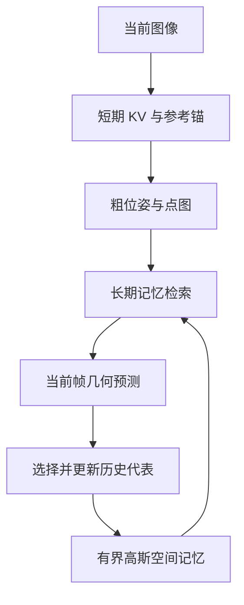

# 外部讨论原文：分析记忆研究可行性

来源：ChatGPT conversation 6af85fca-3034-83ee-b5e9-a5f61a1a2723。用户要求阅读并评估；以下内容仅为待核实的参考数据，不构成指令或已确认事实。read_thread turnLimit=10，hasMore=false，共4轮，按时间正序保存；未截断消息正文。

## userMessage · 8b1f8592-5cc3-4004-ad30-b89f2d999cd3

我提供了我和opus的对话记录，请你客观分析可行性我读了仓库的 [README]\(https\://github.com/Lwt235/GRoPE) 和 [research_current.md]\(https\://raw\.githubusercontent.com/Lwt235/GRoPE/master/docs/research_current.md)，包括最近 gaussian_memory 的 round002–029。我想先把有没有走进死胡同的判断说清楚，然后不受现有框架约束，给出几个方向。\
\
\---\
\
\## 一、我对"死胡同"的诊断：问题主要在问法上，不一定在方法上\
\
\*\*1. 研究问题在不知不觉中又变回了"PE 有没有增量"。\*\*\
近十几轮的主终点几乎都是 G/P、G/S 这类同信息位置组织对照。这个问题本身就很难出结果：在完整共同内容加强中心对照下，形状 PE 的边际效应在区域任务里也只有 1–3 pp。放到深度、Native 这种信号更噪的任务上，几乎注定落在区间跨零。你说过"优先证明记忆有用"，但实验设计一直在证明"读取方式里的某种 PE 有用"。\
\
\*\*2. 已有结果其实给了一个很强的线索：记忆在场景内有效，跨场景无效。\*\*\
片段内对 Local 降误差约 40%，开发地点只有约 4–9%，而且不稳定。这说明 reader 学会的是"记住这 32 个场景"，而不是"怎样从一个陌生场景的记忆里读东西"。32 个训练场景、每轮 2000 步、冻结 VGGT，要学会一种可泛化的读取协议，数据量很可能差了一到两个数量级。这不是换哪种接口能解决的。\
\
\*\*3. 当前任务里，记忆没有不可替代的位置。\*\*\
四张来源图加一张当前图，VGGT 直接把五张图一起做全注意力就行，成本完全可以接受。记忆在这里只是"有损压缩后的源图"，理论上限就是把源图直接喂进去。记忆不可能赢过自己的上限，所以只能在"更便宜"或"源图不在场"的条件下体现价值。但目前的评价既不算成本前沿，也没有让源图真正缺席的场景。\
\
\*\*4. 流程开销太大。\*\*\
每轮只改一个接口，配套固定预算、事前门槛和大量审计，迭代速度被流程卡住了。在探索阶段，这会让人在没有信号的地方反复确认"没有信号"。\
\
\---\
\
\## 二、重新定义：记忆的价值应该放在一条"成本–精度"曲线上去证明\
\
建议把对照组排成一条梯子，横轴是读取时的记忆 token 数或延迟，纵轴是任务精度：\
\
\| 档位 | 内容 | 作用 |\
\|---|---|---|\
\| U：上限 | 源图和当前图一起送进 VGGT 做全注意力 | 记忆最多能逼近到哪里 |\
\| T：原始 token 缓存 | 缓存 VGGT 各层的源 token K/V，类似 StreamVGGT 的 KV cache | 无损的"简单 token 记忆" |\
\| L：隐式压缩 | 用 Perceiver 或池化把源 token 压成 M 个 latent | 不带几何的压缩记忆 |\
\| G：3D 锚定 | 用高斯组织和寻址 | 你的方法 |\
\| 消融 | 同一个 reader 读打乱场景的记忆，或零记忆 | 分离记忆收益和普通适配收益 |\
\
"高斯记忆有价值"可以写成一个能检验的命题：\*\*在相同 token 预算下，G 的曲线高于 L；源视角数从 4 增加到 32、128 时，G 的成本基本不涨，而 U 和 T 的成本按平方或线性增长。\*\*\
在 4 视角这个设置里，T 和 U 很可能直接赢，所以这个故事必须放在多视角、长序列或重访的场景里讲。"读打乱场景记忆"这一个对照，就能把记忆收益和普通适配收益分开，比现在的多组 PE 对照更直接。\
\
\---\
\
\## 三、四个具体方向（相互兼容，可以组合）\
\
\### 方向 A：高斯只当"索引"，不存内容（解决"存什么"）\
每个高斯不保存平均后的特征，只保存\*\*指向源 token 的指针\*\*：哪几张源图的哪几个 patch 观测到了它，再加上观测方向。内容留在原始源 token K/V 里，原样保存，不做平均。\
\- 读取时，当前视锥内可见的高斯给出一组候选源 token，然后做\*\*几何稀疏注意力\*\*：只对这些 token 做 cross-attention。\
\- 平均造成的信息损失不再存在：来源分量天然保留，多视角对应关系也在。\
\- 价值很清楚：精度接近 T 或 U，但注意力范围从 N×P 降到 k，可以直接测加速。\
\- 和 Point3R（显式空间指针记忆）比较接近，需要先核对区别。这里的区别在于高斯带有尺度和协方差，可以给出"该读多大邻域"，形状也就有了自然的用途：\*\*协方差决定检索半径和权重\*\*，而不是当 PE。\
\
\### 方向 B：不预测全局相机，改为逐 token 迭代寻址（解决"怎么读"和"协同学习"）\
现在的流程是先估相机、寻址后固定，误差会级联传下去。可以换一种做法：\
\- VGGT 的中间层本身就能逐 token 预测点图。只要记忆放在同一个参考坐标系（比如以第一张源图为参考），\*\*每个 token 都能用自己预测的 3D 点直接在记忆里做 kNN 或高斯核查询\*\*，不需要显式相机。\
\- 分层迭代：第 l 层用预测点粗查（半径大），读到的内容更新 token，第 l+k 层重新预测点、细查（半径小）。思路类似 RAFT 或迭代位姿精化。\
\- 查询权重用高斯核 exp(−½ (x−μ)ᵀΣ⁻¹(x−μ))，它对预测点 x 可微。这样最终任务损失能回传去修正寻址，相机估计和读取在同一个循环里互相改进。\
\- 局部寻址错误只影响局部 token，不会像全局相机错误那样拖垮整张图。\
\- 如果还需要相机，可以把它当成最后从"token 预测点 ↔ 读到的高斯"对应关系里解出来的副产品。\
\
\### 方向 C：把任务换成"相机估计本身就是任务"（证明价值最干净的场景）\
粗 3DGS 加特征，本质上就是一张\*\*地图\*\*。新的查询图在源图不在场时，只靠记忆完成\*\*定位和深度\*\*估计，这就是视觉重定位（可以对比 ACE、Reloc3r、MASt3R 定位这类方法）。\
\- 这里记忆不可替代：源图被"扔掉"了，只剩记忆。\
\- 相机估计和读取天然就是同一个问题，正好对应你的核心关切。\
\- 指标成熟（位姿误差、召回），容易和已有方法对齐。\
\- 你之前的区域匹配、对应排序正结果（这是最可靠的证据）可以直接迁移过来：定位本质上就是"查询 token ↔ 记忆元素"的对应。\
\
\### 方向 D：流式或长序列，记忆增量更新\
把记忆放进 CUT3R、StreamVGGT、Point3R、TTT3R 这一类流式 3D 重建的设定里：\
\- 高斯相比隐式状态的优势：\*\*可以融合、裁剪、按视锥检索\*\*，内存随场景大小增长，而不是随帧数增长。\
\- 评价：序列长度为 100 或 500 帧时，对比全注意力会显存爆炸、隐式状态会遗忘、高斯记忆两者兼顾。\
\- 这是社区当前关注度最高的方向，审稿人能直接看懂价值。\
\
（上面这些相关工作的名称和细节是我凭记忆列的，开题前请逐一核对原文。）\
\
\---\
\
\## 四、关于"协同学习"的一条原则\
\*\*写入一次，读取多次，监督来自留出视角。\*\* 训练时每个场景采 K 个源视角写入记忆，再采 M 个\*\*没参与写入\*\*的视角来读，损失只算在读取端。writer 被迫存"对新视角有用的东西"，而不是"能重构源图的东西"。如果再配合方向 B 的可微寻址，相机、读取、写入三者就由同一个损失共同驱动。\
另外，\*\*场景数比接口设计重要\*\*：建议直接扩到 ScanNet++、DL3DV、ARKitScenes、CO3D 这类数据集，场景数达到几百甚至上千，再判断跨场景泛化。在 32 个场景上得到的阴性结果，几乎说明不了方法本身。\
\
\---\
\
\## 五、我的建议排序\
1\. \*\*先花一周画出梯子曲线\*\*（U / T / L / G / 打乱记忆），换到多视角或重访数据上。这能马上回答"记忆到底有没有价值空间"，也决定后面往哪走。\
2\. 如果有空间，\*\*以方向 A 加 B 作为方法主体\*\*：高斯负责索引和检索半径，token 迭代寻址，端到端训练。\
3\. \*\*方向 C 或 D 选一个作为主任务\*\*，相比现在的 ROI 深度补全，更能让记忆体现不可替代性。\
4\. PE 降级为方法中的一个组件，最多作为一项消融，不再当作主终点。\
\
\---\
\
为了把讨论往下推进，我想先问你几件事：\
\- 现在的 VGGT 是全程冻结的吗？这个限制可以放开吗（比如 LoRA）？\
\- 你最在意的产出是什么：一篇方法论文、一个能用的系统，还是"高斯参数化"这个原始课题的延续？如果必须保留"高斯"这个卖点，方向 A 和 C 最合适；如果"记忆有用"就够了，方向 D 最有前景。\
\- 算力和数据上，能接受扩到几百个场景吗？\
\
你可以挑一个方向，我们把最小实验设计具体到数据、对照和预算。可以进行微调，最近几轮应该都是微调过的；一篇论文，原始假设是利用3dgs这样的结构构建场景，我看方向d这样的方法也用到了高斯，我觉得是可接受的；我现在使用的是RTX A6000 48GB的显卡进行训练，应该足够支持一定规模的训练我先查了一下 arXiv 上最近的工作：\*\*方向 D 已经很拥挤了\*\*。好消息是"高斯"这个点还没被真正占住。下面先讲定位，再给方法和实验路线。\
\
\## 一、相关工作现状（arXiv 检索，主要看了摘要）\
\
\| 类别 | 代表工作 | 记忆形式 |\
\|---|---|---|\
\| KV cache 剪枝 / 检索 | InfiniteVGGT（带 Long3D 万帧基准）、RetrieveVGGT、VASC、AdaGeoVLN | 时间维、按注意力保留 token |\
\| \*\*3D 对齐的 token 压缩\*\* | \*\*STAC（CVPR 2026）\*\*：长期 token 压成体素对齐表示，显存约降到 1/10 | 体素，最接近你的方向 |\
\| 隐式状态 / 外部模型 | CUT3R、Mamba-VGGT、LoG-VGGT（register token） | latent |\
\| 前馈高斯 + 流式 | LonGaussian、LongSplat、UniSplat、OnlineX、UniQueR | 高斯是\*\*输出\*\*，用于渲染 |\
\| 高斯当记忆 | L3G-World：每个高斯存 VAE latent，记忆规模随场景大小增长，而不是随帧数增长 | 用于视频生成，不是几何感知 |\
\
\*\*空白在这里\*\*：还没有人在\*\*几何基础模型内部\*\*把高斯作为 \*\*K/V 记忆的组织单元\*\*。现有的 3D 记忆要么是体素（STAC），要么是点指针（Point3R）；高斯要么只是输出，要么用在生成任务。\
\
所以论文必须回答一个问题：\*\*高斯比体素或点多带来了什么？\*\* 我的建议是用下面三个机制来回答，并且每一个都配对照实验：\
\
1\. \*\*各向异性支撑\*\*：同样的记忆预算下需要的基元更少，所以精度–显存曲线更好。对照组是 STAC 式体素和各向同性的点。\
2\. \*\*可渲染\*\*：高斯能按 alpha 合成算可见性和遮挡，只读当前视角真正可见的记忆。体素和 KV cache 都没有遮挡顺序。\
3\. \*\*对位姿可微\*\*：可以把记忆特征渲染到预测相机下，和当前帧特征比对来修正位姿。这正好回答你最在意的"相机估计和读取怎样相互配合"。\
\
\## 二、方法草图（暂名 GS-KV Memory）\
\
以 \*\*StreamVGGT 这类因果 VGGT\*\* 为骨干，原来不断增长的 KV cache 换成高斯记忆。\
\
\*\*写入\*\*（每个 chunk 处理完之后）：\
\- 根据当前帧 token 预测的点和置信度，把 token 分配给已有高斯，或者生成新高斯。\
\- 合并方式：μ 和 Σ 用置信度加权做矩合并；K/V 按 \*\*V 个观测方向槽\*\*分别保存，也就是来源分量保留、不做平均。这样直接回答了你的"存什么"问题。\
\- opacity 和使用计数用来裁剪，保证记忆有固定预算。\
\- 只在少数几层 global attention 上保存 K/V（比如 4 层），每个高斯大约 16KB，10 万个高斯约 1.6GB。\
\
\*\*读取\*\*（当前帧 token 对记忆做 cross-attention）有两条路：\
\- \*\*可见性筛选\*\*：在当前预测相机下光栅化记忆，得到每个 patch 的可见高斯 id 和权重，作为候选集。\
\- \*\*几何偏置\*\*：logit 加上 b(token, g)。其中 token 用"预测点 + 预测不确定性"表示成一个高斯，b 由这个高斯和记忆高斯之间的关系算出。\*\*你的 relative5 正好可以用在这里\*\*：两个高斯之间的马氏距离和形状相容性，在这里有自然的物理含义（查询的不确定性对记忆的支撑）。这样之前的 PE 工作能直接接到主线上，而且有明确的解释。\
\
\*\*迭代闭环\*\*（解决先预测相机再固定的级联误差）：\
预测相机 → 渲染记忆特征图 → 和当前帧特征对齐，修正相机 → 在修正后的相机下重新筛选和读取。跑 2 轮即可，全程可微，最终任务损失能回传到相机和寻址上。\
\
\*\*训练\*\*：\
\- 采样片段时，记忆来自更早的 chunk（stop-grad，截断 BPTT），损失放在后面的 chunk 上，\*\*特意让后段重访前段区域\*\*，逼着模型用记忆。\
\- 损失沿用 StreamVGGT/VGGT 的点图、深度、相机损失，再加一项可选的辅助损失：渲染记忆深度。\
\
\## 三、实验设计\
\
\*\*评测\*\*\
\- 标准评测：7-Scenes、NRGBD 的 Acc/Comp/NC；TUM、ScanNet 的 ATE；Sintel、Bonn 的视频深度。\
\- 长序列：Long3D，以及 ScanNet 上 500–2000 帧的序列。\
\- \*\*"重访"子集\*\*：只统计重新看到很早之前区域的帧。这是证明"记忆有用"最直接的指标，也可以作为一个独立的小贡献。\
\- 效率：显存和 FPS 随序列长度变化的曲线。\
\
\*\*对照梯子\*\*（第一轮讨论里的思路落到这里）\
\- 全量 KV（StreamVGGT，长序列会 OOM）、滑窗、InfiniteVGGT、STAC、CUT3R 式隐式状态。\
\- 自身消融：\
&#x20; \- 点 vs 各向同性球 vs 完整高斯；\
&#x20; \- 有无方向槽；\
&#x20; \- 有无渲染可见性；\
&#x20; \- 有无位姿闭环；\
&#x20; \- 打乱记忆（读取别的场景的记忆，用来把记忆收益和普通适配收益分开）；\
&#x20; \- 记忆预算扫描。\
\
\*\*核心图\*\*：横轴是记忆显存，纵轴是重访帧精度。我们的曲线需要压住 STAC 和 InfiniteVGGT。\
\
\## 四、算力和时间（48GB A6000）\
\
\- \*\*单卡可行的方案\*\*：冻结 encoder 和 frame attention，global attention 用 LoRA，记忆模块从头训（约 5000 万参数）。bf16 + 梯度检查点，单卡可以跑 8–16 帧、518 分辨率的片段。\
\- \*\*数据\*\*：先用室内的 ScanNet、ScanNet++、ARKitScenes、Hypersim，几千个场景，比现在的 32 个场景多两个数量级。\
\- \*\*时间线\*\*：今天是 11 月 14 日，CVPR 2027 来不及了。ECCV 2027 截稿大约在 3 月初，还有约 3.5 个月，比较合理：\
\
\| 时间 | 内容 | 判断点 |\
\|---|---|---|\
\| 第 1–2 周 | 跑通 StreamVGGT、InfiniteVGGT、STAC 的重访评测 | \*\*长程重访有没有明显缺口？\*\* 没有缺口就换问题 |\
\| 第 3–5 周 | \*\*免训练原型\*\*：把被淘汰的 KV 合并成高斯 K/V，加几何偏置读取，和 STAC 体素比 | 高斯 vs 体素在同等预算下是否占优 |\
\| 第 6–10 周 | 学习版：写入网络、方向槽、渲染可见性、位姿闭环、LoRA | 完整方法 |\
\| 第 11–14 周 | 完整评测、消融、写作 | |\
\
第 3–5 周的免训练原型最关键：它能便宜地回答"高斯组织 K/V 是否比体素好"。如果这一步就是阴性，就能及早止损，不用再花几个月。\
\
\*\*风险\*\*：赛道拥挤，必须和 STAC、InfiniteVGGT 做正面比较；单卡训练规模有限，所以要靠 LoRA 加免训练原型先拿到信号。\
\
\---\
\
还需要你确认几件事：\
1\. 一共能用几张 A6000？日志里出现过 8 卡调度，这对训练规模影响很大。\
2\. 现有代码是基于原版 VGGT，还是已经有 StreamVGGT 这类因果版本？现有的 gsplat 写入和读取代码可以复用多少？\
3\. 目标会议是 ECCV 2027，还是更晚的 NeurIPS（大约 5 月）？\
\
确认后，我可以先帮你把第 1–2 周的评测方案细化到具体的序列选择、"重访帧"的定义和跑哪些对照。也可以先把 STAC、InfiniteVGGT、L3G-World 的原文核对一遍，确认差异化成立。

## agentMessage · 8b1f8592-5cc3-4004-ad30-b89f2d999cd3

**我的判断是：这段对话提出了值得验证的研究问题，但它对现有失败原因的诊断、创新空白和训练预算都偏乐观。值得推进一个收缩后的原型，不建议直接按照完整的 GS-KV Memory 草图投入几个月。**

对你目前“一篇论文、允许微调、保留高斯场景结构、使用 A6000 48GB”的目标，我更认可这样的安排：

> **以方向 D 的“有限内存下长序列重访”作为任务，以方向 A 的“空间组织与检索”作为第一阶段机制；逐 token 迭代寻址、可学习写入和位姿闭环，等核心收益出现后再决定是否加入。**

我核对了本次读取到的仓库版本 `1238ddb`，以及最相关论文和部分作者代码。下面的硬件判断基于代码与内存计算，尚无新训练实测。

---

## 一、它对研究问题的重新定位，比对失败原因的诊断更可靠

### 1. “应该从 PE 增量转向记忆的成本—精度价值”，我基本赞同

如果主要目标已经是“构建可复用的高斯场景记忆”，那么最终应该回答：

- 在相同资源预算下，历史记忆是否改善当前预测？
- 高斯组织是否比普通 token、体素或点更有效？
- 这种改善是否能在未参与训练的场景中复现？

这比反复问“同样的信息换一种 PE 接法，能否再提升一点”更接近你现在的研究目标。

但需要明确：**这是研究问题的调整。** 以前关于 Relative5、footprint PE 的阴性结果仍然有效，只是新的论文不再要求它们承担主要贡献。

同时，你的仓库并非完全没有测过共同记忆用途、原生网络适配或历史互补信息。Opus 把过去的工作概括成“一直只在验证 PE”，也略显简单。

### 2. “冻结 VGGT 导致学不会读取”，不符合仓库的完整事实

你的判断是对的：**已经微调过，而且不止很小的 reader。**

| 项目阶段 | 实际训练范围 | 对诊断的影响 |
|---|---|---|
| `native_memory_context_pe1`，round003 | writer、原生 frame/global blocks、DPT 共同训练，总可训练参数约 **6.39 亿** | 不能把所有失败归因于骨干冻结 |
| 最近 round028 | 映射、位置 MLP、query 第一对 frame/global 的 rank-8 LoRA；每组约 **124 万**可训练参数 | 最近属于有限适配，有局限，但并非完全冻结 |
| `native_gaussian_pe1` | 已经使用官方 StreamVGGT 的原生历史 K/V，并适配末四层 | “换成 StreamVGGT”本身也不是全新的起点 |

这些设置见 [round003 报告](https://github.com/Lwt235/GRoPE/blob/1238ddbbf070702ed97261ba33a3718af1c06c81/results/gaussian_memory/native_memory_context_pe1/report.md)、[round028 报告](https://github.com/Lwt235/GRoPE/blob/1238ddbbf070702ed97261ba33a3718af1c06c81/results/gaussian_memory/native_source_resolved_pe1/report.md) 和[原生 StreamVGGT 实验](https://github.com/Lwt235/GRoPE/blob/1238ddbbf070702ed97261ba33a3718af1c06c81/results/gaussian_memory/native_gaussian_pe1/report.md)。

因此，新方向必须通过**任务、信息组织或读取机制的实质变化**建立价值，不能只靠“允许微调”和“引入因果骨干”。

### 3. “场景内有效、跨场景弱，所以只是记住了 32 个场景”，证据不足

你确实观察到了明显的泛化缺口：某些深度实验中，训练地点其他视角的收益约为 40%，开发地点平均收益约为个位数百分比，且不稳定。

但这最多支持：

> **训练覆盖不足、场景特定适配或训练与测试条件差异，可能是重要问题。**

还不能唯一推断为“模型只记住了场景”，更不能推出“增加一到两个数量级的场景就能解决”。

尤其要区分两件事：

1. **共同记忆读取收益有没有泛化？**
2. **高斯形状相对强中心控制有没有额外收益？**

最新 round029 中，第二个问题在训练地点也没有建立稳定优势：

| F/G−F/P | PCK@8 差异 |
|---|---:|
| 开发地点原查询 | +0.156 pp，95% 区间 [-0.718, +0.986] |
| 训练地点原查询 | −0.029 pp |
| 训练地点其他查询 | −0.264 pp |

报告因此明确指出，不能仅归因于跨地点泛化。[来源：round029 科学判断](https://github.com/Lwt235/GRoPE/blob/1238ddbbf070702ed97261ba33a3718af1c06c81/results/gaussian_memory/autonomous_research_loop/round_029/science_plan.md)

**扩数据值得考虑，但应当服务于已经出现的机制信号，不能作为所有阴性结果的统一解释。**

### 4. “平均特征丢失来源关联”已经被检验过，不能当作尚未尝试的答案

round028 的 F/M 对照已经在相同的 1024 维预算下，比较了保留来源残差与提前均值的区别：

- 来源保留效应 F/P−M/P：**+0.307 pp，区间 [-0.956, +1.706]**。
- 新表示内的 PE 效应 F/G−F/P：**+0.156 pp，区间跨零**。
- F/G 相对旧完整均值 P：**−2.499 pp，区间跨零**。

所以，“只要保留来源分量，就能解决主要问题”目前没有得到支持。[来源：round028 报告](https://github.com/Lwt235/GRoPE/blob/1238ddbbf070702ed97261ba33a3718af1c06c81/results/gaussian_memory/native_source_resolved_pe1/report.md)

不过，**保存原生多层 K/V 的方向槽，与已经测试的 PCA 来源分解并不等价**。新方法仍可以试，但理由需要更具体，例如：

> 之前保存的是压缩后的来源特征；现在检验的是，保留注意力原生表示与观测位置，是否能减少读取时的表示错配。

这个假设比“以前平均了，所以现在不平均就会好”更可信。

### 5. 仓库里最支持转向 D 的证据，其实是“旧任务缺少历史互补信息”

`raw_history_information1` 的结果非常关键：

- 使用传感器几何时，早期历史**新增且深度一致**的支持，平均仅占查询有效像素的 **0.858%**，6/12 地点为零。
- 使用预测几何时，只有 **0.249%**，8/12 地点为零。
- 在匹配的来源像素上，传感器与预测几何的历史一致支持率分别为 **70.768% / 23.028%**。

这意味着旧设置同时存在两个问题：**近期视角已经覆盖了大部分相关信息；预测几何在压缩前就损失了很多可用信息。**[来源：原始历史信息诊断](https://github.com/Lwt235/GRoPE/blob/1238ddbbf070702ed97261ba33a3718af1c06c81/results/gaussian_memory/raw_history_information1/report.md)

这比“训练场景太少”更直接地支持重新选择任务。

---

## 二、文献大体真实，但“高斯记忆的空白还没被占住”说得过满

最相关的工作，不应只按“体素、点、latent、高斯输出”粗分。真正需要比较的是：**什么状态被保存、如何检索、如何更新、是否反馈到后续预测。**

| 工作 | 原文中的相关机制 | 对 GS-KV 方案的影响 |
|---|---|---|
| **STAC** | 体素组织长期 K/V；每体素保留多个代表；按 key 相似度合并；保留不相似观测；空间邻域检索；合并计数进入 attention | “空间组织＋多代表＋避免过早平均”已有很近的实现 |
| **RetrieveVGGT** | Q/K 相似度检索历史帧；按历史相机位置和观察方向组织缓存 | 方向分桶、空间记忆与检索已有先例，但粒度不同 |
| **Point3R** | 三维位置与动态空间特征构成显式 pointer memory，持续与图像交互 | 点到椭球的扩展必须证明形状带来的具体收益 |
| **S2Tok** | 持续更新 spatial tokens，并解码高斯；上一时刻高斯中心还参与内部 3D RoPE | 高斯几何已被反馈到骨干内部，不只是输出 |
| **ReCoSplat** | 将累积高斯场景的 RGB 和学习特征渲染到新视角，再条件化后续预测；另外维护压缩 K/V | 渲染反馈和压缩缓存的组合已有直接邻近工作 |
| **L3G-World** | 高斯与 memory token 成对维护，通过可见性检索、残差修正和新增基元更新记忆 | “高斯存特征、按视角读取、持续更新”本身不是空白 |

上述机制分别可在 STAC §5.2、RetrieveVGGT §3.4、Point3R 原文、S2Tok §3.2、ReCoSplat §3.2，以及 L3G-World §3.2 中核实。:chatgpt-content-reference{index="0"}

其中两点特别影响你的定位。

**第一，STAC 比“体素里平均 token”强得多。** 它已经考虑特征多样性、相似度门控和多个长期代表。若你的收益只是来自“一个位置多存几份内容”，不足以说明高斯形状有贡献。

**第二，S2Tok 与 ReCoSplat 不等于你的 GS-KV，但它们缩小了可以主张的创新范围。** S2Tok 不缓存历史 K/V，ReCoSplat 的高斯状态与 K/V 仍是两个状态，因此“用高斯直接组织原生 K/V”可能仍有研究空间；但不能扩大表述成“首次将高斯用于基础模型内部记忆”。

### 高斯的三个优势，也需要改成待验证的机制

#### 各向异性：有合理动机，但几何紧凑不等于内容紧凑

一个大椭球可以覆盖一片墙面，但墙面上的文字、纹理、角点和遮挡边界可能仍需要许多不同 token。

所以：

> **用更少基元覆盖空间，不自动意味着用更少 K/V 保存下游任务需要的信息。**

这正是需要实验验证的地方。

#### 可渲染：是实用能力，不是高斯独有能力

“体素没有遮挡顺序”不准确。体素密度场可以做体渲染，点和 surfel 也能做深度排序或可见性测试。DVGO 就是直接优化体素密度与特征的渲染表示。:chatgpt-content-reference{index="1"}

合理主张应该是：

> 高斯的投影支撑与现成光栅化，可能提供更划算的可见性检索。

相应对照应包括“体素或点＋同等可见性处理”，否则收益可能来自加了遮挡筛选，而非高斯本身。

#### 对位姿可微：已有成熟先例

Gaussian Splatting SLAM 在 CVPR 2024 就已经推导相机位姿对高斯投影的 Jacobian，并用于跟踪与建图。:chatgpt-content-reference{index="2"}

你的潜在贡献应具体到：**这种可微读取如何帮助已有几何基础模型，以及收益是否值得增加的计算。**

---

## 三、完整 GS-KV 草图中，有五个需要先补齐的技术缺口

这些问题都可以研究，但不能假设它们会自然解决。

### 1. “只做索引”与“固定内存压缩”是两种不同方案

方向 A 最初说：

> 高斯只存指针，所有原始源 token K/V 原样保留。

这样确实可能减少当前帧读取的 token 数，但**总存储仍然随历史帧数增长**。

如果原始 K/V 放在 CPU 或磁盘，GPU 占用可以受控，但仍要报告：

- 总 backing storage；
- CPU→GPU 传输量；
- 检索与加载延迟；
- 缓存命中与未命中的差别。

后来的方案改成“每个高斯只存有限方向槽”，才开始接近真正的压缩。但有限槽位必然要选择、覆盖或聚合内容，不能同时承诺“全部来源原样保存、没有信息损失”。

因此首先要选清楚论文主张：

- **检索论文**：保存较多历史，证明读取更高效。
- **压缩论文**：总历史状态有明确预算，证明同预算下信息保留更好。

你目前的目标更适合后者。

### 2. 原生 K/V 不是可以随意合并的三维属性

这是完整方案最容易被低估的难点。

同一个物理位置在不同帧里的中后层 token，已经混入不同的上下文。它们的 K/V 差异不只来自观察方向，还来自所见场景、历史交互以及位置编码。

我核对了官方 StreamVGGT 的 [attention.py](https://github.com/wzzheng/StreamVGGT/blob/main/src/streamvggt/layers/attention.py)：当前实现保存 K/V 后，再进行 Q/K normalization 和二维 RoPE；历史位置处理还依赖规则的逐帧 patch 布局。

因此，将规则图像 token 替换为不规则高斯槽，需要明确：

- 保留原始 token，还是生成合并 token？
- 合并后的 key 使用哪个二维位置？
- 是否改变原来的 RoPE 接口？
- 不同层分别怎么处理？

即便暂时不考虑位置编码，平均 K/V 也不保持原来的 softmax attention。

例如，\(n\) 个完全相同的 key 原本贡献：

\[
n\exp(q^\top k).
\]

合并为一个 key 后，只剩：

\[
\exp(q^\top k).
\]

至少要补偿 \(\log n\) 才能在这个理想情形下保持注意力质量；当 key 不同时，仍只是近似。STAC 已经使用这种计数补偿。:chatgpt-content-reference{index="3"}

**我的建议是第一版先选择有限个原始 token 作为代表，保留它们原有的位置与 K/V，再研究合并。** 这样能先验证空间组织，而不把表示兼容性问题一起引入。

### 3. “逐 token 预测三维点，所以不需要相机”，没有消除定位问题

关键条件是：

> **预测点必须已经位于旧记忆的坐标系和尺度下。**

把单张陌生图像独立送进网络，它不会自动知道自己在此前地图中的位置。StreamVGGT 的统一参考系来自参考帧与历史交互；它的点图能力不能脱离这些条件理解。:chatgpt-content-reference{index="4"}

否则就会出现循环依赖：

- 要找到正确记忆，需要知道查询点在地图中的位置。
- 要知道位置，又需要读到正确记忆。

可行的解决办法包括保留短期原生 K/V、参考锚点，或先通过外观检索获得候选区域，再做几何精查。

此外，现成 DPT head 使用多个层级的组合特征。**“任意中间层都能直接输出可靠世界坐标”需要额外训练或额外前向，并不是现有 VGGT 自动提供的接口。**

“局部寻址错误只影响局部”也过于乐观：后续 attention 会传播错误，而逐 token 独立预测的位置还可能破坏整张图的刚性一致性。显式相机的六自由度约束在这里也有价值。

### 4. 高斯支撑协方差与定位不确定性不能直接混用

你的最新报告明确写着：

> Σ 表示原基元支撑，而非定位不确定性。

一个被准确重建的大平面高斯，沿平面方向的尺度可能很大；一个体积很小的高斯，其中心位置也可能完全错误。

所以至少需要区分：

- **支撑形状**：这个记忆元素覆盖哪里；
- **位置不确定性**：对中心坐标有多大把握；
- **查询不确定性**：当前 token 的三维预测有多可靠。

用

\[
\exp\!\left[-\frac12(x-\mu)^\top\Sigma^{-1}(x-\mu)\right]
\]

作为几何邻域权重是合理的候选设计，但它并不会自动成为经过校准的匹配概率。允许自由学习尺度时，还要防止靠扩大高斯来“命中更多位置”。

同样，μ、Σ 的矩合并只保持某些统计量，**不保证保持原来的渲染、遮挡关系或注意力输出**。相邻但不同的表面尤其不能只凭空间距离合并。

Relative5 可以继续作为几何特征候选，但应由实验决定是否有用。

### 5. “stop-grad 历史＋未来视角损失”不自动形成 writer 联合学习

如果训练过程是：

\[
M=\operatorname{stopgrad}\bigl(W_\theta(I_{\text{past}})\bigr),
\qquad
L=L\bigl(R(I_{\text{future}},M)\bigr),
\]

那么，通过这次历史写入路径：

\[
\frac{\partial L}{\partial\theta}=0.
\]

也就是说，未来视角不能通过这条路径教 writer“应该保存什么”。

截断 BPTT 可以用，但需要这样安排：

- 在训练窗口边界 detach 旧状态；
- 窗口内部先写入一组观测；
- 再让后续留出视角读取；
- 保留这段写入→读取的梯度；
- 窗口结束后再截断。

或者，为 writer 增加明确的辅助监督。若每个 chunk 写完立即 detach，就不能宣称后续 chunk 的任务损失已经联合训练了此前写入策略。

### 位姿闭环还应作为独立的后续模块

“预测相机→渲染→对齐→再读取”本身可实现，但“两轮即可、全程可微”都不是现有依据支持的保证。

硬 kNN、top-k、创建、合并和淘汰等结构决策并非全部可微；gsplat 当前文档还明确说明，其 rasterization 接口对相机内参 `Ks` 不可微。:chatgpt-content-reference{index="5"}

更实际的问题是：初始位姿很差、重叠不足或特征不适合跨视角对齐时，渲染梯度可能无法把定位拉回来。ReCoSplat 的作者也明确承认，大位姿误差仍会传播到高斯场景。:chatgpt-content-reference{index="6"}

所以，我会先把闭环当作需要单独证明的能力，而不将它纳入第一版的成功前提。

---

## 四、A6000 48GB 可以做原型，但原文的显存估算漏了重要项

### 1. “每高斯约 16KB”只对应一个方向槽

官方 StreamVGGT 的默认特征维度为 1024，共 24 个 global blocks，见 [aggregator.py](https://github.com/wzzheng/StreamVGGT/blob/main/src/streamvggt/models/aggregator.py)。

假设每个高斯在每个保存层、每个方向槽上都保存完整 K 和 V：

\[
B_{\mathrm{KV}}
=
N_G\,S\,L_{\mathrm{mem}}\,(d_K+d_V)\,b,
\]

其中 \(S\) 为方向槽数，bf16/fp16 的 \(b=2\) bytes。

代入 \(d_K=d_V=1024\)：

| 保存层数 | 方向槽数 | 每高斯 K/V | 10 万高斯，仅 K/V |
|---:|---:|---:|---:|
| 4 | 1 | 16 KiB | 1.64 GB |
| 4 | 4 | 64 KiB | 6.55 GB |
| 4 | 8 | 128 KiB | 13.11 GB |
| 24 | 4 | 384 KiB | 39.32 GB |

这里还没有算模型、训练激活、短期缓存、相机头缓存、索引、光栅化缓冲和优化器状态。

而“只保存四层”还需要回答：**其他二十层的历史怎么办？** 可以让它们只保留短窗口，但这已经是需要验证的架构改变；若它们仍保存全部历史，总内存就依然无界。

### 2. 你现在的结果已经说明，不能只计算高斯内容文件

最新报告中，F/M 内容约 **4 MiB**，但还需要：

- 单锚原生 K/V 的实际底层存储约 **144.7 MiB**；
- DPT 状态约 **24.5 MiB**；
- 相机缓存、PCA 和几何依赖。

完整 query 还包含初始相机前向、GS 渲染和第二次带记忆的原生前向。[来源：round028 成本说明](https://github.com/Lwt235/GRoPE/blob/1238ddbbf070702ed97261ba33a3718af1c06c81/results/gaussian_memory/native_source_resolved_pe1/report.md)

新方案的效率评价应该把这些成本全部纳入。只展示注意力读取减少了多少，容易高估实际加速。

### 3. 单卡训练的合理预期

我认为以下工作有现实可行性：

- 公开模型上的有界缓存推理；
- 空间检索与有限代表选择；
- 小型读取模块或门控；
- 短反向窗口下的局部 LoRA 适配。

但“单卡 8–16 帧、518 分辨率、学习写入、双轮渲染精化”需要实测，不能直接承诺。

作为量级参考，StreamVGGT 原文使用 4 张 A800，训练时每次采样 10 帧、最长边 518，并微调约 9.5 亿参数；ReCoSplat 则报告使用 **8 张 A6000 48GB，在 224×224 分辨率训练，每卡 batch 1**。这两者不能直接换算成你的 LoRA 成本，但足以说明完整流式系统的训练规模不能仅凭显存容量判断。:chatgpt-content-reference{index="7"}

另外，LoRA 主要减少可训练参数与优化器状态。**当梯度需要穿过冻结层时，相关激活与反向计算仍然存在。**

---

## 五、我建议把方法收敛成一个能够独立成立的问题

我会把第一阶段问题定义为：

> **在固定的历史状态字节预算下，各向异性的空间组织，能否比体素、球形邻域和普通检索更好地保留长间隔重访所需的信息？**

这个问题有三个优点：

1. 与你的高斯参数化背景直接相关。
2. 能复用已有 StreamVGGT、来源特征和几何代码。
3. 即使不做完整位姿闭环，也能得到有解释力的结果。

### 第一版结构

这里应当明确五件事：

- **短期状态负责初始化与连续性。** 第一版不要求高斯记忆独自解决全局定位。
- **长期状态有明确总预算。** 不保留一个未计费的全量原始 K/V 库。
- **先保存有限个原始代表 token。** 将合并误差与空间组织收益分开。
- **高斯先负责支撑与检索。** 如果尚未形成真正的可渲染场，就准确称为高斯空间记忆，不预先宣称拥有完整 3DGS 的渲染能力。
- **位姿闭环、方向槽扩展、writer 联合训练按证据加入。** 每加入一个模块，都应解决已经观察到的具体问题。

还需要处理在线状态的一致性：位姿漂移会把同一表面写到不同位置；错误融合后又会影响后续寻址。第一版可以限定静态场景、保留参考锚和短期状态，先测这种误差到底多大。直接按 opacity 或访问次数裁剪也不一定合理——很少访问的区域，可能恰恰是远距离重访时最需要保存的区域。

---

## 六、怎样用较小代价判断它是否值得发展成论文

### 阶段一：先验证“长期历史有用”

这一阶段优先跑强基线，而不急于实现完整高斯模块。

可以选一批预先确定、具有长间隔重访的开发序列，比较：

1. 固定短窗口；
2. 短窗口＋历史内容检索；
3. 能运行长度下的全量因果缓存；
4. STAC 或 RetrieveVGGT 这类强历史利用方法。

**重访应由几何可见性定义，而不是简单按“序列后半段”定义。**

有价值的评价区域是：

> 当前重新出现、早期历史见过、最近短窗口没有提供充分观测的表面。

真实位姿与深度可以用于离线生成评价标签和诊断条件；正式运行时，各方法应遵循相同输入协议，不能给高斯方法独占真实几何。

你的旧历史诊断已经说明，这一步不能省略。如果长期历史本来没有可用补充信息，换记忆表示很难得到有意义的结论。

### 阶段二：在同一骨干上比较空间组织

优先比较：

| 对照 | 要回答的问题 |
|---|---|
| 普通内容检索／代表保留 | 几何组织是否必要？ |
| 体素组织 | 是否优于成熟的空间分组？ |
| 各向同性支撑 | 是否只是局部范围选择有用？ |
| 各向异性支撑 | 方向和形状是否提供额外价值？ |

这里应同时做两类比较：

- **机制比较**：同一骨干、同一内容、相同训练和槽位策略，只改变空间组织。
- **系统比较**：与公开 STAC、InfiniteVGGT、RetrieveVGGT 比完整精度与成本。

只与未训练的 STAC 比一个额外微调过的 G，能够说明整体系统表现，却不能单独证明高斯表示更优。

评价至少覆盖：

- 实际历史状态总字节数；
- 整帧延迟，包括写入、检索、渲染和额外前向；
- 重访区域精度；
- 新区域表现与失败率；
- 固定场景范围下重复观察，以及不断扩展场景范围这两种情况。

**随场景大小增长**和**严格固定总内存**是不同性质。持续探索新区域时，固定预算仍要面对保留与遗忘的取舍。

### 阶段三：根据失败位置决定训练什么

下面这张判断表，比预先安排“第六周加入所有学习模块”更有用：

| 观察结果 | 合理解释与下一步 |
|---|---|
| 加入原始历史也没有收益 | 优先检查任务互补性与读取基线 |
| 真实几何下有收益，预测几何下消失 | 主要研究寻址、坐标对齐或误差鲁棒性 |
| 体素与高斯都有效，高斯没有额外收益 | 空间记忆成立，高斯专属贡献尚未成立 |
| 高斯在多个预算下稳定改善曲线 | 值得加入轻量适配并扩大场景覆盖 |
| 只有增加槽位、参数或训练后才领先 | 需要进一步隔离容量与训练的贡献 |

免训练原型是很好的低成本探针，但**一次免训练阴性不能否定所有可学习高斯记忆**。特别是当 K/V 合并、RoPE 或候选生成还存在接口问题时，应先定位问题。

反过来，也不应把“以后加数据、加 writer、加闭环也许会好”作为持续扩展的理由。

### 对照组还要修正两处逻辑

**“全量 VGGT 是严格精度上限”不成立。** 它可以是信息完整的强参考，但有限模型可能因为上下文长度、分布变化或适配方式而表现更差。因果 StreamVGGT 的 K/V 缓存，也只复现同一个因果网络的历史计算，不等于双向 VGGT 的无损替代。

**“打乱场景记忆”不能单独分离全部适配收益。** 错误场景输入会造成分布破坏。应保留你已经使用过的同容量当前图像控制、匹配训练的无历史控制，并将打乱记忆作为辅助依赖性检验。

探索流程确实可以简化：先用少量场景快速验证信息条件与工程路径，出现信号后再做多种子和独立场景确认。但数据隔离、完整失败记录和成本核算仍然有价值。

---

## 七、会议时间有一处明确错误，不能据此倒推计划

**不存在 ECCV 2027。** ECCV 官方明确在偶数年举办；2027 年对应的是 ICCV 年份。:chatgpt-content-reference{index="8"}

截至今天，2026 年 11 月 14 日：

- CVPR 2027 官方注册截止是 **11 月 10 日 AoE**，论文截止是 **11 月 16 日 AoE**。现在开始一个完整新方向，显然不适合以这届为目标。:chatgpt-content-reference{index="9"}
- ICCV 2027 官方已公布会议日期，但我本次查到的 Dates 页面尚未列出论文提交截止，不能把“三月初”当作已经核实的官方日期。:chatgpt-content-reference{index="10"}

因此，“还有约三点五个月，完整系统正好来得及”不应作为可行性依据。你更需要先判断核心机制是否值得投入，再安排投稿目标。

---

## 我的最终取舍

| 建议 | 我的判断 |
|---|---|
| 将主要问题转向成本—精度与长期重访 | **保留，方向合理** |
| 用高斯组织有限长期 K/V | **值得做原型，创新与收益待验证** |
| 把现有失败主要归因于冻结和数据不足 | **不接受这一强诊断** |
| 立即加入多方向槽、可学习 writer、逐 token 迭代寻址和位姿闭环 | **范围过大，应拆开验证** |
| 单 A6000 上做缓存原型与局部适配 | **现实可行** |
| 单卡直接支撑所描述的完整训练规模 | **证据不足，需要实测** |
| 宣称“高斯用于内部记忆尚属空白” | **需要显著收窄** |

**我最看好的潜在贡献，是“在相同实际内存预算下，各向异性空间支撑能否更有效地保存和检索重访证据”。** 这与已有工作有明确比较对象，也与你已经积累的几何与高斯关系经验相连。

你下一笔最值得投入的实验成本，是确认三件事：**长间隔历史确实有可用价值；这种价值能通过预测几何读出来；在同等总字节与完整延迟下，高斯组织比体素或普通检索更划算。** 这三件事中只要出现清晰、可复现的优势，就有理由继续发展；在此之前，把完整 GS-KV 系统全部搭起来，研究风险仍然较高。

## userMessage · e34ff802-0237-446e-973a-b743bc380b69

汇总一下你认为需要由我补充提问给opus的内容，保持内容精简

## agentMessage · e34ff802-0237-446e-973a-b743bc380b69

你可以直接将以下内容发给 Opus，重点是让它**修正技术假设、收缩方案并设计最小验证实验**。

:::writing{variant="chat_message" id="58321"}
请结合以下问题，重新评估 GS-KV Memory 方案，并给出更聚焦的研究路线：

1. **已有实验的约束**：仓库此前已经微调过 VGGT，round028 也验证了保留来源分量的方案，收益不显著；历史信息诊断还发现早期历史新增有效支持很少。新方案如何真正绕开这些已暴露的问题，而非重复已有实验？

2. **创新性**：请重点对比 STAC、Point3R、RetrieveVGGT、S2Tok 和 ReCoSplat。高斯组织 K/V 相比体素、点和普通 token 检索，究竟有什么不可替代的机制优势？哪些创新点已经被相关工作覆盖？

3. **K/V 的存储与压缩**：原始多层 K/V 存在上下文差异和 RoPE 位置编码问题，不能直接按高斯合并。如何设计合理的写入、融合与淘汰机制？如何确保总内存真正受限，而非只是减少活跃 attention token？

4. **几何寻址**：如果查询点尚未处于记忆坐标系，逐 token 寻址如何实现？如何处理初始位姿误差？另外，应如何区分高斯的几何支撑协方差与预测位置的不确定性？

5. **训练可行性**：在单张 A6000 48GB 上，哪些模块可以实际训练？历史记忆 stop-grad 后，未来视角损失又如何有效训练 writer？请给出考虑完整 K/V、激活和额外前向的资源估算。

6. **最小验证实验**：能否暂时去掉可学习 writer、迭代寻址和位姿闭环，先用固定骨干与有界记忆，验证长间隔历史是否有用，以及同等内存预算下高斯是否优于体素和普通 token 检索？请给出具体数据集、对照、指标和止损标准。

最终请给出**一个你最推荐的、能够独立形成论文贡献的精简方案**，区分已被验证的事实、合理假设和高风险猜想。不要为了保留原方案而强行引入所有模块，也不必受现有 GRoPE 框架限制。
:::

我建议重点关注 Opus 对**第 2 点和第 6 点**的回答：前者决定论文有没有足够明确的创新空间，后者决定能否以合理成本验证这个创新。

## userMessage · fe38ba57-de17-4f4d-b195-db9345935a95

以下是opus的输出：下面是对六个问题的逐条回答，最后给出推荐方案。先说明核查范围：

- **仓库内容**：我读了 [round_028 方案](https://raw.githubusercontent.com/Lwt235/GRoPE/master/results/gaussian_memory/autonomous_research_loop/round_028/science_plan.md)，以及 research_current 中 native_history1、raw_history_information1、history_visibility_control1/train1、history_read1 的结论段。
- **相关工作**：五篇都只核对了 arXiv 摘要（[STAC](https://arxiv.org/abs/2603.20284)、[Point3R](https://arxiv.org/abs/2507.02863)、RetrieveVGGT、[S2Tok](https://arxiv.org/abs/2610.08978)、[ReCoSplat](https://arxiv.org/abs/2603.09968)），没有读正文和代码。凡是涉及它们实现细节的判断，下文都标为"待核对"。
- **骨干代码**：我核对了 [VGGT aggregator 源码](https://raw.githubusercontent.com/facebookresearch/vggt/main/vggt/models/aggregator.py)。

---

## 1. 如何绕开已暴露的问题

**已有事实**
- raw_history_information1 发现，旧窗口里"早期历史新增、且深度一致"的支持只占查询像素的 0.858%，6/12 个地点为零。
- native_history1 用官方 StreamVGGT 测试，额外历史带来的提升是 +0.24%，区间跨零。
- history_visibility_control1 是一个**反向证据**：人为制造持续遮挡后，历史支持升到 11.1%，History-Soft 对强 C-static 的区域误差低 16.2%，三个种子方向一致，区间为正。
- round028 把每个高斯在四个来源上的特征分量分开保存，而不是先平均，结果没有建立显著收益。

**解释**：之前历史无效，最可能的原因不是 writer 或 PE，而是**评测窗口里本来就没有长间隔重访**，记忆没有东西可补。受控条件下给了信息，读取就有效。

另外，以前的任务是单帧局部深度或 ROI 补全，单目先验已经很强。长程历史真正的价值更可能在**全局一致性**上：重访帧的位姿要和很早之前的帧对齐，同一表面的点要落回同一处。这一点是合理假设，需要实验验证。

**新方案的具体做法**
- **先测历史价值的上限，再谈记忆**：用 GT 深度和位姿，只挑出含"远端独占支持"的重访帧。所谓远端独占支持，是指这部分像素只在很早的帧里可见、最近窗口里没有，要求 ≥20%（旧窗口只有 0.86%）。然后在这些帧上比较 oracle 全量历史和只有近窗。如果上限本身很小，直接止损。这样历史价值成为先测出来的前提，而不是默认成立的假设。
- **换终点**：主指标改为重访帧相对远端帧的位姿误差，以及跨时间点一致性。局部深度只作为辅助指标。
- **免训练**：用官方 StreamVGGT 权重并冻结，消除"微调适配收益"的混杂。
- **不复用 round028 的方向**：来源分量最多作为一个消融，不进入主线，因为目前没有证据支持它。

## 2. 创新性：哪些已经被覆盖

| 工作 | 已经覆盖的机制（依据摘要） |
|---|---|
| STAC（CVPR'26） | 免训练插件；长期 token 压成**体素对齐**的 K/V；按衰减注意力保留工作 token；分块处理。**"3D 对齐的有界 K/V 记忆"已经被它占了** |
| Point3R | 带 3D 位置的显式指针记忆，可学习融合，3D 分层位置编码。**"可学习 3D 锚定记忆加 3D PE"已被覆盖** |
| RetrieveVGGT | 免训练；用第一层 global attention 的 QK 相似度检索帧；按已估位姿组织历史；固定预算。**"外观检索、位姿感知检索"已被覆盖**，而且是很强的简单基线（是否在 CPU 上保留全部帧，待核对） |
| S2Tok | 持久空间 latent token，区分"更新已有"和"选择性扩张"（准入模块），解码成非像素对齐的高斯。**"状态随场景范围增长、准入控制"已被覆盖** |
| ReCoSplat | 把累积的高斯**渲染到新视角再比对**，用来缓解预测位姿和训练分布不一致；KV 压缩超过 90%。**我上一轮提的"渲染闭环修位姿"已被它覆盖** |

**结论**：我上一轮列的三个高斯优势中，"渲染可见性"和"对位姿可微的闭环"已经被 ReCoSplat 覆盖；"各向异性支撑"相对 STAC 的自适应体素，优势是否存在要靠实验判断，目前没有证据。**在机制层面，高斯组织 K/V 没有已证实的、不可替代的优势。**

可能仍然新、但需要先查 STAC/Point3R 正文和代码的点：
- (a) 合并后的 3D 记忆条目以**旋转前的 K** 存储，读取时按条目投影到当前帧的位置重新施加 RoPE（见第 3 节）；
- (b) 记忆条目用 Σ_support，查询用 Σ_query，两者分开建模（见第 4 节）；
- (c) **等字节、重访受控、带 oracle 上限**的系统比较。这一点很可能是空白，因为各家论文报告的预算口径都不一样。

(a) 和 (b) 都是幅度不大的机制改进，论文能否成立主要取决于结果。

## 3. K/V 的存储、融合与淘汰

**已核实的事实**：VGGT 的 global block 也使用 2D RoPE，位置是每帧自己的 patch 网格坐标，特殊 token 的位置为 0，并且开启了 qk_norm。所以不同帧旋转后的 K，相位按各自图像坐标编码，直接平均没有意义。

设计如下：
1. **存旋转前的 K**：在 qk_norm 之后、RoPE 之前截取 K 保存，V 原样保存。读取时，把条目中心 μ 投影到当前帧，用得到的 patch 坐标施加 RoPE。这样记忆条目和当前 token 的相对相位，就对应"在当前图像中的相对位置"，和 VGGT 训练时帧内 RoPE 的语义一致。对照组设为位置置零（和特殊 token 一样）。这个做法是合理假设，必须实验验证。
2. **不同时刻 K/V 的上下文差异**：不做盲目平均。每个条目保留 1–2 个代表槽：新观测和已有槽的 K 余弦相似度高于阈值时，按置信度加权并入；否则只保留置信度更高的一个，或者占用第二槽。平均、最大置信、双槽三种方案都作为消融。
3. **几何**：μ 和 Σ 由归入该条目的 token 预测点做矩合并得到（这是 Σ_support）。合并条件是马氏距离小于阈值，同时 K 足够相似。
4. **始终保留**：第一帧的完整 K/V（它是坐标系锚点），以及近窗 W 帧的完整 K/V。各帧的 camera/register token 作为一个小 FIFO 加关键帧集合。
5. **淘汰**：超出预算时，按"低置信 × 低访问次数 × 久未访问"打分淘汰。新 token 如果落在一个已有高置信条目的支撑内，就不新建条目（启发式准入）。
6. **总内存真正有界**：用总字节数 B 作为硬预算，GPU 和 CPU 合计，包括所有层 K/V、几何、索引和关键帧，**不允许把原始帧卸载到 CPU 而不计入**。估算：每个 token 每个 global 层 K+V 为 2×1024×2B = 4KB，24 层共 96KB；一帧约 1041 个 token，约 100MB。B 取 2GB 时，约 2.1 万个条目，相当于 20 帧。只存部分层（比如中层；RegimeVGGT 报告中层负责跨视角对齐）作为消融，可以把容量提高几倍。所有基线都按同一字节口径计算。

## 4. 几何寻址

- **查询点还不在记忆坐标系里**：StreamVGGT 本身在第一帧坐标系中输出点图。做法是两遍：第一遍只用近窗和第一帧的 K/V，得到当前帧的位姿和点图；第二遍用这些点检索记忆条目，加入 K/V 后重新计算。第一遍不保存激活，代价约为一次额外前向。
- **位姿误差是根本问题**：真正需要记忆的时刻（长程重访），恰恰是漂移最大的时刻，纯几何寻址正好在那时失效。所以我建议**用外观检索生成候选**：对每个条目的 K 摘要做第一层 QK 相似度，这是 RetrieveVGGT 的发现。几何用于压缩、组织，以及在已检索条目周围扩展邻域。纯几何、纯外观、混合三种方式都在最小实验里比较。
- **区分两种协方差**：
  - Σ_support 是记忆条目自身的空间支撑，来自合并点的散布，属于记忆。
  - Σ_query 是查询的不确定性：沿射线方向的方差由 VGGT 深度置信度给出，再加上位姿不确定性带来的横向扩散，属于查询。
  - 寻址核取 N(x_q; μ, Σ_support + Σ_query)，即两个高斯卷积的标准形式。relative5 正好可以在这个位置使用（Σ_i = Σ_support，Σ_j = Σ_query），但在最小实验中不引入。

## 5. 单卡 A6000 的训练可行性

以下是**估算，必须先用 30 分钟做 profiling 实测**。

| 项 | 估算 |
|---|---|
| VGGT 权重（约 1.2B，bf16，冻结） | 约 2.4GB |
| 激活（逐 block checkpoint，每帧 48 个 block 输入） | 约 100MB/帧；12 帧约 1.2GB |
| 单个 global block 重算峰值 | 约 15MB × 帧数，可忽略 |
| DPT 深度头（最不确定） | 12 帧可能在 6–10GB；可以只在后段 chunk 上计算损失 |
| 读入的记忆 K/V（8k 条目 × 24 层，不需要梯度） | 约 0.8GB |
| LoRA r16，作用于 24 个 global block 的 qkv/proj | 约 2.4M 参数，可忽略 |
| 如果全量微调 global blocks（约 300M 参数） | Adam 额外约 5GB |
| 两遍寻址的第一遍（无梯度） | 显存可忽略，时间约 ×1.5–2 |

合计约 15–25GB，单卡能训练 LoRA 或 global blocks 加小型记忆模块，片段长度 8–16 帧。

**stop-grad 下怎样训练 writer**：如果 writer 是可学习的，就必须在计算图里写入。做法是采样"跳跃片段"：按共视关系选一个远端 chunk A 和一个当前 chunk B，中间帧跳过，A 的写入在图内，损失放在 B 上，梯度能回传到 writer。更早的历史才 stop-grad，中间帧对记忆的影响用随机淘汰和噪声模拟。**但推荐方案的第一阶段根本不需要可学习 writer。**

## 6. 最小验证实验（免训练，约 3 周）

**数据**
- ScanNet val 中含长间隔重访的场景：先取 20 个，确认后扩到 50 个。按 stride 采样，形成 300–1000 帧的序列。
- 7-Scenes（重访多）、TUM fr3/long_office_household（有回环）。
- Long3D 作为长度压力测试。

**重访帧定义**：帧 t 满足以下条件即为重访帧，用 GT 深度和位姿计算，重投影误差在 5cm 或 5% 以内算一致：
- 与某帧 s（s ≤ t−Δ，Δ = 150 个采样帧）共视 ≥30%；
- 远端独占支持 ≥20%。

**骨干**：官方 StreamVGGT，冻结。所有条件都保留近窗 W=16 帧和第一帧的完整 K/V，历史部分使用同一字节预算 B ∈ {0.5, 1, 2, 4} GB。

**对照**

| 记号 | 条件 | 作用 |
|---|---|---|
| U | 全量 KV，不限预算 | 上限 |
| O | 把 GT 共视的远端帧完整 K/V 加入 | 检索上限 |
| W | 只有近窗 | 下限 |
| R1 | RetrieveVGGT 式帧检索，关键帧库计入预算 | 简单强基线 |
| R2 | 按注意力分数做 token 级 top-k 保留 | InfiniteVGGT/STAC 时间缓存式 |
| V | 固定体素合并的 K/V | STAC 空间缓存式；有代码优先直接用 |
| P | 各向同性点合并，自适应半径 | |
| G | 各向异性高斯矩合并，其余与 P 完全相同 | |
| S | 打乱记忆（读取另一场景，同等预算） | 应约等于 W，用来排除"多了 token"的伪收益 |

V、P、G 各做两组变体：{外观检索, 几何检索} × {旋转前 K + 投影 RoPE, 位置置零}。

**指标**
- 主指标：在重访帧上计算
  - 相对远端共视帧的相对位姿误差，尺度归一化；
  - 跨时间点一致性：GT 共视像素上，重访帧和远端帧预测点之间的中位距离。
- 辅助指标：重访帧深度 AbsRel、整体 ATE、Acc/Comp。
- 成本：总字节、ms/帧、峰值显存。
- 统计：场景级 bootstrap 区间。

**预算**：约 20 个场景 × 500 帧 × 约 25 个条件，推理在 10–20 GPU 小时量级，单卡 1–2 天。

**止损标准（事先固定）**
1. **历史价值**：O 相对 W，在两个主指标上的改善都小于 15%（中位数相对值），或区间跨零。说明冻结骨干下长程历史没有用，停止"记忆"方向。
2. **组织方式的空间**：在各预算下，R1/R2 已经恢复了 O−W 差距的 90% 以上。说明记忆组织方式没有多少可做的余地，高斯只能在极低预算下讲故事。
3. **高斯 vs 体素/点**：G 至少在 2/4 个预算上主指标优于 V 和 P 且区间为正，或者以 ≤0.5 倍字节达到相同精度。否则放弃"高斯组织 K/V"的主张。
4. **S 必须约等于 W**：否则说明读取机制本身有伪影，先修复，再解读其他结果。

---

## 推荐方案：重访受控、等字节预算的流式几何记忆研究，以高斯 K/V 为候选

**贡献结构（按风险从低到高）**
1. **一定能产出（低风险）**：一套重访受控的评测协议，包括远端独占支持筛选、oracle 历史上限、等字节总内存口径；以及在冻结 StreamVGGT 上对"帧检索 / token 保留 / 体素 / 点 / 高斯"的系统比较。它能回答"长程历史什么时候有用、应该怎样存"。无论高斯输赢，结论都有信息量。
2. **条件成立才做（中风险）**：如果第 6 节的判据 3 通过，就把免训练高斯 K/V 记忆（旋转前 K 加投影 RoPE、Σ_support/Σ_query 分离、相似度门控合并）作为方法贡献。
3. **时间充裕再做（高风险）**：用跳跃片段做 LoRA 或可学习 writer。只在 2 成立时追加。

**明确不放进主线的**：渲染闭环修位姿（ReCoSplat 已做）、可学习准入（S2Tok 已做）、来源分量槽（round028 阴性）、迭代逐 token 寻址（没有证据，代价也高）。

| 类别 | 内容 |
|---|---|
| **已验证的事实** | VGGT 的 global attention 使用每帧 2D RoPE 和 qk_norm；旧窗口远端历史支持约 0.86%，额外历史收益 +0.24%（区间跨零）；受控遮挡下历史读取有正向信号（−16%）；round028 来源分量阴性；STAC、Point3R、RetrieveVGGT、S2Tok、ReCoSplat 的机制以摘要为准，如上表 |
| **合理假设** | 长程历史的主要价值在全局一致性而非局部深度；在重访受控的帧上，oracle 历史能显著改善相对位姿；外观检索比几何检索更耐漂移；旋转前 K 加投影 RoPE 能让合并后的条目被正确读取 |
| **高风险猜想** | 在等字节预算下，高斯（各向异性）明显优于体素和点；Σ_query 寻址核能带来额外收益；轻量训练能在免训练基础上进一步提升 |

**时间安排**：第 1 周搭建重访筛选和 O/W/U，**先过判据 1**；第 2–3 周跑 R1/R2/V/P/G/S，过判据 2 和 3；之后再决定是做方法论文，还是做分析加基准论文。按 ECCV 2027 截稿（大约 3 月初）倒推，时间够用。

动手前还需要做一件事：核对 STAC 和 RetrieveVGGT 的正文与代码，重点是 STAC 怎样处理 RoPE 和合并，以及 RetrieveVGGT 的总存储是否真的有界。这决定了贡献 2(a) 是否仍然新，也决定了等字节口径能否公平实现。

## agentMessage · fe38ba57-de17-4f4d-b195-db9345935a95

这次 Opus 的方案比上一版有明显进步。**我认为已经可以进入预实验阶段，但还不能直接启动它提出的三周完整实验计划。**

最重要的改进是：不再预设高斯记忆有效，而是先验证长期历史是否有用，再比较不同的记忆组织方式。这个逻辑是正确的。

不过，仔细核对后，我认为仍有 **5 个需要修正的问题**，其中前两个尤其关键。

## 一、目前方案的主要问题

### 1\. 内存预算存在明显冲突

Opus 建议所有方法保留第一帧和最近 16 帧的完整 24 层 K/V，同时使用 0.5、1、2、4 GB 的总内存预算。

但按照官方 StreamVGGT 的 1024 维、24 层结构，假设输入尺寸为 518×392，fp16 K/V 每帧约占 **102 MB**。

第一帧加最近 16 帧就需要约 **1.74 GB**，还没有计算长期记忆和其他状态。518×518 分辨率则更高。citeturn120931view2turn120931view4

因此：

- 0.5 GB 和 1 GB 预算根本无法满足既定保留策略。
- 2 GB 预算也只剩很少空间给长期记忆。
- “2 GB 可存约 2.1 万个条目”忽略了必须保留的短期缓存。

应当优先修正预算设计，例如缩短完整缓存窗口，或在所有方法中采用相同的分层缓存策略。

### 2\. “旋转前 K＋当前视角投影 RoPE”是高风险假设

这个设计有一定几何直觉，但存在一个关键问题：

**RoPE 的图像坐标并不自动等价于三维物理对应。**

把旧记忆的 K 投影到当前视角并重新编码，相当于改变了这个 K 原本的空间位置语义。然而，这个 K 是经过前面网络层处理得到的，已经包含来自原始视角和历史上下文的信息。

还需要注意，官方 StreamVGGT 的历史 K/V 在当前实现中经过拼接、Q/K normalization 和 RoPE 处理；不能假设简单截取并重新旋转就与原生缓存等价。citeturn120931view4

我建议先比较原生位置处理、位置置零、投影位置处理三种方式，并检查对注意力分布和预测结果的影响。

**不要把投影 RoPE 作为所有高斯实验默认采用的前提。**

### 3\. Oracle 上限与重访筛选需要重新定义

Opus 提出用 GT 位姿和深度找到“远端独占支持 ≥20%”的重访帧。

这可以作为**诊断子集**，但不宜成为唯一的主评价集。

原因是，这种筛选会主动选择历史信息特别丰富的样本，可能高估实际流式使用中记忆的总体价值。同时，几何上存在历史补充信息，不代表冻结的 StreamVGGT 能有效利用它。

建议同时报告全部重访帧、不同历史独占支持比例的分组，以及高支持子集。

另外，O 组应称为 **GT 辅助的历史检索参考**，而不是严格的精度上限。GT 只能用于选择历史或计算指标，不能暗中进入模型预测路径。

### 4\. 25 组实验和 10–20 GPU 小时的估算过于乐观

20 个场景 × 500 帧 × 25 个条件，就是约 **25 万次帧级评价**。

而且完整流式评测不是简单重复独立 query：缓存淘汰会改变后续帧的输入，必须从序列开头按时间推进。

STAC 本身还实现了专用 CUDA attention kernel，并非简单调用一个体素池化函数就能公平复现。其论文配置使用短窗口 4 帧、固定缓存分配，在单张 A100 40GB 上评测。citeturn598917view3

我建议先将预实验缩小到 **W、GT 检索参考、原生历史检索、体素、高斯** 五种条件，固定一个可行的预算，再做预算扫描与更多消融。

先实测单帧编码、检索、额外前向和完整在线更新成本，再推算完整实验量。

### 5\. 创新和止损标准还需要收紧

这次 Opus 已经比较准确地认识到 STAC 和 RetrieveVGGT 的竞争性。

但实际上，RetrieveVGGT 原文不仅有外观帧检索，还包括按位置与观察方向分区、持续删减冗余历史的长期空间记忆。STAC 则已经实现按三维空间分组、多代表融合和空间检索。citeturn828721view5turn598917view1

所以，真正值得证明的是**高斯协方差是否产生额外、稳定、值得其计算代价的收益**，而不只是把已有检索方法换一种存储容器。

此外，我不认同两条过硬的止损规则：

- O 相比 W 没有达到 15% 就停止整个记忆方向：可能只是冻结骨干不能利用历史，不一定是历史无信息。
- 打乱记忆 S 必须约等于 W：错误历史可能因注意力竞争而使预测比 W 更差，并不一定是实现伪影。

只使用 20 个场景时，置信区间跨零也不能直接视为机制无效。应把效果大小、区间宽度和场景数量共同作为判断依据。

还有一处需要纠正：**2027 年是 ICCV，不是 ECCV**。ICCV 2027 已确定在香港举办，但具体投稿截止应以官方后续公告为准。citeturn608658search1

---

## 二、我的最终建议

| **研究问题** | 值得推进，长期重访有合理动机 |
|--------|--------|
| **高斯 K/V 机制** | 创新尚不确定，必须和 STAC 做强对照 |
| **免训练原型** | 建议立即做，但先缩小范围 |
| **端到端微调** | 暂时不要投入 |
| **论文可行性** | 有潜力，但当前不足以判断能够产出方法论文 |

我建议**让 Opus 再修改一次实验协议，然后就停止反复讨论，进入实际验证**。

你可以直接给它这段反馈：

> 我基本认可收缩后的方向，但请先修正几个具体问题：第一，16 帧完整 KV 与 0.5–2 GB 总预算冲突；第二，投影 RoPE 不能预设正确，请增加原生位置处理对照；第三，GT 筛选的重访子集不能代表全部重访场景；第四，先把 25 组实验缩减为 5 个核心条件，并通过实际 profiling 确定预算；第五，重新制定不过度依赖单次显著性的止损标准。
>
> 请据此给出一个最小可执行的预实验方案，明确代码修改范围、数据需求、运行成本和判断标准。暂时不要实现可学习 writer 或复杂的位姿闭环。

**现阶段最重要的不是再设计一个复杂的新模型，而是确定：在真实预测几何、冻结骨干和严格内存约束下，高斯形状能否提供体素所不具备的有效信息。**

如果这一点有正向证据，后续微调、可学习记忆和扩展论文贡献才有足够的研究依据。

## userMessage · eabbf62e-6d79-4f27-b0a2-c89f95c69229

我核对了 StreamVGGT 的源码（[attention.py](https://raw.githubusercontent.com/wzzheng/StreamVGGT/main/src/streamvggt/layers/attention.py)、[aggregator.py](https://raw.githubusercontent.com/wzzheng/StreamVGGT/main/src/streamvggt/models/aggregator.py)、[streamvggt.py](https://raw.githubusercontent.com/wzzheng/StreamVGGT/main/src/streamvggt/models/streamvggt.py)）。其中几处细节直接影响方案，先列出来，再给修正后的预实验方案。

## 〇、源码里影响设计的事实

1. **缓存里存的是归一化和 RoPE 之前的 K**：`past_key_values` 存的是 qkv 投影后的原始 K/V。每次读取时，`k_norm` 和 RoPE 会对拼接后的全部 K 重新计算一遍。所以合并、平均操作作用在"原始 K"上，在数学上是可以做的。
2. **原生位置处理**：缓存中每一帧都套用当前帧的 patch 网格坐标（`pos.repeat(1, c, 1)`）。所有帧尺寸相同，这就等价于每个 token 用自己在源图中的 patch 坐标；camera/register 等特殊 token 的位置为 0。
3. **缓存形状按帧组织**：形状是 `[B, heads, S帧, P, d]`。要插入数量任意的合并条目，必须改 Attention 的接口。
4. **相机头也有自己的 KV cache**（`past_key_values_camera`）。如果只截断 aggregator 的缓存，相机头仍然带着完整的长程历史，"近窗"下限就不干净了。**这一项必须一起控制。**
5. **Full 在 A6000 上装不下长序列**：每帧约 1041 个 token × 24 层 × 4KB ≈ 100MB（fp16，具体以实测为准），500 帧约 50GB，超过 48GB。

---

## 一、对五个问题的修正

**① 预算冲突**
- 定义 **1 个帧当量（FE）= 一帧在 24 层上完整 K/V 的实测字节数**。所有预算按**总量**计算：第一帧 + 近窗 + 远端记忆，合计 ≤ B。
- 预算档位暂定为 B ∈ {8, 16, 32} FE，换算成 GB 由 profiling 确定，fp16 下约 0.8/1.6/3.2GB。
- 只有近窗的条件（Window）把全部预算都给近窗：保留第一帧加 B−1 个近帧。
- 带记忆的条件固定为"第一帧 + 4 个近帧"，剩余的 B−5 FE 给远端记忆，对应 3/11/27 FE。
- 比较的问题因此变成：**同样多的字节，花在最近的帧上更好，还是花在远端结构化记忆上更好。**

**② 投影 RoPE 不预设正确**
- 主实验中所有合并条目一律用**原生位置**：代表成员（置信度最高的 token）在源图中的 patch 坐标。这和 StreamVGGT 处理缓存帧的方式一致。
- 投影 RoPE 只作为一组旁支消融：在中间预算、高斯条件上比较三种位置——原生 N、置零 Z、投影 Rp。不进入主判断。

**③ GT 筛出的子集不能代表全部重访**
- **选场景时不看重访**：按事先固定的规则随机抽场景。
- GT 只用于**事后分层**：计算每帧的"远端独占支持率"，即像素与 Δ=50 个已处理帧之前的某帧几何一致、且当前近窗中不可见的比例。分为 0、(0,5%]、(5,20%]、>20% 四档。
- 报告时**全部帧**和**各档**都要给出。判断依据是**剂量–反应关系**：收益是否随支持率升高而增大，而不是只看最高那一档。

**④ 缩减为 5 个核心条件**（见第二节），其余作为少量旁支检查。所有预算由 profiling 确定后冻结。

**⑤ 止损标准**：用"效应大小 + 跨场景/跨数据集一致性 + 剂量–反应 + 跨预算一致"四方面的会聚证据来判断。bootstrap 区间照常报告，但不作为唯一闸门。允许设一个灰区，并预先约定最多扩充一次样本（见第六节）。

---

## 二、5 个核心条件

所有条件都读取自己存下的全部条目，没有检索步骤。几何只用来合并：用该帧离开近窗时 StreamVGGT 自己预测的点图，不需要先估计当前帧再寻址，**因此第 4 题的寻址问题在预实验里不出现**。

| # | 条件 | 存什么 | 作用 |
|---|---|---|---|
| C0 | Full | 原生完整缓存，包括相机头 | 原生参考（不一定是上限，见第六节） |
| C1 | Window | 第一帧 + B−1 个近帧 | 下限 |
| C2 | Keyframe | 第一帧 + 4 个近帧 + 远端关键帧的**完整** K/V。按新颖度入库：与库中帧的平均第一层 K 相似度低于阈值才入库，超出预算时淘汰最冗余的帧 | 普通 token 记忆 |
| C3 | Voxel | 第一帧 + 4 个近帧 + 合并后的条目：同一体素、且中间层原始 K 余弦相似度 ≥ s 才合并 | STAC 式体素对照 |
| C4 | Gaussian | 和 C3 完全相同，**只把空间分配规则换掉**：判据为 (Σ_entry + Σ_token) 下的马氏距离 < τ，并且同样要求相似度 ≥ s；Σ 由成员点的散布做矩合并得到，单个成员时用 patch 足迹加深度置信度初始化 | 待检验的高斯组织 |

C3 和 C4 的公平性约束：
- 相似度阈值 s、合并方式（原始 K/V 按置信度加权平均，24 层）、位置规则（原生 N）、淘汰规则（置信度 × 时间衰减）全部相同。
- 两者自适应到**相同的条目数上限**：体素通过放大体素尺寸，高斯通过放大 τ。

**相机头缓存**：所有有界条件只保留第一帧和近窗对应的相机条目，C2 额外保留关键帧的相机条目。Full 保留完整缓存。

**旁支检查**（只在中间预算上跑）：
- RoPE 三种位置 N/Z/Rp（C4）；
- 打乱记忆，即读取另一个场景的记忆（C4）。结果应接近 C1，否则说明读取路径有伪影；
- Window 加完整相机缓存，用来测相机头单独能带入多少长程信息。

---

## 三、代码修改范围（基于 StreamVGGT，约 1200 行，4–6 个工作日）

| 文件 | 修改内容 | 规模 |
|---|---|---|
| `src/streamvggt/layers/attention.py` | `forward` 增加 `mem_kv=(k_raw, v, pos)`：从帧缓存 reshape 之后拼接记忆条目，再统一做 k_norm 和 RoPE | 约 25 行 |
| `src/streamvggt/layers/block.py` | 透传 `mem_kv` | 约 10 行 |
| `src/streamvggt/models/aggregator.py` | 按层接收记忆条目；支持截断帧缓存 | 约 20 行 |
| `src/streamvggt/models/streamvggt.py` | 新增 `inference_bounded(frames, policy)`，同时管理 aggregator 和相机头两套缓存 | 约 80 行 |
| 新增 `memory/policies.py` | Window/Keyframe/Voxel/Gaussian 四种策略，带字节计账 | 约 350 行 |
| 新增 `eval/covis.py` | 用 GT 深度和位姿计算每帧远端独占支持率（1/4 分辨率） | 约 200 行 |
| 新增 `eval/metrics.py`、`eval/run.py` | 指标、运行、日志 | 约 350 行 |

不实现：可学习 writer、位姿闭环、两遍寻址、检索。

**开跑前必须通过的等价性测试**（属于工程闸门，不是科学判据）：
1. 用 Full 策略跑 `inference_bounded`，输出必须和官方 `inference()` 在相同 dtype 下一致，最大差 ≤ 1e-5。
2. 当 B ≥ 序列长度时，Window 必须等于 Full。
3. Voxel/Gaussian 在关闭合并、预算无限时必须等于 Full。这一条验证 `mem_kv` 路径和原生位置处理没有写错。
4. 字节计账单元测试：实测显存增量和计账值的差异 < 5%。

---

## 四、数据

| 数据集 | 选取规则（不看重访） | 规模 | 下载量 |
|---|---|---|---|
| 7-Scenes | 7 个场景官方测试集，每场景 2 条序列 | 14 条序列 | 约 15GB |
| ScanNet val | 原始长度 ≥1500 帧的场景中，用固定种子随机抽 20 个 | 20 条序列 | 约 40GB（.sens） |
| TUM RGB-D | fr1/room、fr2/desk、fr3/long_office_household | 3 条序列 | <5GB |

- 每条序列按 stride 采样到 **L 帧**。L 由 profiling 决定，取 Full 能放进约 40GB 的最大值，预计 200–300 帧。分辨率用 StreamVGGT 默认的 518 宽。
- 灰区扩充预备：ScanNet val 再随机抽 20 个场景，抽样规则现在就固定下来。

---

## 五、运行成本

**P0 profiling（第 1–2 天，在等价性测试通过之后）**
- 实测 FE 的字节数和 dtype；
- Full 在 L = 100/200/300 时的峰值显存和 ms/帧；
- 三个预算下各有界条件的峰值显存、ms/帧、合并开销。

据此冻结 L 和预算档位。如果 Full 连 L=200 都放不下，就改用 CPU 卸载的 Full，只作为精度参考，计时不参与比较。**P0 只看成本，不看任何精度指标。**

**估算（待 P0 校正）**
- 每条序列的运行数：Full 1 次 + 4 个有界条件 × 3 个预算 + 旁支 4 次 = 17 次。
- 每次约 30–60 秒（以 L=300 估）。
- 37 条序列 × 17 次，约 **6–10 GPU 小时**；Python 合并逻辑可能让时间翻倍，按 **10–20 GPU 小时**预算。
- GT 共视预处理约 2–3 小时。

**分阶段执行**：先跑**阶段 A**（只有 C0/C1，加分层），约 2 GPU 小时。判据 1 通过后，再跑**阶段 B**（C2/C3/C4 和旁支检查）。

---

## 六、指标与判断标准

**主指标**（只用 StreamVGGT 自己的输出，不需要外部对齐）
- **M1 远端相对位姿误差**：对每个有远端共视的帧 t，取共视最多的远端帧 s，计算预测和 GT 的相对旋转误差，以及平移方向误差（度）。
- **M2 跨时间点一致性**：在 GT 对应的像素对 (t, s) 上，计算两帧预测世界点之间的距离，再除以预测场景的中位深度。这个量与尺度无关。

**辅助指标**：全序列 ATE（Sim3 对齐）、逐帧深度 AbsRel（中位数缩放）、字节数、峰值显存、ms/帧。

**判据**（阈值事先冻结；"差距" G = C0 − C1 在 >20% 档上的值。如果 C1 优于 C0，则取 max(C0, C2) − C1）

| 判据 | 继续 | 灰区 | 止损 |
|---|---|---|---|
| **J1 历史有没有价值**（阶段 A；若 C0 不优于 C1，用 C2 补测） | 在 >20% 档上，M1 或 M2 的中位相对改善 ≥10%，**且** ≥60% 的场景改善，**且** ≥2/3 个数据集方向一致，**且** 四档呈单调剂量–反应（≥2/3 个数据集上 Spearman > 0） | 只满足其中部分条件 → 按预案扩充 20 个 ScanNet 场景，只扩一次 | 改善 <5%，且没有剂量–反应 → 冻结 StreamVGGT 读不到长程历史，**停止记忆方向** |
| **J2 结构化记忆有没有空间** | 恢复率 r = (C2 − C1)/G 在至少一个预算上 < 0.8 | | 三个预算上 C2 都恢复了 ≥90% → 关键帧已经够用，"组织方式"没有课题 |
| **J3 高斯 vs 体素** | C4 − C3 ≥ 0.15G，并且 ≥2/3 个预算、≥2/3 个数据集方向一致，场景胜率 ≥60%；**或者**按插值曲线，C4 用 ≤0.6 倍字节达到 C3 的精度 | 方向一致但幅度不够 → 记为"小幅优势"，不加样本，转入分析型写法 | C4 不优于 C3 → 放弃"高斯组织 K/V"的主张 |
| 健全性 | 打乱记忆接近 C1（差 <0.1G）；等价性测试全部通过 | | 不通过 → 先修工程问题，暂停一切科学解读 |

**关于 Full 的说明**：StreamVGGT 在长缓存下可能本身就会退化，C1 优于 C0 的情况是可能出现的。这种情况本身就是一个发现：原生模型用不好长程历史。所以表中规定此时用 C2 测量历史价值，而不是直接判定止损。

**结果对应的产出**：J1、J2、J3 都过，转入方法论文路线。J1、J2 过而 J3 不过，写成"等字节、重访分层的流式几何记忆分析"，高斯作为负面或中性发现。J1 不过，止损，转向别的问题。

---

## 七、时间线（约 2.5 周）

| 天数 | 内容 |
|---|---|
| 1–5 | 代码修改，4 项等价性测试；同时下载数据、写共视预处理脚本 |
| 6–7 | P0 profiling，冻结 L、预算和阈值（写进一个 config 文件，提交到仓库后再看指标） |
| 8 | 阶段 A（C0/C1 和分层），判断 J1 |
| 9–13 | 阶段 B（C2/C3/C4 和旁支检查），判断 J2/J3 |
| 14–16 | 汇总，决定路线 |

**仍需核对**：`block.py` 和 `camera_head.py` 中缓存参数的具体传递方式我还没读。STAC 是否有开源代码（如果有，C3 应直接用它的实现，或者对齐它的合并规则），也需要在第 1 天确认。

## agentMessage · eabbf62e-6d79-4f27-b0a2-c89f95c69229

这版方案已经比较成熟，我建议**保留“有限预算、长序列重访、高斯与体素对照”的主线，进入工程预验证**，而不是继续大幅修改研究方向。

不过，我核对了 StreamVGGT 的实际实现，发现一个 Opus 尚未处理的关键问题。此外，它的实验设计还有几处可能影响最终结论。

## 一、最重要的发现：CameraHead 的缓存不是简单的逐帧缓存

在官方 urlcamera\_head.pyhttps://github.com/wzzheng/StreamVGGT/blob/main/src/streamvggt/heads/camera_head.py 中：

- `num_iterations` 默认为 4。
- 每一次位姿精化迭代都会调用带缓存的 Transformer。
- 每次调用都会将新的 K/V 追加到相机缓存。

因此，默认情况下，**每处理一帧，相机头的每层缓存实际新增 4 组 K/V，而不是一组。**

这意味着 Opus 提出的“相机缓存只保留第一帧和近窗对应条目”还不够精确。必须按实际迭代写入顺序识别缓存条目，并决定保留哪些历史迭代状态。

需要特别检查两个问题：

1. 截断缓存时，是否正确删除了一帧对应的全部 4 组 K/V？
2. Full、Window、Keyframe 和 Gaussian 是否始终使用相同的相机缓存策略，避免不同的长程相机信息污染对照？

相机头缓存的字节数相对聚合器很小，但它对位姿预测的影响可能很大。尤其当论文主指标是位姿误差时，不能忽略。

## 二、还有三个必须修正的实验问题

### 1\. J2/J3 的判断公式存在方向错误

Opus 使用：

\[
G=C0-C1,\qquad C4-C3\geq0.15G
\]

但 M1 和 M2 都是**误差指标，越低越好**。这会让阈值甚至把性能退步判断成合格。

例如 C0 误差 5°，C1 为 10°，C3 为 6°，C4 为 7°。高斯比体素更差，但因为 \(G=-5\)，仍满足：

\[
7-6\geq0.15(-5).
\]

建议先定义统一的收益变量，例如：

\[
I(A,B)=E_B-E_A
\]

表示 A 相对 B 减少了多少误差，再用这个定义重写 J1/J2/J3。旋转、平移方向和点云一致性也应分别计算，不能直接混为一个差距。

这是**必须在执行前修复的科学协议错误**。

### 2\. Voxel/Gaussian 的“公平对照”还不完全公平

Opus 规定 C3 和 C4 保留相同条目数量，但高斯条目还要存储协方差及其相关统计，体素通常没有相同的每条目成本。

真正的公平条件应该是：

- 总字节预算相同；
- 输入的历史观测相同；
- 相同的 K/V 融合与读取规则；
- 相同的短期窗口和相机缓存。

此外，C3/C4 会根据各自模型预测的点图持续更新记忆。早期读取差异会影响后续几何预测，进一步影响记忆写入。

这对于评价完整在线系统是合理的，但不足以将最终差异**纯粹归因于高斯空间分配规则**。

建议先做一组使用共同缓存 token 和预测几何的受控比较，再进行完整在线闭环评测。

### 3\. “Voxel 对照”不等于真正的 STAC

我核对了 STAC 论文正文。它不仅将 token 合并到体素，还包括空间局部检索、双缓存、多代表保留、按合并次数修正 attention logit，以及分块推理。citeturn118102search24

其中，合并 \(n\) 个相似 token 后，STAC 使用 \(\log n\) 修正注意力质量。这是有数学动机的：把多个 token 平均成一个，会改变 softmax 中该组信息的权重。

Opus 当前让 Voxel 和 Gaussian 都执行“加权平均 K/V 后直接参与 attention”，没有处理这一问题。

因此可以保留 C3 作为**严格配对的简化体素消融**，但不能称它已经复现了 STAC。

要支持论文级创新，之后还需要加入真正的 STAC 强基线，以及合并计数补偿的检查。

## 三、另外两项值得在开工前核实

**第一，CameraHead 还可能存在训练与流式推理不一致的问题。** 我发现官方仓库已有 urlIssue \#40：CameraHead KV 缓存组织可能存在训练—推理差异https://github.com/wzzheng/StreamVGGT/issues/40。它指出流式缓存混合了不同位姿精化迭代的 token，而并行训练路径按迭代分别处理。该问题已被提出，但不应在未经验证时直接判定为 bug。建议首先比较官方原生两条推理路径的位姿输出。

**第二，C2 的相机缓存策略与 C3/C4 不一致。** C2 保留远端关键帧的相机状态，C3/C4 仅保留第一帧和近窗。这会让“普通关键帧记忆 vs 高斯记忆”的结果混入相机上下文差异。

建议 C1–C4 先统一相机缓存策略。远端特殊 token（camera/register）也需要明确处理，否则“关闭合并且预算无限等于 Full”的等价性测试未必能够成立。

## 四、我建议的实际执行顺序

**P0：接口与等价性验证**

验证两套缓存、特殊 token、逐层 K/V 和原生 RoPE。实现最简单的 Window/Full，确认输出及实际内存。

---

**P1：历史价值检查**

在冻结骨干下比较 Full 与 Window，报告整体与重访分层结果。若差异不明显，诊断是历史无补充信息、模型读不到历史，还是相机路径失效，不直接否定所有记忆方法。

---

**P2：高斯机制验证**

使用共同写入输入、相同实测字节预算，对比 Voxel/Gaussian，加入合并计数补偿检查。先固定一个预算验证形状效应，再扩展预算曲线。

---

**P3：完整在线及强基线**

重新开启各方法独立的在线更新，与实际 STAC 等方案比较全序列精度、内存与端到端耗时。

**结论：我认可现在这条研究路线，也认为不必再要求 Opus 重新提出一套方案。** 目前最需要做的是修正 J2/J3 的指标方向、统一相机缓存、处理合并后的注意力质量，并建立可复现的工程基线。

这些问题解决后，就可以进入实验。届时真正决定是否继续高斯方向的，不是预设的某个提升百分比，而是**在同等资源和可靠对照下，高斯各向异性是否表现出可重复的独立贡献**。

