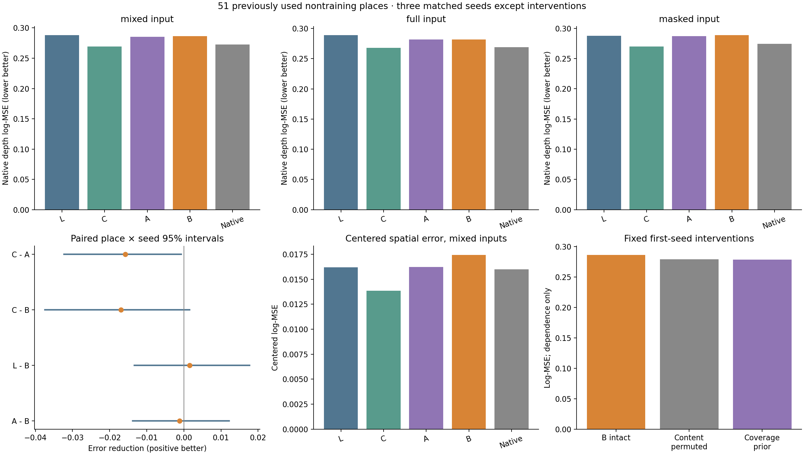
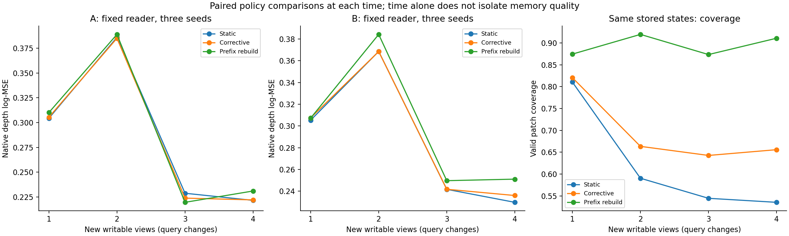
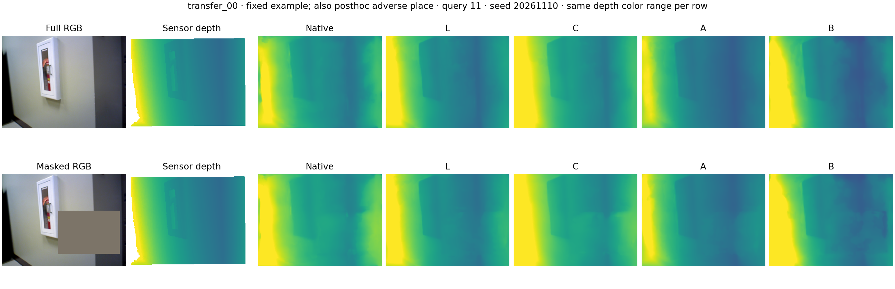
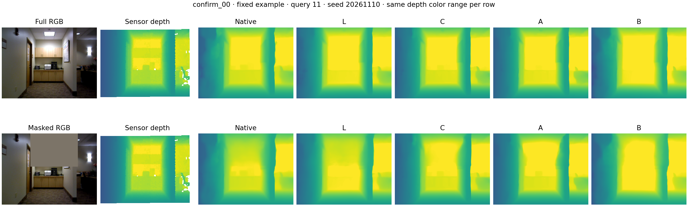
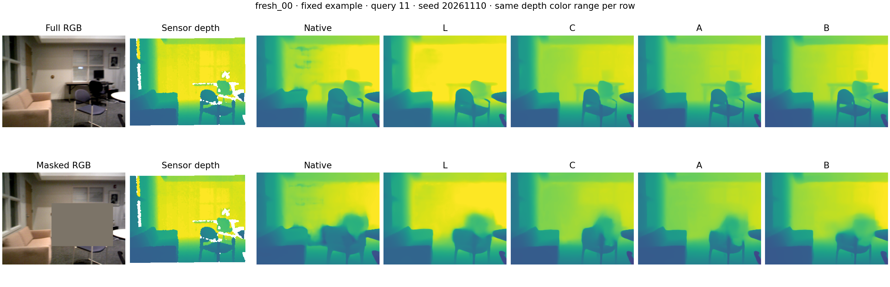

# 高斯几何与内容逐槽绑定：内部 memory cross-attention 验证

逐槽几何绑定已实现且可被读取器学习，但硬投影读取没有建立对强内容对照的收益；本轮 B 保留为负结果与后续对照，不晋升为可靠方法。

`bound_read1`，全部 85 片段为已用开发数据，训练 12 片段；主评价 51 非训练地点（63 片段）。这不是新数据确认。

## 1. 方法与待验证的解释

上一轮几何 Q/K 通路与内容读取相互独立，CG 对仅内容 C 没有明确增量，内容槽的排列也不影响读出。本轮仅替换读取接口：在冻结 VGGT 第 12 个 global block 后，用一个 width64、4-head cross-attention 将每槽高斯的投影支持与该槽 K/V 绑定，后续原生层和 DPT 不变。

`score_ij = q_i·k_j / sqrt(16) + log(w_ij)`；`w_ij` 为前到后 alpha 合成权重；额外零 K/V 的 null 槽先验为剩余透射率。形状协方差描述区域范围，不是位置估计不确定性。

| 组 | 内容来源 | 各槽先验 | null 先验 |
|---|---|---|---|
| L | 当前因果短窗口 | 1/256 | 0 |
| C | 固定历史 M0 | 1/256 | 0 |
| A | 固定历史 M0 | 覆盖 a_i / 256 | 透射率 T_i |
| B | 固定历史 M0 | 逐槽 w_ij | 同一 T_i |

A/B 共享相同的逐 token 覆盖与 null 质量，主比较区分覆盖提示与具体空间对应。L 是容量匹配的实际短窗口对照；它没有历史几何，不能称同几何信息对照。所有组均 137,472 个参数、三配对种子、2,000 步，使用最终检查点。旧结构的适配器不混入匹配主表。

竞争解释包括覆盖门控、无序历史内容已足够、预测几何与尺度噪声、小训练集迁移，以及静态训练和动态状态评价差异。绑定是有结构依据的候选解释，不预先作为唯一病因。初始化 0–3；写入 4/6/8/10；查询 5/7/9/11 永不写回。已知相机、共同尺度及数据来源保持原样。

## 2. 固定记忆的原生输出

| 方法 | 混合 log-MSE | 完整输入 | 遮挡输入 | 混合去均值空间误差 |
|---|---:|---:|---:|---:|
| L | 0.287893 | 0.288685 | 0.287496 | 0.016208 |
| C | 0.269446 | 0.268030 | 0.270154 | 0.013859 |
| A | 0.285197 | 0.281676 | 0.286957 | 0.016240 |
| B | 0.286362 | 0.281885 | 0.288600 | 0.017446 |
| Native | 0.272701 | 0.268743 | 0.274680 | 0.015995 |

正的误差差与降幅表示后者改善；区间按地点与种子配对重采样 5,000 次。

| 比较：前者误差 − 后者误差 | 相对降幅 | 配对种子差 | 地点×种子 95% 区间 | 改善地点 |
|---|---:|---|---|---:|
| coverage_minus_bound | -0.41% | -0.004685, -0.003121, 0.004312 | [-0.013797, 0.012205] | 22/51 |
| local_minus_bound | +0.53% | 0.007289, -0.003524, 0.000829 | [-0.013362, 0.017727] | 25/51 |
| content_minus_bound | -6.28% | -0.024425, -0.011480, -0.014841 | [-0.037444, 0.001551] | 16/51 |
| content_minus_coverage | -5.85% | -0.019740, -0.008358, -0.019153 | [-0.032346, -0.000659] | 23/51 |
| native_minus_bound | -5.01% | -0.013999, -0.014999, -0.011985 | [-0.030011, 0.001710] | 16/51 |
| native_minus_local | -5.57% | -0.021287, -0.011475, -0.012814 | [-0.028357, -0.001809] | 20/51 |
| local_minus_content | +6.41% | 0.031714, 0.007956, 0.015670 | [0.002029, 0.038165] | 33/51 |
| local_minus_coverage | +0.94% | 0.011974, -0.000403, -0.003483 | [-0.012031, 0.017564] | 25/51 |

| 批次 | B 对 A 降幅 | B 对 L 降幅 | B 对 C 降幅 |
|---|---:|---:|---:|
| old12 | -2.12% | -12.82% | -21.19% |
| used_summary20 | -1.13% | +6.33% | -3.62% |
| used_writer19 | +1.16% | +1.58% | -1.61% |
| training12 | +11.72% | +0.89% | +4.46% |

完整输入、隐藏/可见区域、均值偏差、AbsRel 和米制 RMSE 的全部分地点及配对结果见 `static_analysis.json`。共同尺度有已知离散度，本轮没有筛样本或真值对齐；其代价仍由方法整体承担。

B/A 未满足“主均值改善且至少两个种子改善”的诊断条件，未追加 Center；本轮不能给出新的形状必要性结论。

## 3. 对应关系是否被使用

只对首个固定 B 模型做内容置换及替换为 A 先验的零训练干预。表中正值表示干预误差高于完整 B。它们检测依赖性，分布变化仍是竞争解释；匹配训练的 A/B 对照承担用途判断。

| 比较：前者误差 − 后者误差 | 相对降幅 | 配对种子差 | 地点×种子 95% 区间 | 改善地点 |
|---|---:|---|---|---:|
| content_permuted_minus_bound | -2.71% | -0.007570 | [-0.020909, 0.004962] | 21/51 |
| coverage_prior_minus_bound | -2.76% | -0.007695 | [-0.024649, 0.010868] | 20/51 |

固定训练样例上，联合置换内容与几何先验的输出最大差为 0.0320791，只置换内容的最大差为 0.885966。此处是 BF16 实现与已学接口的诊断，不是泛化收益。

同一样例的 CPU FP32 后半网络复核中，联合置换最大／平均差降至 6.67572e-06/1.17515e-07，只置换内容的平均差仍为 0.132281。它支持槽对应实现正确；相对 GPU BF16 同时改变了精度和后端，不能将差异全部归因于精度一个因素。未因此改变训练、指标或新增科学门禁。详见 `precision_diagnostic_cpu.json`。

## 4. 固定读取器能否利用新增观测

复用上一轮保存的状态和更新器，A/B 各三种子固定权重，比较 Static、Corrective 和相同观测的 Prefix 重建。Prefix 只重建 256 槽，不重新联合运行全部 RGB；它是参照而非严格上界。

| 读取器／状态 | 混合 log-MSE | 完整输入 | 遮挡输入 | 混合空间误差 |
|---|---:|---:|---:|---:|
| coverage_static | 0.285197 | 0.281676 | 0.286957 | 0.016240 |
| coverage_corrective_clean | 0.284109 | 0.281166 | 0.285581 | 0.015684 |
| coverage_rebuild_clean | 0.287451 | 0.284614 | 0.288869 | 0.014707 |
| bound_static | 0.286362 | 0.281885 | 0.288600 | 0.017446 |
| bound_corrective_clean | 0.288456 | 0.284517 | 0.290425 | 0.017749 |
| bound_rebuild_clean | 0.298078 | 0.295537 | 0.299349 | 0.017712 |

| 比较：前者误差 − 后者误差 | 相对降幅 | 配对种子差 | 地点×种子 95% 区间 | 改善地点 |
|---|---:|---|---|---:|
| coverage_static_minus_coverage_corrective_clean | +0.38% | -0.001775, 0.001972, 0.003066 | [-0.002880, 0.004821] | 26/51 |
| coverage_static_minus_coverage_rebuild_clean | -0.79% | -0.008278, -0.001527, 0.003043 | [-0.015854, 0.010679] | 25/51 |
| coverage_rebuild_clean_minus_coverage_corrective_clean | +1.16% | 0.006503, 0.003499, 0.000023 | [-0.007803, 0.015748] | 26/51 |
| bound_static_minus_bound_corrective_clean | -0.73% | -0.003482, 0.000751, -0.003552 | [-0.007697, 0.003122] | 23/51 |
| bound_static_minus_bound_rebuild_clean | -4.09% | -0.009616, -0.004494, -0.021040 | [-0.028732, 0.003066] | 22/51 |
| bound_rebuild_clean_minus_bound_corrective_clean | +3.23% | 0.006134, 0.005245, 0.017488 | [-0.002987, 0.024507] | 29/51 |
| coverage_corrective_clean_minus_bound_corrective_clean | -1.53% | -0.006392, -0.004343, -0.002306 | [-0.015957, 0.008024] | 21/51 |
| coverage_rebuild_clean_minus_bound_rebuild_clean | -3.70% | -0.006023, -0.006089, -0.019771 | [-0.025304, 0.004937] | 19/51 |

各时点的查询不同，时间曲线的升降本身不能隔离记忆质量，需比较同一时点策略。原状态末次覆盖 Static/Corrective/Prefix 为 53.53%/65.58%/91.09%；它们的共同支持几何评分只有 44 个地点可用，和本轮 51 地点的原生输出统计范围不同。覆盖提升不等于读出改善。

未触发本轮单模型纠偏/遗忘复测；原因是 B/A 与 B/L 的联合主均值及种子条件未满足。这不是新读取器通过了纠偏验证。上一轮受控恢复混合、原生用途未明确及早期回访退步的负结果原样保留，不能自动迁移为本轮相同数值。

## 5. 实现、来源与成本

四项针对接口的测试及 20/200 步 GPU 小试通过；零适配与原生输出差为 0.0，原生缓存重放差为 0.0。小试模型排除在正式比较之外。

已独立用 NumPy float64 从原始标签重算 26,520 份导出预测；另核对 1,020 行复用原生参照，以及全部种子的初值和 2,000 步采样配对。来源、检查点、缓存和状态身份保存在每片段记录中。没有新地点确认或数据排除。

正式训练 12 次，共 24,000 步，训练循环合计 2.853 worker 小时，峰值已分配显存 4.770 GiB。时间是各 worker 循环之和，含周期检查点，不是墙钟时间或独占性能测量。

共享 GPU 上缓存后半网络原生/A/B 的中位耗时（秒）：transfer_00 0.0706/0.0713/0.0706; confirm_00 0.0704/0.0706/0.1596; fresh_00 0.0732/0.0715/0.1611。投影另外计时，全部样本见 `native_costs.json`；不含前半网络、相机校准和缓存 I/O，不能当作完整在线速度。

每次四视图的 float32 log-prior 临时张量为 4×300×257，共 1,233,600 字节；原 256 槽状态与规则 writer 未改。先验缓存只为本次开发加速，不计作部署时常驻的跨查询存储。旧短序列 CPU4 结果仍显示 Prefix 重建可比 Corrective 更快，不能宣称增量更新有速度优势。

## 6. 结论与下一步

三种子、51 非训练地点的 B 主误差为 0.286362；对 A 平均高 0.41%，对 L 仅低 0.53%，方向混合且区间跨零。B 比 C 平均高 6.28%，三个种子均退步，但地点×种子主区间仍跨零；不能把它写成所有地点都受损。C 对 L 低 6.41%、三个种子及配对区间支持改善；然而 L 本身比原生 VGGT 高 5.57%，所以不能把相对 L 的收益直接当成相对原生模型的稳定用途。

B 的去均值空间误差比 C 高 25.88%，三个种子均退步，配对区间支持空间误差增加。固定图像中，墙面和远端柜体可见分区或细节偏差，遮挡后各组均有模糊；没有看到 B 一致恢复细节。固定 transfer_00 恰好也是按主地点 B 对 L 的最大退步所标注的反例，因此实际审阅三个固定案例，没有额外挑选第四张图。图像不替代整体评分。

首个固定模型在训练地点明显依赖对应关系：B 为 0.005893，置换内容／替换成均匀覆盖先验后约为 0.128133/0.128127。主 51 地点的两项干预均值反而比完整 B 低约 2.64%/2.68%，区间跨零。它证明了可学习依赖，未证明依赖对迁移有益。固定样例的 CPU FP32 联合置换复核恢复到极小差异，支持槽身份实现正确；没有据此改动模型或效用标准。

固定 B 读取 Corrective 和 Prefix 状态时，主误差分别为 0.288456/0.298078，相对 Static 平均高 0.73%/4.09%；Corrective 的种子方向混合，Prefix 三种子均退步，主区间均跨零。相同状态的覆盖增加没有转成明确的原生收益。按事前规则未触发 Center 或本轮纠偏／遗忘复测，故本轮不支持形状必要性或纠偏成功；上一轮的纠偏与回访负结果保留，不能直接当作本轮数值。

A 比 C 高 5.85%，三种子均退步，配对区间支持覆盖门控存在代价。初始记忆几何诊断中，主评价查询 patch 平均 35.84% 没有直接投影支持，训练地点为 17.44%；有覆盖时归一化真实槽先验的熵有效槽数约 4.21。它们是先验统计，尚不能证明被屏蔽的槽有用。几何误差、静态训练与动态状态差异、训练覆盖有限仍是竞争解释；同源其他片段的有限诊断也显示，低拟合误差不能直接推广到其他窗口。

下一项选择一个不增加参数或模块的固定改动：在 C 的全局内容读取上加 log1p(M*w_ij) 的几何位置偏好，M=256，所有真实槽保留可读性。零覆盖回到 C，均匀覆盖在数学上不改变注意力分布。仅新增三个 Soft 匹配拟合，复用原强对照；C/Soft 都完成动态状态读取与有限回访，不把静态获胜作为动态实验前提。若只追回硬先验损失而不胜过 C，就不宣称高斯 PE 有独立价值；若仍无用途，停止该静态先验的细调，转向明确的训练状态／监督匹配或训练覆盖假设。

独立 NumPy 复算覆盖 26,520 份新预测，最大指标差约 2.37e-6；12 次正式训练的初值、采样和来源匹配，训练循环合计 2.853 worker 小时、峰值已分配 4.770 GiB。共享 GPU 计时中 B 在两个样例明显慢于 A，当前固定顺序的短测量不能隔离共享负载与方法开销，不据此声称速度优势。全部 85 片段已用、相机给定、几何与规则 writer 固定；没有学习几何、未知位姿、长期在线记忆或新地点确认的证据。历史外部 Content Gaussian 的有限正面结果不被本轮改写。

## 7. 图与原始记录

固定配置见 `plan.json`、`evaluation_protocol.json`、源码快照；主分数、独立复算和成本见相应 JSON。旧 `incremental_vggt1` 与此前正负结果均保留。

三个案例事先固定；其中 transfer_00 同时也是按主地点 B 对 L 的最大退步事后标注的反例，未额外选择不同片段。案例不替代整体统计。
