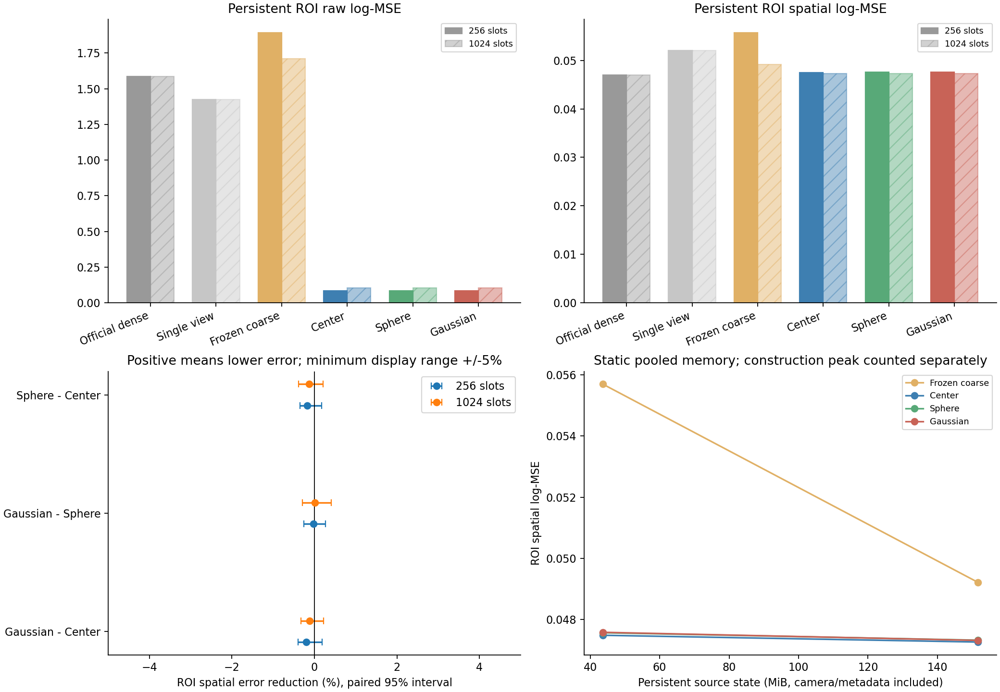
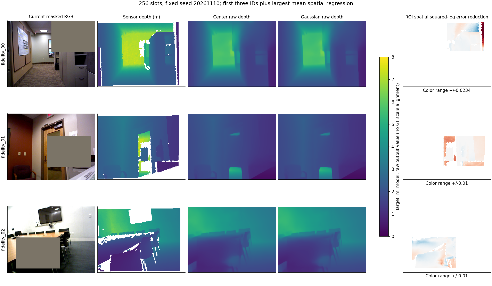

# coarse_memory_pe1：有限场景记忆中的范围与形状

**结论：在这次固定粗记忆接法中，范围和完整协方差都没有建立相对强中心的实用空间收益。结束该接法的形状扩展，不补种子、扫容量或修五维公式。** 九次2000步训练、432份适配输出、72份新参照和24份复用官方评分均已完成；本轮验证已得到结果，总体高斯PE研究目标仍未达成。

本轮把查询两遍的24个global层都接到256/1024槽粗记忆上，移除了上一轮已读取完整历史的query prefix和早期DPT旁路。因此它确实检验了新的读取条件。源区域存在范围差异和各向异性，256槽旧开发输入的典型范围比约2.11、主轴方差比约9.69，但这些输入性质并没有自动转化为形状收益。

256槽、持续遮挡ROI的中心／球形／高斯空间log-MSE为0.047483／0.047566／0.047580。高斯对中心的相对降误差为−0.204%，地点和种子配对95%区间[−0.400,+0.185]%，三个种子均未改善，7/12地点改善。球形对中心为−0.175% [−0.355,+0.170]%，三个种子也均未改善；高斯对球形为−0.029% [−0.255,+0.269]%。这不是显著恶化或严格等效的证明，但没有出现事前关心的约1%正向空间增量，范围和方向都没有获得采用理由。

1024槽的高斯对中心空间降误差为−0.114% [−0.321,+0.218]%，三个种子均未改善；高斯对球形为+0.016% [−0.287,+0.405]%。两预算效应差区间为[−0.287,+0.136]个百分点，没有建立更紧预算更需要形状的证据。不同预算也改变第一遍预测几何，不能把容量间变化唯一归因于区域范围。

**原始误差的改善需要与空间收益分开。** 256槽持续遮挡下，官方／冻结粗读取／中心／球形／高斯ROI原始log-MSE为1.584619／1.892048／0.084450／0.084188／0.084227。中心比冻结粗读取低95.54%，其中99.55%的误差减少对应区域均值偏差平方下降；空间误差低14.74%，但区间[−12.57,+35.69]%仍跨零。相对官方，中心空间误差反而平均高1.00%、区间跨零。完整输入的共同读法也没有建立全面空间改善；1024槽中心相对冻结粗读取的全图空间误差高40.22%，辅助区间刚支持退步，高斯高40.41%的辅助区间仍跨零。大幅原始误差下降不能当作精细几何恢复。

高斯对中心的256槽ROI原始误差低0.265% [−0.460,+1.006]%，三个种子同向，但仅6/12地点改善；空间误差方向相反。1024槽原始误差低0.662%，区间也跨零。保留可能的小幅整体估计差异，不把它解释为已确认的高斯结构贡献。上述偏差是统计分解，不唯一证明物理尺度是病因；模型原始输出没有按查询真值对齐。

辅助正结果也保留：完整输入256槽的高斯／球形对中心ROI AbsRel分别低1.25% [0.003,2.930]%／1.16% [0.106,2.692]%，球形全图RMSE低0.86% [0.011,2.074]%；1024槽持续遮挡下球形的全图偏差平方低1.45% [0.160,3.230]%。这些是多项预定辅助指标中的有限开发线索，没有显示完整形状超过球形的稳定用途，也不能替代主空间终点或未用数据确认。

最大主空间绝对退步例为brown_bm_4：中心／高斯的ROI空间误差为0.175169／0.175821，原始误差却为0.249018／0.248612。这说明较低的原始误差可与更差的区域结构并存。固定前三示例已包含该例；全部12地点保留，未据结果挑选新的有利子组。

**压缩是真实的共同存储收益，查询没有加速。** 源持久状态由未压缩的782.75MiB降至43.64／151.69MiB，约缩小17.94／5.16倍，三组共有，模型权重和构建临时激活不计入该比值。空闲卡6上按同一固定工作负载复测，256槽中心／球形／高斯两遍查询约361／365／364ms，1024槽约403／403／405ms，差异很小；官方未适配单遍背景约144ms。不能把两遍接口称加速，也不能把存储压缩归给形状PE。完整来源构建约1.16／1.33秒、峰值6.56GiB，允许临时完整KV；尚非全程固定内存或在线融合。首轮受外部任务干扰的成本数据完整保留；复测14次采样未观测到外部计算进程，结论只描述该设备、固定旧训练输入和运行条件。

本轮的取舍是：若只在三组中选择研究参照，保留强中心作为更简单的默认；不晋升球形或完整高斯为新方法，不把未适配官方或single-view参照当作公平PE胜负。这些参照也未经过匹配训练，所以没有证明场景记忆本身的必要性。冻结writer/DPT、预测几何、逐层聚合K/V与人工持续遮挡条件共同限定本结论；它不能否定所有高斯PE，也不是光度优化3DGS的验证。

保留此前区域关系任务的正结果及全部原生负结果。本有限目标结束，不自动开展在线融合、新确认、RGB扩展或新的训练路线。

## 设计与证据边界

三组共享来源、FPS/最近中心成员、聚合K/V、成员数补偿、训练容量和实际样本顺序，只比较强中心、球形范围、完整协方差。256/1024两档容量等量训练，9次2000步，最终检查点；432份适配输出，72份新无训练参照，另复用24份父轮已独立评分的官方输出。所有地点已用，无新确认。

查询两遍都从当前RGB骨干特征开始，全部24个global层读取粗记忆；没有读取完整历史的query prefix或早期DPT特征旁路。源writer和DPT冻结，24层Q/输出rank8适配与共享关系映射合计786,784参数。第一遍预测相机/深度生成查询几何，三组共用，查询真值不进入PE。该实验是受限接收端训练，不是全模型训练。

源构建允许暂时使用完整源K/V，查询前释放；这是静态构建后的读取预算比较，尚未实现全程固定内存或在线融合。高斯表示观测支持区域，不是光度优化后的3DGS。K/V仍按层保留，不能称最终单特征紧凑架构。

B与C/D是固定容量的描述选择，非严格嵌套特征消融；C/D为同迹形状控制。跨容量的第一遍几何也可能改变，容量交互不能唯一归因形状。官方dense和single-view均未作本轮匹配适配，只是质量/成本背景；PE主证据来自同预算B/C/D。

主终点事前固定为256槽持续遮挡ROI去均值log-MSE；原始误差、均值偏差平方、全图、完整输入和成本均保留。统计分解不证明唯一物理尺度病因，模型原始输出未按查询真值对齐。

## 主表

| 槽数 | 条件 | 方法 | ROI原始误差 | ROI空间误差 | ROI偏差平方 | 全图原始误差 | 全图空间误差 |
|---|---|---|---:|---:|---:|---:|---:|
| 256 | full | official | 1.495270 | 0.017395 | 1.477876 | 1.455380 | 0.009850 |
| 256 | full | single_view | 1.199477 | 0.018253 | 1.181224 | 1.177916 | 0.010344 |
| 256 | full | coarse_frozen | 1.673481 | 0.017908 | 1.655574 | 1.635553 | 0.011159 |
| 256 | full | center | 0.062683 | 0.018175 | 0.044508 | 0.052229 | 0.013897 |
| 256 | full | sphere | 0.062073 | 0.018233 | 0.043839 | 0.051656 | 0.013952 |
| 256 | full | gaussian | 0.062180 | 0.018220 | 0.043960 | 0.051685 | 0.013892 |
| 256 | persistent | official | 1.584619 | 0.047015 | 1.537604 | 1.476146 | 0.020454 |
| 256 | persistent | single_view | 1.423318 | 0.051997 | 1.371322 | 1.210250 | 0.024292 |
| 256 | persistent | coarse_frozen | 1.892048 | 0.055694 | 1.836354 | 1.677709 | 0.025772 |
| 256 | persistent | center | 0.084450 | 0.047483 | 0.036967 | 0.052730 | 0.022637 |
| 256 | persistent | sphere | 0.084188 | 0.047566 | 0.036622 | 0.052436 | 0.022695 |
| 256 | persistent | gaussian | 0.084227 | 0.047580 | 0.036647 | 0.052488 | 0.022669 |
| 1024 | full | official | 1.495270 | 0.017395 | 1.477876 | 1.455380 | 0.009850 |
| 1024 | full | single_view | 1.199477 | 0.018253 | 1.181224 | 1.177916 | 0.010344 |
| 1024 | full | coarse_frozen | 1.617770 | 0.017313 | 1.600458 | 1.580658 | 0.009851 |
| 1024 | full | center | 0.086444 | 0.018295 | 0.068149 | 0.067607 | 0.013814 |
| 1024 | full | sphere | 0.086142 | 0.018332 | 0.067810 | 0.067200 | 0.013790 |
| 1024 | full | gaussian | 0.085922 | 0.018320 | 0.067602 | 0.066948 | 0.013833 |
| 1024 | persistent | official | 1.584619 | 0.047015 | 1.537604 | 1.476146 | 0.020454 |
| 1024 | persistent | single_view | 1.423318 | 0.051997 | 1.371322 | 1.210250 | 0.024292 |
| 1024 | persistent | coarse_frozen | 1.712316 | 0.049212 | 1.663104 | 1.598817 | 0.021048 |
| 1024 | persistent | center | 0.104588 | 0.047261 | 0.057326 | 0.065316 | 0.021251 |
| 1024 | persistent | sphere | 0.103891 | 0.047323 | 0.056568 | 0.064703 | 0.021278 |
| 1024 | persistent | gaussian | 0.103895 | 0.047315 | 0.056580 | 0.064809 | 0.021341 |

## 持续遮挡配对比较

正数表示候选误差更低；5000次地点和种子配对重采样。三个种子和十二旧地点不是一般分布保证。区间跨零不证明等效，极小正区间也不自动构成实用收益。

| 槽数 | 比较 | ROI空间降误差% [95%区间] | ROI原始降误差% [95%区间] | 空间改善地点/种子 |
|---|---|---:|---:|---|
| 256 | gaussian_vs_center | -0.204204 [-0.400352, +0.184916] | +0.264568 [-0.459788, +1.006485] | 7/12; 0/3 |
| 256 | gaussian_vs_sphere | -0.029444 [-0.254631, +0.268682] | -0.045500 [-0.757576, +0.579104] | 6/12; 1/3 |
| 256 | sphere_vs_center | -0.174708 [-0.355446, +0.169511] | +0.309927 [-0.426652, +0.982106] | 4/12; 0/3 |
| 256 | center_vs_coarse_frozen | +14.742941 [-12.567762, +35.685776] | +95.536574 [+92.640731, +97.708234] | 8/12; 3/3 |
| 256 | gaussian_vs_coarse_frozen | +14.568843 [-12.812020, +35.701264] | +95.548383 [+92.677083, +97.709263] | 8/12; 3/3 |
| 256 | center_vs_official | -0.995720 [-27.394941, +22.759711] | +94.670632 [+91.525915, +97.195697] | 6/12; 0/3 |
| 256 | gaussian_vs_official | -1.201957 [-27.639280, +22.724837] | +94.684731 [+91.565422, +97.201173] | 6/12; 0/3 |
| 256 | gaussian_vs_single_view | +8.493742 [-21.867462, +31.740393] | +94.082366 [+89.496708, +97.261902] | 6/12; 3/3 |
| 1024 | gaussian_vs_center | -0.114226 [-0.321350, +0.218393] | +0.662379 [-0.345371, +1.643190] | 5/12; 0/3 |
| 1024 | gaussian_vs_sphere | +0.015714 [-0.287138, +0.404545] | -0.003828 [-0.900576, +0.735330] | 7/12; 2/3 |
| 1024 | sphere_vs_center | -0.129960 [-0.385350, +0.204122] | +0.666182 [-0.204364, +1.399901] | 6/12; 1/3 |
| 1024 | center_vs_coarse_frozen | +3.964052 [-22.007886, +22.510368] | +93.892019 [+90.757005, +96.743167] | 6/12; 3/3 |
| 1024 | gaussian_vs_coarse_frozen | +3.854355 [-22.229934, +22.577035] | +93.932477 [+90.835827, +96.753517] | 6/12; 3/3 |
| 1024 | center_vs_official | -0.524195 [-28.292007, +22.429104] | +93.399805 [+90.157162, +96.433672] | 5/12; 1/3 |
| 1024 | gaussian_vs_official | -0.639019 [-28.444264, +22.517893] | +93.443524 [+90.258939, +96.451216] | 5/12; 1/3 |
| 1024 | gaussian_vs_single_view | +9.002748 [-23.063952, +32.096781] | +92.700496 [+87.277794, +96.643416] | 6/12; 3/3 |

## 成本与实现检查

训练循环合计15.185 worker小时、峰值已分配5.762GiB。432份适配输出及72份新参照独立NumPy评分，最大指标差1.78e-15。逐种子初始化、计划采样与实际采样日志配对一致，每拟合两档容量各2000个微样本。

矩合并与NumPy独立复算通过。无位置变更的全层查询在相同零global掩码下，与官方模型输出完全一致；不加该零掩码时BF16不同注意力内核导致相对RMS约0.0582%，已保留诊断而未更改科学算子。该检查不代替任务效用。

- 256槽：完整持久状态43.642MiB，包含特殊token和相机缓存。完整协方差元数据可省的上界不足再容纳一个全24层K/V槽，因此同上限中心组不能多加一槽。缓存准备实测峰值6.521GiB、中位源编码/相机重放1.213s；该准备复用了先前源预测几何，不代表完整冷构建成本。完整来源几何重建另见下方实测。
- 1024槽：完整持久状态151.687MiB，包含特殊token和相机缓存。完整协方差元数据可省的上界不足再容纳一个全24层K/V槽，因此同上限中心组不能多加一槽。缓存准备实测峰值6.521GiB、中位源编码/相机重放1.213s；该准备复用了先前源预测几何，不代表完整冷构建成本。完整来源几何重建另见下方实测。

两遍查询实测（固定两个训练片段，两条件，两容量，首种子，预热后各三次，源驻GPU，排除模型/磁盘加载）：

| 槽数 | Center ms | Sphere ms | Gaussian ms |
|---|---:|---:|---:|
| 256 | 361.4 | 365.0 | 364.5 |
| 1024 | 402.8 | 403.4 | 404.5 |

Current image transfer/backbone, frozen coarse depth+camera+query geometry/descriptor, adapted second query/depth. Sources resident; model/disk loading excluded. Full source cost additionally measured from RGB, including source depth and geometry; source images/model resident. Not bounded-memory construction or all-task VGGT timing.

同四个固定训练条件下，官方未压缩单遍查询中位数144.2ms，完整来源状态782.750MiB。它是未适配的一遍背景参照，PE主比较仍为匹配的B/C/D。

从来源RGB重新预测深度/相机并生成几何、归一化键、FPS和聚合的完整来源构建实测（来源图像和模型已载入，临时允许完整原生KV，排除磁盘I/O；不是全程有界内存）：
- 256槽完整来源构建中位数1.159s；来源持久状态约缩小17.94倍。该比值不包括模型权重和临时激活，且聚合压缩为三组共有。
- 1024槽完整来源构建中位数1.329s；来源持久状态约缩小5.16倍。该比值不包括模型权重和临时激活，且聚合压缩为三组共有。

四个来源构建条件的峰值已分配显存最高6.558GiB；旧缓存准备计时未包含的来源深度头和几何生成现已计入。分项、与实际使用来源几何的重放差及原生KV字节见runtime.json。

资源环境：GPU 6，共享worker=False。若共享，启动前要求其他驻留进程对应的设备计算利用率不高于5%，使用既有12GiB单worker上限；保留前后占用记录。这是条件性耗时实测，不能称独占性能基准。

此表使用事前登记的固定成本复测：首轮设备后来被其他任务使用，其原始数据保留在cost_shared_attempt1；卡6空闲后按相同片段、模型和重复次数重新测量，未按耗时选择片段或取更快的结果。全过程每五秒采样，共14次，观测到外部计算进程=False。采样不能排除采样间短暂占用，不将本设备的描述推广为一般硬件性能保证。

缓存K保留原生Q/K归一化和二维旋转后的FP32表示，V为BF16；实际字节已逐张量计数，未按二者都为BF16估算。本轮不改缓存精度或训练来追求更小数字。全缓存来源边界、形状和实际持久字节的核对见[input_inventory.json](input_inventory.json)。

## 示例与反例

预定前三ID加最大空间退步例，去重后为['fidelity_00', 'fidelity_01', 'fidelity_02']；最大退步地点brown_bm_4。图用固定首种子，选例按三种子平均；全部地点和反例保留。误差图仅展示ROI内去均值平方log误差差，正值蓝色为高斯改善，各行色域已标明，至少±0.01以免放大小数差异。

[固定计划](../../../docs/gaussian_memory_coarse_budget_plan.md) · [完整分析](analysis.json) · [独立评分](independent_result_checks.json) · [训练身份](training_lock.json)
