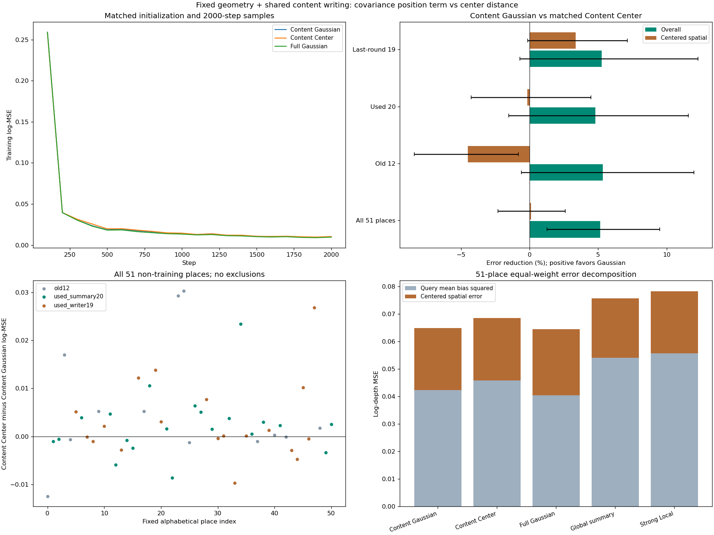

# 仅学习内容时，高斯协方差位置项仍有开发用途

2026-11-10。**本轮完成，采用Content Gaussian作为下一阶段的精炼工作基线，保留Full/Frozen及全部强对照。** 新增Content Center三个匹配拟合，复用24个旧模型，85个已用片段全部评价。51个非训练主地点中，Content Gaussian比Content Center整体log-MSE低5.17%，三个种子同向、配对区间为正。它与完整几何写入的整体差异仍不确定，但空间误差较小。该决定是开发阶段的结构选择，不是新确认，也不是学会了准确构造几何的证明。

## 本轮回答什么

此前Full Gaussian比Full Center更好，但不清楚这种优势是否必须依赖几何参数的共同更新。本轮只补缺失的Content Center控制：固定均值、协方差和opacity，只学习共享内容残差及读取器。其reader/writer初始参数逐张量复制同种子Content Gaussian，全部2000步采样逐项相同，唯一配置差别是attention位置项使用高斯Mahalanobis距离还是已有固定方差的中心距离。[事前方案](../../../docs/gaussian_memory_content_center_plan.md)

共同key/value和writer输入仍包含原高斯信息，因而这是**协方差如何参与位置编码**的比较，不是彻底去除形状信息。四个参考视图构建256槽状态、一次写入保存、供多个查询重用；查询不进入writer。冻结VGGT、32维PCA、原几何初值、已知相机、尺度规范化、300个深度patch的输出接口不变。无需额外模块或新损失。

三个新拟合使用种子20261110/11/12、十二原训练片段、batch=2、学习率3e−4、AdamW weight decay=0.01、梯度裁剪5.0、固定2000步。reader为145477参数，writer为9450参数，总154927；两个Content组均有650个不参与预测的几何输出参数。这里只减少可学习几何分支的作用，不声称检查点大小或速度已有显著改进。

## 数据身份与完成范围

66个既有片段加上一轮19个目录片段，共85片段、639查询、1278遮挡输入，全部完成。新增255份Content Center记忆均保存重载后读取。主汇总采用事前指定的51个非训练地点、63片段；其余训练地点留出视角和旧开发片段完整保留为背景。原十二地点各两片段，先在地点内平均，再对地点与种子等权。

本轮**全部数据已用**。上一轮19地点明确改标 `used_writer19`，新模型的结果不能重新算作新确认。目录身份不保证物理地点别名独立，也不保证VGGT预训练未见过图像。无新增数据下载，无PCA重拟合、阈值扫描、重新选模或追加种子。24旧模型和旧预测逐项复用，只有新增控制作GPU推理。[配置与输入身份](plan.json) · [27模型固定清单](evaluation_lock.json) · [全部评分](evaluation/scores.json)

## 位置项的收益保留，但分批不确定性仍需保留

以下均为整体log-MSE，越低越好；百分比为Content Gaussian相对Content Center的误差降低。区间是“Content Center−Content Gaussian”的原始log-MSE差值，来自10000次配对地点×种子bootstrap，不是百分比区间。

| 评价范围 | Content Gaussian | Content Center | 相对降低 | 差值95%区间 | 改善地点 |
| --- | ---: | ---: | ---: | --- | ---: |
| 主汇总51地点 | 0.064908 | 0.068443 | 5.17% | [0.000878, 0.006494] | 31/51 |
| 原十二地点，两片段平均 | 0.108998 | 0.115139 | 5.33% | [−0.000681, 0.013803] | 7/12 |
| 已用20地点 | 0.046008 | 0.048324 | 4.79% | [−0.000729, 0.005598] | 13/20 |
| 上一轮19地点 | 0.056957 | 0.060129 | 5.28% | [−0.000423, 0.007389] | 11/19 |

主汇总三个种子差值为+0.002276、+0.004986、+0.003344；三个分批中的每个种子也均为Gaussian更好。合并结果及分批方向支持保留该位置项，但每个较小分批的主区间跨零，不将其写成三次独立确认，也不把同向均值解释为处处获胜。

主汇总的遮挡、可见、完整输入log-MSE相对Content Center分别降低6.00%、4.83%、4.75%，三种子同向且区间为正；AbsRel降低3.96%、区间为正，RMSE平均降低1.25%、区间跨零。位置项收益不是只存在于一个遮挡评分，但这些辅助指标不改变研究范围。[完整分批、种子及每地点结果](analysis.json)

## 与强对照和完整写入的关系

| 方法 | 主汇总log-MSE | 去均值空间MSE | 完整输入去均值空间MSE |
| --- | ---: | ---: | ---: |
| Content Gaussian | 0.064908 | 0.022669 | 0.019032 |
| Content Center | 0.068443 | 0.022695 | 0.018769 |
| Full Gaussian | 0.064412 | 0.024009 | 0.020162 |
| Full Center | 0.069866 | 0.024261 | 0.020181 |
| Frozen Gaussian | 0.067121 | 0.021994 | 0.018092 |
| Frozen Center | 0.071420 | 0.021790 | 0.017672 |
| GlobalSummary | 0.075699 | 0.021598 | 0.015675 |
| 小Local | 0.079667 | 0.022733 | 0.016714 |
| 强Local | 0.078202 | 0.022525 | 0.016557 |

在这51个已用地点中，Content Gaussian相对强Local、GlobalSummary整体降低17.00%、14.25%，差值区间分别为[0.006994, 0.020408]、[0.005995, 0.016302]，三个种子均正，41/51、39/51地点改善。遮挡区相对强Local降低22.06%，区间为正。这些汇总包含长期用于开发的旧地点，不能拿来替代上一轮19地点的独立结果。

仅看上一轮19地点，Content Gaussian相对强Local整体降低9.47%、区间[−0.001604, 0.013635]仍跨零；遮挡区降低15.66%、区间[0.003059, 0.021302]为正。相对全局摘要整体降低11.21%、区间为正。因而最近一批数据支持的强Local用途仍以缺失观测补充最清楚，可靠整体优势未被本次旧数据合并“补成”确认。

相对Full Gaussian，Content整体误差平均高0.77%；Full−Content差值区间[−0.002812, 0.002031]跨零，种子方向混合。Content的去均值空间误差则低5.58%，完整输入低5.60%，三个种子同向、两项区间均为正。选用Content作为工作基线，是基于几何更新未建立额外整体用途、而简化后空间代价较小的取舍；**不是宣布两者等效或Content整体更强**。Full模型及其正面证据继续保留。

相对完全冻结的Gaussian，Content整体平均低3.30%，三个种子同向，但差值区间[−0.000748, 0.005837]跨零；空间误差反而高3.07%、完整输入高5.20%，区间支持退步。所以本轮也没有证明可学习内容写入相对冻结状态必不可少。

## 收益仍主要是整体偏差，精细空间建模没有随之成立

Content Gaussian和Content Center的均值偏差平方为0.042239、0.045748，去均值空间误差为0.022669、0.022695。整体差距主要来自前者；后者相差仅0.12%、区间跨零。这里是误差的代数分解，不是注意力内部机制的因果分解，更不是三维表面精度。

分批还有明确反例：原十二地点中，Content Gaussian虽然整体平均更好，去均值空间误差却比Content Center高4.49%、完整输入高5.57%，两项区间均支持退步。上一轮19地点空间误差平均改善3.36%，但区间跨零。不同地点的细节表现并不统一。

与强Local相比，Content Gaussian在51地点完整输入的去均值空间误差高14.95%，差值区间[−0.003870, −0.001153]；仅去掉几何更新并未解决保真问题。这是实际预测能力的边界，不是浮点噪声；它限定结论，但不作为禁止继续主任务研究的门禁。

## 依赖、正确性与图像证据

Content Gaussian在51地点的移除记忆/打乱内容槽/错误相机/恢复初始内容分别使整体误差增加59.73%/34.03%/35.02%/20.48%，区间均为正；Content Center对应为51.56%/25.17%/28.33%/15.00%。学习状态与空间绑定确被使用。干预可能形成分布外状态，不能替代冻结组重训比较；两种方法均依赖记忆，也不单独证明协方差特有机制。

三次新训练的初始reader/writer及全部6000步采样与Content Gaussian完全一致。损失、梯度有限，内容梯度非零、几何梯度为零。均值和opacity更新严格为零，协方差相对变化最大2.49e−8；恢复初始几何的读取差最大2.38e−7，属于原有容差内的CPU/CUDA舍入。

九次新模型独立CPU保存状态读取及三次旧Content Gaussian哨兵读取，最大差1.19e−6；NumPy评分最大差6.00e−9；误差分解账目差5.67e−16。24旧模型和评分保持不变，没有重跑全部旧GPU评价。[核对记录](checks.json) · [逐步配对](training_pairing.json) · [评价前分析代码记录](analysis_source_lock.json)

七张预定图均实际打开审阅。fit_00展示训练地点的粗深度可学性；transfer_00中Content Gaussian优于Center，却不如Full和强Local；confirm_00及fresh_19中强Local更好；confirm_15的全局摘要最好、两种Content很接近；fresh_00所有方法均未恢复近处椅子的准确深度边界。图中数字是首种子、首查询、首遮挡，不能替代地点均值。显示截断未用于评分。[逐图审阅](review.json)

三次GPU训练分别32.91、32.51、33.41秒，合计98.83秒，峰值0.3716GiB；新增模型全部评价32.02秒。GPU1启动前两次复核占用，使用一个显存上限12GiB的共享worker；评价曾因其他任务计算繁忙等待，最终在利用率55%/53%、空余约36GiB时启动。上述是本次共享运行代价，不是独占速度基准。

## 固定工作基线及下一步边界

当前采用的精炼表达为：**冻结VGGT提供的粗高斯几何，学习每个槽的内容残差，利用投影协方差组织单层cross-attention的读取。** 三个已有Content Gaussian检查点直接作为工作基线，身份和比较对象记录于[working_baseline.json](working_baseline.json)。无需训练新主模型，也不因为单个微小分数切换结构。

本轮明确了“保持几何不变，协方差位置组织仍有额外开发用途”；还没有回答“网络能否更准确地建立共享几何”，也未建立未知位姿、长序列或一般Transformer用途。整体研究目标仍未完成，原完整写入原型的有限可学性与全部历史失败继续保留。

下一项应从继续拆writer转向**固定方法的收益边界**：在同一读写任务中，检验“参考确实覆盖、当前查询缺失”时是否更值得采用该位置项，并与参考缺乏覆盖的情况区分，始终保留Content Center、强Local和Global。竞争解释是主要做了场景整体深度校准，收益未随可读取空间证据变化。若覆盖相关收益成立，可收窄为跨视图缺失信息读取；若不成立，则把贡献限定为粗场景条件化，不能宣传局部几何恢复。具体覆盖定义与分析须在该下一项开始前固定；当前不据已有分数挑阈值，也不自动增添精度补偿模块。下一项尚未启动。
