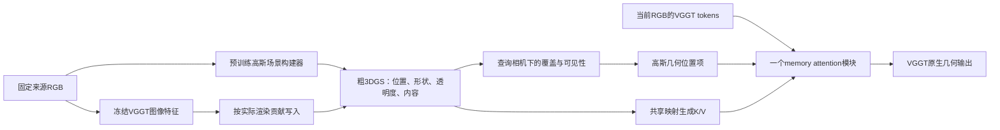

# 回到粗3DGS场景记忆：文献核对与下一项验证方案

2026-11-11。状态：研究设计，尚未启动本方案的模型下载、建图或训练。用户要求重新检索文献、细化原始构想并防止重心偏移。本文件承接该要求；正在执行的 `coarse_memory_pe1` 按原固定配置收尾，不能据本文件中途改组、改指标或删除负结果。

**大纲对应核对（2026-11-11）：** 已对照[持续更新记录](research_outline_alignment.md)。本方案直接服务O2/O3的公共粗高斯记忆，以及O4–O6的视图读取、渲染和参数PE；C1–C4是构建、内容绑定、读取及PE形式的实现尝试，C5/C6的已知相机、静态构建与冻结骨干是临时验证条件。prototype1已有可渲染记忆，bound_read1／soft_read1已有投影attention的负结果，native_gaussian_pe1未建立原生形状增量；本轮提出的实质变化是预训练场景初始化与可见性内容绑定，不将其预判为已确诊病因。以无历史、同预算token、相同场景内容／中心／投影五组同步检验场景用途和PE增量，按第7节结果决定保留、收窄或结束。记录已登记为“仅设计”，无新结果；直接特征渲染融合仍是未在本新配置下比较的另一种大纲解释。

## 1. 保持不变的主问题

导师的原始构想是：为VGGT建立一份比较粗的、以3DGS表示的公共场景记忆，每个当前视图从中提取相关信息，高斯参数参与PE。

本方案的主问题明确为：**仅由来源图像建立并保存一份粗高斯场景后，VGGT能否利用它更准确地恢复另一视图的几何；相同场景内容下，源于高斯投影与可见性的PE能否超出可学习中心编码？**

报告同时回答三个问题：场景里保留了什么；VGGT是否从记忆获得实际几何收益；几何PE是否有额外收益。它们是同一实验的证据层次，不是要求前一项的所有指标获胜才能开展后一项的门禁。

当前方案限定为静态局部场景、给定相机的条件验证。它不完成未知相机定位、在线融合或长期遗忘问题。给定相机用于把“如何找到当前视图”与“已找到后如何读取场景”分开，不能据此宣称未知相机VGGT已经得到改善。只有明确写出这一条件，静态验证才服务原构想而不替代它。

## 2. 先纠正历史描述

上一条对话将“当前K/V方案”与“原始3DGS memory”区分是必要的，但对整个实验历史的概括不完整：

- [prototype1](../results/gaussian_memory/prototype1/report.md)已经保存 `μ/Σ/opacity/32维特征`，使用gsplat投影与alpha合成；共享writer可修改几何。已有给定相机、保存后独立读取多个视角的证据。六个未参与当轮优化的场景，学习几何对固定几何的特征MSE低5.69%，但这不是精确几何或原生VGGT用途证据。
- [bound_read1](gaussian_memory_bound_read_plan.md)已经把逐槽投影/遮挡权重放入内部attention。对强内容对照的迁移结果不佳；[soft_read1](gaussian_memory_soft_read_plan.md)保留全局读取后仍未建立可靠原生用途。因此“增加opacity、renderer或attention bias”均不是新的设计贡献。
- [coarse_memory_pe1](gaussian_memory_coarse_budget_plan.md)保存各层聚合K/V与几何矩，检验同内容下的范围/方向PE；它没有优化一份可重观察的高斯特征场。其阴性结果约束该接法，不否定原始场景记忆构想。

**本方案有实质变化的部分是：用已有可渲染场景构建器得到高斯结构，通过实际视图贡献绑定来源特征，保存一份统一特征场；同时测量该场景的保真与原生输出用途。** 这仍是待检验的组合，不能预先把过去的失败归因于writer、32维压缩或接入层。

## 3. 本次文献检索与取舍

检索日为2026-11-11。按“VGGT＋Gaussian场景构建”“Gaussian空间记忆”“特征写入与读取”“空间聚合损失”定向检索。专用arXiv/CrossRef MCP本会话未提供，使用网页检索发现候选，再读取arXiv论文、作者项目页与官方代码。CVF的Feature 3DGS页面返回403，改核对作者的arXiv v2。以下为定向设计核对，不是穷尽性新颖性审查；同名不同版本只计一篇。公式/结论与我们建议的实现分开陈述。文献条目见[参考文件](references/gaussian_scene_memory_20261111.bib)。

| 论文和核对位置 | 原文支持的事实 | 对本方案的具体作用与边界 |
| --- | --- | --- |
| [3DGS，2023](https://repo-sam.inria.fr/fungraph/3d-gaussian-splatting/) | 各向异性高斯表示场景，配合可见性感知的splatting。 | μ/Σ/α必须共同定义可投影的场景。拥有这几个字段本身不是精确场景几何的证据。 |
| [AnySplat，2505.23716v1，§3.2–3.3](https://arxiv.org/html/2505.23716v1) | 从未标定图像预测高斯和相机；借助VGGT几何先验训练；体素化减少原始基元冗余。 | 优先复用官方预训练模型作为固定场景构建器，避免先从头训练一套新writer。论文没有证明其场景可直接替代VGGT记忆，也没有保证数千基元的保真。 |
| [CF³，2508.05254v3，§4.1–4.3](https://arxiv.org/html/2508.05254v3) | 按高斯的实际alpha合成贡献提升多视图特征，再进行特征压缩和稀疏化。 | 首版采用可见性加权特征写入，避免只按三维中心距离平均。其近似加权融合仍可能混合冲突特征；不照搬全部自动编码、方差过滤和稀疏化模块。 |
| [Feature 3DGS，2312.03203v2，§3](https://arxiv.org/html/2312.03203v2) | 高斯可以承载并渲染视觉模型特征；通道和分辨率关系影响可用性。 | 渲染特征而非只渲染RGB是已有可行接口。教师特征重建只是载体证据，最终仍测VGGT深度。 |
| [M3，2503.16413v1，§3.3](https://arxiv.org/html/2503.16413v1) | 渲染低维查询，再从原维度的特征库读取内容；强调压缩和特征空间错配问题。 | 内容保真需要实测。首版保留来源特征原维度，不同时引入M3外部bank和多模态模块；不能据M3直接判定我们的失败是维度不足。 |
| [Point3R，2507.02863v1，§3.2、附录A](https://arxiv.org/html/2507.02863v1) | 位置与几何/视觉内容绑定，读取预测后写回；使用强3D中心位置编码。 | 空间记忆与强中心PE不是新的贡献；同内容中心对照必需。我们借鉴其位置与内容绑定思想，不把局部对照称为完整Point3R复现。 |
| [StreamVGGT，2507.11539v1，§3.2–3.3](https://arxiv.org/html/2507.11539v1) | 通过训练过的因果Transformer保存历史K/V并直接预测几何。 | 保留原生质量/成本参照以及同预算历史token对照。查询不能先读取全历史再声称收益由高斯记忆提供。 |
| [Slot3R，2610.12282v1，§3.2–3.4；预印本](https://arxiv.org/html/2610.12282v1) | 相近空间地址可对应多种内容状态；过早合并可能损失证据。 | 固定预算下保留边界和冲突情况作为反例。第一版不增加多槽和门控，不能假定高斯矩合并自动解决了冲突。 |
| [GSMem，2603.19137v1，§3.1–3.3；预印本](https://arxiv.org/html/2603.19137v1) | 将3DGS作为能重新选择视角读取的场景记忆，用于具身推理。 | 同一个保存状态的多视角重观察是有意义的能力指标；不引入VLM、场景图、探索策略或图像生成。 |
| [Adaptive World Memory，2609.21502v1，§III-B/C；预印本](https://arxiv.org/html/2609.21502v1) | 先维护潜在记忆，再从增强特征解码高斯；同时有复杂在线地图系统。 | “记忆能输出高斯”不等于“高斯本身是被读取的记忆”。我们要保存并读取后者，不复制其门控、子图和闭环系统。 |
| [Frame-Consistent Feed-Forward 3DGS，2610.23039v1，§4；预印本](https://arxiv.org/html/2610.23039v1) | 在其VGGT＋TokenGS组合中，坐标约定和尺度一致性会显著影响结果。 | 在接口预检核对坐标与尺度，修常规错误；不能直接断言这也是本项目的病因，更不复制其具体尺度常数。 |

官方[AnySplat代码](https://github.com/InternRobotics/AnySplat)和[权重入口](https://huggingface.co/lhjiang/anysplat)已核对，`inference(context_image)`返回高斯及来源相机。通过GitHub连接器读取的模型文件blob SHA为`5e7b211db7bfc308194be31080d875df3d524c8e`，encoder为`8e6c73497b696ac4689a9120fc2f3c7bbd20c9d9`，高斯类型定义为`c4f6929af47b85a0fba1db65d706bf04d91aa50e`。这些是文件身份，不是仓库commit或权重SHA；执行时另行固定commit/revision/哈希。仅核对了公开接口，尚未在本服务器验证AnySplat兼容性、显存或SUN3D效果。

## 4. 一个最小的候选结构

### 4.1 保存的状态

`M = {(μ_j, R_j, s_j, α_j, f_j, c_j)}; Σ_j = R_j diag(s_j²) R_jᵀ`。

`c_j`只保留RGB/DC色彩供建图和检查；内容`f_j`是绑定在同一基元上的冻结VGGT图像编码器特征。首版以2048个基元、1024维原特征为资源起点，内容使用FP16，几何与透明度使用FP32；不先压成32维，不创建24份历史K/V。按这些字段估计主体约4.11MiB，执行时连相机、坐标规范、计数和其他持久对象一起实测，不能用这个估算冒充总内存。2048不是已经验证的最优容量。

任何共享构建模型、读取模型和临时完整高斯集合分别计入模型常驻与构建峰值。某个系统可以有较小持久状态但很昂贵的构建成本，两者都要披露。

### 4.2 如何构建粗场景并写入内容

1. 固定AnySplat官方预训练构建器，仅输入来源RGB，生成来源高斯和相机。用来源相机之间的对应关系建立共同坐标和尺度；若采用给定相机进行相似变换对齐，仅使用来源相机。记录剩余的来源重投影误差，不以查询真值修正记忆。
2. 初版粗化采用固定空间覆盖采样选2048个已有高斯作为初值，保留其已有形状与opacity。随后只在来源视图做一次有界的粗场景拟合，拟保留300步作为资源起点；优化μ/R/s/α/DC色彩，使用来源RGB及固定构建器的来源深度/覆盖保持项。连续损失按训练片段固定尺度归一化，系数和采样在正式构建前锁定。不按开发查询PSNR挑步数或容量，不强制把相近但不同表面合为一个大椭球。
3. 对固定粗几何，用标准alpha合成得到来源像素对每个基元的贡献`w_suj`，按CF³的近似提升写入 `f_j = Σ_s,u w_suj F_s(u) / Σ_s,u w_suj`。`F_s`是逐来源图像独立的冻结VGGT图像编码器特征，按源像素位置采样。无贡献基元标无内容，不能填入查询特征。特征写入只执行一次，比较组共用其输出。
4. 保存状态，释放原始来源图像、完整高斯和来源特征；每个查询重新加载同一状态。检查当前视角改变时，渲染深度/覆盖/特征是否相应改变，以及源场景中已经观测的表面是否仍能被读取。

这一首版有每场景构建优化，不能称纯前馈系统。AnySplat的前馈初始化、源视图拟合和特征提升的成本全部单列；正式比较中的G/C/P共享同一构建过程。首版目的是检验一个真实场景载体，不同时研究新的可泛化writer。若以后取消逐场景拟合，属于独立的成本/泛化问题。

来源拟合的精确学习率、各项归一化和采样分辨率，在仅两个既定训练片段的接口/资源小试中具体化；这些构建配置需在正式执行前填写。小试不读取开发查询效果、不挑最优公式。若出现明显跨表面混合或孔洞，保留原始/粗场景成对结果；其科学意义通过正式查询输出判断，不无限追逐RGB质量。

### 4.3 高斯参数怎样成为PE

先用标准3DGS投影和前后alpha合成得到查询patch位置的`w_ij`。这是基元j对视图位置i的贡献，含中心、形状、透明度和遮挡关系。使用已有的一个有限软位置项作为初始接口：

`b_ij = log(1 + N * w_ij)`

`attention_ij = softmax_j(q_i^T k_j / sqrt(d) + b_ij)`。

这里的PE是几何相对位置偏好；高斯特征`f_j`生成K/V，图像token生成Q。零投影覆盖时`b=0`，保留内容读取，避免再次把几何支持当成历史内容能否读取的硬限制。空记忆单独返回零残差。该公式来自已有soft_read接口，不宣称公式新颖或已有效；本轮变化在场景构建、内容绑定与使用条件，不再扫描温度、截断或期望RoPE。

重用一个共享的memory attention模块，首版放在VGGT四个固定global块0/6/12/18之后，width256、4 heads，输出投影零初始化。四次调用共享权重，不是四套新模块。查询从当前RGB开始，不能读取完整历史前缀或缓存的历史融合DPT特征。骨干与DPT先固定，仅训练匹配的读取模块；这检验固定接收网络下的场景用途，不等于完整端到端训练。

同一renderer同时输出深度/覆盖/特征用于场景检查，但这些图不再作为额外输入分支叠加到VGGT；主候选只有上述attention通路。

### 4.4 相机和中心对照的边界

首轮明确使用给定查询相机，因此投影PE不依赖查询真值深度。为避免让中心对照独自承受额外深度预测误差，本轮固定使用可学习的多尺度中心—射线位置编码：相机中心为o，patch的单位世界射线为d_i，`v_j=μ_j-o`，`t_ij=d_i·v_j`，`r²_ij=max(||v_j||²-t_ij²,0)`。场景长度单位u只由来源确定。

中心描述为五个`log1p(r²/(s*u)²)`（s取已有`.02/.05/.1/.2/.5`）加`asinh(t/u)`和`log1p(||v||/u)`，经共享的7→16→4小MLP产生各head位置项，最后线性层不设bias。它使用空间中心、相机方向、深度顺序线索，只有区域范围/方向/透明度不可用。T和P使用完全相同的这一编码；G使用单一投影位置项，不额外叠加该MLP。P多出的192个有效参数作为中心对照的微小容量优势列明，不为追求参数个位数相同而再加模块。

这是一项明确的可学习中心对照，不是完整Point3R或其3D RoPE的重现。以前的3D RoPE比较保留为历史证据；本轮可以回答同信息的中心—射线对照是否足够，不能据此声称胜过所有强PE或Point3R系统。若结果需要支持更广的PE领先主张，额外强基线属于后续明确范围，不能从本轮数据推导出来。

## 5. 固定比较：用途与PE增量一起测

| 组别 | 查询时的场景信息 | 目的 |
| --- | --- | --- |
| L：当前视图适配 | 同容量当前视图适配，无历史场景 | 是否超出共同适配收益 |
| T：历史token/点记忆 | 同来源原始特征及来源预测中心，按同持久字节上限选取，使用上述中心—射线位置编码 | 是否优于较简单的历史保存方式 |
| C：高斯场景内容 | 同一个真实高斯场景的`f_j`，全局内容读取，关闭新增几何PE | 场景内容是否有用途 |
| P：高斯场景＋中心PE | 与C/G完全相同的`μ/f`及构建，上述中心—射线位置编码 | 固定场景后中心能做到什么 |
| G：高斯场景＋投影PE | 相同内容，使用实际投影/可见性位置项 | 高斯参数化的整体读取增量 |

T与P是两个不同控制：前者比较存储/构建方式，后者隔离给定高斯场景内容的PE。P不是完整Point3R系统。T的来源中心来自相同构建器的来源预测深度；构建时各组享有相同来源信息和预训练工具，不能让G独享更多来源或真值。T/P允许比G多上述192个参数，报告实际有效参数。

额外保留两种直接参照而不增加训练路线：原生StreamVGGT在相同来源上的输出/成本；保存后的3DGS直接渲染深度。前者不是同预算系统，后者检验VGGT读取是否只是重现一个已经足够的渲染结果。无需复现Point3R、M3和Slot3R的完整训练来回答本轮问题。

初始正式预算为五组各三个配对种子、2000步、有效batch2，固定最终检查点；AdamW学习率1e-4、weight_decay=.01、clip5，深度损失沿用当前原始log-MSE＋去均值log-MSE；在资源小试后、读取新开发评分前写入运行配置。三个种子和样例顺序配对；不因中间结果追加位置公式。

不把“G对P没有增量”解释成“高斯场景无用”：若C/P对L/T有效，保留场景表示的有限用途；若G只优于自己的消融而不优于强T或原生用途参照，则不晋升为实用方法。

## 6. 数据、监督和评价

- 首轮复用当前目录中12个训练地点、12个隔离开发地点的12帧片段；本次已核对两组各12地点、每片段12帧。全部是已用数据，不能称新确认。
- 选来源位置`[0,3,6,9]`，查询位置`[2,5,8,11]`。四个查询共用一份来源状态；明确这是静态来源集合任务，不能把包含后时刻来源的早查询称为因果流式预测。写入/拟合函数不接受查询RGB、深度、教师特征或标签。
- 训练和开发均保留完整RGB与一个固定区域缺失条件，缺失规则在评分前固化；主比较为缺失区域的原生深度去均值log-MSE，同时报告原始log-MSE、偏差平方、全图和完整输入。预定缺失条件之外不搜索有利遮挡。
- 用评估深度与相机统计查询区域是否被来源真实观察过，分有来源支持/无来源支持报告，并始终保留总体结果。这个标签只作评价，不能用于writer、PE、选择保留的高斯或排除失败地点。没有来源支持的区域不能用来要求记忆恢复从未见过的表面。
- 使用现有原生深度监督和损失。查询标签只通过训练损失进入共享读取参数，不进入每场景构建。场景渲染深度、跨视角重投影误差及局部深度结构是载体/几何辅助指标；RGB质量仅作构建诊断。
- 统一源场景的坐标与尺度；保留原始深度偏差，并展示空间残差。不得按每个查询的GT单独对齐后只报告改善。去均值误差只是空间结构代理，不能独自证明准确三维表面。
- 对固定模型做移除记忆、打乱内容—几何绑定和改变查询相机的有限干预。它们检验依赖性，不替代T/P的匹配训练。显示同一保存场景的多个查询，以及按主误差选出的最大退步例。

正式报告以地点等权、种子配对，给出效应量、不确定性和实际成本。以此前约1%的相对空间改善作为投入兴趣参考，不能把它变为通用门禁，也不能用微小正负差给方法判生死。几何、全图和完整输入的明显代价必须连同收益报告。

## 7. 一轮如何改变决定

| 观察到的结果 | 能支持什么 | 下一项决定 |
| --- | --- | --- |
| 场景可重观察，G也可靠优于L/T/P，原始深度与完整输入没有相当损害 | 给定相机、静态粗场景下，场景记忆及投影PE均有用途 | 固定方法，再设计未用地点确认和预测相机验证；不立即加模块 |
| C/P有用途，G没有额外收益 | 场景内容有效，新增高斯PE尚无证据 | 保留更简单读法，不宣称形状或新PE有效 |
| 只有渲染/特征指标改善，原生深度没有改善 | 载体可用性与接收网络用途之间仍有缺口 | 收束本轮接口，检查固定的直接渲染深度参照；不继续修静态核 |
| 正确记忆不优于T/L，或效应主要是整体偏差 | 尚无可靠场景几何收益 | 如实结束该配置，不自动增加公式、种子和任务 |
| 场景在未参与建图的视图失真，读法均失败 | 存在场景保真问题，但不是唯一病因 | 保留来源到粗状态的成对结果；任何下一项writer研究单独说明假设和范围 |

一个阶段的失败不能证明所有3DGS memory不可行；一个场景渲染成功也不能证明PE有效。允许方法作用范围有限，不能用不断改名来扩大结论。

## 8. 执行顺序与防偏移规则

1. **完成现有固定轮次。** `coarse_memory_pe1`结果归档为粗K/V上的PE证据；不将其胜负设为本方案前置条件。本次仅新增文献与方案文档。
2. **一次接口与资源小试。** 固定两个旧训练片段，核对AnySplat官方输出、坐标/尺度、源-only构建、标准gsplat、保存重读及读取梯度。默认2048槽和1024维仅允许在读开发结果前因实际资源限制共同修订一次。检查零初始化与空记忆、量级错误和有效梯度，不做高精度参考求积或所有旧门禁的交集。
3. **落实单一运行配置。** 固定上述中心对照、构建优化、源/查询文件身份、全部成本边界和训练预算；先写明不同结果改变的决定，再正式运行。相机条件和是否逐场景拟合必须出现在报告首段。
4. **一次完成场景检查与用途比较。** 两种证据同步交付；不先把RGB渲染调到某个排行榜水平才允许跑VGGT。模型和公式不随中间消融反复切换。
5. **结果决定收束或确认。** 未用地点确认、未知相机和增量更新是后续独立范围，不因本方案而自动启动。动态对象、SLAM闭环、VLM、语义bank和新渲染网络不加入首版。

每一项新增工作必须能回答：它改善了场景保存、当前视图读取还是高斯PE的哪个缺口；哪个固定比较会检验它；什么结果会使我们放弃它。若只能使某个代理分数更好而不改变方法取舍，就不进入当前主线。

运行使用现有兼容Python/CUDA/gsplat，保持系统GLIBC不变；先查实时GPU占用，优先空闲卡，保护他人任务。下载若执行，沿用用户指定数据盘、hf-mirror.com及绕过代理的约定。多GPU并行是训练任务并行，不要求新增代理协作。
