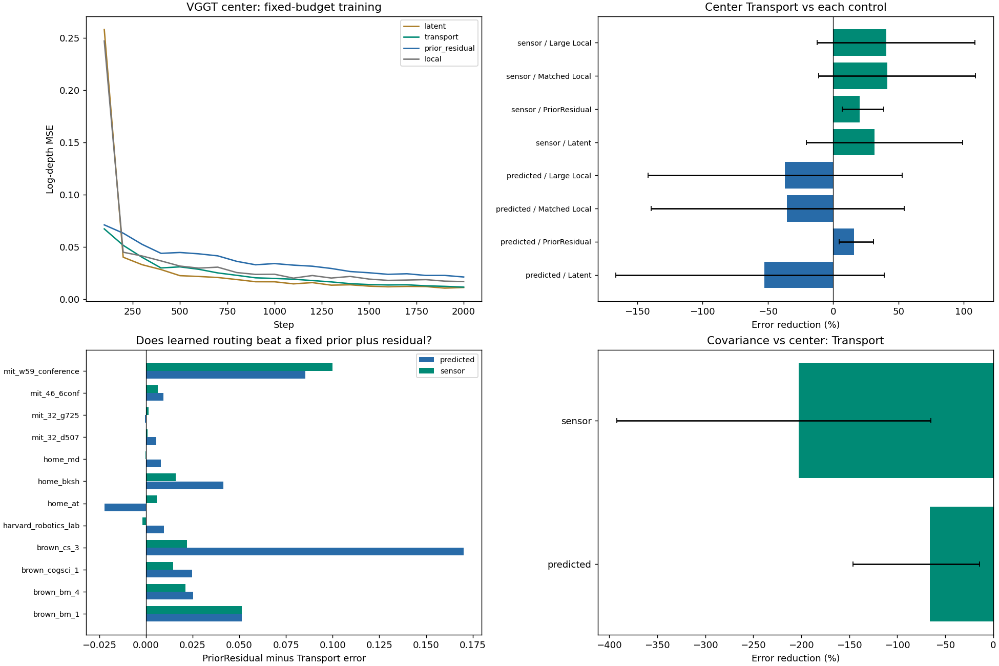
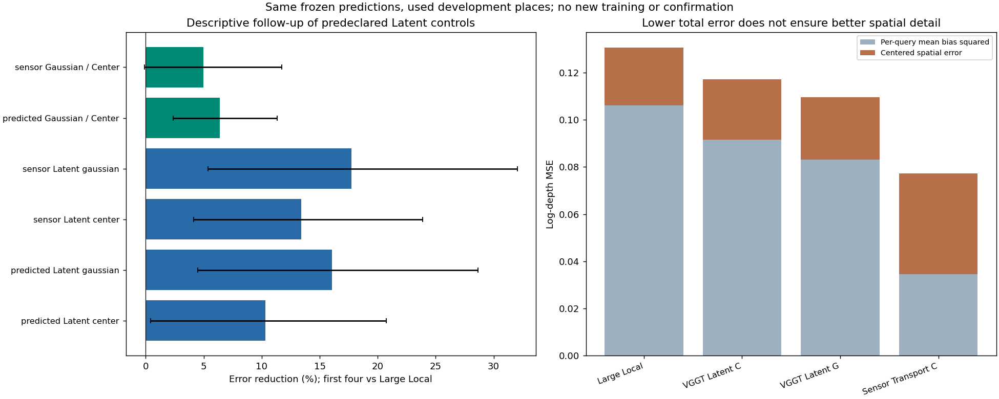

# geometry_transport1：几何应直接变成输出，还是用于引导内容读取

2026-11-10。**本轮完成39次固定预算GPU训练、46历史片段全评、独立核对和九图审阅。显式深度传递没有成为可靠的预测几何方案；预定的隐向量对照反而提供了新的正面开发证据。** 使用VGGT预测几何、冻结256槽高斯记忆、以完整协方差引导内容attention的Latent组，比原强Local主误差低16.04%，比同结构中心位置项低6.38%，两项三个种子均改善、地点区间均为正。该信号来自已用数据和对照组，不能改写显式传递主假设的结果，也没有新确认。

[事前计划](../../../docs/gaussian_memory_geometry_transport_plan.md) · [源/输入/配置身份](plan.json) · [完整评分](evaluation/scores.json) · [主比较](analysis.json) · [对照组的描述性补充](control_analysis.json) · [核对](checks.json) · [实际审阅](review.json)

## 本轮问题与最小干预

reference_geometry1中，同一参考几何替换让零训练中心读取改善57.97%，却只让联合学习Gaussian改善0.75%。本轮检验：让attention把参考几何深度直接保留到输出，是否比完全依赖隐向量回归更有效。竞争解释是：改善只来自几何初值、局部残差或传感器额外信息，未必需要学习跨视图路由。

为隔离读取，本轮冻结**整个**场景状态：256槽的均值、完整协方差、opacity=0.7和32维内容；核心状态45 KiB。原VGGT与上一轮的部分传感器辅助几何分别测试；成员和内容相同，仍有缺测回退及旧分组可能混合表面的限制。查询RGB/深度不参与状态构建，各场景没有独立优化参数。给定相机和参考单位继续沿用。

三种读取都使用相同查询token、相机、标签和采样：

| 读法 | 实现 | 可学习参数 |
| --- | --- | ---: |
| Latent | 当前视图分支＋单层四头attention的内容读出，经GELU和线性头回归深度 | 145,477 |
| Transport | Latent的全部层和初值，再将同一attention加权的中心对数深度直接加到输出；原头学习残差 | 145,477 |
| PriorResidual | 固定几何权重直接读取深度，加当前视图MLP残差；不学习跨视图路由 | 147,209 |
| 新Local | 与PriorResidual相同宽67的当前视图MLP，无记忆 | 147,209 |
| 原强Local | 复用surface1宽191的无记忆网络 | 435,757 |

Latent/Transport的Q来自2048维查询token和18维相机描述，K含32维内容与10维几何，V将内容和中心对数深度投影到64维。位置项分别使用固定中心距离C或投影协方差二次型G；中心组的key仍含完整几何，不能称完全无形状。G−C检验完整投影协方差先验，不单独证明各向异性的贡献。

写成读出公式，令`w`为四头attention权重、`z_j`为槽中心在查询相机中的米制深度：

- Latent：由`Σ w V([f_j, log z_j])`与局部分支共同回归`y`。
- Transport：`y = y_Latent + mean_head Σ_j w_j log z_j`。
- PriorResidual：`y = Σ_j w_geometry,j log z_j + MLP_local(query)`。

这是对数深度探针，不是完整RGB渲染或新的RoPE旋转公式。投影范围不等于遮挡合成，也没有声称这些粗槽中心一定是查询可见表面。

所有新读法共同采用有效候选归一化：只有候选全部失效/被移除时才使用零背景。K投影零初始化，位置强度初值1，输出头为零。于是Transport/PriorResidual初始预测复现对应零训练几何读数，Latent初始预测为0。两组参数相同但预测不同，保留几何初值本来就是干预。共同修改归一化、初始化并冻结写入，意味着不能把新Latent与surface1的差异单独归因于其中某一点。

## 数据、预算与比较范围

三读法×两位置项×两几何来源×三个种子20261110/11/12，共36次；另训练新Local三次。全部2000步、batch2、AdamW 3e-4、weight decay .01、clip5。十二训练地点各一片段，72训练查询/288遮挡，每步样本与surface1逐项配对；没有续训、选checkpoint或调权重。

全部模型固定后，统一评估46个历史片段、288查询/576遮挡，以及完整输入。主评价十二个非训练地点各两个片段，先合并同地点，再跨种子配对；区间为地点×种子bootstrap的95%描述区间。所有地点保留，均为已用开发数据。

39新模型与3个原强Local共42个学习模型；4个零训练几何读数也保留。加上预定干预，每片段202条遮挡条件，共9292条评分；完整输入1932条。92份固定状态保存后供所有读法使用，不为每个模型重新构造一份更有利的记忆。

## 主假设：显式传递有条件作用，未形成可靠预测几何方案

十二非训练地点的主log-depth MSE，越低越好。新Local为0.132137，原强Local为0.130624。

| 几何 / 位置项 | 零训练读数 | PriorResidual | Latent | Transport |
| --- | ---: | ---: | ---: | ---: |
| VGGT / 中心C | 0.255828 | 0.212948 | 0.117139 | 0.178897 |
| VGGT / 协方差G | 0.631049 | 0.486360 | **0.109667** | 0.296777 |
| 传感器辅助 / 中心C | 0.107512 | 0.097137 | 0.113113 | **0.077341** |
| 传感器辅助 / 协方差G | 0.533481 | 0.493341 | 0.107470 | 0.233930 |

下表给出Transport相对同条件控制的误差降低，正数为改善，负数为更差。

| 条件 | 对Latent | 对PriorResidual | 对强Local | 对零训练读数 |
| --- | ---: | ---: | ---: | ---: |
| VGGT / C | −52.72% | +15.99% | −36.96% | +30.07% |
| VGGT / G | −170.62% | +38.98% | −127.20% | +52.97% |
| 传感器辅助 / C | +31.63% | +20.38% | +40.79% | +28.06% |
| 传感器辅助 / G | −117.67% | +52.58% | −79.09% | +56.15% |

四个Transport都稳定超过对应PriorResidual和零训练读数：三个种子同向、地点区间为正。C的两种来源分别10/12地点优于PriorResidual，G则均12/12。这支持学习读取有增量，不能解释成只复制固定读数。

但主用途尚未成立。VGGT/C相对强Local的绝对收益为−0.048273，区间[−0.185228,+0.069254]，三个种子均差、仅4/12地点改善；VGGT/G为−0.166153，区间[−0.358851,−0.005788]。学习改善了原先很差的几何读数，不代表超过强基线。

传感器/C有实质正面信号：三个种子和9/12地点平均优于Latent与强Local，且优于PriorResidual的绝对收益0.019796、区间[0.006636,0.037526]。但对强Local的0.053283收益区间仍为[−0.015974,0.141817]，对Latent也跨零；brown_bm_1、brown_bm_4、mit_w59_conference有明显反例，而home_at贡献很大的正向差值。不能删去这些地点或把40.79%的平均改善当成稳定推广。

传感器/C在遮挡区比强Local低54.60%，区间为正，RMSE/AbsRel也有正区间；可见区与完整输入的主误差区间仍跨零。有限正面作用保留，不因全图不稳定而抹去，也不替代预测几何条件。

显式传递中的G相对C反而更差：VGGT/传感器辅助分别高65.89%/202.47%，三个种子均差，区间均不利。不能因此断言协方差没有价值，因为同一先验在下面的Latent读法中有不同表现。

## 对照带来的新线索：协方差引导内容读取更值得固定下来

Latent是事前设置并全量训练的对照。看到它的正面结果后，只对已冻结预测补充了**所有**Latent/其他读法相对强Local及位置项的配对描述，没有增加训练、改变预测或重新命名主比较。详细结果见control_analysis.json；这是开发发现，不是本轮新确认。

| Latent条件 | log-MSE | 相对强Local降低 | 绝对收益95%区间 | 改善种子 / 地点 |
| --- | ---: | ---: | --- | --- |
| VGGT / C | 0.117139 | 10.32% | [0.000535,0.027110] | 3/3；9/12 |
| VGGT / G | 0.109667 | **16.04%** | [0.005878,0.037408] | 3/3；9/12 |
| 传感器辅助 / C | 0.113113 | 13.41% | [0.005402,0.031187] | 3/3；10/12 |
| 传感器辅助 / G | 0.107470 | 17.73% | [0.007024,0.041859] | 3/3；10/12 |

VGGT/G还比参数匹配的新Local低17.01%，区间为正；比同结构VGGT/C低**6.38%**，绝对收益0.007473、区间[0.002791,0.013261]，三种子、10/12地点改善。传感器G−C平均改善4.99%，但区间跨零。形状位置项的收益具有条件性。

VGGT/G对强Local的改善同时出现在遮挡19.28%、可见14.82%、完整输入17.32%、RMSE10.43%、AbsRel10.87%，这些配对区间均为正。两批主片段分别改善21.21%/12.72%，区间均正；三个主地点反例为brown_bm_1、mit_32_d507和mit_w59_conference，其中mit_32_d507差值很小，仍保留完整分数。

训练片段留出视角仍有正面可学性：VGGT/G Latent在原三/新增九训练片段相对强Local改善34.41%/29.67%，所有地点、三个种子同向；在原三个地点被移出训练的另九片段改善27.44%，三个地点同向。显式VGGT/C则在那九片段高237.23%，再次显示几何读数的直接输出不可靠。

这支持一个精炼的开发候选：**把高斯均值和范围作为“读哪些内容”的位置依据，保留学习读出，不强制将中心深度叠加到最终预测。** 它是已知相机、固定粗记忆上的单层读取；尚未证明可学习写入接回后仍成立，也没有恢复未知相机或完整VGGT下游用途的主张。

## 机制与空间质量：正面总误差不等于细节都改善

VGGT/G Latent相对自身正常预测，移除记忆使误差高47.32%、打乱内容空间绑定高21.16%、错误记忆相机高25.70%；三个种子全部受损，地点分别12/12、11/12、12/12，区间均为正。说明模型确实使用这份状态及其空间关系，不能单由此排除更简单的场景摘要也能获得收益。

传感器/C Transport恢复初始固定路由使误差高12.83%，移除残差使误差高20.17%，两项区间为正；它确实利用了学习路由与残差。移除显式深度通路后大幅变差，是模型依赖其训练时分解的证据，不是对重训基线的额外胜出。所有PriorResidual对内容打乱逐值不变，去掉残差复现零训练读数，控制成立。

按事前计划分解每查询误差：`总log-MSE = 平均log-depth偏差² + 去均值空间误差`。

| 条件 | 平均偏差平方 | 去均值空间误差 | 总误差 |
| --- | ---: | ---: | ---: |
| 强Local | 0.106213 | 0.024411 | 0.130624 |
| VGGT/C Latent | 0.091664 | 0.025475 | 0.117139 |
| VGGT/G Latent | 0.083104 | 0.026563 | 0.109667 |
| 传感器/C Transport | 0.034485 | 0.042856 | 0.077341 |

VGGT/G Latent的整体偏差平方比强Local低21.76%；空间项却高8.81%（区间跨零），完整输入空间项高23.39%（区间不利）。G相对C的空间项也略差，主总误差改善主要来自平均偏差减少。**这是用途的限定，不抵消已经观察到的总体准确度改善，也不设置“所有辅助指标必须获胜”的新门槛。** 它提醒我们，下一次应检验空间组织是否超过更简单的全局场景校准。

传感器/C Transport的空间项高75.56%，完整输入高119.77%，两项区间不利。它的部分大幅总误差改善更不能直接解释成更精细的表面。完整输入的误差不一致性，VGGT/G Latent和传感器/C Transport分别比强Local低38.69%/62.57%；沿用surface1的结论，这个分数可以奖励共同偏差，必须和准确度、空间误差共同解释。

## 实际可视化与正确性

实际查看预定七案例及总览，再补看由相同冻结分数生成的对照总览，共九图。它们保留明显正负例：

- fit_00的中心显式传递改善遮挡区，VGGT/传感器辅助第一查询误差0.0053/0.0034，强Local0.0127；coverage_04却是VGGT/C Transport0.0046高于强Local0.0031，传感器版本0.0026改善。
- transfer_00显式传递的远近结构偏差明显，中心VGGT/传感器为0.0607/0.0520，强Local0.0178；transfer_08则Latent C为0.0087、VGGT/C Transport0.0222、强Local0.0260，有条件改善。
- fidelity_00中近表面没有恢复，VGGT/传感器中心Transport达到2.0293/2.2705，强Local0.4905；这个反例没有被隐藏。fidelity_07相反，传感器中心Transport0.0041，强Local0.0750。
- fidelity_11显示另一类明显失败：VGGT/传感器中心Transport0.3754/0.2271，强Local0.0162。单张正例无法代表地点，更不能替代配对分数。

所有图使用固定第一查询/掩码与seed20261110，不根据分数选择；6米只用于颜色显示饱和，评分未裁剪。补充对照图是已有分数的描述性展示，没有额外模型或样本选择。

39次训练的2000步样本、有限损失/梯度和共享初值核对通过。参考/查询边界与主地点隔离沿用已固定源身份；整个状态没有进入优化器。92份保存状态身份不变，CPU/GPU协方差计算最大差4.77e−7；初始几何读数最大差7.15e−7。独立CPU命令仅加载保存状态、查询token、相机和尺度，读出与GPU最大差1.11e−6，独立NumPy评分差2.15e−8；原强Local与四个零训练控制回放差为零。PriorResidual去残差与固定读数的最大差5.13e−6，属于同一计算不同CPU/GPU矩阵路径的微小舍入，不影响判断。没有因此追加训练或修改数据。

GPU1启动前利用率45%/43%、空闲39,116 MiB，单共享worker、12 GiB上限；未修改或停止其他任务。39次训练总计497.65秒，约8.29分钟，PyTorch峰值分配0.5956 GiB；含加载的训练阶段500.33秒，评价88.68秒。冻结投影预计算复用，没有新下载或VGGT特征提取。

## 决定与下一步

1. 结束显式深度传递作为当前预测几何方案的推广。保留它相对固定读数/局部残差的学习增量，以及传感器中心输入下的有限收益；不加置信度门、裁剪或新的损失来追这轮分数。
2. 固定**当前Latent读取**为有正面开发证据的候选，VGGT/G为重点，Center和两个Local继续作为控制。不把对照组发现改名为预注册主成功，不把冻结记忆说成学会建立记忆。
3. 下一次建议将**未用数据确认与一个参数匹配的全局场景摘要控制**合并成固定比较：查询和参考信息相同，判断高斯空间组织是否提供超出整体深度校准的增量。旧数据只用于准备/训练，不继续在本候选上扫描null、初始化、带宽或分支结构；这些因素的独立因果作用目前允许未解释。若确认并有空间组织增量，再在同一读取上恢复共享写入；若只剩全局校准用途，则收窄贡献或采用更简单表达。该下一项尚未启动。

总体目标仍是精炼、可信且具有一般用途的3DGS场景记忆/Transformer位置编码。本轮提供了一个值得确认的读取候选和清楚的负结果，尚未完成总体研究目标。

