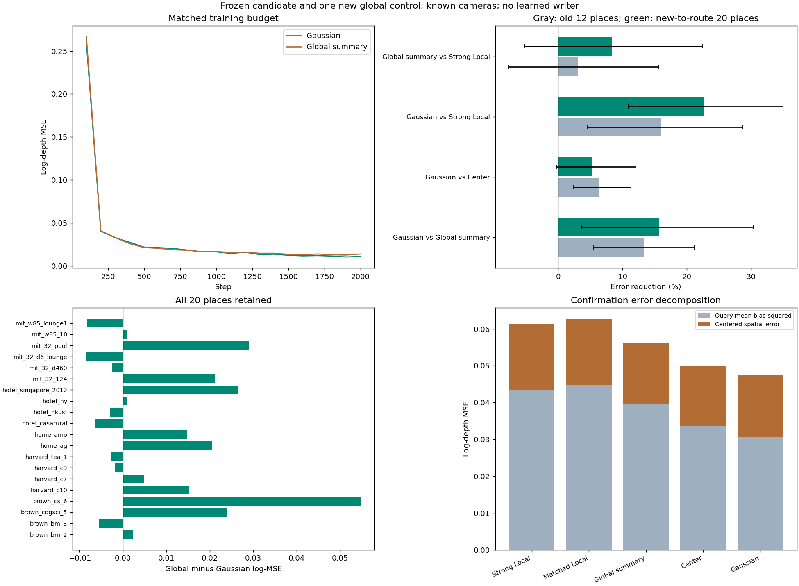

# global_summary1：空间读取在新地点超过全局摘要，协方差增量仍需限定

2026-11-10。**本轮完成了一个有正面结果的固定候选确认。** 在20个此前未进入共享记忆路线的地点上，原VGGT高斯协方差Latent读取的主log-depth MSE，比同参数全局摘要低15.71%、比原强Local低22.74%；两个比较三个种子均改善，地点×种子区间为正。相对中心位置项平均低5.27%，三个种子同向、14/20地点改善，但区间略跨零，因此协方差的额外价值证据较弱。核心用途主要仍是减少整体深度偏差，不能解释成精细表面已经改善。

这里只新增全局摘要三个模型；候选、中心项和两个Local共十二已有模型完全不变。三次2000步训练、旧46片段加新20地点全部评价、独立核对和预定八图审阅完成。新地点的深度曾用于旧区域配准研究，所以本轮是**新于当前共享记忆路线的确认**，不是整个项目从未接触的外部测试集。

[事前方案](../../../docs/gaussian_memory_global_summary_plan.md) · [模型/输入/地点固定记录](plan.json) · [全部模型固定记录](evaluation_lock.json) · [原始评分](evaluation/scores.json) · [配对统计](analysis.json) · [核对](checks.json) · [实际审阅](review.json)

## 检验的问题与结构

上一轮Gaussian的主要改善来自每查询平均深度偏差降低，存在一个简单解释：参考图像只提供了场景级校准信息，一个全局摘要就能替代按位置读取。本轮固定原候选，检验这个解释，而不是继续调整候选。

所有记忆方法获得同一份256槽VGGT预测几何与32维内容，核心状态45 KiB，均值、协方差、opacity=0.7和内容全部冻结。查询来自实际VGGT单视图2048维patch token；已知相机、参考相机基线标定的尺度及局部分支信息在各组共同提供。传感器只生成标签，不进入记忆或读取器。

| 方法 | 读取方式 | 参数 | 本轮训练 |
| --- | --- | ---: | --- |
| Gaussian | 每patch内容attention＋投影协方差位置bias，学习读出 | 145,477 | 复用三模型 |
| Center | 同结构，位置bias换成中心距离 | 145,477 | 复用三模型 |
| GlobalSummary | 查询q取整图均值，学习读取同一记忆，形成一个64维摘要，广播到全部patch | 145,477 | 新增三模型 |
| Local | 宽67当前视图网络，无场景记忆读取 | 147,209 | 复用三模型 |
| 强Local | 宽191当前视图网络，无场景记忆读取 | 435,757 | 复用三模型 |

GlobalSummary保留相机坐标下完整key几何、内容、深度value、候选可用性和opacity；局部分支仍逐patch处理。四头尺度用作内容attention温度，初值1。它具有与候选相同的参考信息、参数量和完整初值；差别是没有逐patch位置bias和逐patch不同的记忆读取。该比较支持当前空间接法相对**这个**查询条件全局摘要的用途，不单独隔离query池化、温度与位置bias各自的贡献，也不能否定所有可能的全局摘要结构。

三个新模型沿用十二旧训练地点、72查询/288遮挡、2000步、batch2、AdamW 3e-4、wd .01、clip5，种子20261110/11/12。全部6000步采样与同种子的候选逐项一致，不选checkpoint或重训候选。候选是单层attention的位置bias实现，不是新的RoPE旋转公式。

## 数据与确认边界

新名单直接取既有region_rotary_confirmation元数据的全部20地点，无结果筛选；与当前记忆路线的25个旧地点按地点前缀无交集。每地点按原始序号取前13帧，0/4/8/12作参考，另外9帧作查询，每查询两张固定像素遮挡。20地点、180查询、360遮挡全部完成，零排除、零替换。

260张RGB补齐到用户指定data目录的`GRoPE/gaussian_memory/global_summary_v1`，56.91 MiB，未使用代理；两个连接错误按原路径重试恢复。已下载深度、相机和元数据不重选。全部模型固定后，复用原VGGT、PCA、参考几何、256槽聚合和标签处理，提取20份保存状态及80个缓存文件；PCA没有重拟合。查询图像不进入参考聚合，查询深度只用于监督/评分。缓存和图像身份记录于[下载清单](download_complete.json)与[缓存清单](cache_identity.json)。

旧46片段仍是开发评价；新20地点为本路线方法未见确认。主统计在地点内汇总、再跨三个种子配对，95%区间为10000次地点×种子bootstrap描述区间。不能把多个查询当作独立地点，也不把这里的数据新颖性扩展为完全未用外部数据。后续如依据本轮结果改方法，这20地点就已用于开发选择，不能再次称为新确认。

## 主比较

主log-depth MSE越低越好。

| 方法 | 旧十二主地点、两片段 | 新二十地点、一片段 |
| --- | ---: | ---: |
| Gaussian | **0.109667** | **0.047335** |
| Center | 0.117139 | 0.049970 |
| GlobalSummary | 0.126553 | 0.056158 |
| Local | 0.132137 | 0.062617 |
| 强Local | 0.130624 | 0.061268 |

下表收益为“控制误差−Gaussian误差”，正数有利于Gaussian；区间为绝对log-MSE差，不是百分比区间。

| 新地点比较 | 相对误差降低 | 绝对收益95%区间 | 改善种子 / 地点 |
| --- | ---: | --- | --- |
| 对GlobalSummary | **15.71%** | **[0.002086,0.017045]** | 3/3；12/20 |
| 对强Local | **22.74%** | **[0.006703,0.021428]** | 3/3；16/20 |
| 对Local | **24.41%** | **[0.007860,0.023233]** | 3/3；16/20 |
| 对Center | 5.27% | [−0.000130,0.006048] | 3/3；14/20 |

Gaussian对GlobalSummary三个种子的绝对收益为0.009900/0.007111/0.009458；对强Local为0.012378/0.015275/0.014145。旧十二地点对GlobalSummary也改善13.34%，三个种子、十二地点均改善，区间[0.007009,0.026814]。因此，这个全局摘要没有解释掉候选的已观察到用途。

对中心项的5.27%不是“证明没有效果”：三个种子和大多数地点支持正方向，遮挡区及AbsRel的比较区间也为正。但主区间略跨零，不能把完整协方差的额外收益写成同样清楚的确认；Center的key本身仍含完整几何，这里检验的是位置bias组织形式，不是形状输入有无或纯各向异性。

GlobalSummary自身对强Local平均改善8.34%、三个种子同向、14/20地点改善，但区间[−0.003208,0.013731]跨零。不能称其没有使用参考信息，也不能据此声称全局摘要等效于Local。

所有地点保留。Gaussian对GlobalSummary有8个地点退步，包括hotel_casarural、mit_32_d6_lounge和mit_w85_lounge1；对强Local有4个退步地点，其中hotel_casarural较明显，绝对差−0.026241。brown_cs_6对GlobalSummary的正向差较大（+0.054736），但另有11地点正向。整体区间与逐地点结果一起报告，不删除反例来制造普遍有效的结论。

## 其他指标与收益性质

| Gaussian相对控制的误差降低 | GlobalSummary | 强Local | Center |
| --- | ---: | ---: | ---: |
| 遮挡区log-MSE | 23.63% | 28.93% | 5.97% |
| 可见区log-MSE | 12.55% | 20.32% | 5.00% |
| 完整输入log-MSE | 14.54% | 20.58% | 4.97% |
| 米制RMSE | 6.00% | 12.43% | 1.59% |
| AbsRel | 6.53% | 11.49% | 3.75% |

Gaussian对GlobalSummary的遮挡、可见、完整输入log-MSE区间均为正，RMSE/AbsRel则跨零；对强Local以上五项均为三个种子改善、区间为正。对Center只有遮挡区log-MSE与AbsRel在这五项中区间为正。这些辅助结果限定解释，不设置“全部必须显著”的额外门槛。

仍按原定分解：`总log-MSE = 每查询平均log-depth偏差² + 去均值空间误差`。

| 方法 | 平均偏差平方 | 去均值空间误差 | 总误差 |
| --- | ---: | ---: | ---: |
| 强Local | 0.043381 | 0.017886 | 0.061268 |
| GlobalSummary | 0.039711 | 0.016447 | 0.056158 |
| Center | 0.033550 | 0.016419 | 0.049970 |
| Gaussian | **0.030564** | 0.016771 | **0.047335** |

Gaussian相对GlobalSummary减少23.03%的偏差平方，但去均值空间项高1.97%，区间跨零；完整输入空间项高18.66%，三个种子均差、区间不利。相对强Local，遮挡输入空间项平均低6.23%，区间仍跨零，完整输入则高4.32%、区间跨零。相对Center的空间项也未改善。

**空间读取的用途与精细空间误差改善是两个不同主张。** 本轮支持当前按位置读取对总体深度估计的额外用途；其效果主要落在全图平均偏差上。一个合理但未独立验证的解释是：按位置找对参考内容，也能帮助整幅查询获得更合适的深度基准；只有全局汇总可能混合了不相关部分。本轮不把这一解释当成已唯一定位的机制，也不因主要收益是校准就抹去准确度改善。

## 记忆依赖、可视化与核对

新地点Gaussian移除记忆、打乱内容空间绑定、错误记忆相机，主误差分别增加67.66%/25.97%/35.66%；三个种子均受损，地点分别17/20、15/20、20/20，区间均为正。GlobalSummary移除记忆也差31.17%、区间为正，说明对照确实学会使用参考；但内容打乱/错误相机仅差0.95%/1.32%，区间跨零。后两者与全局接法较少依赖精确空间绑定相容，不替代重训模型之间的用途比较。

实际查看预定七案例和总览，共八图。第一查询/第一遮挡/seed20261110固定，保留了有利于不同方法的例子：

- 新brown_bm_2：Gaussian0.0101、Global0.0114、强Local0.0071，第一查询Local更好，与地点总均值可以不同。
- 新harvard_c7：Gaussian0.0078、Center0.0066、Global0.0101、强Local0.0102；空间读法改善，但协方差不是该视角最优。
- 新hotel_casarural：Gaussian0.1207、Global0.1088、强Local0.0654；三种记忆读法都高估了较近表面的深度，保留明显反例。
- 新mit_32_d460：Global0.0073、Gaussian0.0117、强Local0.0109，全局摘要在该视角更好。
- 旧fit_00：Global0.0053优于Gaussian0.0080和强Local0.0127；旧transfer_00及fidelity_07的第一查询则均为强Local更好。未用单图替代地点配对统计。

颜色显示在6米饱和，评分不裁剪。总览中训练曲线正常且接近，Gaussian对全局摘要及强Local的主区间为正，而误差堆叠再次显示主要减少平均偏差。

三次初值和全部采样配对通过；旧39个checkpoint身份不变，旧评分回放差为零。GlobalSummary的联合槽位重排对全部评价仅有浮点舍入差，全图摘要逐patch逐值相同；空记忆结果有限。三片段×五读法的独立CPU保存状态读取与GPU最大差7.16e−7，NumPy独立评分差4.68e−9；分解恒等核对通过。没有因微小舍入追加训练或改变方案。

1卡两次占用核对后以单共享worker运行，12 GiB上限，未终止或修改其他任务。新训练共42.44秒、峰值0.4683GiB；包括加载的训练阶段44.40秒。确认提取循环52.93秒，含加载63.58秒，峰值4.6354GiB；全部评价35.03秒。没有新的候选调参、网络故障后的模型重训或数据排除。

## 决定与下一步

1. **保留并固定当前Gaussian空间读取。** 相对这个同参数、同参考信息的全局摘要和两个Local，它的总体精度收益在本路线新地点得到正面确认，值得继续投入。Center保留为强控制，协方差的额外价值作支持性而非已充分确立的主张。
2. **结束这一轮“是否只是全局摘要”的检验。** 结果支持当前逐位置接法，但不足以宣布它是唯一有效摘要方式；不继续扫描全局控制宽度、温度或新模块，也不为了所有辅助指标获胜而修补已冻结候选。
3. **下一步回到共享记忆主线：在固定的读取结构上恢复一个共享可学习写入器，与冻结记忆直接配对。** 检验写入—保存—不同视角读取能否保持当前用途，并保留Center/Local控制；已用二十地点只作为后续开发数据，新的独立确认需另行预定。无需等空间细节指标全部获胜才开展这个实验。该下一项尚未启动。

当前证据仍限于已知相机、四参考、256槽、冻结VGGT、单层读取和粗深度探针。联合写入收益、未知位姿、长期记忆、完整VGGT下游效果及跨任务一般性仍未证明。总体研究目标未完成；本轮完成的是一个有明确正面证据及边界的读取确认。

