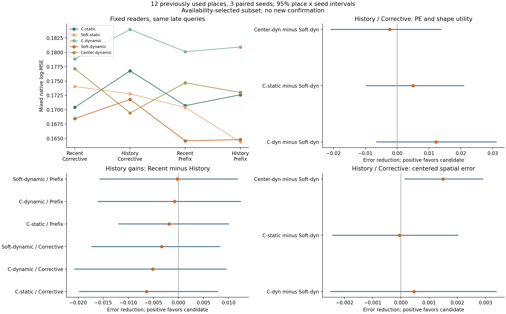
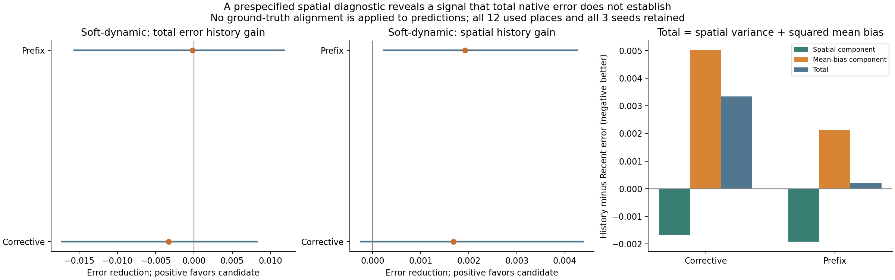
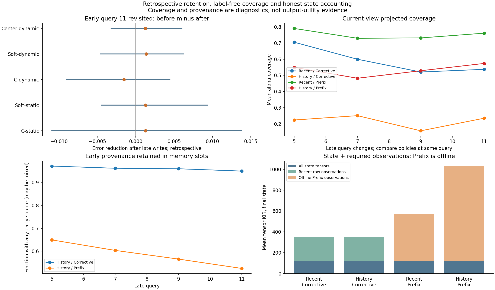
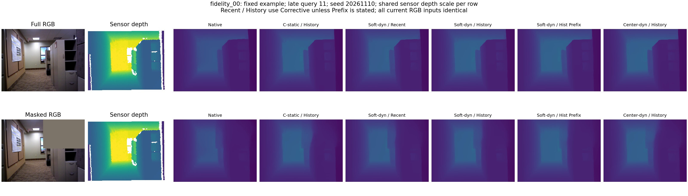
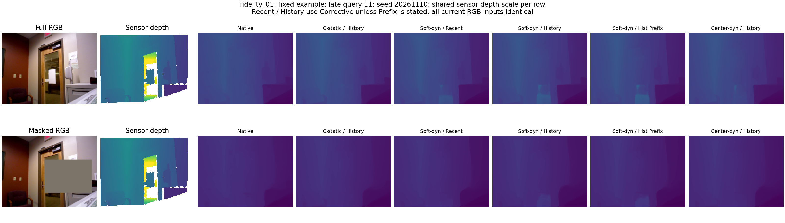
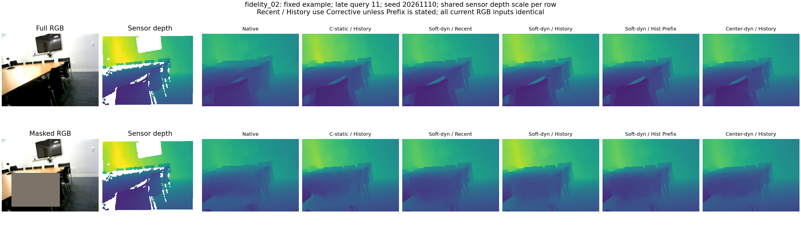
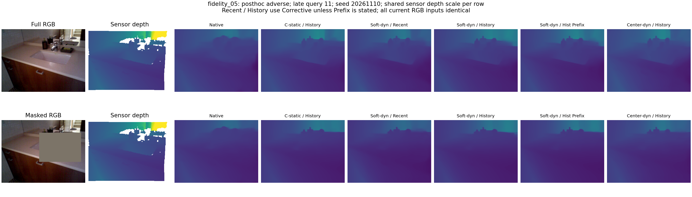

# 窗口外历史信息能否提高高斯场景记忆的用途

明确加入窗口外历史后，整体输出用途仍未确立；但出现相对空间结构改善与整体深度偏差相抵消的证据。保留这条有限信号，下一项检验当前观测与历史修正的尺度分工，不继续细调位置先验或立即修补更新器。

## 问题与固定比较

此前训练状态匹配并未建立对强纯内容读取器的可靠净收益，而且新增观察多数仍在原生四帧窗口内。本轮不再修改公式：固定五组各三个模型，检验明确位于当前窗口之外的早期观察，以及高斯几何位置项是否帮助读取这些信息。

12 个既有非训练地点各含早晚两个不重叠的12帧窗口，共288张已下载RGB。它们按成对可用性确定，且此前相对改善较强，不能代表全部51地点或作为新确认。两窗相隔较大，不是连续长视频。

早窗末态接入晚窗，与晚窗重置比较；两者都提供Corrective与累计重建Prefix，共四种256槽状态。所有模型和当前四帧输入相同，几何以早窗世界坐标和单位统一。近期对照共享坐标/尺度元数据，但不读取早期几何与内容槽。B初始四帧联合编码仅在B第3帧到达后整批可用。

观察均来自memory-free直接分支；查询帧和传感器标签从不写入。相机已知，主评价使用原固定标定，未重新对齐预测到真值。仅浮点并行累加的逐位检查在预运行修正为合理容差，科学方案与更新运算未改，见 `pre_run_fixes.json`。

C也读取同样的高斯聚合内容，因此本轮只检验读取位置项与历史范围，不能证明高斯压缩优于普通token/KV记忆。Center同时改变协方差形状和投影足迹，不是纯方向消融。冻结读法的负结果也不能否定端到端训练。

主指标是地点等权的混合原生深度log-MSE，越低越好。差值为前者减后者，正值表示后者改善；区间来自5000次配对地点×种子重采样。12个地点、3个种子均保留；辅助指标不替代主比较。

## 四种状态的主误差

| 读取器 | Recent-Corrective | History-Corrective | Recent-Prefix | History-Prefix |
|---|---:|---:|---:|---:|
| C-static | 0.170424 | 0.176785 | 0.170715 | 0.172606 |
| Soft-static | 0.174049 | 0.172771 | 0.170405 | 0.164383 |
| C-dynamic | 0.178845 | 0.183984 | 0.180123 | 0.180924 |
| Soft-dynamic | 0.168471 | 0.171808 | 0.164595 | 0.164797 |
| Center-dynamic | 0.177146 | 0.169448 | 0.174696 | 0.173017 |
| Native | 0.177173 | 0.177173 | 0.177173 | 0.177173 |
| L | 0.183053 | 0.183053 | 0.183053 | 0.183053 |

Native与L行在四列中按身份复用，不是四次独立评价。static/dynamic后缀表示先前训练接收的记忆状态，本轮均零训练。

## 高斯位置项与强内容读取的增量

| 比较（前者误差减后者） | 相对降低 | 绝对差的95%区间 | 三种子绝对差 | 改善地点 |
|---|---:|---|---|---:|
| content_dynamic_minus_soft_dynamic | +6.62% | [-0.006464, 0.031126] | 0.017962 / 0.007689 / 0.010877 | 7/12 |
| content_static_minus_soft_dynamic | +2.82% | [-0.009647, 0.020916] | 0.006445 / 0.003553 / 0.004933 | 5/12 |
| center_dynamic_minus_soft_dynamic | -1.39% | [-0.020859, 0.013751] | -0.003043 / 0.002931 / -0.006969 | 5/12 |
| soft_static_minus_soft_dynamic | +0.56% | [-0.012622, 0.011402] | 0.009265 / -0.003201 / -0.003176 | 9/12 |
| content_static_minus_content_dynamic | -4.07% | [-0.019790, 0.002916] | -0.011517 / -0.004135 / -0.005944 | 5/12 |
| native_minus_soft_dynamic | +3.03% | [-0.012555, 0.026591] | 0.007693 / 0.009004 / -0.000601 | 7/12 |
| local_minus_soft_dynamic | +6.14% | [-0.007944, 0.037382] | 0.016688 / 0.013416 / 0.003632 | 5/12 |
| native_minus_content_static | +0.22% | [-0.016593, 0.017161] | 0.001248 / 0.005451 / -0.005534 | 7/12 |
| local_minus_content_static | +3.42% | [-0.016056, 0.029858] | 0.010243 / 0.009863 / -0.001301 | 5/12 |

## 同一读取器是否受益于更早历史

| 比较（前者误差减后者） | 相对降低 | 绝对差的95%区间 | 三种子绝对差 | 改善地点 |
|---|---:|---|---|---:|
| content_static_recent_corrective_minus_content_static_history_corrective | -3.73% | [-0.019668, 0.007804] | -0.000533 / -0.014014 / -0.004536 | 4/12 |
| content_static_recent_rebuild_minus_content_static_history_rebuild | -1.11% | [-0.011863, 0.009966] | 0.000320 / -0.005340 / -0.000652 | 5/12 |
| content_static_recent_rebuild_minus_content_static_recent_corrective | +0.17% | [-0.005825, 0.007699] | 0.000205 / 0.002168 / -0.001500 | 3/12 |
| content_static_history_rebuild_minus_content_static_history_corrective | -2.42% | [-0.009976, 0.002235] | -0.000648 / -0.006505 / -0.005384 | 5/12 |
| soft_static_recent_corrective_minus_soft_static_history_corrective | +0.73% | [-0.009332, 0.010389] | -0.001742 / 0.007736 / -0.002159 | 7/12 |
| soft_static_recent_rebuild_minus_soft_static_history_rebuild | +3.53% | [-0.004096, 0.017349] | 0.011227 / 0.007522 / -0.000683 | 9/12 |
| soft_static_recent_rebuild_minus_soft_static_recent_corrective | -2.14% | [-0.012619, 0.004070] | 0.002586 / -0.005768 / -0.007751 | 6/12 |
| soft_static_history_rebuild_minus_soft_static_history_corrective | -5.10% | [-0.016983, -0.000229] | -0.010382 / -0.005555 / -0.009226 | 3/12 |
| content_dynamic_recent_corrective_minus_content_dynamic_history_corrective | -2.87% | [-0.020625, 0.009509] | 0.002178 / -0.001712 / -0.015882 | 6/12 |
| content_dynamic_recent_rebuild_minus_content_dynamic_history_rebuild | -0.44% | [-0.015996, 0.012346] | 0.007187 / 0.003184 / -0.012774 | 7/12 |
| content_dynamic_recent_rebuild_minus_content_dynamic_recent_corrective | +0.71% | [-0.004941, 0.009808] | -0.000031 / 0.002216 / 0.001649 | 5/12 |
| content_dynamic_history_rebuild_minus_content_dynamic_history_corrective | -1.69% | [-0.012040, 0.005551] | -0.005040 / -0.002681 / -0.001460 | 4/12 |
| soft_dynamic_recent_corrective_minus_soft_dynamic_history_corrective | -1.98% | [-0.017236, 0.008215] | 0.002091 / -0.006110 / -0.005992 | 7/12 |
| soft_dynamic_recent_rebuild_minus_soft_dynamic_history_rebuild | -0.12% | [-0.015647, 0.011783] | 0.007280 / -0.004348 / -0.003539 | 9/12 |
| soft_dynamic_recent_rebuild_minus_soft_dynamic_recent_corrective | -2.36% | [-0.012471, 0.002942] | 0.000996 / -0.004377 / -0.008248 | 5/12 |
| soft_dynamic_history_rebuild_minus_soft_dynamic_history_corrective | -4.25% | [-0.015052, 0.000429] | -0.004193 / -0.006140 / -0.010701 | 3/12 |
| center_dynamic_recent_corrective_minus_center_dynamic_history_corrective | +4.35% | [-0.003639, 0.019978] | 0.007094 / 0.011517 / 0.004482 | 7/12 |
| center_dynamic_recent_rebuild_minus_center_dynamic_history_rebuild | +0.96% | [-0.009094, 0.011572] | 0.006208 / 0.004956 / -0.006127 | 8/12 |
| center_dynamic_recent_rebuild_minus_center_dynamic_recent_corrective | -1.40% | [-0.014417, 0.008159] | 0.002680 / 0.000826 / -0.010855 | 6/12 |
| center_dynamic_history_rebuild_minus_center_dynamic_history_corrective | +2.06% | [-0.008370, 0.017099] | 0.003566 / 0.007387 / -0.000246 | 6/12 |

- corrective：Soft-dynamic历史收益减C-dynamic历史收益 = 0.001802，区间 [-0.014055, 0.017190]，种子差 -0.000086 / -0.004398 / 0.009890。
- corrective：Soft-dynamic历史收益减C-static历史收益 = 0.003024，区间 [-0.006678, 0.015543]，种子差 0.002625 / 0.007904 / -0.001456。
- rebuild：Soft-dynamic历史收益减C-dynamic历史收益 = 0.000599，区间 [-0.014743, 0.011487]，种子差 0.000093 / -0.007532 / 0.009235。
- rebuild：Soft-dynamic历史收益减C-static历史收益 = 0.001689，区间 [-0.009402, 0.011131]，种子差 0.006960 / 0.000993 / -0.002887。

上述交互是两组历史收益之差；正值表示Soft受益更多。Prefix是访问累计原始观察的离线重建参照，不是严格性能上界，也不是在线定长存储。

## 完整、遮挡与空间误差

预定的去均值空间误差用于诊断相对深度结构。总log-MSE严格分解为该空间误差与平均log残差的平方；这里没有用真值重新校正或替换原生预测。下列辅助结果不能替代整体主比较。

| 比较（前者误差减后者） | 相对降低 | 绝对差的95%区间 | 三种子绝对差 | 改善地点 |
|---|---:|---|---|---:|
| content_static_recent_corrective_minus_content_static_history_corrective | +4.17% | [-0.001906, 0.004035] | -0.000292 / 0.001056 / 0.001850 | 6/12 |
| content_static_recent_rebuild_minus_content_static_history_rebuild | +6.33% | [-0.000805, 0.003917] | 0.000685 / 0.001245 / 0.001914 | 7/12 |
| content_dynamic_recent_corrective_minus_content_dynamic_history_corrective | +2.39% | [-0.002383, 0.003206] | -0.000760 / 0.001523 / 0.000749 | 7/12 |
| content_dynamic_recent_rebuild_minus_content_dynamic_history_rebuild | +4.06% | [-0.001101, 0.002817] | 0.000849 / 0.000743 / 0.000871 | 8/12 |
| soft_dynamic_recent_corrective_minus_soft_dynamic_history_corrective | +7.72% | [-0.000248, 0.004375] | 0.001293 / 0.001511 / 0.002239 | 9/12 |
| soft_dynamic_recent_rebuild_minus_soft_dynamic_history_rebuild | +9.25% | [0.000229, 0.004251] | 0.001152 / 0.002377 / 0.002249 | 11/12 |

### Recent / Corrective

| 指标/输入 | C-static | C-dynamic | Soft-dynamic | Center-dynamic | Native |
|---|---:|---:|---:|---:|---:|
| full/log_mse | 0.158813 | 0.166433 | 0.155699 | 0.167812 | 0.168440 |
| masked/log_mse | 0.176230 | 0.185050 | 0.174857 | 0.181812 | 0.181540 |
| masked/hidden_log_mse | 0.203721 | 0.214608 | 0.203980 | 0.214225 | 0.208218 |
| masked/visible_log_mse | 0.167118 | 0.175234 | 0.165363 | 0.171243 | 0.172982 |
| mixed/centered_log_mse | 0.020901 | 0.021048 | 0.021763 | 0.021932 | 0.025369 |
| mixed/bias_squared | 0.149523 | 0.157796 | 0.146708 | 0.155214 | 0.151805 |
| mixed/absrel | 0.225860 | 0.229111 | 0.230546 | 0.236293 | 0.232144 |
| mixed/rmse_m | 0.678669 | 0.680411 | 0.689052 | 0.696123 | 0.751755 |

### History / Corrective

| 指标/输入 | C-static | C-dynamic | Soft-dynamic | Center-dynamic | Native |
|---|---:|---:|---:|---:|---:|
| full/log_mse | 0.165897 | 0.172530 | 0.160201 | 0.158427 | 0.168440 |
| masked/log_mse | 0.182229 | 0.189710 | 0.177612 | 0.174958 | 0.181540 |
| masked/hidden_log_mse | 0.213300 | 0.218994 | 0.206746 | 0.203984 | 0.208218 |
| masked/visible_log_mse | 0.171983 | 0.180138 | 0.168106 | 0.165511 | 0.172982 |
| mixed/centered_log_mse | 0.020029 | 0.020544 | 0.020082 | 0.021571 | 0.025369 |
| mixed/bias_squared | 0.156756 | 0.163439 | 0.151726 | 0.147877 | 0.151805 |
| mixed/absrel | 0.239062 | 0.243648 | 0.232431 | 0.229480 | 0.232144 |
| mixed/rmse_m | 0.697199 | 0.702487 | 0.674814 | 0.671818 | 0.751755 |

去均值空间误差的配对比较：

| 比较（前者误差减后者） | 相对降低 | 绝对差的95%区间 | 三种子绝对差 | 改善地点 |
|---|---:|---|---|---:|
| content_dynamic_minus_soft_dynamic | +2.25% | [-0.002486, 0.003380] | 0.002513 / -0.000769 / -0.000357 | 6/12 |
| content_static_minus_soft_dynamic | -0.26% | [-0.002415, 0.002017] | 0.001367 / -0.001096 / -0.000430 | 5/12 |
| center_dynamic_minus_soft_dynamic | +6.90% | [0.000144, 0.002902] | 0.002107 / 0.001448 / 0.000910 | 9/12 |
| soft_static_minus_soft_dynamic | +0.07% | [-0.001346, 0.001305] | 0.000788 / -0.000438 / -0.000305 | 6/12 |
| content_static_minus_content_dynamic | -2.57% | [-0.001934, 0.000998] | -0.001146 / -0.000327 / -0.000073 | 5/12 |
| native_minus_soft_dynamic | +20.84% | [0.002036, 0.008579] | 0.005988 / 0.004124 / 0.005746 | 9/12 |
| local_minus_soft_dynamic | +14.27% | [-0.000348, 0.008184] | 0.002507 / 0.001510 / 0.006013 | 8/12 |
| native_minus_content_static | +21.05% | [0.000850, 0.009770] | 0.004621 / 0.005220 / 0.006177 | 9/12 |
| local_minus_content_static | +14.50% | [-0.000419, 0.009063] | 0.001139 / 0.002606 / 0.006444 | 8/12 |

### Recent / Prefix

| 指标/输入 | C-static | C-dynamic | Soft-dynamic | Center-dynamic | Native |
|---|---:|---:|---:|---:|---:|
| full/log_mse | 0.160359 | 0.167847 | 0.152733 | 0.164165 | 0.168440 |
| masked/log_mse | 0.175893 | 0.186261 | 0.170525 | 0.179961 | 0.181540 |
| masked/hidden_log_mse | 0.202363 | 0.215859 | 0.197390 | 0.215284 | 0.208218 |
| masked/visible_log_mse | 0.167096 | 0.176476 | 0.161711 | 0.168488 | 0.172982 |
| mixed/centered_log_mse | 0.020244 | 0.020234 | 0.020824 | 0.021921 | 0.025369 |
| mixed/bias_squared | 0.150471 | 0.159888 | 0.143770 | 0.152774 | 0.151805 |
| mixed/absrel | 0.223945 | 0.227693 | 0.227966 | 0.225697 | 0.232144 |
| mixed/rmse_m | 0.665022 | 0.673972 | 0.666718 | 0.669560 | 0.751755 |

### History / Prefix

| 指标/输入 | C-static | C-dynamic | Soft-dynamic | Center-dynamic | Native |
|---|---:|---:|---:|---:|---:|
| full/log_mse | 0.163439 | 0.169589 | 0.154975 | 0.162716 | 0.168440 |
| masked/log_mse | 0.177190 | 0.186591 | 0.169708 | 0.178167 | 0.181540 |
| masked/hidden_log_mse | 0.206257 | 0.216903 | 0.196885 | 0.213490 | 0.208218 |
| masked/visible_log_mse | 0.167604 | 0.176681 | 0.160843 | 0.166623 | 0.172982 |
| mixed/centered_log_mse | 0.018962 | 0.019413 | 0.018899 | 0.020617 | 0.025369 |
| mixed/bias_squared | 0.153644 | 0.161510 | 0.145898 | 0.152400 | 0.151805 |
| mixed/absrel | 0.232259 | 0.234028 | 0.226279 | 0.225479 | 0.232144 |
| mixed/rmse_m | 0.678707 | 0.677879 | 0.656610 | 0.664492 | 0.751755 |

## 早期视角保持与对应依赖

回访固定早窗query11完整输入，用早窗末态与晚窗History-Corrective末态读取；三种子全评。前者180行按严格身份复用，后者180份新预测。这是事后回访，不混入因果主成绩。

| 比较（前者误差减后者） | 相对降低 | 绝对差的95%区间 | 三种子绝对差 | 改善地点 |
|---|---:|---|---|---:|
| content_static_early_minus_content_static_late | +0.81% | [-0.010934, 0.013839] | -0.005091 / 0.009639 / -0.000727 | 8/12 |
| soft_static_early_minus_soft_static_late | +0.85% | [-0.004450, 0.009350] | -0.001371 / -0.000213 / 0.005388 | 5/12 |
| content_dynamic_early_minus_content_dynamic_late | -1.00% | [-0.009024, 0.004452] | -0.002829 / 0.000274 / -0.002049 | 4/12 |
| soft_dynamic_early_minus_soft_dynamic_late | +1.04% | [-0.004636, 0.006240] | -0.001313 / 0.003355 / 0.002004 | 7/12 |
| center_dynamic_early_minus_center_dynamic_late | +0.94% | [-0.003209, 0.005997] | 0.000844 / -0.000364 / 0.003297 | 7/12 |

首个Soft-dynamic种子在History-Corrective上做内容槽置换与均匀先验；正差表示干预有损害，只检验依赖。

| 比较（前者误差减后者） | 相对降低 | 绝对差的95%区间 | 三种子绝对差 | 改善地点 |
|---|---:|---|---|---:|
| content_permuted_minus_soft | +1.90% | [-0.001915, 0.009987] | 0.003289 | 5/12 |
| uniform_prior_minus_soft | +1.41% | [-0.001043, 0.007645] | 0.002424 | 2/12 |

## 记忆保留、覆盖与资源

| 状态 | 末次查询平均覆盖 | 保留早期来源的槽数 | 完整状态KiB | 近期缓冲KiB | 离线Prefix观察KiB |
|---|---:|---:|---:|---:|---:|
| Recent / Corrective | 0.5372 | 0.00 | 122.00 | 226.56 | 0.00 |
| History / Corrective | 0.2351 | 242.92 | 122.00 | 226.56 | 0.00 |
| Recent / Prefix | 0.7606 | 0.00 | 122.00 | 0.00 | 453.12 |
| History / Prefix | 0.5736 | 134.50 | 122.00 | 0.00 | 906.25 |

早期来源槽可以同时融合晚期观察，不代表纯早期信息仍完整保存；覆盖不等于输出用途。完整状态包含24列source/conflict与256×256 lineage，不宣称任意长序列恒定字节。Prefix另需累计观察，表中已计入。

新增训练0步、下载0字节。状态生成合计45.76秒，预测阶段记录的推理时间合计475.93 worker秒，峰值已分配4.512GiB。使用0/2/4卡，通过两次实时占用检查，每卡一个worker、12GiB上限；这些是运行成本，非独占速度基准。

## 固定案例与反例

以下均为首种子晚窗query11完整与mask0输入，使用公共传感器色阶；固定三例加按三种子主误差选出的Soft-dynamic相对C-static最差地点，后者明确标为事后反例。图像不能替代整体统计。

## 独立核对与证据边界

9,108份新预测已从原始传感器标签以float64 NumPy独立评分，756行父轮评分按身份核对。15个检查点、公共尺度、48次旧更新操作、来源时间顺序、只读查询及全量输出身份均检查；没有剔除地点或查询。评分最大绝对差为6.49e-07，不影响方法结论。

所有模型与数据均已用于开发；此轮回答固定表示与读取器在这12对窗口上的适用边界。不得升级为未用数据确认、准确高斯几何学习、一般PE优势或无限长度记忆成功。

## 方法取舍与下一步

在 History-Corrective 上，Soft-dynamic/C-dynamic/C-static 主误差为 0.171808/0.183984/0.176785；Soft 对两种 C 平均低 6.62%/2.82%，三个种子同向，但地点×种子区间均跨零，仅 7/12 和 5/12 地点改善。History-Prefix 对两种 C 平均低 8.91%/4.52%，也是三种子同向、区间跨零。候选保留平均相对优势，尚未建立可靠适用范围；不能把当前旧子集升级为全51地点或新确认。

同一 Soft-dynamic 保留早期历史后，Corrective 主误差从 0.168471 升至 0.171808（高 1.98%），Prefix 从 0.164595 变为 0.164797（高 0.12%）；均一个种子改善、两个退步、区间跨零。强 C-static 的历史主误差也高 3.73%/1.11%。Soft 与 C 的历史收益交互仍不确定，因此没有建立整体长历史用途，也不能把候选相对 C 的优势都归因于更早历史。

预定辅助指标提供了实质线索：Soft 的 Prefix 历史空间误差降低 9.25%，三个种子、11/12 地点改善，绝对差区间 [0.000229,0.004251]；完整与遮挡输入分别低 9.77%/9.06%，区间均为正。总 log-MSE = 去均值空间误差 + 平均 log 残差平方；此处空间项减少 0.001926、偏差平方增加 0.002128，恰好抵消为总误差增加 0.000202。Corrective 空间项也平均低 7.72%、三种子同向但混合区间略跨零。历史可能含可利用的相对结构，整体尺度/偏差没有随之改善；这不是用真值校正后的部署成功。

完整高斯相对 Center 在 History-Corrective 的主误差反而高 1.39%、种子混合；History-Prefix 平均低 4.75%、三种子同向但区间跨零。两种历史策略的空间误差分别低 6.90%/8.33%，三种子同向、均 9/12 地点改善、区间为正，支持该预定辅助维度上的形状/足迹差异。不过对强 C-static 的空间误差仍基本持平（Corrective 高 0.26%、Prefix 低 0.34%，均不确定），不能据此宣称独立 PE 必要。

更新边界也很明确：History-Corrective 末态平均 242.9/256 槽仍含早期来源，只有 27.0 槽含晚期来源，当前查询平均 alpha 覆盖为 0.235，Recent-Corrective 为 0.537。History-Prefix 将含晚期来源槽提高到 131.5、覆盖提高到 0.574，但低于 Recent-Prefix 的 0.761。Corrective 的容量拒绝候选记录说明新区域吸收受限；这些事件发生次数不同，不能仅按原始总数比较概率。Prefix 没有建立整体历史收益，故不能把失败唯一归因于 writer。早期来源可能与晚期混合，来源保留不是完整信息保留。

早期 query11 的三种子回访中，Soft-dynamic 主误差平均低 1.04%、空间误差高 1.78%，均种子混合、区间跨零；没有可靠遗忘损害，也没有等价性或长程保持成功的证明。首种子内容置换/均匀先验的主误差损害不确定，几何对应依赖并不普遍。三固定例与水槽反例仍有全局深度偏差和模糊结构，遮挡家具未一致恢复；不把有限空间统计解释为普遍细节恢复。

本轮零训练、零下载，三个 GPU worker 正常退出；9,108 份新预测从原始标签独立复算，756 行父轮评分按身份复用，所有12地点和3种子保留，七幅最终PNG实际审阅。12对窗口是已用、稀疏且相隔较大的子集；相机给定，几何和读取器固定。固定256槽的完整状态为122 KiB，另需近期缓冲；source/conflict列随本轮时间范围扩展，Prefix需要累计观察，均不能冒称任意长序列恒定内存。

下一项建议 native_anchor_probe1：只用已有预测，固定“当前原生输出保持可见区域的整体 log 深度、记忆只提供零均值相对结构修正”的算式；对 Soft、两个 C、Center 和 L 施加完全相同处理，不用传感器有效掩码或深度计算校正量，不扫描系数。它检验有用空间信号是否能成为原生输出收益，以及收益是否仍需要高斯位置项；如只帮助所有读法，则归为通用读出约束。如仍无用，停止该诊断，查原始历史的任务相关信息。计划已写，尚未执行或建立下一项目标。

