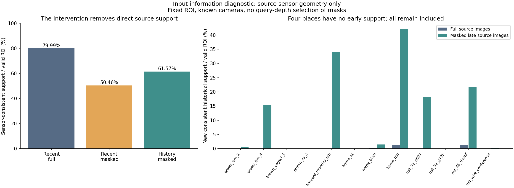
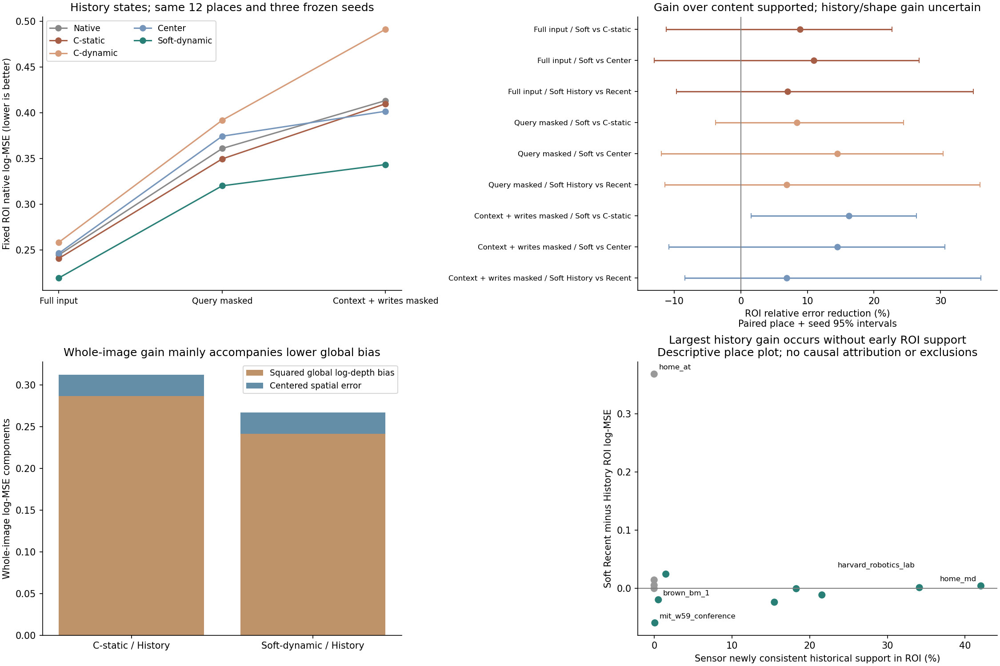
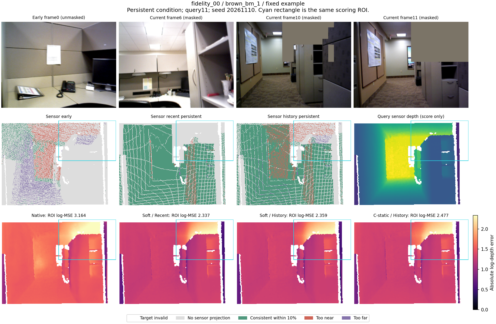
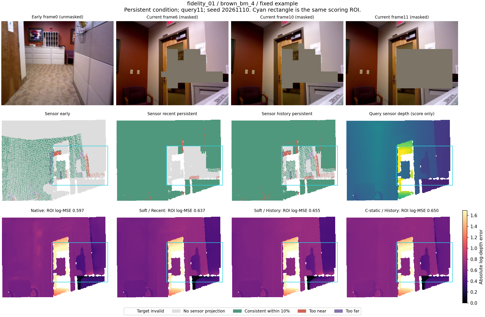
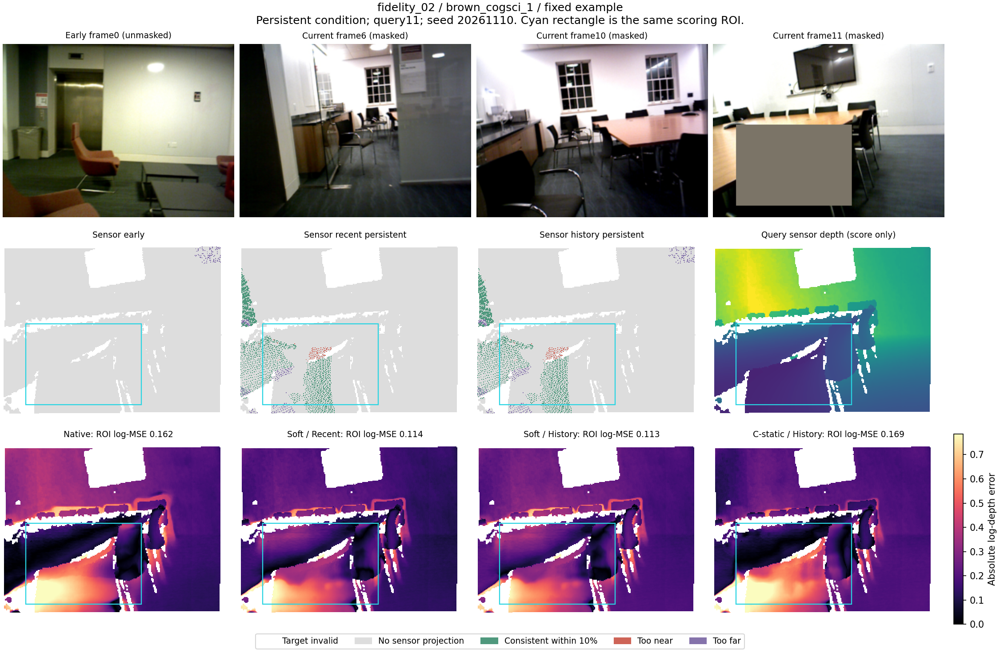
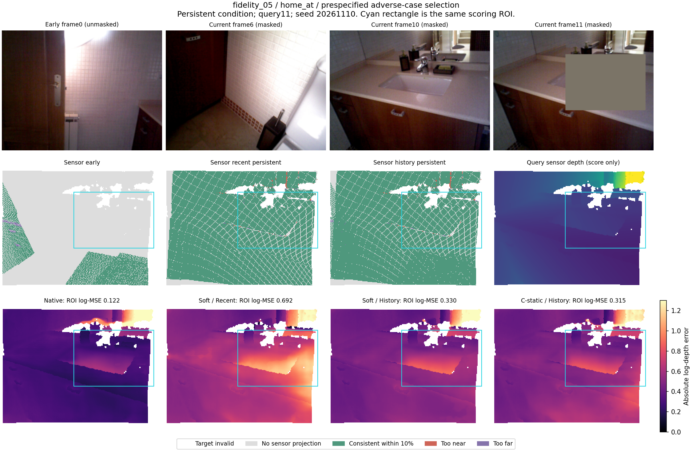

# history_visibility_control1：强内容对照出现收益，历史补缺和形状增量仍待建立

2026-11-11。有限实验完成。**保留 Soft 高斯读取作为开发候选；当前条件下超过强内容的收益值得继续，但尚未建立由窗口外历史补缺、特别是高斯形状带来的可靠增量。**

## 最直接的结论

在一致遮挡条件下，History-Soft-dynamic 的固定区域原生 log-MSE 比 History-C-static 低16.21%，三个种子同向、9/12地点改善，地点×种子配对95%区间为[1.58%,26.41%]；相对匹配训练的 C-dynamic 低30.10%，区间[4.84%,38.34%]。全图相对强 C-static 也低14.57%，区间[1.70%,23.90%]。这是本轮明确的开发信号，不应因为其他比较不确定而抹掉。

但同一 Soft 加入早期历史后，固定区域仅平均改善6.90%，区间[-8.37%,36.06%]；相对 Center 的14.49%均值优势区间为[-10.82%,30.68%]。对 Native/Local 的区域平均优势也未越过零。因而目前没有完成“历史有额外用途→高斯形状比强对照更适合读取这份历史”的完整证据链。

## 固定实验与信息边界

使用全部12个已用 fidelity 片段，每个片段早期0/1/2/3、晚期写入4/6/8/10、查询11、当前四帧6/8/10/11。Recent只由四个晚期来源构建，History再包含四个早期来源；两者均256槽Prefix重建，不声称常量成本在线更新。

三条件为完整输入、仅查询mask0、晚期所有上下文及写入一致遮挡。用早期源传感器点和已知相机确定落入固定query11 mask0矩形的表面，然后遮挡其在晚期输入触及的14×14 patch。早期RGB若被晚期编码重用，也用遮挡副本；早期记忆保持完整。查询深度只在构造完成后评分，没有用于选择掩码。未依照结果换地点、掩码或阈值。

源传感器仅用于人工任务构造和信息诊断；候选状态仍使用VGGT预测几何与原置信筛选，也允许网络在被遮挡patch推断内容。所有条件共用原完整输入标定和相机，属于固定标定的特权构造诊断，不是严格纯RGB部署。仅查询条件的原特征/预测可复用，但按本轮共同尺度重新评分。

主区域始终是同一个mask0矩形，完整输入也在该区域计分；全图、区域外和误差分解同时报告。冻结五组读取器各三种子及三个Local，Native保留；不训练、不下载。全部数据已用，无独立确认。统计单位是12地点与3个配对模型种子；Native没有三个独立训练种子。

## 遮挡是否制造了可补充的信息

| 源传感器诊断（固定区域有效像素为分母） | 比例 |
|---|---:|
| 早期自身一致支持 | 11.154% |
| 近期完整来源一致支持 | 79.985% |
| 近期一致遮挡后的一致支持 | 50.458% |
| 历史一致遮挡后的一致支持 | 61.572% |
| 完整来源下新增且一致的历史支持 | 0.237% |
| 一致遮挡下新增且一致的历史支持 | 11.136% |

近期直接一致支持由79.99%降至50.46%，历史新增且一致支持由0.237%升至11.136%，后者地点区间[3.563%,19.921%]。因此在整体均值上，干预确实制造了可补充的直接表面信息，不能把本轮仍不稳定的输出收益全部归于“历史完全没信息”。

brown_cogsci_1、brown_cs_3、home_at、mit_32_g725四个地点早期没有覆盖固定区域，晚期源掩码均为空，故一致遮挡与仅查询遮挡相同；全部保留。其余地点也并非移除了区域内全部其他线索，当前直接一致支持仍有50.46%。原始传感器信息不能证明候选的预测高斯状态准确保存了这些表面。

## 固定原生比较

以下为误差降低百分比及地点×种子95%配对区间，正值有利于候选。均使用History状态，历史/近期一行例外。该开发诊断没有多重比较校正，也没有未用数据确认。

| 比较 / 固定区域 | 完整输入 | 仅查询遮挡 | 上下文与写入一致遮挡 |
|---|---|---|---|
| Soft对强C-static | +8.87% [-11.22, +22.68] | +8.41% [-3.80, +24.42] | +16.21% [+1.58, +26.41] |
| Soft对C-dynamic | +15.08% [-8.59, +26.48] | +18.29% [+3.44, +33.11] | +30.10% [+4.84, +38.34] |
| Soft对Center | +10.95% [-13.02, +26.80] | +14.48% [-11.95, +30.40] | +14.49% [-10.82, +30.68] |
| Soft对Native | +10.27% [-15.06, +21.51] | +11.29% [-18.54, +21.56] | +16.91% [-11.53, +28.52] |
| Soft对Local | +12.40% [-32.58, +28.89] | +10.99% [-37.16, +22.50] | +24.17% [-45.12, +38.62] |
| Soft History对Recent | +7.02% [-9.66, +34.90] | +6.86% [-11.37, +35.95] | +6.90% [-8.37, +36.06] |

| 一致遮挡 / 全图及区域外比较 | 降低比例和区间 |
|---|---|
| 全图：Soft对C-static | +14.57% [+1.70, +23.90] |
| 区域外：Soft对C-static | +13.75% [-0.92, +23.27] |
| 去均值空间误差：Soft对C-static | +0.16% [-13.17, +11.19] |
| 整体偏差平方：Soft对C-static | +15.86% [+1.93, +25.64] |

全图收益主要伴随整体深度偏差下降；去均值空间误差相对强C只低0.16%，种子混合、区间跨零。这保留“几何偏好帮助稳定粗场景读取”的解释，尚不支持更准确的精细表面恢复。

历史增量从仅查询遮挡的6.86%变为一致遮挡的6.90%，不能仅凭两项均值接近宣称等效；配对的原始log-MSE增益变化为+0.001874，区间[-0.017331,+0.022659]，没有建立干预使历史更有用的证据。Soft在只有Recent状态时也已比C-static平均低12.74%，所以超过内容的收益并不专属于窗口外历史。

最大的Soft历史增益出现在home_at，而该地点没有早期区域内的直接表面支持；这可能来自区域外语义、整体偏差、记忆组成变化等，不能当成局部表面被补回的证明。这里是事后描述，用于限制因果解释，未删地点或追加显著性筛选。

## 实现核对与代价

- 1224份输出全部独立按原始标签评分；最大指标数值差5.99e-07。72份未改变输入的Local预测与父轮最大差0。
- 全12地点的源掩码另用NumPy齐次变换独立构造，掩码差0个patch；36张传感器投影图支持像素差0。48份状态均保留256槽、来源符合时间限制，查询不写入。
- 固定fidelity_00的完整/仅查询骨干重放与原缓存前缀、特征和原生深度完全一致。源文件、检查点与输入缓存身份均核对。
- GPU 2、5各完成6片段，worker耗时42.44/41.27秒，峰值已分配4.671GiB；使用12GiB上限并保护其他任务。计时不是独占性能基准。
- 62个新增冻结骨干窗口，1188次读取器原生输出；12份新Native与24份原Native共同重新评分。零训练、零下载。

## 方法取舍与下一步

保留本轮对强内容读取的正面证据，停止把同一个冻结读取器在更多掩码下的小幅变化当作路线推进。接下来最有辨别价值的是一次固定预算的任务匹配训练：只训练C、Soft高斯、Center三个现有读法，让它们都见过完整/仅查询/一致遮挡及Recent/History状态；相同输入、初值、采样和预算，并保留当前强旧C与冻结模型。模型结构和几何公式保持精炼。

训练限于原训练地点，评价地点仍隔离，但本轮12地点已反复使用，只能作为开发验证。若匹配训练后历史增益随缺失信息增加，且高斯稳定超过强C与Center，再考虑未用数据确认；若只有内容级收益，就收窄为共享记忆读取；若历史仍无可靠增量，结束这项固定Prefix读取接法的推广，不继续逐项堆补。该后续只提出，尚未执行。

具体建议见[history_visibility_train1](../../../docs/gaussian_memory_visibility_training_plan.md)。训练来源可用性已作只读检查，未启动训练。

这轮没有证明一般高斯PE有效，也没有推翻早期解耦架构结论或恢复静态积分核路线。旧实验的所有负结果保留；本轮正面信号对应的是当前内部VGGT读取器、固定相机/标定与人工可见性条件。

## 固定例图与反例

固定fidelity_00/01/02；另按预定Soft对强C最差地点规则选反例。主统计使用三个种子，例图使用第一固定种子。第一行实际RGB与遮挡；第二行为传感器信息诊断及查询标签；第三行为实际网络输出误差，色阶仅在同一例图内共享。浅灰表示无传感器投影，不是网络拒绝输出。

已实际审阅6幅最终PNG；详见visual_review.json。
