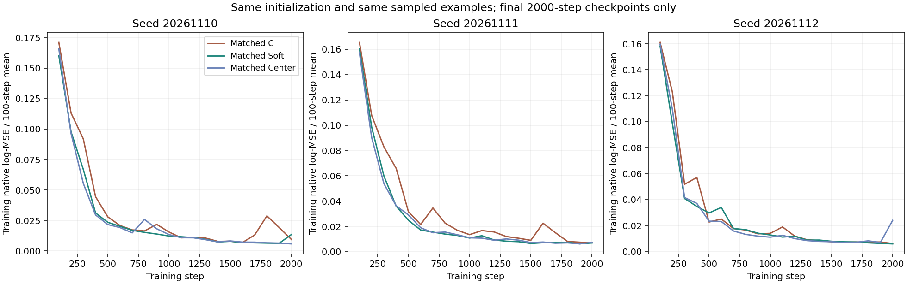
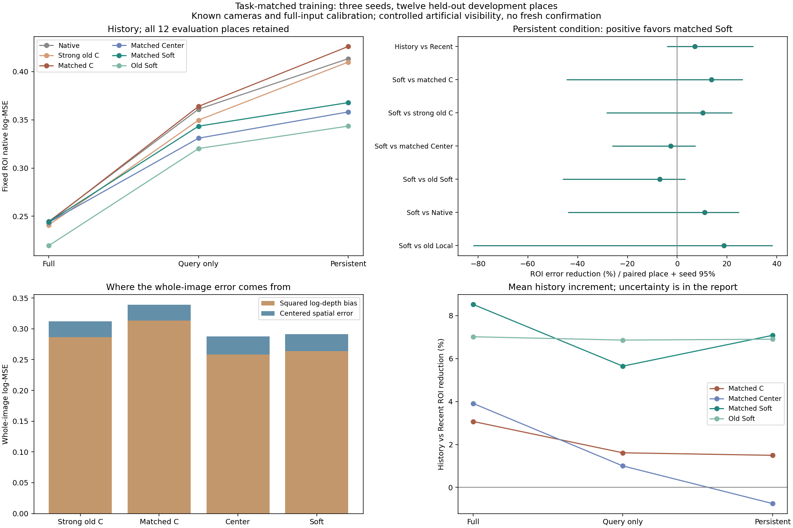
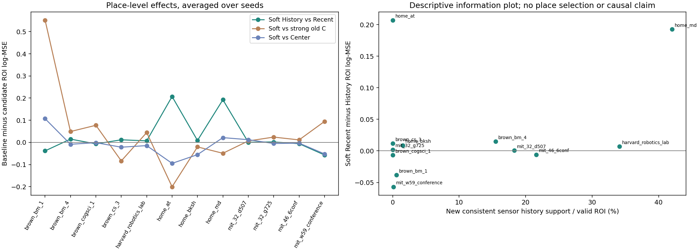
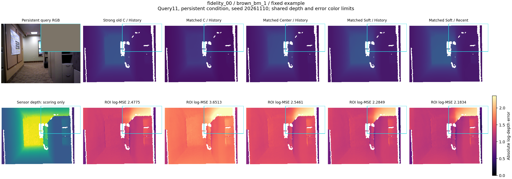
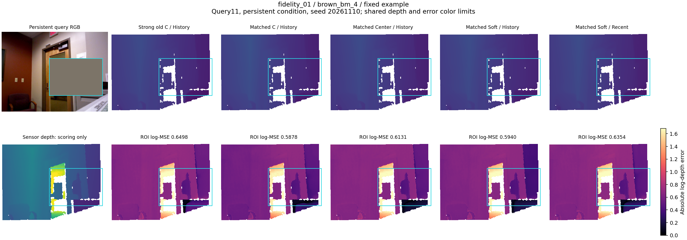
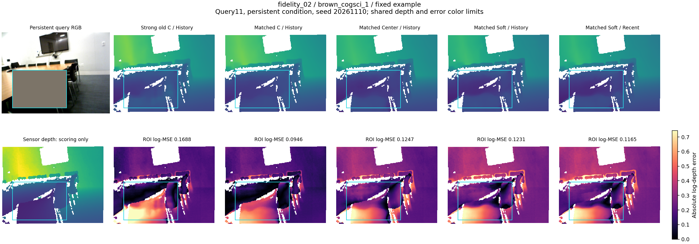
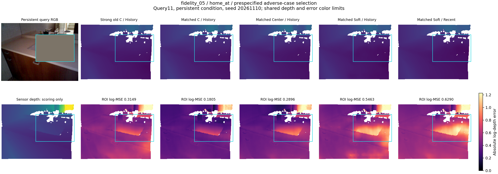

# history_visibility_train1：一次任务匹配训练检验

**结论：一次任务匹配训练没有建立可靠的新收益，不采用这批新模型替代旧 Soft。结束当前冻结状态＋固定 Prefix 接法的训练修补与推广检验。** 九次训练和全部评价正常完成；这是有限预算下的开发负结果，不是高斯参数化普遍无效的证明。

用最直白的话说：让读取器专门练习持续缺失、近期/历史两种记忆范围之后，训练样本学得更好了，但在隔离地点上没有把“历史有用”和“完整高斯形状比中心更有用”变成可靠结论。

持续遮挡下，新Soft的History区域log-MSE为0.367861，Recent为0.395901，平均降低7.08%，三个种子同向、8/12地点改善，但地点×种子95%区间为[−4.12%,30.56%]。新C加入历史仅低1.50%，新Center反而高0.75%，两者也不确定。新Soft从仅查询遮挡到持续遮挡的历史增益增加0.007479，区间[−0.022648,0.040060]；与旧Soft相比，历史增益变化也不确定。**当前预算下，任务匹配并没有解决历史补充用途的缺口。**

新Soft相对新C区域误差平均低13.67%，但仅4/12地点改善；brown_bm_1上的大差异对平均值影响很大。相对强旧C平均低10.26%、三个种子同向、8/12地点改善，但区间[−28.41%,22.07%]跨零。新C本身比强旧C的区域误差高3.95%、全图高8.53%，两项都不确定；因此不能只选择新C作为基准宣布成功。相对匹配Center，新Soft区域误差高2.69%，只有1/3种子、3/12地点改善，完整形状的额外价值仍未确立。

**这次训练也没有让Soft自身变得更可靠。** 相对上一轮保留的Soft-dynamic，新Soft持续条件区域/全图误差高7.09%/9.24%，三个种子均退步，但区间仍跨零。完整输入下全图误差高14.85%，区间支持退步。对强旧C的完整输入去均值空间误差高31.30%，区间也支持退步。这是不能用持续遮挡平均收益掩盖的代价。

持续条件下，新Soft对强旧C全图误差平均低6.68%，区间跨零；去均值空间误差反而高8.86%，也不确定。其平均总误差优势仍伴随整体偏差平方减少，并未建立更精细空间几何恢复。对Native/Local的区域和整体用途同样没有稳定区间支持。

反例home_at同时具有两件事实：新Soft加入历史的区域误差改善较大，但该地点早期来源在固定ROI没有投影支持；新Soft History仍明显弱于强旧C。它提示历史引起的全局内容或尺度变化可以改变输出，**观察到History/Recent差异本身不能证明局部历史几何补缺**。home_md有较多源传感器新增一致支持，也出现较大历史改善；两例应并列保留，不能凭单例认定机制。全部12地点继续参与统计。

证据层级现在明确为：接口、数据因果性、配对训练及评分已核对；旧冻结Soft在受控缺失下优于强内容的开发信号保留；稳定历史增量、高斯协方差必要性、对原生任务的可靠净用途和新场景确认仍未完成。训练与评价地点分离，但这些评价地点早已用于研究设计，不能称新确认。训练拟合正常也不能证明当前预算已经排除所有可能的优化问题。

**方法取舍：** 保留旧Soft、全部强对照与新模型的完整记录；新训练不晋升为工作基线。依照事前分支，停止用训练分布不匹配继续解释这一固定接法的失败，不再围绕本批结果追加种子、换掩码、调公式或按评价挑检查点。此前区域匹配的正面证据不受此结论覆盖。

后续优先收敛研究主张：将已验证的高斯区域PE适用范围，与VGGT共享记忆当前尚未建立的收益分开陈述。如果还要推进共享记忆，下一次设计必须先明确一种当前观测确实缺少、记忆能可靠保存且读取器能利用的信息，并提出能区分表示损失与读取失败的实验；它需要本质新的问题定义，不能只是这条训练修补路线的又一次重复。本轮不自动启动新的研究阶段。

## 问题与固定方法

假设：既有读取器没有见过持续缺失与不同历史范围，任务匹配训练可能恢复历史利用和高斯形状的额外收益。竞争解释：预测或压缩记忆的信息不足，或者普通内容/中心读法已足够。仅改变训练分布，结构、PE公式和骨干不改。

当前接法是在冻结 VGGT 第11个全局块处加入一次记忆交叉注意力，256个槽存放预测的高斯中心、协方差与32维内容。Soft 的空间偏好是 `log(1/256 + w_ij)`，其中 `w_ij` 是由高斯投影和前后遮挡累计得到的逐槽权重；在注意力分数中与内容Q/K相加。C的空间偏好为常数；Center用原训练统计的固定球形方差代替每个槽的协方差。三者共享137,472个可训练读取参数，全部几何和VGGT冻结。这里的位置项绑定同一内容槽，Soft始终保留对每个槽的读取能力。

## 数据、训练与评价

- 原12个训练地点，query5/7/9/11；0–3帧为完整早期历史，查询前的4/6/8/10为近期来源。每个查询独立选定固定mask0区域，用早期来源传感器点投影构造持续遮挡；任何晚期编码中的早期RGB副本也遮挡。查询目标深度不用于选择掩码。
- 三种可见性条件 × Recent/History两范围，共288种训练样本。9次拟合（三方法×三种子），2000步，有效batch2，AdamW 3e-4/weight_decay .01，梯度裁剪5，全图原生log-MSE；同种子完整初始化和每一步样本完全配对。不增加ROI损失或蒸馏，不用评价成绩选模。
- 评价仍为全部12个fidelity地点、query11、三条件和两范围，新增648份预测；原1224份输出及强旧C等对照原样保留。训练与评价地点分离，但评价地点已参与先前研究设计，属于开发验证。
- 训练输入提取172个窗口，四次旧输入重放完全一致；48个训练查询中4个没有早期点落入ROI，近期来源平均遮挡18.60%的patch。评价干预和来源支持数据沿用上一轮。
- 所有条件共享完整输入的原尺度标定和已知相机。指标未做目标深度对齐。地点等权，三种子等权，5000次地点与种子联合配对重采样；区间是开发分析，不能替代新数据确认。

## 主比较：持续遮挡下固定ROI原生log-MSE

正的相对降低表示候选误差更低。History和Recent均为256槽；加入历史同时改变槽内来源与压缩分配。

| 比较（后者为候选） | 基准误差 | 候选误差 | 相对降低及95%区间 | 三种子降低% | 改善地点 |
|---|---:|---:|---|---|---:|
| 新 Soft Recent → History | 0.395901 | 0.367861 | +7.08% [-4.12, +30.56] | +3.48/+8.11/+9.35 | 8/12 |
| History 新 C → 新 Soft | 0.426131 | 0.367861 | +13.67% [-44.57, +26.30] | +14.07/+13.24/+13.69 | 4/12 |
| History 强旧 C → 新 Soft | 0.409940 | 0.367861 | +10.26% [-28.41, +22.07] | +2.92/+9.00/+17.23 | 8/12 |
| History 新 Center → 新 Soft | 0.358209 | 0.367861 | -2.69% [-26.18, +7.41] | -0.47/+2.08/-9.87 | 3/12 |

### 强参照和自身改进

| 比较（后者为候选） | 基准误差 | 候选误差 | 相对降低及95%区间 | 三种子降低% | 改善地点 |
|---|---:|---:|---|---|---:|
| 旧 Soft-dynamic → 新 Soft | 0.343504 | 0.367861 | -7.09% [-46.05, +3.26] | -3.34/-15.69/-3.62 | 6/12 |
| 强旧 C-static → 新 C | 0.409940 | 0.426131 | -3.95% [-24.21, +26.34] | -12.98/-4.89/+4.11 | 8/12 |
| 旧 C-dynamic → 新 C | 0.491443 | 0.426131 | +13.29% [-12.19, +41.21] | +21.21/+7.06/+10.18 | 8/12 |
| Native → 新 Soft History | 0.413428 | 0.367861 | +11.02% [-43.84, +24.78] | +11.70/+14.81/+6.56 | 6/12 |
| 旧 Local → 新 Soft History | 0.452983 | 0.367861 | +18.79% [-82.00, +38.26] | +26.00/+2.64/+23.33 | 4/12 |

## 三可见性条件与历史增量

### 完整输入

| 比较（后者为候选） | 基准误差 | 候选误差 | 相对降低及95%区间 | 三种子降低% | 改善地点 |
|---|---:|---:|---|---|---:|
| 新 C Recent → History | 0.251601 | 0.243871 | +3.07% [-4.42, +17.22] | -0.26/+4.93/+4.15 | 8/12 |
| 新 Center Recent → History | 0.253566 | 0.243642 | +3.91% [-7.13, +23.08] | +7.12/-4.25/+7.68 | 6/12 |
| 新 Soft Recent → History | 0.266894 | 0.244144 | +8.52% [-5.38, +35.23] | +7.68/+7.14/+10.56 | 7/12 |
| 强旧 C History → 新 Soft History | 0.240861 | 0.244144 | -1.36% [-41.80, +16.34] | -6.34/+6.88/-4.77 | 6/12 |
| 新 Center History → 新 Soft History | 0.243642 | 0.244144 | -0.21% [-23.80, +9.83] | -0.04/+4.36/-4.89 | 4/12 |

### 仅查询遮挡

| 比较（后者为候选） | 基准误差 | 候选误差 | 相对降低及95%区间 | 三种子降低% | 改善地点 |
|---|---:|---:|---|---|---:|
| 新 C Recent → History | 0.369940 | 0.363974 | +1.61% [-3.29, +9.15] | +1.12/-0.24/+3.88 | 7/12 |
| 新 Center Recent → History | 0.334307 | 0.330960 | +1.00% [-9.39, +12.71] | +4.64/-6.07/+3.99 | 5/12 |
| 新 Soft Recent → History | 0.363993 | 0.343432 | +5.65% [-8.12, +27.31] | +7.04/+7.05/+2.88 | 5/12 |
| 强旧 C History → 新 Soft History | 0.349665 | 0.343432 | +1.78% [-29.83, +18.31] | -1.27/+3.77/+2.78 | 7/12 |
| 新 Center History → 新 Soft History | 0.330960 | 0.343432 | -3.77% [-24.67, +7.37] | -3.74/+3.51/-11.56 | 4/12 |

### 持续遮挡

| 比较（后者为候选） | 基准误差 | 候选误差 | 相对降低及95%区间 | 三种子降低% | 改善地点 |
|---|---:|---:|---|---|---:|
| 新 C Recent → History | 0.432598 | 0.426131 | +1.50% [-0.97, +8.17] | +0.79/+0.52/+3.01 | 8/12 |
| 新 Center Recent → History | 0.355541 | 0.358209 | -0.75% [-6.37, +14.43] | +2.10/-3.86/-0.70 | 8/12 |
| 新 Soft Recent → History | 0.395901 | 0.367861 | +7.08% [-4.12, +30.56] | +3.48/+8.11/+9.35 | 8/12 |
| 强旧 C History → 新 Soft History | 0.409940 | 0.367861 | +10.26% [-28.41, +22.07] | +2.92/+9.00/+17.23 | 8/12 |
| 新 Center History → 新 Soft History | 0.358209 | 0.367861 | -2.69% [-26.18, +7.41] | -0.47/+2.08/-9.87 | 3/12 |

### 历史增量的交互

| 比较 | 绝对log-MSE增量及95%区间 |
|---|---|
| 新Soft：持续减仅查询的历史增益 | +0.007479 [-0.022648, +0.040060] |
| 新Soft：持续减完整的历史增益 | +0.005290 [-0.020522, +0.035147] |
| 持续条件：新Soft减新C的历史增益 | +0.021572 [-0.023881, +0.074664] |
| 持续条件：新Soft减新Center的历史增益 | +0.030708 [-0.007526, +0.088104] |
| 持续条件：新Soft减旧Soft的历史增益 | +0.002573 [-0.049060, +0.052205] |

## 全图、可见区与误差来源

全图log-MSE等于去均值空间误差加整体log深度偏差平方。它们共同解释误差来源，不能把偏差减少写成更精细的空间几何恢复。

### 全图：持续遮挡

| 比较（后者为候选） | 基准误差 | 候选误差 | 相对降低及95%区间 | 三种子降低% | 改善地点 |
|---|---:|---:|---|---|---:|
| 新 Soft Recent → History | 0.304668 | 0.291358 | +4.37% [-8.45, +26.90] | +3.57/+7.04/+2.71 | 6/12 |
| History 新 C → 新 Soft | 0.338838 | 0.291358 | +14.01% [-50.96, +27.68] | +13.41/+12.02/+16.19 | 3/12 |
| History 强旧 C → 新 Soft | 0.312219 | 0.291358 | +6.68% [-30.48, +18.76] | -0.24/+3.83/+14.40 | 7/12 |
| History 新 Center → 新 Soft | 0.287355 | 0.291358 | -1.39% [-26.85, +10.13] | +1.33/+5.82/-11.63 | 4/12 |

### 可见区：持续遮挡

| 比较（后者为候选） | 基准误差 | 候选误差 | 相对降低及95%区间 | 三种子降低% | 改善地点 |
|---|---:|---:|---|---|---:|
| 新 Soft Recent → History | 0.277688 | 0.269188 | +3.06% [-10.94, +26.07] | +3.64/+6.27/-0.37 | 5/12 |
| History 新 C → 新 Soft | 0.313837 | 0.269188 | +14.23% [-56.89, +28.21] | +13.25/+11.51/+17.23 | 3/12 |
| History 强旧 C → 新 Soft | 0.283760 | 0.269188 | +5.14% [-35.67, +17.78] | -1.57/+1.49/+13.18 | 5/12 |
| History 新 Center → 新 Soft | 0.267031 | 0.269188 | -0.81% [-28.95, +11.65] | +2.00/+7.63/-12.42 | 4/12 |

### 去均值空间误差：持续遮挡

| 比较（后者为候选） | 基准误差 | 候选误差 | 相对降低及95%区间 | 三种子降低% | 改善地点 |
|---|---:|---:|---|---|---:|
| 新 Soft Recent → History | 0.033094 | 0.027860 | +15.82% [-2.80, +42.31] | +9.10/+12.94/+25.35 | 8/12 |
| History 新 C → 新 Soft | 0.025796 | 0.027860 | -8.00% [-32.01, +8.62] | -20.53/-10.38/+6.01 | 4/12 |
| History 强旧 C → 新 Soft | 0.025594 | 0.027860 | -8.86% [-42.10, +8.55] | -12.49/-17.51/+3.54 | 4/12 |
| History 新 Center → 新 Soft | 0.028851 | 0.027860 | +3.43% [-16.62, +29.07] | -6.80/-5.77/+20.83 | 3/12 |

### 整体偏差平方：持续遮挡

| 比较（后者为候选） | 基准误差 | 候选误差 | 相对降低及95%区间 | 三种子降低% | 改善地点 |
|---|---:|---:|---|---|---:|
| 新 Soft Recent → History | 0.271573 | 0.263498 | +2.97% [-10.28, +24.72] | +2.93/+6.24/+0.13 | 5/12 |
| History 新 C → 新 Soft | 0.313042 | 0.263498 | +15.83% [-58.67, +29.13] | +16.00/+14.22/+16.96 | 3/12 |
| History 强旧 C → 新 Soft | 0.286625 | 0.263498 | +8.07% [-33.06, +20.43] | +0.95/+5.99/+15.22 | 7/12 |
| History 新 Center → 新 Soft | 0.258504 | 0.263498 | -1.93% [-33.62, +11.07] | +2.15/+7.10/-15.68 | 6/12 |

### AbsRel：持续遮挡

| 比较（后者为候选） | 基准误差 | 候选误差 | 相对降低及95%区间 | 三种子降低% | 改善地点 |
|---|---:|---:|---|---|---:|
| 新 Soft Recent → History | 0.325478 | 0.317935 | +2.32% [-9.78, +14.30] | +5.48/+2.38/-1.02 | 5/12 |
| History 新 C → 新 Soft | 0.306266 | 0.317935 | -3.81% [-19.98, +4.76] | -12.68/+1.62/-1.26 | 3/12 |
| History 强旧 C → 新 Soft | 0.324810 | 0.317935 | +2.12% [-12.50, +14.55] | +5.11/+1.68/-0.55 | 6/12 |
| History 新 Center → 新 Soft | 0.306765 | 0.317935 | -3.64% [-14.76, +4.89] | -1.70/+0.18/-9.56 | 4/12 |

### 米制RMSE：持续遮挡

| 比较（后者为候选） | 基准误差 | 候选误差 | 相对降低及95%区间 | 三种子降低% | 改善地点 |
|---|---:|---:|---|---|---:|
| 新 Soft Recent → History | 0.998023 | 1.010514 | -1.25% [-12.00, +6.55] | +2.57/+0.31/-6.84 | 7/12 |
| History 新 C → 新 Soft | 0.991167 | 1.010514 | -1.95% [-17.53, +6.67] | -7.89/+4.31/-2.70 | 4/12 |
| History 强旧 C → 新 Soft | 1.040725 | 1.010514 | +2.90% [-11.29, +15.48] | +3.09/+7.44/-1.89 | 7/12 |
| History 新 Center → 新 Soft | 0.982224 | 1.010514 | -2.88% [-13.49, +3.39] | -0.25/+0.37/-8.91 | 4/12 |

## 训练、实现与资源

| 方法 | 种子 | 前20步损失 | 后20步损失 | 耗时秒 | 峰值GiB |
|---|---:|---:|---:|---:|---:|
| content | 20261110 | 0.128742 | 0.006725 | 652.20 | 4.933 |
| content | 20261111 | 0.177215 | 0.007588 | 655.26 | 4.933 |
| content | 20261112 | 0.237786 | 0.005840 | 670.13 | 4.933 |
| soft | 20261110 | 0.128002 | 0.017310 | 668.65 | 4.931 |
| soft | 20261111 | 0.178023 | 0.007631 | 672.47 | 4.931 |
| soft | 20261112 | 0.234465 | 0.005753 | 655.19 | 4.931 |
| soft_center | 20261110 | 0.128156 | 0.006084 | 661.13 | 4.931 |
| soft_center | 20261111 | 0.175775 | 0.008543 | 659.60 | 4.931 |
| soft_center | 20261112 | 0.234638 | 0.016660 | 669.29 | 4.931 |

正式训练共18,000步、36,000次样本呈现，累计1.657 worker小时，峰值4.933 GiB。另有三方法各两步接口/资源预检，未进入正式模型。GPU 2/3/4/5/7每卡一个训练进程，逐次启动前检查占用，12GiB上限；无下载。

全部648份新预测由独立NumPy公式评分，1224行父轮记录与预测身份复用核对；192份训练状态和48组掩码核对，三方法三种子的完整初始化与2000步采样顺序一致。数值评分最大差：`{"log_mse": 2.457129220090337e-07, "centered_log_mse": 1.1627394894131449e-08, "bias_squared": 4.916748048700015e-07, "absrel": 8.332270817756893e-08, "rmse_m": 2.2076191985576088e-07, "hidden_log_mse": 3.7129528340784645e-07, "visible_log_mse": 3.9582559629991465e-07}`。实现正确性只保证比较可解释，不保证方法有效。

## 图像与反例

固定展示前三个fidelity片段及新Soft对强旧C区域误差最大的地点（按三种子均值，字母序处理并列）。示例图只取首种子，不替代完整配对统计。

## 范围与可复现记录

本轮只回答固定Prefix接法在受控可见性分布上，匹配训练能否改善读取。已知相机、完整输入标定、源传感器构造干预、冻结预测几何和旧开发地点都是边界。它不证明严格纯RGB在线系统、真实遮挡、一般位置编码收益、几何写入学习或长期记忆；也不抹去先前区域匹配的正面证据和原生推广的负结果。

- [固定计划](plan.json)与[source snapshot](source_snapshot/)记录代码、数据、模型和父轮身份。
- [输入核对](input_checks.json)、[独立评分与配对核对](independent_checks.json)、[完整指标与区间](analysis.json)。
- [方法取舍](method_decision.json)、[实际图像审阅](visual_review.json)与[完成记录](phase_completion.json)。
