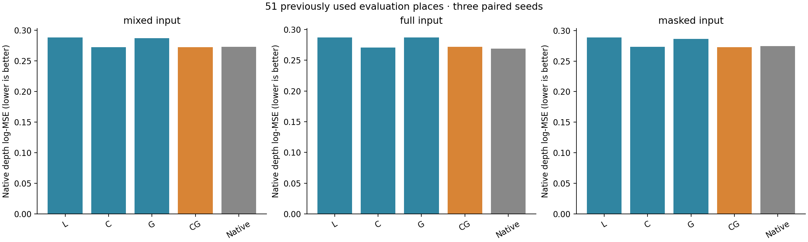
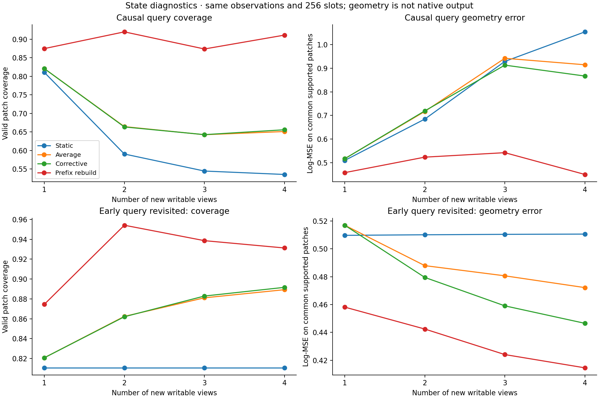
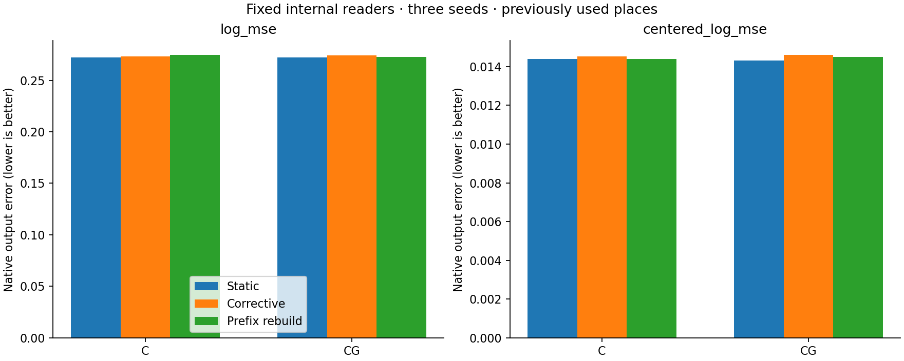
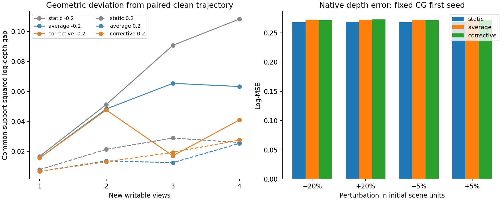
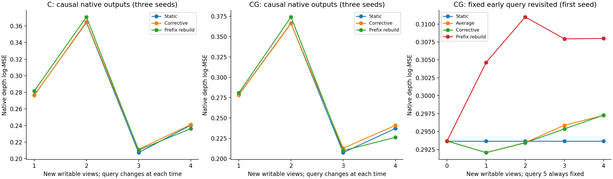
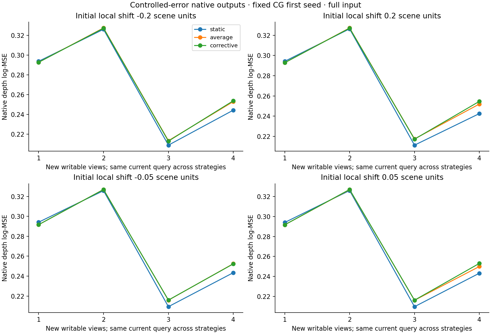
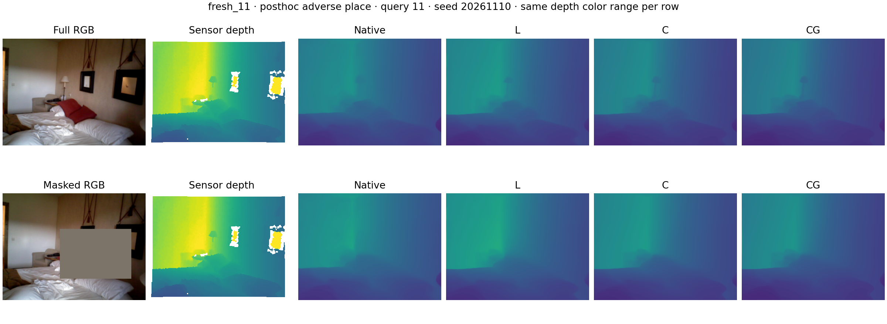

# 增量高斯记忆与 VGGT 内部投影 PE：完整开发验证

实验目录：`incremental_vggt1`。这是已用数据上的匹配开发实验，不是新地点确认。

**本轮跑通了内部读取与增量状态验证，但尚未得到可推广的内部高斯 PE 方案：CG 与仅历史内容几乎持平，覆盖增长也未带来稳定的原生输出收益。下一轮聚焦几何与内容的逐槽绑定。**

固定记忆时，CG 相对 C 的原生深度 log-MSE 降幅为 **-0.06%**，相对 L 为 **+5.48%**。正数表示误差下降。以下同时报告种子、地点不确定性、完整输入和空间细节代价，不以混合均值单独晋升方案。

本轮真正完成的推进是：把高斯几何编码接入冻结 VGGT 的第 12 个 global block，并让它通过后续原生层和 DPT 影响输出；另用同一批因果直接观测检验 256 槽记忆的增量更新。没有学习几何 writer，没有未知相机或长期 SLAM 的结论。

## 1. 科学问题与固定比较

- A：历史内容与投影几何 PE 是否超过相同容量、相同当前短窗口的适配？竞争解释包括普通二维适配、当前局部内容和整体深度偏差校正。
- B：有限历史权重和局部重建是否吸收新区域、撤销初始错误？竞争解释包括更多观测、遗忘困难区域以及读出器掩盖错误。
- L/C/G/CG 每组 3 个种子、每种子 2,000 步，158,976 个参数；初值和每步样例完全配对。主干和原生 depth head 冻结，后续层保留梯度。
- 原生 VGGT 是额外绝对参照；主对照 L 同样获得 3 个最近可写历史帧和当前帧。L/C 使用相同新增 10 维二维位置描述，G/CG 使用 10 维投影几何。所有组保留原生 RoPE。
- 编码为 `p(u)=[Σ_j w_j(u)·(μ_j^cam, vech(Σ_j^cam)), Σ_j w_j(u)]`；权重采用前到后 alpha 合成。原生 Q/K 归一化与 RoPE 之后使用 `q′=q+A p(u), k′=k+B p(u)`，再接一个 width64 的内容 cross-attention 残差。形状协方差描述区域范围，不代表估计不确定性。
- 85 个已用片段均评价；训练仅原 12 个片段。主结果按 51 个非训练地点等权（63 片段），同时分开旧 12/已用 20/已用 19 地点。不能把片段或 patch 当独立地点。
- 初始化 0–3；写入 4/6/8/10；查询 5/7/9/11 永不写回。遮挡先施加到查询 RGB。尺度来自无记忆分支的相机基线，所有组共享，无真值尺度对齐；本轮 85 片段均可校准。

尺度可计算不代表准确：完整查询窗口的相机基线尺度比率 max/min 中位数为 2.29，90% 分位数为 8.42。该离散度也会受短基线影响；本轮没有据此筛样本或改尺度。匹配方法共享尺度，端到端方法仍须承担这部分误差；该诊断仅提示，不能把总误差直接归因到更新器或 PE 某一部件。

**结构边界：** 几何 PE 与内容 cross-attention 是并行通路。内容槽单独置换不会改变读出，本版没有把每个高斯的位置显式绑定到其内容 K/V。因此即使 CG 有效，也不能宣称已经证明逐槽空间寻址。
该边界有代数依据及已学习权重的数值验证：非零内容残差平均绝对幅度为 0.10016，内容置换的最大差为 2.38e-07，内容置零的平均差为 0.07576。这证明分支读取的是无序内容集合，不是本身已经证明任务收益。

## 2. 固定记忆：VGGT 原生输出

| 方法 | 混合 log-MSE | 完整输入 | 遮挡输入 | 混合去均值空间误差 |
|---|---:|---:|---:|---:|
| L | 0.28808 | 0.28683 | 0.28870 | 0.01528 |
| C | 0.27212 | 0.27032 | 0.27302 | 0.01438 |
| G | 0.28661 | 0.28711 | 0.28637 | 0.01486 |
| CG | 0.27229 | 0.27149 | 0.27269 | 0.01431 |
| Native | 0.27270 | 0.26874 | 0.27468 | 0.01600 |

| 比较（前者误差 − 后者误差） | 相对降幅 | 三种子差 | 地点×种子配对 95% 区间 | 改善地点 |
|---|---:|---|---|---:|
| local_minus_combined | +5.48% | 0.01856, 0.01650, 0.01229 | [-0.00241, 0.03889] | 28/51 |
| content_minus_combined | -0.06% | -0.00662, 0.00647, -0.00036 | [-0.00859, 0.00813] | 30/51 |
| geometry_minus_combined | +5.00% | 0.01781, 0.01601, 0.00914 | [-0.00479, 0.03847] | 22/51 |
| native_minus_combined | +0.15% | 0.00175, 0.00209, -0.00261 | [-0.01420, 0.01628] | 27/51 |
| native_minus_local | -5.64% | -0.01682, -0.01442, -0.01490 | [-0.03439, 0.00139] | 19/51 |
| local_minus_content | +5.54% | 0.02519, 0.01004, 0.01265 | [-0.00374, 0.04104] | 24/51 |
| local_minus_geometry | +0.51% | 0.00076, 0.00049, 0.00315 | [-0.00604, 0.00957] | 32/51 |

区间使用 5,000 次地点与种子配对重采样；三个种子和已用地点仍限制了不确定性的解释。完整输入、隐藏区、可见区、AbsRel、米制 RMSE、均值偏差和训练地点结果完整保存于 `static_analysis.json`。

| 地点批次 | CG 相对 C 降幅 | CG 相对 L 降幅 |
|---|---:|---:|
| old12 | -3.49% | +7.80% |
| used_summary20 | +1.22% | +10.64% |
| used_writer19 | +0.47% | -0.92% |
| training12 | -0.62% | +6.45% |

CG 相对 C 未满足“均值改善且至少两个种子改善”的诊断触发条件，因此未追加 CG-center；本轮没有新的高斯形状必要性结论。

## 3. 固定读出：新增观测是否有用

| 固定读取器／状态 | 混合 log-MSE | 完整输入 | 遮挡输入 | 混合空间误差 |
|---|---:|---:|---:|---:|
| content_static | 0.27212 | 0.27032 | 0.27302 | 0.01438 |
| content_corrective_clean | 0.27338 | 0.27184 | 0.27415 | 0.01452 |
| content_rebuild_clean | 0.27473 | 0.27418 | 0.27501 | 0.01439 |
| combined_static | 0.27229 | 0.27149 | 0.27269 | 0.01431 |
| combined_corrective_clean | 0.27438 | 0.27386 | 0.27463 | 0.01461 |
| combined_rebuild_clean | 0.27262 | 0.27226 | 0.27280 | 0.01449 |

| 关键比较 | 相对降幅 | 地点×种子配对区间 |
|---|---:|---|
| content_static_minus_content_corrective_clean | -0.46% | [-0.00430, 0.00093] |
| content_static_minus_content_rebuild_clean | -0.96% | [-0.00768, 0.00227] |
| content_rebuild_clean_minus_content_corrective_clean | +0.49% | [-0.00302, 0.00565] |
| combined_static_minus_combined_corrective_clean | -0.77% | [-0.00792, 0.00156] |
| combined_static_minus_combined_rebuild_clean | -0.12% | [-0.00683, 0.00783] |
| combined_rebuild_clean_minus_combined_corrective_clean | -0.64% | [-0.00965, 0.00482] |

Prefix rebuild 使用相同的初始化与新观测，直接重建 256 槽，不重新联合运行全部图像。它是离线参照，并非严格上界。几何与原生输出分别判断，输出改善本身不证明状态纠错。

## 4. 状态几何、覆盖与受控错误

| 干净状态 | 末次因果查询覆盖 | 末次共同支持几何误差 | 平均局部重建次数／片段 | 容量拒收次数／片段 |
|---|---:|---:|---:|---:|
| static_clean | 53.53% | 1.05380 | 0.00 | 0.00 |
| average_clean | 65.10% | 0.91457 | 0.00 | 159.21 |
| corrective_clean | 65.58% | 0.86688 | 12.02 | 133.87 |
| rebuild_clean | 91.09% | 0.45050 | 0.00 | 0.00 |

四次因果查询的共同支持保留比例为 [0.9858044986339176, 0.9012944043851366, 0.7991215446416069, 0.8153875657156402]，有可评分共同支持的地点数为 [51, 48, 44, 44]/51。几何误差在所有对照共同覆盖处计算，并单列覆盖；原先把无覆盖深度钳为近零的评分原样保留作排错记录，不作为几何准确率。该修正不修改状态、模型或原生输出分数。
各时点查询视角不同，不能把时间曲线的升降直接解释为记忆变好或变坏，应比较同一时点的配对策略；固定早期视角的曲线另列。共同支持掩码随状态而变，因此固定早期视角的几何曲线也须配合覆盖解释；原生早期查询的传感器评分掩码则固定不变。容量拒收记录是候选处理次数，不等于独立新区域数量。

| 初始局部偏移 | Static 原生误差 | Average 原生误差 | Corrective 原生误差 | Corrective 相对 Average 降幅 | 末次几何恢复差：Static / Average / Corrective |
|---|---:|---:|---:|---:|---|
| -0.2 初始单位 | 0.26822 | 0.27161 | 0.27164 | -0.01% | 0.10824 / 0.06322 / 0.04095 |
| 0.2 初始单位 | 0.26863 | 0.27240 | 0.27295 | -0.20% | 0.02585 / 0.02528 / 0.02753 |
| -0.05 初始单位 | 0.26817 | 0.27173 | 0.27170 | +0.01% | 0.00432 / 0.00322 / 0.00578 |
| 0.05 初始单位 | 0.26823 | 0.27116 | 0.27200 | -0.31% | 0.00325 / 0.00368 / 0.00430 |

| 偏移 | 末次共同支持处几何真值误差：Static / Average / Corrective | Corrective 相对 Average 的误差差区间 |
|---|---|---|
| -0.2 | 1.32601 / 1.08666 / 0.91021 | [0.03853, 0.34541] |
| 0.2 | 1.04542 / 0.94171 / 0.87235 | [0.00118, 0.15903] |
| -0.05 | 1.06862 / 0.91807 / 0.86558 | [-0.01610, 0.13604] |
| 0.05 | 1.06075 / 0.92662 / 0.85516 | [0.01152, 0.14656] |

扰动覆盖固定的 52/256 槽，负号朝向首相机、正号远离；不能挑选有利方向。原生扰动探针仅固定第一个 CG 种子与完整输入，属于机制诊断。几何恢复差是与同策略干净轨迹的偏离，降低不等于更接近真值。
重建/合并来源已从各步事件复原并核对，查询帧未进入来源集合。52 个初始受扰槽的 ancestry 标签都会被保留，局部重建也保留原 ancestry；因此不能把标签计数当作“没有删除或遗忘”的证据。固定受扰区域覆盖和早期查询复测承担这项判断。具体事件与来源见 `perturbed_lineage_diagnostics.json`。
主评价 63 片段中，末次写入后 54 个可能回访受扰区域、9 个没有；回访由初始几何、相机和无记忆直接观测判定，不是真值可见性。两组末次原生输出和固定受扰区域指标保存在 `integrated_analysis.json`，局部覆盖保存于 `revisit_diagnostics.json`。

| 早期只读查询的事后回访 | 首次写后误差 | 末次写后误差 |
|---|---:|---:|
| static_clean | 0.29368 | 0.29368 |
| average_clean | 0.29206 | 0.29725 |
| corrective_clean | 0.29206 | 0.29729 |
| rebuild_clean | 0.30464 | 0.30799 |

这是固定查询 5 在较晚记忆上的回访，不能混入当时的因果预测成绩；查询图像始终不写回。

## 5. 资源与实现校验

- 正式训练 12 次、共 24,000 步；各拟合记录的训练循环耗时合计 2.867 小时（包含周期检查点写入，是并行工作时长之和，不是墙钟时长），单进程峰值已分配显存 4.761 GiB，共享 worker 上限 12 GiB。来源见 `training_summary.json`。
- 状态 256 槽：部署字段 53,248 字节，另有 65,536 字节的诊断 lineage；四帧最近观测缓存 232,000 字节。需把辅助缓存计入在线总内存。
- 三个固定片段的 CPU4 四次写入耗时（秒）：transfer_00 corrective=0.160, prefix=0.066; confirm_00 corrective=0.095, prefix=0.064; fresh_00 corrective=0.254, prefix=0.065。短前缀下批量重建更快，不能声称当前增量融合有速度优势。
- 共享 GPU 上，缓存第 11 层之后到 DPT 的读出中位耗时（秒）：transfer_00 native=0.1407, CG=0.1457; confirm_00 native=0.0603, CG=0.0610; fresh_00 native=0.0607, CG=0.0608。此测量不含前半网络、RGB 直接观测分支和缓存 I/O，不是完整在线速度或独占性能基准。
- 本版每个查询窗口的统一尺度还依赖无记忆相机预测。因此部署成本需要计入原始相机分支以及插入适配后的后续网络，不能把缓存后半网络时延当作整套在线系统时延。
- 零适配与原生输出最大差为 0.0，缓存重放最大差为 0.0。已独立用 NumPy float64 重算 30600 份导出原生预测评分，并核对三种子的配对初值和每一步采样。
- Alpha 遮挡顺序、零覆盖、坐标/槽置换、二阶矩合并及只读帧拒写等五项有意义的测试通过。适配器梯度、Q/K logits 与输出变化有固定样例记录。
- 普通修复记录：旧 torch 的 argsort 参数签名；原生集成评价前统一了缓存和动态 PE 的截断顺序。其中截断顺序差异仅影响 340 个查询窗口中的 1 个、9 个标量（最大 0.006681），未重训或选择检查点。

## 6. 可保留的结论与下一步边界

**本轮结论：内部接口可训练，但投影 PE 的独立用途与增量输出收益均未确立。** 零适配和原生回放一致，已学习的 Q/K、attention 和 DPT 输出均发生变化，12 次配对训练全部完成。当前 CG 保留为完成验证的研究原型；因果缓存、内部接口和固定对照继续用于后续实验。此前外部 Content Gaussian 的有限正面证据仍然保留，其结论不自动延伸到本内部接口。

**PE 的主比较几乎持平，不能把它描述为明确失败或明确成功。** 51 个非训练地点的 CG/C log-MSE 为 0.272292/0.272118，仅差约 0.06%，三种子一正两负、配对区间跨零。CG 相对 L 平均降低 5.48%、三种子同向，但地点区间仍跨零；相对原生 VGGT 仅降低 0.15%，方向混合。G 相对 L 仅低 0.51%。完整输入、遮挡及去均值误差也未建立 CG 相对 C 的可靠增量。因此，本轮没有充分依据额外保留这条投影 Q/K 通路，也不据此否定高斯参数化的一般可行性。预定 Center 触发条件未满足，形状必要性仍待其他有效接口检验。

**可学性与跨地点用途分开判断。** 训练地点 CG 的误差约 0.00640，而主评价地点为 0.27229；训练适配很强，却未形成优于原生模型的稳定迁移收益。主评价总误差主要由整体深度偏差构成，但去掉均值偏差也未建立 CG 对 C 的优势。原 12/已用 20/已用 19 地点相对 L 的降幅分别为 7.80%/10.64%/−0.92%，说明整体均值不能代表所有地点。三个固定案例有正有负；事后 hotel_pedraza 反例中，各方法均有明显整体深度偏差，CG 并未消除它。

**状态积累保留了几何信号，当前固定读取器没有将其转化为稳定收益。** 末次查询覆盖由 Static 的 53.53% 增至 Corrective 的 65.58%，Prefix rebuild 达到 91.09%；在 44 个有共同支持的地点，几何误差由 1.05380 降至 0.86688，Prefix 为 0.45050。三种子原生输出却显示，Corrective 相对 Static 的 C/CG 误差平均高 0.46%/0.77%，区间跨零；Prefix 的 CG 也仅近似持平。因而不能仅凭覆盖增长宣称有效增量记忆，也不能将问题单独归因于在线压缩算法。

**纠偏与遗忘目前只有受限、混合的证据。** −20% 初始深度偏移下，Corrective 比普通平均更接近配对干净轨迹；其他方向并未一致成立。相对传感器几何的若干末次指标有改善，但固定首个 CG 种子的原生误差对普通平均没有明确优势。早期只读查询在首次与末次写入间从 0.29206 升至 0.29729，约退步 1.79%；该单种子诊断的地点配对区间支持退步。保留祖先标签并不证明没有遗忘。当前更新器适合作为可解释的状态对照，还不能作为已验证有效的神经记忆纠偏方案。

**下一轮只改变几何进入内容读取的位置。** 当前几何 PE 与内容 attention 平行：单独置换内容槽，输出在数值精度内不变；因此当前结构并未提供逐槽空间寻址。下一项检验把同一高斯的投影支持与其 K/V 绑定，用一个几何条件的 memory cross-attention 替换当前分离的几何注入与内容读出。固定 M0、原生插入层、数据、训练预算和更新器；用容量匹配的局部/历史内容控制及绑定干预判断是否真正利用对应关系。具体配置将写入下一轮事前计划，再训练。它是一个有结构依据的待检验解释，尚未证明是唯一病因。

**保留的竞争解释与范围。** 读取器只在静态 M0 上训练，动态状态可能带来输入分布变化；VGGT 几何、相机尺度校准及 256 槽压缩也可能限制用途。下一轮先隔离固定记忆的空间读取，随后才判断是否需要针对动态状态训练。所有 85 片段均已用，给定相机、四次新观测、冻结骨干与规则更新不构成未知位姿、长期记忆或端到端几何写入的证据。当前短序列中 Prefix 重建更快，缓存读出时延也不等于完整在线成本。

## 7. 原始证据与可视化

配置、缓存身份和尺度：`plan.json`、`training_statistics.json`、外部缓存各 `identity.json`；训练日志和最终检查点在各方法／种子目录。
汇总：`static_analysis.json`、`integrated_analysis.json`、`state_analysis.json`、`independent_checks.json`。每帧预测与评分的 SHA256 保存在 `evaluation/`。历史负结果未覆盖。

固定案例：`figures/example_transfer_00.png`、`example_confirm_00.png`、`example_fresh_00.png`。案例不是整体统计的替代。

另附事后按主地点平均退步选择的反例：hotel_pedraza 的首个片段 fresh_11；它不是独立确认或事先固定案例。

