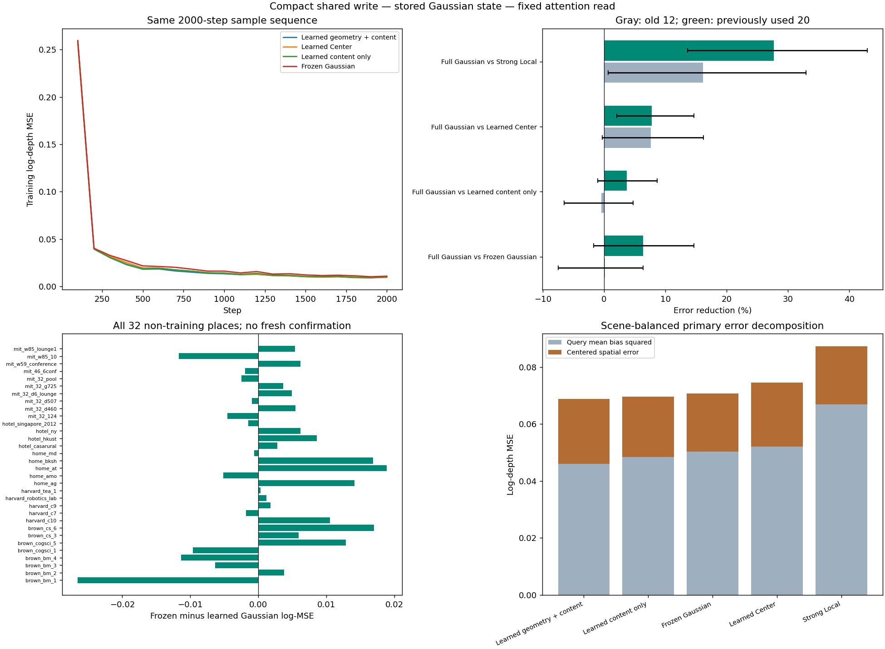

# joint_write1：精炼共享写入保留了用途，几何更新的额外价值仍有限

2026-11-10。**当前读取器可以接回共享可学习写入，保存后的高斯状态仍能被不同查询视角有效读取。** 完整方案在32个非训练地点的主log-depth MSE为0.068756，比强Local低21.22%、比全局摘要低16.72%、比同样学习写入的Center低7.69%；三个种子均改善，配对地点×种子区间为正。

但完整写入相对冻结Gaussian仅平均改善2.76%，相对仅内容写入改善1.25%，两项区间跨零。去均值空间误差反而比冻结记忆高11.66%，且两批地点都出现这一退步。因此本轮支持**有实际用途的粗场景记忆闭环**，不支持“几何更新已改善真实场景形状”，也没有证明完整写入优于冻结或仅内容方案。全部数据曾经使用，本轮是开发验证。

九次2000步GPU训练、24个固定模型、66片段468查询/936遮挡输入、594份保存记忆及全部评价完成。没有新增数据、损失、参数扫描或检查点选择。训练用时合计374.91秒，峰值0.3864GiB；评价81.27秒。

[事前方案](../../../docs/gaussian_memory_joint_write_plan.md) · [配置与身份](plan.json) · [模型固定记录](evaluation_lock.json) · [原始评分](evaluation/scores.json) · [完整配对统计](analysis.json) · [独立核对](checks.json) · [实际图像审阅](review.json)

## 问题、结构与公平比较

上一轮global_summary1已确认冻结Gaussian空间读取相对全局摘要及强Local的用途，但只训练读取器，未完成导师要求的可学习写入。本轮检验：保持该读取接口时，恢复共享写入能否保留用途；竞争解释是只需适配内容，放开几何可能导致路由偏移或细节损失。

四个参考视图经冻结VGGT初始化256个粗高斯槽。写入器只使用原有32维内容、3维中心和3维Cholesky对角对数，不增加2048维参考context；每槽经过一个共享的38→64→64→42 MLP，输出中心、正定协方差、opacity及内容的残差更新。末层零初始化，初始状态与冻结组在浮点容差内一致。多个查询共用同一份记忆，不逐场景优化参数，也不将查询RGB或传感器标签送入writer。

读取器沿用Gaussian Latent：实际2048维VGGT单视图patch token作为query，单层cross-attention通过投影协方差位置bias读取状态，再回归粗log-depth。它是Transformer注意力中的几何位置项，不是新RoPE旋转公式。几何参数是被学习/保存/读取的实际中间状态；本轮没有加入RGB渲染目标。

| 组别 | 写入可学习范围 | 读取器位置项 | 总参数 | 本轮拟合 |
| --- | --- | --- | ---: | ---: |
| Full Gaussian | 内容＋中心/协方差/opacity | 投影协方差 | 154,927 | 3 |
| Content Gaussian | 仅32维内容 | 投影协方差 | 154,927（650参数不参与任务） | 3 |
| Full Center | 内容＋中心/协方差/opacity | 固定尺度中心距离 | 154,927 | 3 |
| Frozen Gaussian / Center | 整份状态冻结 | 对应两种位置项 | 各145,477 | 复用各3 |
| GlobalSummary | 整份状态冻结 | 查询条件全局摘要 | 145,477 | 复用3 |
| Local / 强Local | 无场景记忆 | 当前视图网络 | 147,209 / 435,757 | 复用各3 |

新增writer只有9,450参数；核心256槽状态仍为45KiB。它比旧289,066参数writer更小、输入也不同，因此不是surface1旧写入器的直接复现。冻结VGGT、槽位初始化和分组仍提供了基础几何，本轮学习的是共享残差写入，不能称从RGB自主发现全部几何或端到端训练整个VGGT。

九次训练从同种子的原读取器初值出发，writer三组也逐参数同初值；沿用12训练地点×1片段、72查询/288遮挡、batch2、AdamW lr3e-4、wd.01、clip5、2000步。逐步地点和样本序列与冻结组完全配对。增加的参数和优化自由度属于实验处理；并未单独隔离每个几何参数的因果贡献。Center的key仍含完整形状，其比较隔离的是位置bias结构，不是形状输入有无。

## 数据与主结果

全部66片段保留。主组将旧12地点两片段先在地点内平均，再与上轮已使用的20地点合并，32地点等权；两个队列同时独立列出。它们与12训练地点隔离，但均不是新的确认数据。其他22片段含训练片段留出视角、旧训练地点其他片段和一个剩余开发地点，全数结果保留在analysis.json。参考帧0/4/8/12与查询分开，传感器深度只生成监督/评分标签，已知相机和参考尺度条件不变。

| 方法 | 主组32地点 | 旧12地点 | 已用20地点 |
| --- | ---: | ---: | ---: |
| Full Gaussian | **0.068756** | 0.109507 | **0.044305** |
| Content Gaussian | 0.069629 | **0.108998** | 0.046008 |
| Frozen Gaussian | 0.070709 | 0.109667 | 0.047335 |
| Full Center | 0.074480 | 0.118515 | 0.048059 |
| Frozen Center | 0.075158 | 0.117139 | 0.049970 |
| GlobalSummary | 0.082556 | 0.126553 | 0.056158 |
| Local | 0.088687 | 0.132137 | 0.062617 |
| 强Local | 0.087276 | 0.130624 | 0.061268 |

收益为“控制误差−Full Gaussian误差”，正数有利于完整方案。区间是10000次地点×种子配对bootstrap的绝对log-MSE差，表示当前样本下的不确定性，不是新数据泛化保证。

| 主组比较 | 相对降低 | 绝对收益95%区间 | 改善种子 / 地点 |
| --- | ---: | --- | --- |
| 对强Local | **21.22%** | **[0.008969, 0.028732]** | 3/3；26/32 |
| 对GlobalSummary | **16.72%** | **[0.005958, 0.022415]** | 3/3；23/32 |
| 对Full Center | **7.69%** | **[0.001694, 0.010499]** | 3/3；24/32 |
| 对Frozen Gaussian | 2.76% | [−0.002298, 0.005872] | 3/3；19/32 |
| 对Content Gaussian | 1.25% | [−0.002109, 0.003426] | 3/3；16/32 |

Full Gaussian对冻结组的配对种子收益为0.004620/0.000240/0.001001；对仅内容组为0.002165/0.000408/0.000047，后两种子很小。旧12地点对冻结组只有0.15%平均改善且一个种子退步，对仅内容组反而差0.47%、两个种子退步；已用20地点则分别改善6.40%/3.70%，均三种子同向，但各自区间仍跨零。这些差异不能靠合并后正均值解释为完整写入已经稳定更好。

对强Local，完整方案在旧12/已用20分别降低16.17%/27.69%，两个队列区间均为正。对Full Center分别降低7.60%/7.81%，旧队列区间略跨零、20地点区间为正。仅内容组对强Local在主组也降低20.22%，三种子、27/32地点改善且区间为正，说明几何更新并非当前用途的必要条件。

## 保留的收益与明确代价

主组Full Gaussian的遮挡/可见/完整输入误差，比强Local低24.66%/19.92%/20.79%，对应区间均为正；RMSE和AbsRel平均低12.59%/13.94%。对冻结组则分别仅低1.46%/3.26%/2.55%，区间均跨零。旧队列的完整输入、遮挡、RMSE相对冻结组还有平均退步。

| 主组log-MSE分解 | Full Gaussian | Frozen Gaussian | Content Gaussian | 强Local |
| --- | ---: | ---: | ---: | ---: |
| 每查询均值偏差平方 | 0.045928 | 0.050266 | 0.048322 | 0.066943 |
| 去均值空间误差 | **0.022827** | 0.020443 | 0.021307 | 0.020333 |
| 完整输入去均值空间误差 | **0.019840** | 0.017565 | 0.018660 | 0.015530 |

完整写入对冻结组把均值偏差平方平均降低8.63%，却将空间误差增加11.66%（绝对退步区间[0.001389,0.003449]）；完整输入空间误差增加12.95%，区间同样为明确退步。旧12/已用20的空间退步分别为12.61%/10.76%，两批区间均不含零。相对强Local的主空间误差也增加12.27%，完整输入增加27.75%。**这是收益结构上的真实代价，不是微小数值瑕疵。** 总误差仍更低，是整体深度偏差减少超过了空间细节损失。

三个原训练片段的留出视角，Full/Frozen为0.011019/0.012881；九个新增训练地点为0.011121/0.012527。原训练地点其他片段也平均改善，但唯一剩余开发地点为0.039955对0.036582，反而退步。没有为了保留正结果删去这些片段。

## 写入是否被实际使用

594份状态均由共享writer产生，保存后重载；读取阶段只用该状态、查询token和相机，不再调用writer或参考图像。Full Gaussian在主组的中心平均移动0.10081规范化单位（换算约0.2444m），协方差相对Frobenius变化均值1.0558，内容残差RMS为0.3274；更新并非恒等，全部保存协方差正定。这些幅度说明模型在改变几何，不能直接说明几何更准确。

| 对Full Gaussian的固定干预 | 主组误差变化 |
| --- | ---: |
| 移除记忆 | +74.02% |
| 内容槽打乱，几何保持 | +35.68% |
| 使用错误的记忆投影相机 | +42.03% |
| 整份状态恢复初始值 | +25.98% |
| 仅几何及opacity恢复初始值，保留学习内容 | **−0.96%** |

前四项主组区间为正，说明读取使用了学习状态及正确的空间绑定。仅恢复几何的区间跨零，旧12地点反而改善2.40%，已用20地点损害1.17%，各自区间均跨零。结合仅内容重训控制，当前不能证明学习几何额外必要；也不能把“恢复整份初始状态变差”全部归因于几何。

这些干预固定读取器，改变状态分布，属于依赖诊断；不能单独当作物理几何的因果贡献。当前共同坐标系、固定槽位和已知相机条件也仍然成立。未验证长期增量保持、未知相机、原生3DGS基元或更大Transformer中的通用性。

## 独立核对与实际案例

全部九次拟合有限、采样及初值配对；15个旧模型身份不变，8910个旧指标回放最大差为0。594份保存状态逐值重载一致。三片段×三新增组的独立CPU读取最大差5.96e−7，独立NumPy评分最大差2.98e−9；均在事前容差内。完整/内容组几何梯度按预期存在/为零。

评价开始前，把内容组恢复初始几何的逐位相等断言改为计划已规定的2e−5容差，原因是CPU预计算协方差与CUDA重建有正常舍入差；实际最大读取差1.49e−6。九次训练、模型和预测算法均未修改，[旧代码/配置及修正记录](pre_evaluation_revision1/record.json)保留。这不作为新科学轮次或失败结果。

预定七个案例和总览八图已实际查看。fit_00首查询明显改善；transfer_00首查询也改善，但brown_bm_1地点汇总相对冻结组退步，说明单张好例子不能代表地点。fidelity_07（卧室）完整写入误差0.1619，高于冻结0.1198、强Local0.0750；confirm_10也有大范围深度高估，强Local更好。confirm_00/05/15均有冻结或内容组更好的局部表现。预测未塌成常数，但不据视觉声称精细表面改善。

## 决策与下一步

本轮落在事前的“可学闭环保留用途，但写入增量未确立”分支。固定这套**小型共享writer＋256高斯状态＋单层几何attention**为开发候选，保留冻结Gaussian和Content Gaussian作为必要控制，不把完整写入宣布为唯一优胜方案。不为不足3%的平均差异扫描超参，不为辅助指标追加模块，也不把空间细节代价省略掉。

下一步优先固定现有检查点做新于本次设计的地点确认，继续比较Full/Content/Frozen Gaussian、Full Center与强Local/GlobalSummary；同一预定名单同时报告整体误差、去均值空间误差和全部地点方向。要决定的是：**可学习共享记忆的总体用途能否迁移，以及它是否持续以空间细节为代价**，而非再从已用地点挑选一个漂亮均值。若只有冻结/内容组稳定保留用途，就收窄为固定几何的可学习内容记忆；若完整组用途稳定但仍牺牲细节，贡献限定为粗场景条件记忆，不宣称几何重建改善。新地点清单与下载尚未启动，本轮所有已授权验证已完成。
