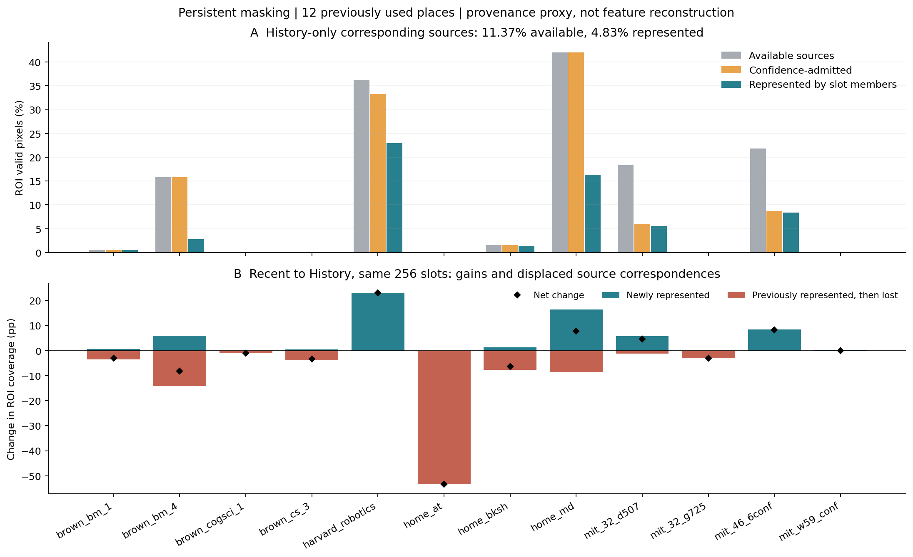
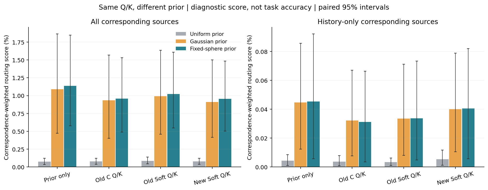
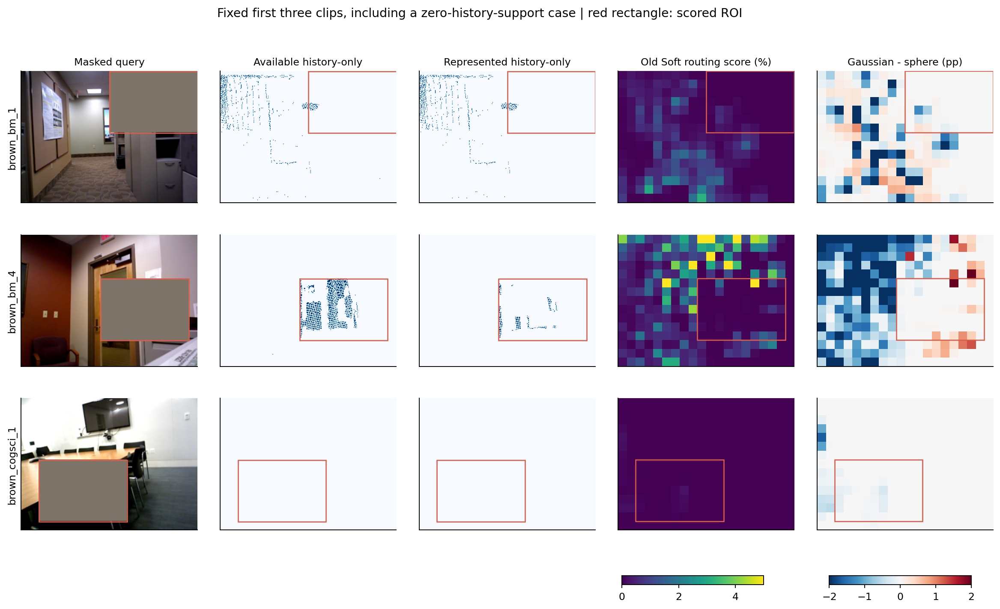

# memory_addressability1：空间地址有作用，形状增量与历史净用途仍待证明

2026-11-11。已完成固定 12 地点、48 份状态、21 个冻结读取器的零训练诊断，取得 1,512 组 Q/K、19,008 行诊断评分。结论是：**部分历史来源在写入时丢失；保留下来的对应来源确实能被空间位置项更有选择地读取；完整协方差没有超过固定球形的可靠寻址优势。这些事实仍不足以解释或建立原生输出收益。**

没有产生新方法或新任务成绩，不替换旧 Soft 工作参照，不重开 Prefix 训练修补。全部使用已有数据，属于开发机制诊断。主分析为 persistent / History / 固定缺失 ROI；完整图像、其他条件、全部对照和逐地点值见 [analysis.json](analysis.json)。

## 如何追踪“信息”

使用原 FPS/8 邻居合并函数重建每个槽的 patch 成员和混合权重，48 状态的中心、协方差、内容均与原缓存完全相同。用来源传感器深度与已知相机建立来源像素到查询像素的对应，深度相对差固定不超过 10%，不填洞；persistent 条件排除直接遮挡的晚期来源像素。查询深度仅用于诊断标签，没有进入模型。

先统计查询像素是否在任何来源、接纳的来源和实际槽成员中有对应。再以每个来源 patch 对查询 patch 的有效像素支持比例 M，按槽内原混合权重构造 U。注意力分数为 `sum_s(A[p,s] U[p,s])`，按有效查询像素加权。**它是对应来源的加权读取分数，不是匹配准确率、输出误差或信息容量。** 无支持地点/patch 在无条件分数中保留为零。

DINO 特征混合周围上下文，成员保留不证明信息可解码，未成为局部成员也不证明信息彻底消失。标签使用实际表面对应，而任务还可能利用全局场景线索。这里追踪查询 11 的直接读取，其他三个上下文视图的记忆残差还可间接影响输出。

## 1. 来源有损失，加入历史还会挤掉近期来源

以下是 12 地点等权平均，占固定缺失区有效像素的百分比：

| 对应来源 | 原始可用 | 通过原置信度接纳 | 至少在一个槽的成员中保留 |
| --- | ---: | ---: | ---: |
| History 全部来源 | 62.39% | 60.03% | 46.22% |
| 其中：仅早期来源具有对应 | 11.37% | 9.00% | 4.83% |
| Recent 来源 | 51.03% | 51.02% | 49.13% |

早期独有覆盖由 11.37% 降为 4.83%，并非历史完全不可用。四地点没有早期独有 ROI 支持，全部保留。非零的八地点平均保留率是 57.46%；把像素合并计算为 42.98%。分母不同，不能互换，也不能忽略覆盖本身较小。

固定 256 槽下，Recent 到 History 的成员对应发生了替换：

| persistent 范围 | 新增覆盖 | 丢失原覆盖 | 净变化及地点 95% 区间 |
| --- | ---: | ---: | ---: |
| 缺失 ROI | +5.15 pp | −8.06 pp | −2.91 pp [−14.12, +5.58] |
| 全图 | +3.18 pp | −9.64 pp | −6.46 pp [−13.92, −1.13] |

全图 12 地点都有部分近期来源被挤掉，净覆盖仅三地点增加。完整输入下，History 全图净覆盖也降低 7.26 pp，区间 [−14.64, −2.13]。这支持“原始观察更多不等于固定容量内的来源更完整”，没有证明 256 是不可用容量，更没有唯一归因于协方差公式。来源像素的集合差已与槽成员精确对应，区别于上一轮将筛选、区域化、合并混在一起的覆盖诊断。

## 2. 空间项确实改善寻址，完整形状没有稳定增量

在 **同一个冻结模型的同一组 Q/K** 上，只替换计算注意力的先验，其他因素不变。下表是对应来源读取分数 ×100；后两列是诊断先验，不用于重新解码或选择模型。

| Q/K 来源，persistent History ROI | 均匀先验 | 完整高斯先验 | 固定球形先验 |
| --- | ---: | ---: | ---: |
| 旧 Soft，全部对应来源 | 0.08560 | 0.99047 | 1.02233 |
| 新 Soft，全部对应来源 | 0.07662 | 0.91192 | 0.95410 |
| 旧 Soft，仅早期独有来源 | 0.003269 | 0.033505 | 0.033677 |
| 新 Soft，仅早期独有来源 | 0.005416 | 0.040098 | 0.040560 |

旧 Soft 的高斯相对均匀先验，全部来源分数增加 **0.9049 pp**，配对地点×种子 95% 区间 **[0.3945, 1.5135]**，三个种子、11/12 地点同向；是原分数约 11.57 倍，绝对分数仍低。仅历史独有来源增加 **0.03024 pp [0.00668, 0.06631]**，三个种子和八个有支持地点均同向。新 Soft 的这两项也为正。实际旧 Soft 对实际 C-static 的读取分数也提高，但不同模型之间不能单独归因于先验；同 Q/K 对照才隔离了本轮的空间项作用。

旧 Soft 高斯相对固定球形的全部来源差为 **−0.03186 pp [−0.14828, +0.08173]**；新 Soft 为 **−0.04217 pp [−0.15024, +0.06457]**。历史独有部分、完整输入及仅查询遮挡也没有建立可靠形状增量。固定球形仍有空间中心与投影支撑，不能称为完全没有几何的控制；没有差异证据也不是等效证明。

注意力质量仍有明显余量：有对应槽的查询 patch 上，旧 Soft 平均给任一命中槽的质量为 15.21%，强 C-static 为 1.87%；历史独有部分为 5.94% / 0.71%，后者只在八个有支持地点取条件平均。按混合权重计算，旧 Soft 的全部来源分数仅相当于“每 patch 选标签最好槽”参照的 14.89%，历史独有部分为 4.02%。这个使用查询标签的参照不能部署，不能当作可达到的任务上界。

数学上，当前先验 `softmax(log(1/256+w))=(1/256+w)/(1+sum(w))` 保留全局读取，几何权重的总覆盖不超过 1，先验自身的均匀部分至少占一半；真实注意力还要乘内容因子。它解释了设计的保守性，本轮不据低绝对分数扫描温度或放大位置项。学习 Q/K 局部削弱了几何选择性，但没有将其抹去，不能认定“位置项完全被忽略”。

## 3. 不能把来源覆盖或注意力当作最终效果

上一轮已经表明：新任务匹配 Soft 对强旧 C 的缺失区均值有改善，主区间跨零；对新 Center 没有优势；新增历史的整体收益也不稳定。旧 Soft 在受控缺失条件下对强 C 的有限正结果保留，但对 Center 和新增历史的稳定收益仍未建立。本轮没有新增任务推理，除一个旧输出回放哨兵外，最终输出证据都引用原实验，不重复计为新证据。

一个具体反例阻止我们把覆盖损失直接认作病因：`home_at` 没有早期独有 ROI 表面对应，并且是本轮 ROI 近期来源丢失最多的地点；旧 Soft 的 ROI log-MSE 却从 Recent 的 0.58580 降到 History 的 0.21720，新 Soft 也从 0.60190 降到 0.39478。这个按最大来源损失描述的反例不参与选模，说明非局部上下文、场景偏差调整等作用仍未被排除。

固定前三个片段的图也保留了无早期支持的 `brown_cogsci_1`，没有只展示成功案例。

## 当前取舍与下一步

当前能支持的主张是 **高斯槽可组织共享场景状态，空间位置能帮助读取与当前区域对应的来源**。在当前 VGGT 内部接口上，尚不能主张真实形状协方差优于强中心位置项，也不能主张长期记忆改善原生输出。旧区域关系 PE 的正面证据、独立粗读出任务的有限正面证据与本分支的负结果必须分别保留。

因此不新增形状模块、不扫温度、不采用上一轮的新训练，也不因有覆盖损失就直接改 writer。下一项若继续实验，最有辨别力的是一个**固定模型的正确地址干预**：保持现有槽内容、输出映射及状态不变，用诊断对应关系引导读取，并设置等程度的无对应路由控制，检查现有保留内容能否改善原生输出。它只测试通路可能性；真值辅助成功不是可部署方法，失败也可能来自不匹配的干预，不能唯一证明内容无信息。具体干预规则须在运行前固定，本轮没有执行或排队这项实验。

更完整的主张边界见 [研究结论](../../../docs/gaussian_memory_evidence_scope.md)。本轮结束时，固定 Prefix 方案的训练修补仍关闭。

## 实现与证据身份

- 48 状态重建的中心/协方差/内容最大差均为 0；独立 NumPy 对应像素对和覆盖计数差为 0。
- 19,008 行路由评分独立复算，分数最大差 7.98e−9，命中质量最大差 9.19e−8。126 个实际 SDPA 对照的最大相对 RMS 差约 0.173%，属于 BF16 数值实现差；原生哨兵的插入前 token 与最终深度均完全重现。
- 首次检查因 SDPA 偏置 dtype 上下文不一致报错，已记录并修复；旧部分结果留在 `attempt1/`，最终全部重新计算，未改变科学比较。见 [失败与修复记录](preflight_failure1.json)。
- GPU 2/5 的最终 worker 循环为 8.78/8.12 秒，峰值 4.60/4.44 GiB；时间不含模型加载、实现和 CPU 复算。独立 CPU 检查约 139 秒。零训练、零下载、无新确认。
- [事前计划](../../../docs/gaussian_memory_addressability_plan.md) · [固定身份](plan.json) · [独立检查](independent_checks.json) · [来源集合差](retention_comparison.json) · [三图审阅](visual_review.json) · [完成记录](phase_completion.json)。旧输出参照：[受控读取](../history_visibility_control1/report.md)、[匹配训练](../history_visibility_train1/report.md)。
