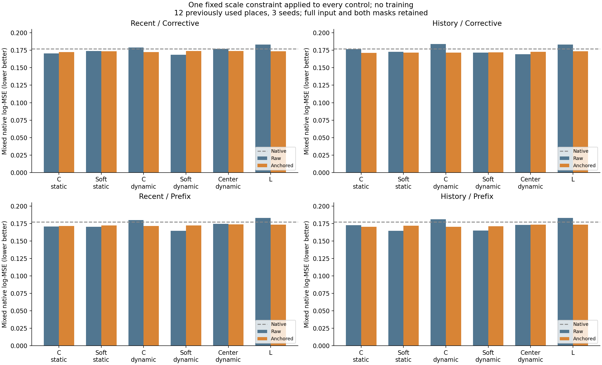
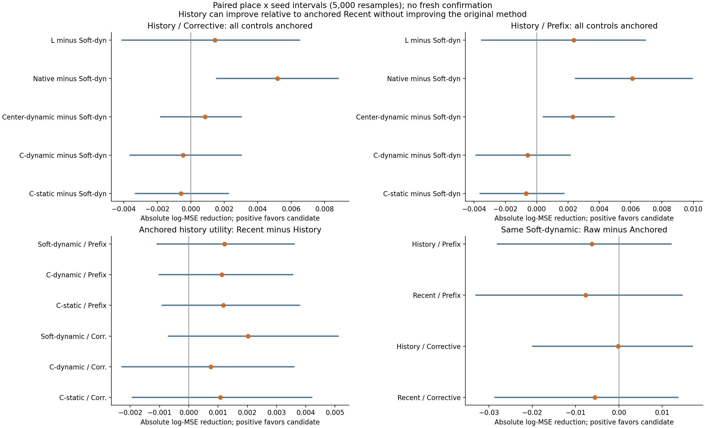
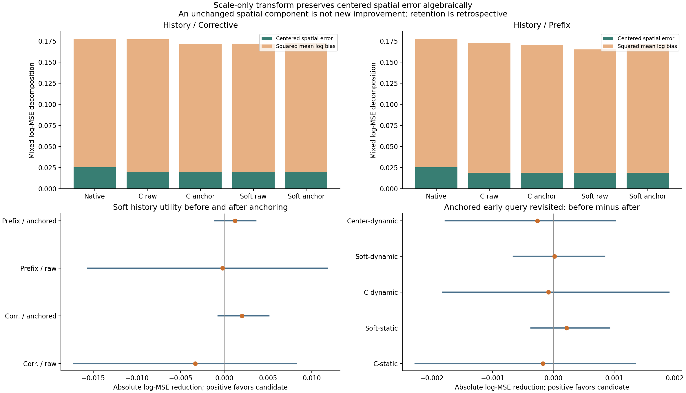
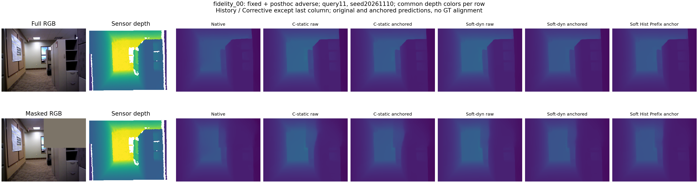
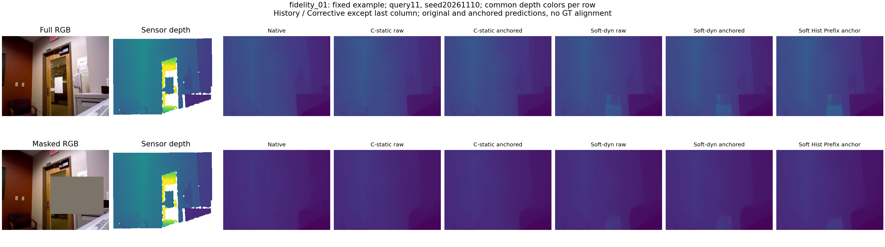
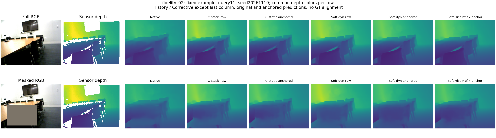

# native_anchor_probe1：当前尺度约束没有形成方法改进

2026-11-11。固定旧模型、旧数据上的开发诊断，全部预定比较已完成；没有新增训练、下载或骨干推理。

**决定：不采用这一固定尺度约束作为主方案，也不继续搜索它的权重或公式。** Soft-dynamic在History-Corrective下主误差高0.11%，基本持平；History-Prefix下高3.81%，三个种子都退步，但两项地点区间均跨零。约束后历史相对近期略有改善，却不能超过同样约束的强内容对照。保留空间历史信号与有限形状信号，不升级为一般PE效果。

## 问题、固定比较与来源

前一轮发现历史的空间改善被平均深度偏差抵消。本轮检验：让当前观测负责尺度、记忆只提供相对结构，能否把这一信号转为整体用途。竞争解释是记忆原本也在修正有用的整体偏差，Native尺度不够可靠；或内容读取能解释收益，或历史缺乏相关信息。

`r=log(D_M)-log(D_0); delta=mean_U(r); D_anchor=D_0*exp(r-delta)`。U仅由固定RGB人工遮挡确定：完整输入用全部像素，遮挡输入用所有未遮挡像素。无标签、无传感器有效掩码、无可学习参数、无系数搜索、无输出裁剪；原米制标定不变。实际这是整幅深度乘一个常数。

固定history_read1的12对旧窗口、15个记忆读取模型、三种子、四种状态及全部查询/条件；额外保留三个L模型。8640份主预测、432份L、360份回访前后与288份干预，共9720份变换，另原样复用144行Native。所有父预测和评分保留，详见plan.json的来源/索引/哈希。

C-static是此前训练的强内容读取器；C-dynamic是状态匹配训练的内容对照；Soft-static/Soft-dynamic分别为相应高斯读取；Center-dynamic限制几何形状；L只有当前观测。static/dynamic指模型训练条件，此处所有记忆读取模型均接收各个规定状态。

主指标仍为地点等权的完整输入与两遮挡混合log-MSE。正的“前者减后者”表示后者更好；5000次配对地点×种子重采样。以下区间是单项诊断区间，没有把众多辅助比较当作独立确认。

## 所有模型的主误差：原输出 → 统一尺度约束

| 模型 | Recent Corrective | History Corrective | Recent Prefix | History Prefix |
|---|---:|---:|---:|---:|
| C-static | 0.170424 → 0.172484 | 0.176785 → 0.171403 | 0.170715 → 0.171577 | 0.172606 → 0.170394 |
| Soft-static | 0.174049 → 0.173637 | 0.172771 → 0.171703 | 0.170405 → 0.172175 | 0.164383 → 0.171750 |
| C-dynamic | 0.178845 → 0.172280 | 0.183984 → 0.171525 | 0.180123 → 0.171621 | 0.180924 → 0.170491 |
| Soft-dynamic | 0.168471 → 0.174012 | 0.171808 → 0.171989 | 0.164595 → 0.172291 | 0.164797 → 0.171068 |
| Center-dynamic | 0.177146 → 0.174004 | 0.169448 → 0.172856 | 0.174696 → 0.173903 | 0.173017 → 0.173375 |
| Native | 0.177173 → 0.177173 | 0.177173 → 0.177173 | 0.177173 → 0.177173 | 0.177173 → 0.177173 |
| L | 0.183053 → 0.173436 | 0.183053 → 0.173436 | 0.183053 → 0.173436 | 0.183053 → 0.173436 |

同一Soft四种状态的前后配对：

| 比较：前者误差减后者 | 相对降低 | 绝对差的95%区间 | 三种子绝对差 | 改善地点 |
|---|---:|---|---|---:|
| Recent / Corrective 原输出 − 约束输出 | -3.29% | [-0.028621, 0.013631] | -0.000872 / -0.013790 / -0.001963 | 6/12 |
| History / Corrective 原输出 − 约束输出 | -0.11% | [-0.019958, 0.016918] | -0.002211 / -0.004573 / 0.006242 | 5/12 |
| Recent / Prefix 原输出 − 约束输出 | -4.68% | [-0.032966, 0.014561] | 0.001843 / -0.016902 / -0.008029 | 6/12 |
| History / Prefix 原输出 − 约束输出 | -3.81% | [-0.028029, 0.012041] | -0.005421 / -0.009900 / -0.003493 | 6/12 |

同样的约束对C-dynamic和L的主均值改善更明显，但各自整体区间仍跨零。不能以“只校正Soft、对比未校正C”的方式宣称PE收益；也不能仅凭平均数声称约束普遍有害。

## 同样处理后的强对照：独立PE收益尚未建立

### History / Corrective

| 比较：前者误差减后者 | 相对降低 | 绝对差的95%区间 | 三种子绝对差 | 改善地点 |
|---|---:|---|---|---:|
| C-static − Soft-dynamic | -0.34% | [-0.003311, 0.002251] | 0.000298 / -0.002662 / 0.000608 | 6/12 |
| C-dynamic − Soft-dynamic | -0.27% | [-0.003631, 0.003009] | 0.001182 / -0.002294 / -0.000277 | 5/12 |
| Center-dynamic − Soft-dynamic | +0.50% | [-0.001796, 0.003020] | 0.000413 / 0.001925 / 0.000263 | 7/12 |
| Native − Soft-dynamic | +2.93% | [0.001552, 0.008814] | 0.005483 / 0.004431 / 0.005641 | 8/12 |
| L − Soft-dynamic | +0.83% | [-0.004105, 0.006510] | 0.000186 / -0.000933 / 0.005089 | 8/12 |

### History / Prefix

| 比较：前者误差减后者 | 相对降低 | 绝对差的95%区间 | 三种子绝对差 | 改善地点 |
|---|---:|---|---|---:|
| C-static − Soft-dynamic | -0.40% | [-0.003617, 0.001740] | -0.000475 / -0.002175 / 0.000628 | 4/12 |
| C-dynamic − Soft-dynamic | -0.34% | [-0.003868, 0.002128] | -0.000241 / -0.001711 / 0.000221 | 5/12 |
| Center-dynamic − Soft-dynamic | +1.33% | [0.000416, 0.004949] | 0.001226 / 0.002850 / 0.002845 | 10/12 |
| Native − Soft-dynamic | +3.45% | [0.002469, 0.009933] | 0.006466 / 0.005244 / 0.006607 | 9/12 |
| L − Soft-dynamic | +1.37% | [-0.003512, 0.006921] | 0.001169 / -0.000120 / 0.006054 | 8/12 |

Soft比强C-static在两个历史条件分别高0.34%/0.40%，区间跨零；没有独立于强内容读取的净收益。History-Prefix下比Center低1.33%，三种子同向、10/12地点改善、区间为正，支持这个固定接口中的有限形状增量。它不能替代对强C的比较。

约束后的Soft比Native低2.93%/3.45%，两个混合区间为正，说明当前读取保留有限任务用途；相对L仍不确定。这个结果不等于约束本身改善了Soft：原Soft没有从约束中获益。

## 窗口外历史：方向更一致，整体证据仍不足

### Corrective

| 比较：前者误差减后者 | 相对降低 | 绝对差的95%区间 | 三种子绝对差 | 改善地点 |
|---|---:|---|---|---:|
| C-static Recent − History（均约束） | +0.63% | [-0.001926, 0.004201] | 0.000504 / 0.001474 / 0.001266 | 8/12 |
| Soft-static Recent − History（均约束） | +1.11% | [-0.000628, 0.005124] | 0.000370 / 0.002169 / 0.003264 | 8/12 |
| C-dynamic Recent − History（均约束） | +0.44% | [-0.002276, 0.003589] | 0.000085 / 0.001465 / 0.000714 | 7/12 |
| Soft-dynamic Recent − History（均约束） | +1.16% | [-0.000694, 0.005106] | 0.000752 / 0.003107 / 0.002213 | 8/12 |
| Center-dynamic Recent − History（均约束） | +0.66% | [-0.001211, 0.004373] | 0.000473 / 0.000512 / 0.002459 | 7/12 |

### Prefix

| 比较：前者误差减后者 | 相对降低 | 绝对差的95%区间 | 三种子绝对差 | 改善地点 |
|---|---:|---|---|---:|
| C-static Recent − History（均约束） | +0.69% | [-0.000909, 0.003788] | 0.000750 / 0.000912 / 0.001887 | 8/12 |
| Soft-static Recent − History（均约束） | +0.25% | [-0.001072, 0.002518] | -0.000237 / 0.000702 / 0.000809 | 6/12 |
| C-dynamic Recent − History（均约束） | +0.66% | [-0.001007, 0.003555] | 0.001484 / 0.000721 / 0.001185 | 9/12 |
| Soft-dynamic Recent − History（均约束） | +0.71% | [-0.001082, 0.003597] | 0.000017 / 0.002654 / 0.000997 | 10/12 |
| Center-dynamic Recent − History（均约束） | +0.30% | [-0.000877, 0.002034] | -0.000162 / 0.000775 / 0.000971 | 6/12 |

Soft的历史主收益变为1.16%/0.71%，两个主比较三种子均同向，分别8/12和10/12地点改善，但两项主区间均跨零。Corrective完整输入的辅助收益1.52%、区间为正；不能替换混合主结论。Prefix下C-static也改善0.69%，与Soft的0.71%接近；历史收益的Soft−C交互区间均跨零。

这次对照说明：限制不同状态的整体尺度变化后，历史的相对结构信号更容易看见，但尚未形成更好的整体方法，也未证明需要高斯PE。

## 为什么旧空间改善没有变成新方案

同一张图的log深度只减去一个常数，因此去均值空间误差必然不变。前一轮Prefix历史空间误差降低9.25%的结果保留，但这不是本轮产生的新改善。把平均预测深度对齐到Native，并不保证使平均预测误差更接近零；记忆可能已在纠正Native的偏差，而统计用的有效深度区域也与无标签的RGB支持区不同。

本轮可直接确认的是：尺度归还Native并未带来可靠净收益，不能再把“偏差项抵消空间项”解释为一个只要去掉就有益的外来漂移。空间与整体偏差的分解是诊断，不能替代同方法前后与强对照比较。

## 完整/遮挡辅助检查

### 完整输入

| 比较：前者误差减后者 | 相对降低 | 绝对差的95%区间 | 三种子绝对差 | 改善地点 |
|---|---:|---|---|---:|
| History / Corrective / C-static − Soft-dynamic | -0.51% | [-0.002642, 0.000816] | -0.000269 / -0.000792 / -0.001435 | 4/12 |
| History / Corrective / Center-dynamic − Soft-dynamic | +0.37% | [-0.001259, 0.002289] | 0.001519 / 0.000692 / -0.000390 | 6/12 |
| History / Corrective / Native − Soft-dynamic | +3.31% | [0.003101, 0.008230] | 0.005874 / 0.005458 / 0.005411 | 10/12 |
| History / Prefix / C-static − Soft-dynamic | -0.54% | [-0.002521, 0.000823] | -0.000630 / -0.000787 / -0.001203 | 5/12 |
| History / Prefix / Center-dynamic − Soft-dynamic | +0.57% | [-0.000161, 0.002108] | 0.001394 / 0.000654 / 0.000723 | 9/12 |
| History / Prefix / Native − Soft-dynamic | +3.58% | [0.003306, 0.008899] | 0.006544 / 0.005922 / 0.005618 | 10/12 |

### 两遮挡条件

| 比较：前者误差减后者 | 相对降低 | 绝对差的95%区间 | 三种子绝对差 | 改善地点 |
|---|---:|---|---|---:|
| History / Corrective / C-static − Soft-dynamic | -0.26% | [-0.004564, 0.003529] | 0.000582 / -0.003598 / 0.001629 | 6/12 |
| History / Corrective / Center-dynamic − Soft-dynamic | +0.56% | [-0.002626, 0.003669] | -0.000140 / 0.002542 / 0.000590 | 8/12 |
| History / Corrective / Native − Soft-dynamic | +2.75% | [0.000609, 0.009441] | 0.005287 / 0.003917 / 0.005756 | 8/12 |
| History / Prefix / C-static − Soft-dynamic | -0.33% | [-0.004710, 0.002612] | -0.000398 / -0.002869 / 0.001543 | 5/12 |
| History / Prefix / Center-dynamic − Soft-dynamic | +1.68% | [0.000329, 0.007005] | 0.001143 / 0.003948 / 0.003907 | 9/12 |
| History / Prefix / Native − Soft-dynamic | +3.38% | [0.001696, 0.010977] | 0.006426 / 0.004905 / 0.007101 | 8/12 |

隐藏/可见像素、AbsRel、米制RMSE、逐查询、逐地点×种子矩阵及所有近期状态的比较均保存在main_analysis.json；全模型前后比较在before_after_analysis.json。没有按辅助指标选模型、删地点或更换主条件。

## 回访与依赖干预

| 比较：前者误差减后者 | 相对降低 | 绝对差的95%区间 | 三种子绝对差 | 改善地点 |
|---|---:|---|---|---:|
| C-static 回访前 − 后（均约束） | -0.26% | [-0.002273, 0.001349] | -0.001209 / 0.000291 / 0.000406 | 7/12 |
| Soft-static 回访前 − 后（均约束） | +0.32% | [-0.000366, 0.000926] | 0.000376 / 0.000536 / -0.000258 | 5/12 |
| C-dynamic 回访前 − 后（均约束） | -0.12% | [-0.001815, 0.001902] | -0.000519 / 0.000704 / -0.000431 | 5/12 |
| Soft-dynamic 回访前 − 后（均约束） | +0.03% | [-0.000658, 0.000842] | -0.000039 / -0.000306 / 0.000400 | 5/12 |
| Center-dynamic 回访前 − 后（均约束） | -0.40% | [-0.001780, 0.001019] | -0.000039 / -0.001308 / 0.000555 | 3/12 |

Soft回访主误差约持平（平均改善0.03%），所有回访区间跨零；未做等价检验，不能声明无遗忘。回访为回溯查询，不混入因果主任务。

| 比较：前者误差减后者 | 相对降低 | 绝对差的95%区间 | 三种子绝对差 | 改善地点 |
|---|---:|---|---|---:|
| 打乱内容 − 完整Soft | +0.06% | [-0.000820, 0.001020] | 0.000110 | 8/12 |
| 均匀先验 − 完整Soft | +0.22% | [-0.000137, 0.001244] | 0.000387 | 7/12 |

干预仅为固定第一种子的依赖诊断，两项区间均跨零；尚无可靠证据把迁移收益归因于特定空间绑定。

## 实现与代价

- 9720份新导出预测与144行Native均用原始传感器深度、独立float64 NumPy公式复算；标签、输入、父预测和源代码身份已核对。
- 固定第一对窗口/第一种子/查询11的56份输出另用`D_M*exp(-mean(log(D_M/D_0)))`核对；最大相对误差2.92e-07。
- 全部预测未遮挡区相对Native的平均log差绝对值最大9.17e-08；去均值空间评分改变最大2.81e-08。这是合理float32尾差，不是科学改进或失败。
- GPU 0空闲复核后启动，沿用12GiB上限。批处理worker 66.17秒，其中变换运算0.937秒，峰值已分配0.0191GiB；读写和CPU评分占主要时间。不是独占吞吐基准。
- 无训练、下载或新骨干推理；GPU worker退出码0。检查与报告脚本的退出和实际图像审阅另见execution_status.json与visual_review.json。

## 范围与下一步

这是12个已经使用、按数据可用性选出的地点，不代表51地点总体，也不是新确认。相机/标定仍为给定条件；Prefix依赖累计原始观察，是离线对照，不能宣称常数内存。历史容量覆盖等父轮负结果不因本轮处理而改变。

结束尺度校正分支，保留原读取器为研究基线。下一项应直接检验：当前查询需要的信息是否存在于窗口外原始历史，以及压缩记忆/读取是否把它丢失。固定近期与历史来源，通过原始观测的正对照区分“信息不存在”与“表示或读取损失”，先查清信息支持，再决定是否修改writer；不要继续扫描校正公式。[下一项有限诊断方案](../../../docs/gaussian_memory_raw_history_information_plan.md)只已提出，本目标不自动启动它；它也不是后续GPU学习实验的永久门禁。

## 固定例图与反例

fidelity_00/01/02为事前固定例；再加入按统一混合主误差选出的最差地点，明确标注为事后描述。相同一行共享传感器深度色阶仅用于显示，未参与模型变换；原图与约束图结构相同、整体深度会变。

最差地点：brown_bm_1（fidelity_00）。

已实际审阅6幅最终PNG。最差地点与固定例fidelity_00重合，因此三个例图已覆盖固定案例与最差反例，没有另挑一个地点替换。

