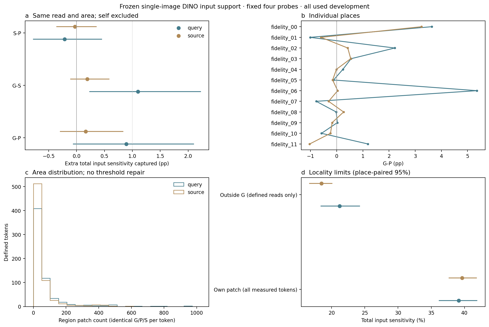
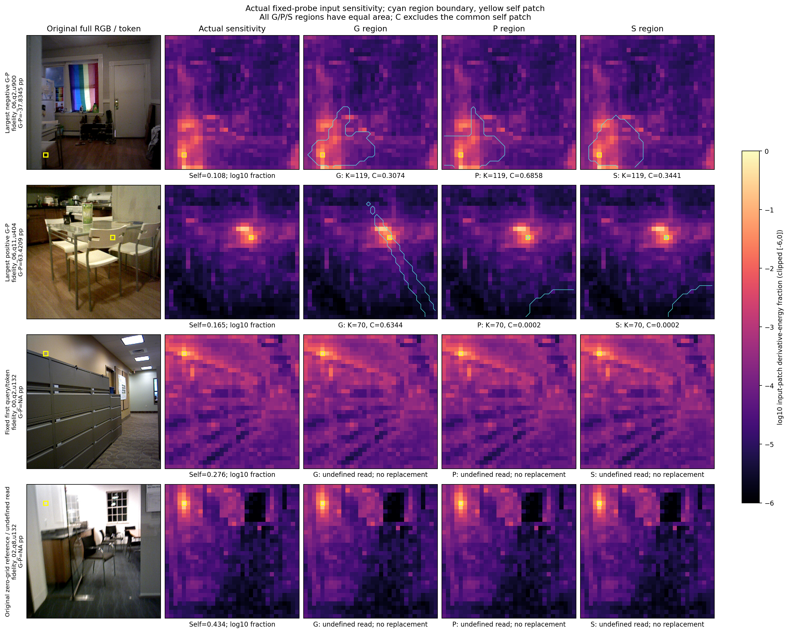

# native_content_support1 — completed fixed input-support measurement

2026-11-14. Implementation complete; scientific disposition returns to original Astra. Query **G−P=+0.8902 [-0.0548, +2.0968] percentage points**. This fails the locked mean≥+1pp and positive95%lower criterion. Query **G−S=+1.1026 [+0.2381, +2.2230]pp** is separately positive conditional evidence against the spherical layout, and is preserved. Source G−P=+0.1639 [-0.2912, +0.8320]pp is auxiliary and uncertain. No PE utility, native net utility, fresh confirmation or overall success is established. No old reader/training was reopened.

[Unique scientific contract](../autonomous_research_loop/round_023/science_plan.md), SHA256 `a145317509d7f3cbaace3a1004d9dc03d1faf805a99033e7dee44534892fdca9`; [analysis handoff](../autonomous_research_loop/round_023/analysis_handoff.json), [representation facts](../autonomous_research_loop/round_023/representation_facts.md), [configuration](configuration.json), [method flags](method_decision.json). This implements that contract; it is not a second scientific plan. Original requested implementation identity gpt-6.1-sol/high is reused; interface has no Fast/service-tier field, Fast unrequested/unverified, backend effective configuration unknown.

The hypothesis was that physical fullΣ gives an informative support layout for actual stored DINO content beyond strong centers. Competing explanations include own-patch dependence, broad contextual dependence, sufficient center layout and source-rendering freedom inΣ. Unlike round011/012 reconstruction/PE/native measurements, round008 semantics or round022 sampling labels, this measures a new local input derivative. O2/O3 shared J fields and O4/O5 real read define the objects; O6 receives design evidence only, C2 adds a content-property measurement and C4 the matched layout controls. All old positive/negative outcomes and closures remain. Old data, single-image DINO, supplied camera/sensor, static four sources and learned J formation are scope limits, not universal requirements.

## Actual object, precision and controls

All twelve original used development places, sources0/3/6/9 and full original queries2/5/8/11:96 unique images,48query+48source. The frozen output is the complete1024D single-image `aggregator.patch_embed` DINO `x_norm_patchtokens`, before VGGT's subsequent24 frame/global pairs. We strictly loaded all304,372,736 DINO parameters from the published checkpoint by mmap; no full VGGT instantiated, no weight update. Original RGB0..1 at448², original ImageNet normalization, eval, original BF16 autocast, inputFP32, energy reductionFP64. The original SDPA path was usable unchanged. Model published identity `3d3d914d09609fdb485e16947c4885cca0e5ea4e5557598a3b3ffb1cfe0a2f59` was inherited without rehashing the large checkpoint. [Input identities](input_identities.json) record actual RGB bytes and twelve old field identities; all layouts share each field read-only.

The fixed16 tokens are Cartesian rows/columns4,12,20,28 (lower/right member of the even center pair, fixed before measurements). Four shared Rademacher vectors seed20261114 have entries±1/32, norm1, [saved probes](probes.pt). Each token/probe VJP differentiates its channel projection w.r.t original unmasked RGB. Square and sum all RGB/pixels in each14² input patch, multiply by1024 for the Frobenius estimator, then average four energies before fractions. The scale cancels fractions. This is a four-probe local first-order approximation, not exact Jacobian, attention weights, finite occlusion or cross-view invariance. Per-probe variation is retained without extra probes or independent-model claims.

For each measured image one actual original GS raster yields W. Multiply the selected rows by has_content and normalize once; this **same row** is used by G/S/P. G uses full ordinary physicalΣ, S traceΣ I/3, P equally mixes1/8/16/31 nearest valid-center second moments about the same slot center with unit²×1e−6I ridge. Centers, mixture spread between centers, actual visibility, camera and weights are common; P is not a total removal of shape from the renderer. Project each by the original perspective Jacobian, near.01/far100 and common+.3patch²I. FP64 Gaussian log-density mixtures are normalized once over the image grid, not per component. G includes self and the smallest density-ranked other-patch set reaching95% total image-grid mass; S/P include self and exactly G's count, stable flattened-index ties. No area/threshold/probe/field tuning; no learning/capacity or extra image inputs for G. Layout/regions/read rows are saved for all96images.

`C_X` is nonself energy inside the X region divided by **all** input energy. Four-probe energies combine first, defined tokens equally within image, defined images equally within place, then all12places equally. Missing layout is NA, never0 or replacement; its input sensitivity/self statistics remain.5000 paired-place bootstrap draws, seed20261114, conditional on the fixed probes; tokens/probes are not independent places. The criterion is explicitly conjunctive; neither component passed for G/P. Original Astra owns disposition, with no automatic follow-on fit.

## Full outcomes and heterogeneity

| Quantity | query mean [95%] | source auxiliary mean [95%] |
|---|---:|---:|
| CG_CP_pp | +0.8902 [-0.0548, +2.0968] | +0.1639 [-0.2912, +0.8320] |
| CG_CS_pp | +1.1026 [+0.2381, +2.2230] | +0.1922 [-0.1030, +0.5821] |
| CS_CP_pp | -0.2124 [-0.7726, +0.4501] | -0.0283 [-0.3545, +0.3547] |
| self_fraction | +0.3915 [+0.3621, +0.4186] | +0.3965 [+0.3769, +0.4181] |
| outside_G_fraction | +0.2121 [+0.1841, +0.2421] | +0.1845 [+0.1669, +0.2005] |
| area_fraction | +0.0630 [+0.0450, +0.0812] | +0.0516 [+0.0380, +0.0673] |

First three quantities are percentage points; remaining rows are fractions. Self uses all measured nonzero-derivative tokens, whereas outsideG/area use defined reads. **These cohort means have different populations and must not be added to make one exact mass partition.** Per defined token self+C_G+outsideG=1. Query self is39.1455% and outsideG21.2101%; source39.6471% and18.4550%. The substantial outside mass limits a local-support account even where G wins.

| Place | query G−P pp | query G−S pp | defined query tokens /64 | source G−P pp | defined source tokens /64 |
|---|---:|---:|---:|---:|---:|
| fidelity_00 brown_bm_1 | +3.6313 | +1.0941 | 46 | +3.2398 | 63 |
| fidelity_01 brown_bm_4 | -1.0159 | -0.6194 | 64 | -0.6005 | 64 |
| fidelity_02 brown_cogsci_1 | +2.2178 | +4.3362 | 23 | +0.4222 | 32 |
| fidelity_03 brown_cs_3 | +0.5486 | +0.1389 | 9 | +0.5345 | 16 |
| fidelity_04 harvard_robotics_lab | +0.2350 | +0.2019 | 64 | -0.0115 | 64 |
| fidelity_05 home_at | -0.1196 | -0.2027 | 37 | -0.1564 | 64 |
| fidelity_06 home_bksh | +5.3537 | +5.2042 | 59 | +0.0353 | 64 |
| fidelity_07 home_md | -0.7826 | +0.4964 | 63 | -0.3104 | 64 |
| fidelity_08 mit_32_d507 | -0.0188 | +0.3392 | 62 | +0.2622 | 64 |
| fidelity_09 mit_32_g725 | +0.0218 | +0.4573 | 64 | -0.1763 | 64 |
| fidelity_10 mit_46_6conf | -0.5813 | +0.1929 | 64 | -0.2371 | 64 |
| fidelity_11 mit_w59_conference | +1.1927 | +1.5924 | 61 | -1.0348 | 64 |

Query region count min/Q25/median/Q75/Q95/max=[8.0, 26.0, 38.0, 64.0, 246.5, 965.0]; source=[10.0, 26.0, 36.0, 52.5, 165.0, 586.0]. No region is only self or all1024patches. Query equal-place/image area mean6.2985%, source5.1569%; raw token area histogram is separately shown. Broad tails and same-area controls prevent greater area from being counted as shape advantage.

Four fixed-probe separate query G−P place means=[1.0837231750305978, 0.9126713847011744, 0.8254573561154057, 0.7409220396001571]; source=[0.174078036667314, 0.15126406423538494, 0.09463196181874427, 0.3241509977362111]. These are ratios per probe averaged after, whereas the primary takes the ratio after energy averaging; they need not average to the primary. They describe probe variation, not a second main endpoint or four independent replications. Complete1536 token rows,96image rows and24place/cohort rows are [token JSON](token_measurements.json), [CSV](token_measurements.csv), [image measurements](image_measurements.json), [place measurements](place_measurements.json) and [summary](summary.json). Every negative query token is retained and sorted in [figure selection](figure_selection.json).

## Undefined reads, original zeros and actual figures

Query defined616/768, undefined152; source defined687/768, undefined81. Zero-total-derivative tokens0 in both; **all1536 selected tokens still measured**. All12places have an estimable layout. Query images with all selected16reads undefined: fidelity_02_query_8, fidelity_02_query_11, fidelity_03_query_5, fidelity_03_query_8, fidelity_03_query_11, fidelity_05_query_11. Source: fidelity_02_source_6, fidelity_02_source_9, fidelity_03_source_3, fidelity_03_source_6, fidelity_03_source_9. This is not the entire1024-patch grid being empty.

Original J full-grid-zero references, inherited from saved metadata at effectivealpha≤1e−8, query: fidelity_02_query_8, fidelity_03_query_5, fidelity_03_query_8, fidelity_03_query_11; source: fidelity_02_source_9, fidelity_03_source_3, fidelity_03_source_6, fidelity_03_source_9. Current selected-read undefined uses exact effective W sum0, a different predicate. [Original zero coverage](original_zero_coverage.json) preserves all96 image flags/authorities, including old pre-J flags. No new coverage raster or old score was computed for this lookup. Full-grid-zero images remain and have nonzero DINO derivatives; they receive no substitute support layout.

Both final PNGs were actually viewed, with matching PDF/SVG retained and hashes in [figure review](figure_review.json). Outcomes show the main interval crossing0, the separate positive G/S interval, place variation, long area tail and explicitly different self/outside populations. Cases are the complete-query largest negative and positive, fixed first query/token and a distinct original zero-grid image; log10 energy fraction clip[−6,0], cyan region boundaries and yellow self.

Largest negative `fidelity_06_query_2`, token900: **−37.8345pp**, C_G=.30744,C_P=.68578,C_S=.34412,119patches,self=.10834. P follows the sensitive left band better than G's right/lower extension. Largest positive `fidelity_06_query_11`, token404: **+63.4209pp**, C_G=.63443,C_P=.000219,C_S=.000242,70patches,self=.16513; G captures a diagonal sensitive band. These two extremes in the same place do not substitute for place means. Fixed `fidelity_00_query_2` token132 is undefined with self=.27645; original zero-grid `fidelity_02_query_8` token132 is undefined with self=.43356 and visibly nonzero wider sensitivity. No invented G/P/S contour appears for undefined reads.

## Validation, unique execution and ordinary failure

Preflight was the first formal image, not an extra measurement. One extra no-grad forward matched its old1024×1024 cached features with max/RMS difference0; input-grad and no-grad outputs also matched exactly. [Preflight evidence](preflight_cache.json). Frozen parameter versions and no parameter gradients were checked for every image. Per-image flock plus a unique manager lock prevent duplicate work; every8192-byte probe payload is memmap-flushed/fdatasync'd, hashed and journal-fsynced before commitment. SIGTERM preserves the current committed probe and resumes only uncommitted work. No actual interruption/restart was needed, so this is supported durable-interface behavior, not a claimed destructive power-loss test.

CPU scoring reloaded every energy/layout SHA and6144 unique probe journals, checked finite nonnegative energies/regions/equal area and recomputed G scalars independently with Torch versus NumPy: max absolute difference **4.44089e-16**. A separate CPU verifier uses Python math.fsum directly on all four saved probe entries for **all G/P/S**, rebuilds image/place means and5000paired-place intervals: C maximum difference4.44e−16 and endpoint maximum difference1.33e−15pp, [full verification](independent_metric_verification.json). These validate saved-energy metrics, not another encoder Jacobian realization. No authoritative results were changed and no old depth/feature scores were recomputed. Actual manager exec69074/PID60998 exit0 waited all children: prepare60999, preflight61047/GPU4, shards61230/GPU4,61231/GPU6,61232/GPU7 all exit0. Three safe cards were used simultaneously, with live CUDA/NVML/foreign-PID/RAM/disk admission;0–3/5 foreign workloads were protected. CPU scoring exec92741, refinement94627 and independent verification chunk9687b6 exited0; hostps andNVML showed all owned measurement PIDs absent at23:29:18UTC. [Actual process completion](process_completion.json).

One CPU figure/coverage-helper import failed exit1 due an unterminated f-string before scientific operations. Fixed ordinary syntax, py_compile checked; only CPU metadata/figure/I-O helper retried. One exact-line patch miss made no mutation. Initial duplicate example corrected and selected16/full-grid wording clarified without recomputing statistics or any model/VJP/raster. Original scoring source v1 and figure selection are archived in engineering_revisions, including [failure record](engineering_revisions/cpu_figure_lookup_v2_failure.json). A later CPU-only packaging refresh exited1 because an already updated outline row no longer matched the original exact label; the idempotent prefix match was fixed and packaging retried. This affected no measurements, statistics or figures; its record is engineering_revisions/cpu_packaging_v2_failure.json. Actual measurement code and source identity remain indexed; v1 scorer archive matches its recorded initial hash.

## Actual costs, budgets and limits

Exactly4 CUDA accesses/4DINO loads, **97 DINO forwards** (96gradient +1preflight),96 actual GS rasters,96 layout constructions,6144 VJP started and6144 complete.0training/updates/new native depth/downloads/discarded GPU work. Four GPU worker processes including preflight consumed **173.080586s=0.04807794workerh** total, including loading/recovery allowance/I-O/actual wait tails. CPU prepare plus GPU-child wall totals179.083207s; separate CPU scoring8.30425s and refinement6.82808s body wall include evaluation/figures, imports additionally covered by conservative CPU accounting.

Actual synchronized wall sums: DINO-only load18.347828s; extra preflight forward0.205901s;96gradient forwards4.990911s;96layout builds13.925662s, **including** nested actual raster3.832224s;6144joint VJP/energy/transfer/durable-I-O intervals110.927560s. The latter is not an isolated backward kernel timer; original pure backward and separate I-O subintervals were not instrumented. Separately recorded [CPU I-O calibration](io_cost_calibration.json) on fixedfirstquery/source measures actual write/fsync/reload of full524416-byte energy files and8192-byte probes; OS cache/exclusivity differ and it cannot be subtracted to fabricate original pure kernel time. [Cost ledger](cost_actual.json) gives exact boundaries, means/min/max and inherited formation scope. New image forward/layout/64VJP are actually paid; saved energy or kernel cache is never called complete native inference. This round did not run native/DPT queries and makes no native latency claim.

Existing J formation is a **dependency**, not a free frontend: its prior report records mean9.879s/place for300-step fitting after initial field/target materialization, with shared source preparation/cold costs separately limited; no fresh formation/end-to-end acquisition timing was run here. Twelve fields are reused for eightimages/place and three layouts, not copied or refit. [Original formation/cost report](../native_feature_field_pe1/report.md).

[Budget evidence](execution_budget.json): GPU0.04807794≤2workerh; CPU conservative upper1.440999≤4workerh, charging4slots continuously from23:13UTC through packaging+120s reserve, including helpers/failure/idlegaps. Conservative admitted host working-set20GiB (3×6+2)≤32. A concurrentRSS snapshot was4,668,710,912bytes; CPU scoring/refinement peakRSS859,533,312bytes. **No fine-grained whole-GPU-phase host peak trace was persisted**, so the4.35GiB snapshot is not presented as the actual peak; the20GiB analytical admission bound and sampled live guard are the resource evidence. No RAM staging, full checkpoint copies, large field copies or new DATA. Own permanent+code bytes before packaging111,327,979; conservative peak with32MiB final/atomic/temporary/doc margin144,882,411bytes≤3GiB. Final manifest gives exact final files. Old results/data and system GLIBC remain unchanged.

Implementation correctness and evidence are complete for this finite measurement. The main G/P condition is unmet; separate positive G/S evidence is conditional, source increment uncertain, coverage and broad sensitivity limit generalization. These are used development data, fixed probes and one DINO/J configuration. No extrapolation to all representations, accurate physical geometry, PE effect, native benefit or fresh confirmation is warranted. Original Astra receives the complete outcome and retains scientific disposition; this implementation does not dispatch a successor or reopen a closed family.
