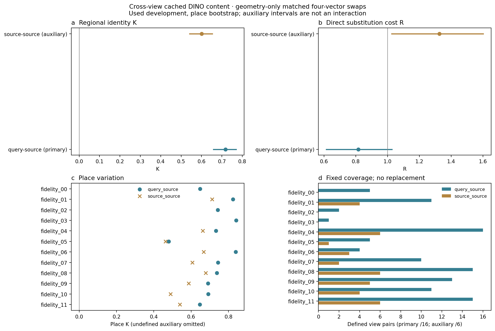
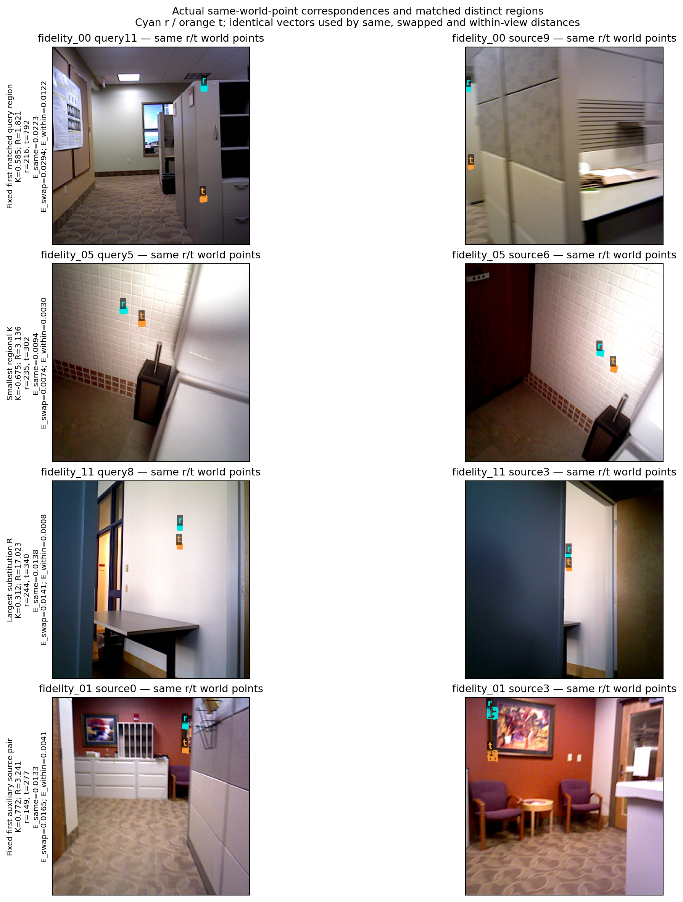

# native_crossview_content1 — actual cached cross-view content

2026-11-14. Finite implementation complete, scientific disposition returns to original Astra. **Primary K=0.718158 [0.658895, 0.770049]**, positive95%lower, supports region-difference signal within the measured sensor/pose-defined scope. **R=0.816285 [0.614509, 1.027321] crosses1**, so direct substitution remains unresolved. This is the locked regional-signal/substitution-unresolved branch, not proof of stable constant world vectors, PE usefulness, native net utility, GS compression, fresh confirmation or overall success. Geometric coverage and ambiguous projected edge/wall cases materially limit literal same-surface interpretation.

[Unique scientific contract](../autonomous_research_loop/round_025/science_plan.md), SHA256 `0a9018d6843177bb122c399dd0dceb9e8587765c578dd615970b677de94c14af`; [analysis handoff](../autonomous_research_loop/round_025/analysis_handoff.json), [available input facts](../autonomous_research_loop/round_025/crossview_input_facts.json), [configuration](configuration.json), [input identities](input_identities.json). No second scientific plan. Reused original gpt-6.1-sol/high request; Fast field unavailable, unrequested/unverified and backend effective configuration unknown.

## Question and fixed objects

The hypothesis is shared regional content across views; competitors are whole-image/place similarity, shared regional differences with view-dependent offsets, and visibility/member/geometry-resampling errors. Round024 ended the local-input-support rationale after G/P failed its locked condition while retaining G/S positive and broad sensitivity. That derivative measurement does not answer cross-view content correspondence. Earlier source-only and native-task field formation supplied reconstruction/training examples without this same-four-vector matched exchange. This round changes the observable and correspondence, without reopening a reader or training family. [Round024 judgment](../autonomous_research_loop/round_024/science_plan.md), [source formation](../native_feature_field_pe1/report.md), [native-task formation](../native_task_writer_pe1/report.md).

Exactly12 original used development places, four sources0/3/6/9 and original full queries2/5/8/11:96 existing images.192query×source and72unordered earlier-anchor source×source viewpairs, all retained. Complete original1024D single-image DINO caches, no re-encoding, PCA, whitening, centering, norm matching or learning. J fields and theirΣ/read rows never select these regions; no field is rebuilt or modified. Query features/sensor are offline measurement only. Existing sensor/common-valid/published camera/RGB and feature identities are referenced from their old small manifests, with no old largeweight or feature-cache rehash. Source-pair and original query payload identities are explicit; all new geometry/vector payloads have checksums.

O2/O3 public-content premise and O4 cross-view reading motivate this C2 measurement. C5 supplied sensor/common_valid/cameras, static four-source scenes and used data are temporary limits. C1/C3/C4/C6 model/field/PE/training stay unchanged; this is not O5GS-compression fidelity or O6increment. All previous positive/negative outcomes and family closures, especially round024, are preserved.

## Geometry locked before feature values

Query target/valid/K_metric are the original210² cache. Source448² depth_sensor and **common_valid** use exactly the original PIL nearest210resize; intrinsics scale210/448. Filled depth1 is never used to reconstruct validity. CachedRGB448 remains unchanged. Pixel centers are edge coordinates(x+.5,y+.5), scaled along original crop to448 and32² featuregrid. Each anchor14²pixel patch footprint defines a region via210grid center membership; source-source anchors use earlier sourceframe.

Each valid anchor point is backprojected to a world point and projected into the target. Nearest target210sensor center must be in-view/valid and agree in depth within max(.02m,.02×measuredDepth). Its measured center/depth backprojects to anchor; the nearest reverse anchor must likewise be valid with the same reverse-depth rule. Both210pixel-center cycle errors must be≤1pixel, with positive/in-frame target/cycle projections. No depth interpolation through invalid values. Feature sampling uses the **original anchor world points**, continuously projected in both images, so both means use exactly the same members and uniform anchor-grid weights. At least16accepted points and at least50%of all footprint grid points are required. These given sensor/pose checks are not independent semantic surface groundtruth.

Region geometry: mean depth in eachview; two sorted principal projected RMS scales in eachview; accepted/grid coverage. Eligible pairs have eachview depthmax/min≤1.25, each of four scalemax/min≤1.5 and coverage difference≤.10. Their **positive-weight bilinear participating patch index sets are disjoint in EACH view**. Stable ascending anchorpatchID greedy selection chooses the closest remaining eligible unused region, no replacement, tiesbyID. Distance is equal-weight mean of seven squared tolerance-normalized differences: two fractional depthratios/.25, four fractional scaleratios/.5, one coveragedifference/.10. Zero/zero scales ratio1, positive/zero infinite; no epsilon or postscore tuning.

In each attempt, all264geometry tables and matching IDs were saved and globally locked **before that attempt's feature numeric phase**. The invalidv1 attempt had already materialized these same feature caches before formalPILv2 geometry was recomputed; this exposure is retained, not presented as pristine first-access prospectivity. The correction follows the original fixedPIL contract and geometry-only code, without feature-dependent matching or threshold changes. [Geometry lock](geometry_lock.json) checks all payload identities; feature-read timestamps are later than lock. EachDATAgeometry file retains all accepted anchor indices/projected target locations/residuals, all1024region stats, qualified/matched IDs and packed interpolation supports. Every invalid/unmatched region remains in the coverage/stage logs; no threshold was relaxed or replacement data used.

## Same four vectors and aggregation

Uniformly bilinear-read all1024channels at those exact common worldpoints in both original featuregrids. Coordinate is32*p210/210−.5, border handling is common and align_corners=False equivalent. FP64 point aggregation, rounded once to savedFP32 regional means; FP64 six distances use those same saved values. Four vectors x=f_a(r), y=f_b(r), u=f_a(t), v=f_b(t) are used unchanged by E_same=.5[d(x,y)+d(u,v)], E_swap=.5[d(x,v)+d(u,y)], E_within=.5[d(x,u)+d(y,v)], d=norm²/1024.

K=(E_swap−E_same)/E_within, R=E_same/E_within. The algebraic difference is(x−u)·(y−v)/1024; it removes common view-offset cross terms, so positiveK does not prove direct original-vector substitution. Every viewpair first equally averages regional E values. Main sources equally within each query, then queries equally within place, then place ratiosK/R; final mean is over places, not a pooled ratio or region-count-weighted mean. Missing sources/queries are NA, with defined counts shown, not zero/replaced. Auxiliary fixed six sourcepairs are equally averaged within each defined place then ratios; no source/query interaction is inferred. Place-balanced mean E rows are reported separately and need not have ratios equal to meanplaceK/R.5000 paired-place bootstrap, seed20261114, conditional on this fixed cache/matchpopulation; regions/pairs are not independent places. A singleplace would get no overallinterval.

## Results, complete coverage and variation

| Quantity | primary query–source,12 places | auxiliary source–source,9 places |
|---|---:|---:|
| K | 0.718158 [0.658895, 0.770049] | 0.600536 [0.542287, 0.652917] |
| R | 0.816285 [0.614509, 1.027321] | 1.326423 [1.026204, 1.602660] |
| E_same | 0.008647 [0.006698, 0.010860] | 0.011377 [0.009563, 0.013055] |
| E_swap | 0.016703 [0.014898, 0.018845] | 0.017104 [0.014891, 0.019296] |
| E_within | 0.011062 [0.009842, 0.012287] | 0.009245 [0.007598, 0.011039] |

Primary108/192viewpairs,18407regionpairs,12/12definedplaces. Auxiliary37/72viewpairs,3548regionpairs,9/12definedplaces; fidelity00/02/03 are undefined auxiliary. Primary37964/196608candidate regions qualify,36814are matched,1150qualifiedunmatched; auxiliary7457/73728qualify,7096matched,361qualifiedunmatched. Remaining regions fail common-member count/coverage; reason counts can overlap and sequential perpoint rejection counts are separately retained.84primary and35auxiliaryviewpairs have no matchedregionpair. ZeroE_within regionalpairs0, zero viewpair denominator0; no zero-spatial-contrast filtering occurred. Primary384negative regionalK, auxiliary93negative; all region-level values are retained even though all defined viewpairK and all primary placeK are positive.

| Place | primary defined pairs /16 | defined queries /4 | region pairs | K | R | auxiliary pairs /6 | auxiliary K | auxiliary R |
|---|---:|---:|---:|---:|---:|---:|---:|---:|
| fidelity_00 brown_bm_1 | 5 | 4 | 129 | 0.6473 | 1.3291 | 0 | NA | NA |
| fidelity_01 brown_bm_4 | 11 | 4 | 2688 | 0.8239 | 0.4594 | 4 | 0.7118 | 0.9141 |
| fidelity_02 brown_cogsci_1 | 2 | 2 | 338 | 0.7423 | 0.9934 | 0 | NA | NA |
| fidelity_03 brown_cs_3 | 1 | 1 | 217 | 0.8412 | 0.3120 | 0 | NA | NA |
| fidelity_04 harvard_robotics_lab | 16 | 4 | 3259 | 0.7332 | 0.4942 | 6 | 0.6629 | 0.6199 |
| fidelity_05 home_at | 5 | 3 | 708 | 0.4805 | 1.5111 | 1 | 0.4622 | 1.7569 |
| fidelity_06 home_bksh | 4 | 3 | 825 | 0.8391 | 0.3932 | 3 | 0.6668 | 1.4769 |
| fidelity_07 home_md | 10 | 4 | 1283 | 0.7444 | 0.7659 | 2 | 0.6065 | 1.3646 |
| fidelity_08 mit_32_d507 | 15 | 4 | 2903 | 0.7380 | 0.5720 | 6 | 0.6780 | 0.7083 |
| fidelity_09 mit_32_g725 | 13 | 4 | 2826 | 0.6898 | 1.0462 | 5 | 0.5869 | 1.6694 |
| fidelity_10 mit_46_6conf | 11 | 4 | 1620 | 0.6921 | 0.8678 | 4 | 0.4901 | 1.9231 |
| fidelity_11 mit_w59_conference | 15 | 4 | 1611 | 0.6461 | 1.0511 | 6 | 0.5396 | 1.5046 |

fidelity03's main outcome rests on only oneviewpair/onequery, so12place means do not mean full16pair coverage perplace. Camera/depth/visibility selection narrows the scope; this is not unseen-data confirmation. All four previous J-GS whole-zero query references stay in the fixed query×source list; [historical zero query retention](historical_zero_query_retention.json) joins old flags without recalculating old scores/rasters. Old GS zero and this sensor matching eligibility are distinct.

[Every viewpair](viewpair_measurements.json), [48query records](query_measurements.json), [48source diagnostics](source_measurements.json), [24place/cohort records](place_measurements.json), [all21955regionpair records](region_pair_measurements.json), [CSV](region_pair_measurements.csv), [all477negative regional cases and extrema](counterexamples.json). [Fullgeometry quality](geometry_quality.json) retains stage rejection totals, all-common residual quantiles and matched depth/scale/coverage/viewangle summaries; [summary](geometry_quality_summary.json) reports descriptive raw-regionpair quantiles/separations. They are quality/scope records, not searched scientific subgroups.

## Actual visual review and counterexamples

Both final PNGs were actually viewed; PDF/SVG and currentSHA identities are in [figure review](figure_review.json). Figure1 keepsK/Rseparate, the R=1reference and three undefinedauxiliary places, including primary1/16coverage atfidelity03. Figure2 shows cyanr/oranget copies of the same sensor/pose-derived world samples. The fixedfirst displayed main case is lexical-keyfirst matched region, not a favorable effect-selected case.

The smallest primary regionalK is **−.675170** at fidelity05 q5/s6,r235/t302, R3.136091, E_same .00942982,E_swap .00739967,E_within .00300687. Both regions have full common-point fractions and lie on a tiledwall; swap beats same and remains a genuine counterexample within the supplied geometry. The largestR is **17.022709** at fidelity11 q8/s3,r244/t340; K.312404, E_same .01382122,E_swap .01407487,E_within .000811928, coverage2/3each. Small same-view regional contrast makes replacement expensive even with positiveK; low-texture whitewall/door-edge context is visible. No small-denominator cases were removed or normalized away.

The firstmain cabinet-edge/wall example hasK.585299,R1.821032. The firstauxiliary fidelity01s0/s3 example hasK.772465,R3.241359; wall/decoration/painting-edge appearances are visually ambiguous under the supplied projections. Depth and reprojection threshold compliance alone cannot prove correct semantic surface correspondence or exclude RGB/depth/pose calibration error. These examples are preserved and flag limits, **not evidence that an obviously wrong match establishes representation instability**. The overall positiveK is therefore conditional regional signal in the fixed sensor/pose matched population; precise physical-point invariance remains unverified. We did not alter geometry to rescue the measure.

## Validation, ordinary failures and recovery

Independent CPU NumPy arithmetic on all21955saved same-four-vector quadruples recomputes allE/K/R; maxGPU-versusCPU E/ratio difference is1.36002e-15, exchange/dot identity residual2.77556e-17. All matched geometric constraints, uniqueness/no-replacement and disjoint supports were independently checked; maxsavedmatching-distance difference1.66533e-16. This validates this measurement's arithmetic, not another descriptor/geometry realization or old task scores. [Independent verification](independent_verification.json).

Fixed first matched region percohort CPUgrid_sample versus production FP64aggregate/FP32save differs by at most3.40e−7 in anychannel, with exactly same samples; no materialchange to interpretation and no precision tuning. OriginalPIL versus corrected source resize differs0 in depth and validity. Analytic camera round-trip max8.35e−14pixels. [Interface validation](interface_validation.json), [corrected source preflight](source_resize_preflight_v2.json). No model was instantiated in any stage.

**Two ordinary engineering faults are retained.** Initial v1 used Torch nearest-exact instead of originalPIL nearest; fixedsource interface validation found depth difference.255m and common_valid differences on sampling ties. All264v1geometry and264vector measurements were invalidated and archived **before scientific reporting**, with full558543368B DATA, code/config/locks/figures and107.418382GPUworkerseconds retained and charged. This is not an alternate scientific arm, a K/R-driven selection or a new plan. Corrected v2 uses originalPIL and matched an independentPIL index-remap preflight exactly. [Failure001](engineering_revisions/source_resize_failure001.json).

The firstv2manager(session40361) hit a/proc RSS race: a finishing process had noVmRSSline. It exited1 after88validgeometry tables. Workers90298/90299 finished their22commits each and wrote resource-end records, then were confirmed absent; their actual exitcodes could no longer be waited by their original parent and remain **unknown**, never calledwait0. Launch-to-confirmed-absence55.05s each is charged conservatively. The manager now tolerates disappeared/emptyRSS and its abnormal cleanup signals/waits only owned children. Resume94824 reused all88commits and completed only remaininggeometry then264vector pairs; no validv2pair was repeated. [Failure002](engineering_revisions/manager_proc_race002.json). Perpair lock, atomic fsyncwrite/hash then marker and singlemanager flock prevent duplicatecommits. No actualSIGTERM recovery/power-loss test is claimed.

Originalmanager44995 and archivedCPU44826 exited0; failedmanager40361 exited1; finalmanager94824 and formalCPU81670 exited0. Of24formalworkers,22were actually waited with exit0 and2have independently observed completed+absentstatus with unknownexitcodes. All48workerPIDs across attempts were absent at finalhostcheck; all scientific CPUstages ended. [Completion](execution_completion.json), [terminal hostcheck](terminal_process_check.json). GPU4/7 were used concurrently while6/0–3/5 were externallybusy; no artificial defaulttwocardcap and no externalprocess modified. No oldround023/otherqueue was polled or restarted.

## Actual operations, cost and budget

Across both attempts:48CUDA arithmetic-worker starts,528geometric pairmeasurements,528vector pairmeasurements,120GPU-worker cachedfeaturefile reads,24feature-materialization scene loads.43900regionalquadruples,263400squared1024Ddistances,6657022worldpoint/view interpolations. Formal attempt alone:264geometry+264vectorpairs and21955quadruples (18407main/3548auxiliary),60featurefile reads/96viewfeatures materialized. CPU interface checks add4numericfeature reads perattempt,8total; no new encoder or image. Prepared depth/mask/camera loads and graph construction are included in full workerwall. All phases perform0training/forward/newprediction/gradient/render/download/oldscore-recompute/oldweight-hash.

**GPUworkercharge316.091691s=0.08780325h≤1h**, including invalidattempt, imports/CUDA/loading/geometry/CPUmatching/serialization/hash/I-O/recovery and conservative lost-parent observationtails. Combined sub-timer sums: geometry34.159431s, featurematerialization1.155280s, vectorpairconstruction35.396261s. They include indicated CPU/I-O and are not isolated kernels; workeroverheads and sourceinput loading remain charged outside sub-timers. [Exactcost ledger](cost_actual.json). Cached original DINO/sensor/camera formation is an inherited dependency, not a free acquisition or a new end-to-end nativequery timing. No native/DPT pass or amortized inference speed is claimed.

CPUscoring bodywall sums28.191789s; both actualCPUprocess usage records total30.799393s. Additional manager/preparation/recovery/interface/packaging costs are conservatively overbounded by1.002097workerh (3slots continuously since23:50UTC through delivery+120s), not calledpureCPUutilization. CPU2threads/worker; only2safe GPUs concurrently, with liveRAM/disk guards. Per-worker lifetime peakRSS preserved for all48workers; sum of two largest peaks2,589,851,648B bounds concurrentworkerRSS, plus2GiB manager/packaging reserve. Persisted concurrentRSS samplemax2,507,571,200B, CPUscoringpeak859,533,312B. Actual GPU allocationpeaks are in worker_resources. Engineering admission32GiB host,3GiB/worker+2GiBmanager, no RAM staging; cardcount adapts to safeoccupancy and independent remainingtasks.

AllnewDATA including invalidv1+formalv2 **1,117,244,176B**, conservative atomicpeak+32MiB=1,150,798,608B≤4GiB. Project including fulloldattempt/code/finalstats beforepackaging120,584,738B; conservative+64MiB=187,693,602B≤1GiB, covering finalreport/manifest/livingdocs and largesttemporary. Both versions remain; no oldmodel/field/data deletion or systemGLIBCchange. [Budget ledger](execution_budget.json) and finalmanifest expose actualidentities/counts/limits; GPUusage did not expand withcardcount.

The finite content-carrier measurement and validation are complete. Regional signal exceeds fixed same-view matched swaps under the given geometric scope; main direct substitution remains uncertain and some correspondence/coverage limits remain. Auxiliary R>1 is preserved without changing the primarybranch or claiming interaction. Implementation correctness, contentmechanism, GS/PE/nativeutility and freshconfirmation remain distinct. Original Astra decides the single scientificdisposition; this implementation neither declares overall success/pauses research nor opens a successor or old family.
