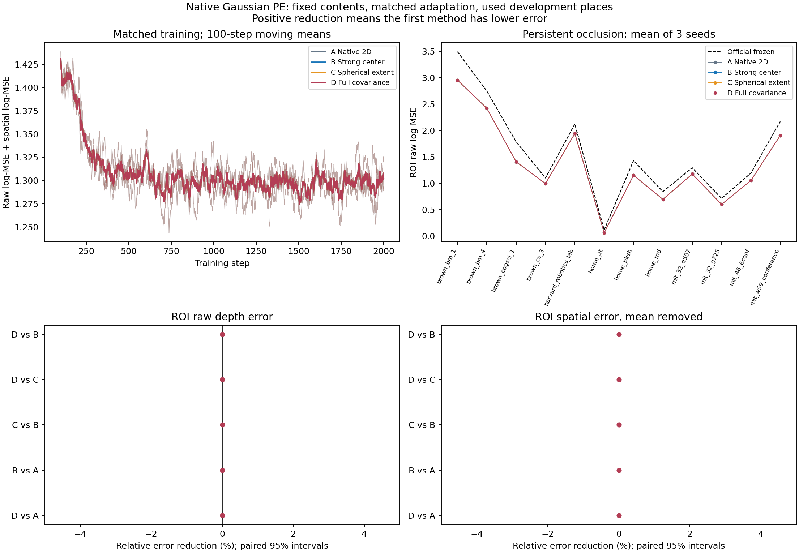
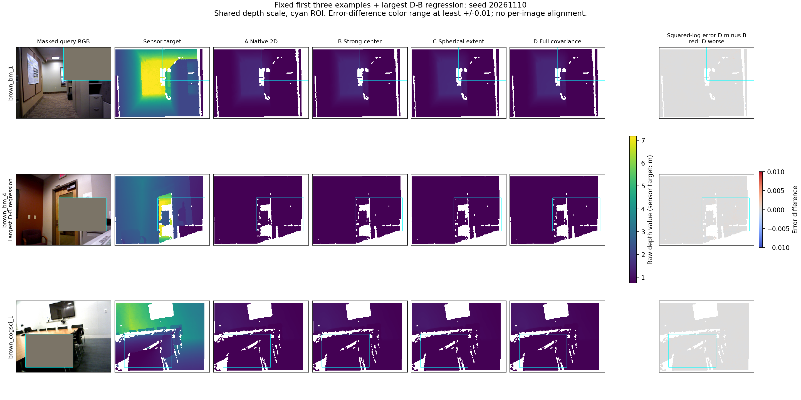

# native_gaussian_pe1：原生读取中的高斯位置编码

**结论：本接法不采用完整高斯作为新主方法。共同适配降低了区域整体偏差，位置编码之间没有体现实用增量。**

12次固定2000步训练、三个配对种子及312份评价输出全部完成；独立像素评分、输入边界、初始化和实际采样日志检查通过。持续遮挡ROI中，官方模型/原生适配/强中心/球形/完整高斯的log-MSE为 **1.584619 / 1.364770 / 1.364773 / 1.364783 / 1.364778**。后四组几乎重合。

完整高斯比强中心的ROI误差平均高 **0.000393%**，主相对收益区间为[−0.000918,+0.000215]%，三个种子均略高；比球形平均低 **0.000304%**，区间[−0.000137,+0.000843]%，种子方向混合。空间误差对强中心仅低 **0.001119%**，区间仍跨零。完整输入也没有有用的形状收益；D对C有一个微小正区间，持续遮挡C对B有一个微小负区间，两者均不作为实用胜负。不能把统计区间跨零称为等效，也不能把极小但区间不跨零的量当成有用方法。

共同原生适配相对官方模型的ROI误差低 **13.87% [11.54,16.41]%**，12地点、三个种子均改善；其中 **99.95%** 的log-MSE减少对应区域均值偏差平方减少。去均值空间误差仅低0.26%、区间[−4.34,+5.75]%，没有建立局部结构改进。完整输入的全图空间误差还平均高5.11%，辅助区间刚支持恶化；这进一步限制了将共同适配称为全面几何改进。均值偏差分解不是某个物理尺度病因的因果证明，官方原生单位也未作查询真值对齐。

按训练输入固定的范围离散度、各向异性和预测重叠分组，各组D对B的主平均增量仍为微小负值，没有找到值得采用的适用子范围。不根据哪组获胜再挑场景、改阈值或换公式。固定三个示例已经包含最大D−B误差差地点brown_bm_4，所有地点保留。完整高斯和强中心的预测相对RMS差约1.3–1.7×10⁻⁵，属于很小的输出变化；本轮不为这些小数位追加FP32训练或调参。

成本方面，完整高斯查询中位数约 **310ms**，强中心284ms，原生适配直接单遍210ms。D比B慢约9.2%、比A直接接法慢约47.7%，却没有相应的输出收益。保留四组作为受控研究参照，结束当前末四层查询适配接法的形状扩展，不补种子、调形状公式或宣称高斯方法已有效。

**这个阴性结论有明确边界：** 当前是未压缩、按观测patch保留的原生内容，预测几何、冻结writer及DPT头、有限末四层适配、已用开发地点和深度任务。它不能否定已有区域PE正证据，也不能证明粗高斯场景记忆无效；不能将未压缩通路的获胜设为所有后续粗记忆研究的通用门槛。整体研究目标尚未完成。若后续继续，需要另行固定能区分“粗粒度/不同范围支持需要形状”与“同预算强中心已足够”的假设；本轮没有启动新的压缩、Point3R训练或新确认。

## 设计与范围

四组同一官方StreamVGGT、同一来源/维度/数量的原生历史特征、最后四层rank8 QKV与输出适配，共196,960可训练参数。A保留二维RoPE并配等容量二维关系映射；B叠加Point3R式三维多基频中心RoPE和中心关系；C保留各自范围，D保留完整协方差。中心、球形、完整组初始预测完全相同。形状不进入旋转幅度衰减。

关系映射固定五维输入：B使用五个距离尺度，C/D使用一个距离与四个高斯关系量。因此D/B检验固定容量下的编码选择，属于强中心控制；D/C则直接检验保留迹后的完整协方差增量。不是完整Point3R模型或其训练配方的复现。

第一遍预测深度/相机，逐patch点集生成均值和协方差；源帧不含未来，查询允许当前RGB。第二遍只训练查询读取，历史writer和原生DPT头冻结。不读取查询真值几何生成PE。数据遮挡构造使用旧传感器几何，训练和评价标签为传感器深度；这些用途与模型输入分开。该表示为高斯参数形式的观测区域，不是完整渲染优化后的3DGS场景。本轮不证明压缩和在线高斯融合已经完成。

官方原始输出未作尺度对齐；对其原始误差的改善不能自动解释为几何质量提高，偏差分解和去均值误差必须同时阅读。图中传感器目标单位为米，模型保留未经查询真值校准的原始数值。

12旧训练片段、96训练样本；12地点隔离的已用开发地点、24查询条件。四组各三种子、2000步、有效batch2、相同初始化/采样；AdamW1e-4。损失为原生log-MSE加去均值log-MSE，等权。所有终点固定，无开发选模，零新下载或新确认。

## 主表

| 条件 | 方法 | ROI log-MSE | ROI空间误差 | ROI偏差平方 | 全图log-MSE |
|---|---|---:|---:|---:|---:|
| full | Official frozen | 1.495270 | 0.017395 | 1.477876 | 1.455380 |
| full | A Native 2D | 1.342647 | 0.017735 | 1.324912 | 1.310390 |
| full | B Strong center | 1.342645 | 0.017735 | 1.324910 | 1.310387 |
| full | C Spherical extent | 1.342649 | 0.017735 | 1.324915 | 1.310391 |
| full | D Full covariance | 1.342646 | 0.017735 | 1.324911 | 1.310388 |
| persistent | Official frozen | 1.584619 | 0.047015 | 1.537604 | 1.476146 |
| persistent | A Native 2D | 1.364770 | 0.046894 | 1.317876 | 1.309993 |
| persistent | B Strong center | 1.364773 | 0.046894 | 1.317879 | 1.309992 |
| persistent | C Spherical extent | 1.364783 | 0.046894 | 1.317889 | 1.309997 |
| persistent | D Full covariance | 1.364778 | 0.046894 | 1.317885 | 1.309994 |

| 持续遮挡比较 | 原生ROI相对降误差% [95%区间] | 空间相对降误差% [95%区间] | ROI改善地点 | ROI改善种子 |
|---|---:|---:|---:|---:|
| gaussian_vs_center | -0.000393 [-0.000918, +0.000215] | +0.001119 [-0.000389, +0.002436] | 7/12 | 0/3 |
| gaussian_vs_sphere | +0.000304 [-0.000137, +0.000843] | +0.000067 [-0.000749, +0.000869] | 12/12 | 2/3 |
| sphere_vs_center | -0.000697 [-0.001306, -0.000156] | +0.001052 [-0.000301, +0.002088] | 3/12 | 0/3 |
| center_vs_native | -0.000217 [-0.001601, +0.000989] | -0.000116 [-0.002117, +0.001552] | 8/12 | 1/3 |
| gaussian_vs_native | -0.000610 [-0.002217, +0.000992] | +0.001003 [-0.001682, +0.002913] | 9/12 | 0/3 |
| native_vs_official | +13.87 [+11.54, +16.41] | +0.26 [-4.34, +5.75] | 12/12 | 3/3 |

正数表示第一个方法误差更低。区间为5000次地点/种子配对重采样；三个种子和十二旧地点不构成广泛分布保证，区间跨零不表示等效。主要比较D对B/C；其余和输入分层为辅助分析。

主比较图保留至少±5%的显示参照，误差差图保留至少±0.01的色差范围，以免将微小变化自动放大；这些显示尺度不是统计等效界限或方法采用门槛。精确数值全部保留在analysis.json中。

## 输入条件与反例

阈值仅由训练预测几何中位数决定：{"extent_spread": 0.6335384014711176, "anisotropy": 96.83408959078463, "overlap": 0.9946911036968231}。各条件的地点、效应及区间见[完整分析](analysis.json)；不按结果排除零支持或失败地点。预测中心近邻覆盖不等于真实新增历史支持，分层结果只用于探索适用范围。

固定前三例及最大退步例为['fidelity_00', 'fidelity_01', 'fidelity_02']，最大D-B主误差退步地点brown_bm_4。图用固定首种子，选择依据三个种子平均；不逐图对齐尺度。

## 正确性、成本与局限

120份缓存的来源和查询边界、训练/开发地点隔离、官方代码与模型身份已核对。NumPy独立复算6份多帧几何，中心最大差5.96e-08，协方差最大差2.95e-08；24个官方历史输出与父轮最大差0。288份适配输出独立像素评分最大差2.22e-15；最终模型和实际样本日志配对检查见[独立复算](independent_result_checks.json)。

训练循环共5.858 worker小时，峰值已分配显存8.264GiB。缓存约23.733GiB，包含历史K/V、训练重放输入、预测几何和审计信息，不是紧凑持久记忆大小。两遍查询推理和实际持久缓存成本另外列于runtime.json（若尚未生成则待测），不能以末段读取时间代替总推理时间。

在NVIDIA RTX A6000上，固定两个训练片段、两条件、各三次，源缓存驻GPU、排除模型加载和磁盘I/O：官方查询中位数142.1ms；A直接单遍210.1ms；B两遍284.1ms；C两遍310.7ms；D两遍310.3ms。A直接单遍与匹配两遍的预测最大差0。D比B约慢9.2%，比A直接单遍约慢47.7%。这些是本原型的深度查询成本，不能写成全任务/全硬件基准；A直接路径不需要查询相机/深度预估，官方及几何两遍路径包含对应头。完整冷启动来源构建、缓存字节和分项时间见runtime.json。

正式训练前修复了缓存目录和CPU评分设备问题，保留版本记录；原计划/初始预检源码与最终训练源码分开存档。关系MLP采用共同的split-K梯度归约优化：前向和输入梯度不变、权重梯度对照FP32归约通过；不声称与旧BF16梯度训练轨迹逐位相同。见[训练源码锁](training_lock.json)、[运行预检](preflight_final/complete.json)、[运行优化检查](preflight/splitk_gradient_checks.json)。

当前阴性只能约束该预测几何、固定writer与有限末层适配；阳性也只支持本开发条件，需要固定方法后的未用数据确认。已有区域PE证据、原生历史不确定性和旧接法负结果继续保留。

本轮只评价深度输出，未证明适配深度与冻结相机头共同改善三维重建；不能将结果写成完整VGGT任务或真实3DGS渲染已改进。

[固定计划](../../../docs/gaussian_memory_native_pe_plan.md) · [全部分析](analysis.json) · [输入核对](independent_input_checks.json) · [方法取舍](method_decision.json)
