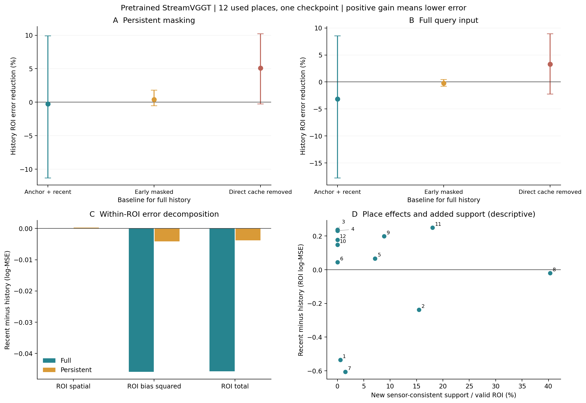
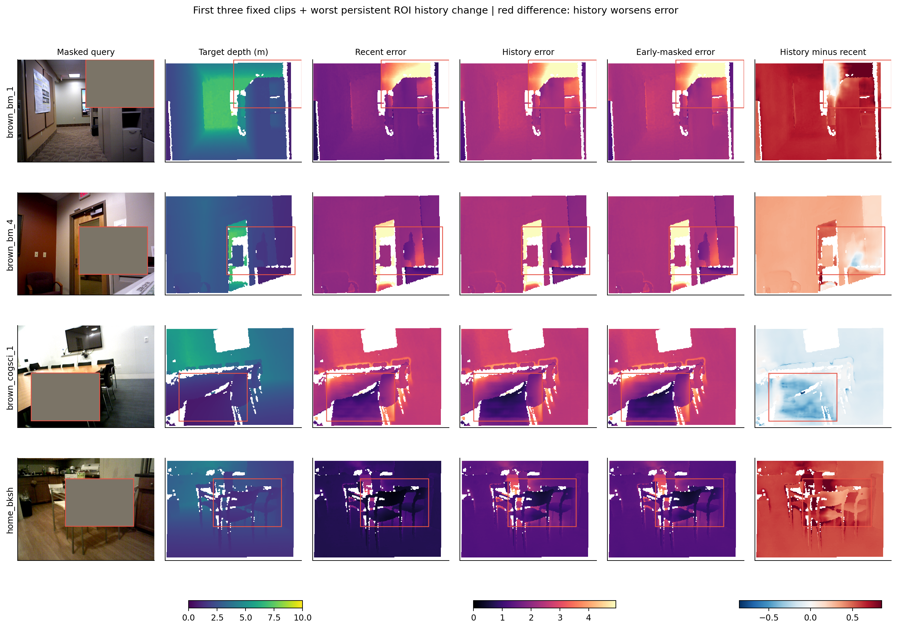

# native_history1：预训练原生通路的历史用途验证

2026-11-11。12个已用地点、一个官方预训练检查点、完整/持续遮挡、四组共96份原生查询输出；零训练。研究判断见下方解释，不以接口检查替代用途。

## 固定比较与边界

R从RGB独立重放0/4/6/8/10后读取query11，H多读取1/2/3。首帧锚点0在各组完全相同。H-mask同长度但遮掉1/2/3中与固定查询ROI相关的来源patch，并重编码后续状态。H-drop沿H构建状态，只在query11前移除早期帧的直接缓存；后续帧仍可携带间接历史，因此它不能代替R。

R本身已保留首帧0和近期历史，主比较仅检验额外1/2/3帧在共同锚点之上的净增益；阴性结果不能概括成原生记忆整体无用，共同锚点已经提供足够信息也是竞争解释。

原生518×392深度双线性映射到既有280×210传感器评分网格。主成绩直接使用模型深度，不使用每方法尺度拟合或旧VGGT尺度。输入遮挡由源传感器几何构造，是人为控制条件；深度和真值对应不作为模型输入。所有地点都已用，不是新确认；多次推理不构成多个种子。

## 主结果

正数表示候选完整历史的误差更低；95%区间为5000次配对地点重采样。

### 持续遮挡、固定缺失区

| 比较（候选 / 基准） | 基准误差 | 候选误差 | 相对降低及95%区间 | 改善地点 |
|---|---:|---:|---:|---:|
| 完整历史 / 近期 | 1.580801 | 1.584619 | -0.24% [-11.31, +9.91] | 8/12 |
| 完整历史 / 早期遮挡 | 1.591001 | 1.584619 | +0.40% [-0.54, +1.78] | 4/12 |
| 完整历史 / 撤掉早期直接缓存 | 1.669755 | 1.584619 | +5.10% [-0.25, +10.24] | 9/12 |

### 完整输入、同一物理区域

| 比较（候选 / 基准） | 基准误差 | 候选误差 | 相对降低及95%区间 | 改善地点 |
|---|---:|---:|---:|---:|
| 完整历史 / 近期 | 1.449518 | 1.495270 | -3.16% [-17.77, +8.53] | 8/12 |
| 完整历史 / 早期遮挡 | 1.492163 | 1.495270 | -0.21% [-0.78, +0.48] | 3/12 |
| 完整历史 / 撤掉早期直接缓存 | 1.546472 | 1.495270 | +3.31% [-2.24, +8.95] | 7/12 |

### 持续遮挡：全图

| 比较（候选 / 基准） | 基准误差 | 候选误差 | 相对降低及95%区间 | 改善地点 |
|---|---:|---:|---:|---:|
| 完整历史 / 近期 | 1.446096 | 1.476146 | -2.08% [-14.87, +8.92] | 8/12 |
| 完整历史 / 早期遮挡 | 1.475922 | 1.476146 | -0.02% [-0.42, +0.59] | 3/12 |
| 完整历史 / 撤掉早期直接缓存 | 1.526511 | 1.476146 | +3.30% [-1.89, +8.64] | 8/12 |

### 持续遮挡：缺失区内部去均值空间误差

| 比较（候选 / 基准） | 基准误差 | 候选误差 | 相对降低及95%区间 | 改善地点 |
|---|---:|---:|---:|---:|
| 完整历史 / 近期 | 0.047294 | 0.047015 | +0.59% [-11.59, +9.88] | 9/12 |
| 完整历史 / 早期遮挡 | 0.047185 | 0.047015 | +0.36% [-1.59, +4.09] | 6/12 |
| 完整历史 / 撤掉早期直接缓存 | 0.048637 | 0.047015 | +3.33% [-15.51, +14.41] | 9/12 |

### 持续遮挡：缺失区整体偏差平方

| 比较（候选 / 基准） | 基准误差 | 候选误差 | 相对降低及95%区间 | 改善地点 |
|---|---:|---:|---:|---:|
| 完整历史 / 近期 | 1.533507 | 1.537604 | -0.27% [-11.87, +10.18] | 8/12 |
| 完整历史 / 早期遮挡 | 1.543816 | 1.537604 | +0.40% [-0.62, +1.83] | 4/12 |
| 完整历史 / 撤掉早期直接缓存 | 1.621119 | 1.537604 | +5.15% [-0.49, +10.60] | 9/12 |

### 持续遮挡：缺失区AbsRel

| 比较（候选 / 基准） | 基准误差 | 候选误差 | 相对降低及95%区间 | 改善地点 |
|---|---:|---:|---:|---:|
| 完整历史 / 近期 | 0.667606 | 0.662750 | +0.73% [-3.15, +3.91] | 8/12 |
| 完整历史 / 早期遮挡 | 0.663857 | 0.662750 | +0.17% [-0.19, +0.69] | 3/12 |
| 完整历史 / 撤掉早期直接缓存 | 0.671427 | 0.662750 | +1.29% [-0.53, +3.03] | 9/12 |

### 持续遮挡：全图去均值空间误差

| 比较（候选 / 基准） | 基准误差 | 候选误差 | 相对降低及95%区间 | 改善地点 |
|---|---:|---:|---:|---:|
| 完整历史 / 近期 | 0.020856 | 0.020454 | +1.93% [-13.54, +14.79] | 8/12 |
| 完整历史 / 早期遮挡 | 0.020509 | 0.020454 | +0.27% [-1.43, +3.38] | 5/12 |
| 完整历史 / 撤掉早期直接缓存 | 0.020704 | 0.020454 | +1.21% [-22.52, +18.08] | 8/12 |

## 实际新增信息

| 条件 | 缺失区新增且深度一致支持 | 全图新增且深度一致支持 | 缺失区零新增地点 |
|---|---:|---:|---:|
| full | 0.221% | 0.689% | 7 / 12 |
| persistent | 7.654% | 2.813% | 5 / 12 |

新增来源仅指1/2/3相对共同锚点0和近期4/6/8/10的补充；不能沿用旧0..3独有覆盖率。该传感器投影是信息条件代理，不保证网络特征保留或利用了这些内容。五个零新增地点保留，分层与相关性仅作诊断。

## 研究解释与决定

本轮没有建立额外早期历史在共同锚点之上的稳健净收益。持续遮挡ROI的R/H为1.580801/1.584619，H平均误差高0.24%，配对95%相对收益区间[−11.31,+9.91]%。8/12地点改善，仍被少数较大退步抵消；不能写成所有地点都失败，也不能据8个地点改善就改换汇总方式晋升。完整输入同一区域平均高3.16%，区间也跨零。

同长度早期遮挡对照没有明确分离局部历史内容的作用：H对H-mask缺失区平均低0.40%，区间[−0.54,+1.78]%，只有4/12地点改善。H对H-drop平均低5.10%，9/12地点改善，但区间[−0.25,+10.24]%仍跨零；这是方向性直接缓存依赖线索，不能升级为可靠净用途。H-drop相对独立R平均高5.63%、区间跨零，间接保留本身也没有形成稳健优势。

约97.03%的H缺失区log-MSE来自区域均值偏差平方；各地点原生预测总体偏小。缺失区去均值空间误差相对R平均仅低0.59%，区间[−11.59,+9.88]%；全图空间误差平均低1.93%，区间同样跨零。因此没有通过去均值指标挽救出明确几何收益。尺度分解是事前指标，不进行每方法尺度搜索或将对齐结果替换主成绩。这些原生单位下的分数不能与旧已校准VGGT接法的绝对分数直接比较。

反例具有辨别价值。home_bksh的ROI误差高73.35%，尽管区域空间项稍有改善，整体偏差仍显著拖累；它是预定规则选出的最大退步地点。home_md有40.31%的新增一致来源支持，误差仍高2.45%。brown_cogsci_1没有新增一致ROI支持，整体误差却低11.72%，区域空间项反而变差。这些现象说明来源覆盖、局部内容补充、全局上下文与尺度不是同一回事；它们尚未被因果分离。

实际新增且传感器深度一致的支持占有效ROI平均7.65%，5地点为零且全部保留。R本身有首帧0及近期历史，主比较只检验新增1/2/3帧；共同锚点可能已提供很多信息。阴性结果不能否定原生记忆整体，更不能否定高斯PE。接口检查只证明官方因果通路复现成功，未证明在本条件下更长历史一定有用。

方法取舍：保留官方StreamVGGT及固定原生K/V作为已复现的研究载体，不晋升为新的高斯方法或历史增益方案。结束本轮追加/遮挡/移除历史的诊断，不继续修补旧单层残差、PCA32或尺度。下一阶段回到同内容上的位置编码增量：先固定原生内容、来源、读取通路和共同适配范围，制定现有位置项、强中心三维RoPE、球形和完整形状的配对学习比较；尺度与空间结构在评价前分别定义。具体查询三维位置、形状映射和适配预算仍须事前选定，不把本轮当作所有PE研究的永久门禁，也不直接把Point3R论文的整模型效果移植为本项目证据。本轮未启动这些后继任务。

96份输出已独立复算，官方逐帧回放最大差为0；短序列因果批处理与缓存的相对RMS差约0.208%，并非严格数值恒等，全部主比较统一使用缓存BF16路径。初次独立检查因缓存来源列表的元数据别名而退出：原列表随后被query11追加。修复只将记录还原为查询前快照，原记录和实际执行源码保留在metadata_repair1；预测、输入、模型和评分未改变，没有重跑推理。当前源码已改为复制列表，执行时源码身份仍按原快照保存。

## 实现核对与实际成本

96份导出独立NumPy评分，最大评分差1.78e-15；独立双线性映射最大绝对差1.49e-05。源支持投影另行独立核对，逐地点差异见[independent_checks.json](independent_checks.json)。

官方RGB预处理、原生缓存推理回放及短序列因果批处理核对见[preflight.json](preflight.json)。相机头每帧4轮迭代均追加缓存；H-drop按来源移除各层的3个帧条目和相机头的12个条目，保留官方算法。点图和tracking head权重保留，但完整评价只执行深度与相机输出，不能当作全任务性能或速度。

检查点文件5.027 GB，全部片段推理循环合计69.69秒，峰值已分配6.955GiB。循环不含模型下载、加载、源支持准备及报告时间。

| 查询前缓存 | 聚合器K/V MiB | 相机K/V MiB |
|---|---:|---:|
| Anchor + recent | 487.969 | 1.250 |
| Full history | 780.750 | 2.000 |
| Early content masked | 780.750 | 2.000 |
| Direct early cache removed | 487.969 | 1.250 |

这是未压缩原生通路基线，不是256×32紧凑状态；模型、各层K/V、相机缓存和峰值临时显存分别报告。HF传输停滞后使用作者清华官方备用站，按同一HF固定revision中的检查点SHA256校验，未用代理；网络重试流量未完整计量。

## 图与反例

最大退步地点：`home_bksh`。色标在所有显示方法与地点间共享，仅显示范围截断；统计不截断。编号地点映射见figure_manifest.json。

[固定计划](../../../docs/gaussian_memory_native_route_plan.md) · [身份与配置](plan.json) · [全部统计](analysis.json) · [方法取舍](method_decision.json) · [实际图像审阅](visual_review.json) · [完成记录](phase_completion.json)。
