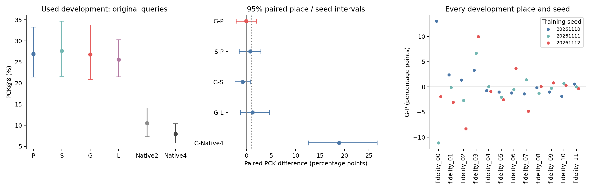
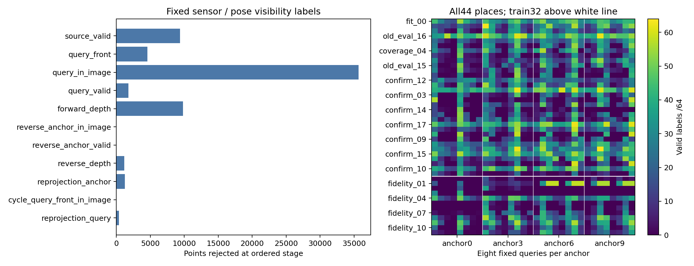
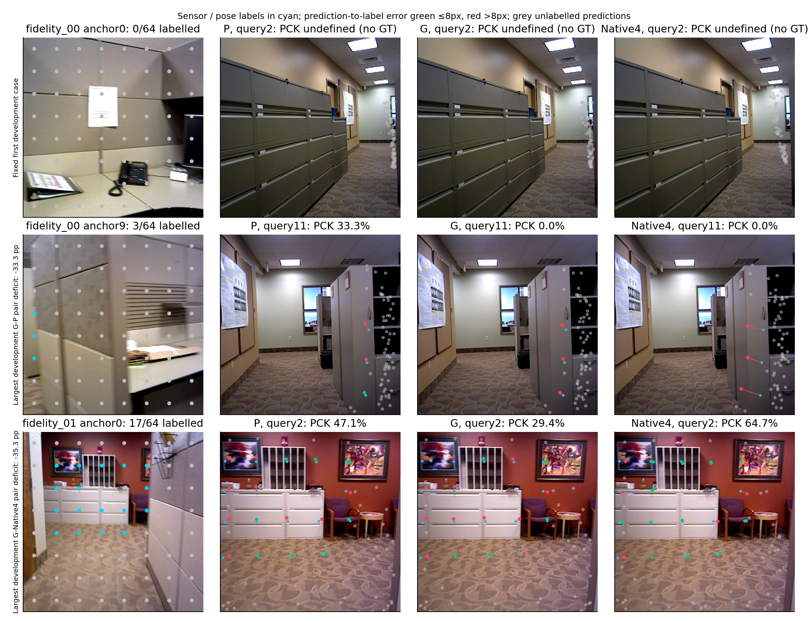
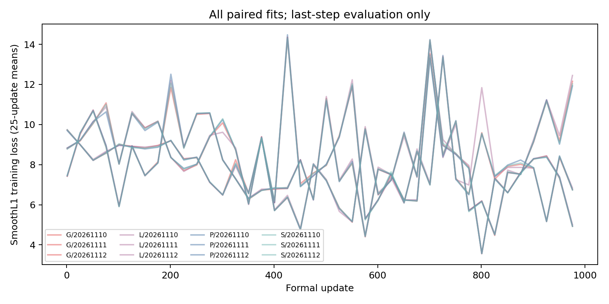

# native_track_memory_pe1：固定公共GS的原生点跟踪用途

2026-11-14，round026实现完整交付。唯一科学合同为[science_plan.md](../autonomous_research_loop/round_026/science_plan.md)，SHA256 `b57eecaf79e94b756aa4541d15310cbaac97c76f0b09edb61ebffb985812a518`。12 fits×1000更新、全部16896学习组预测及2816固定原生参考完成；固定末步，无挑选checkpoint、扩步或新增seed。所有数据是used development。下列是合同终点事实，后继科学取舍交回原Astra，不自行启动修补。

## 主要结果及界限

| Development original contrast | PCK difference pp [paired95%] |
|---|---|
| G-P | -0.081 [-2.135, 1.982] |
| S-P | 0.724 [-1.497, 2.902] |
| G-S | -0.805 [-2.384, 0.756] |
| G-L | 1.242 [-1.277, 4.684] |
| G-Native2 | 16.290 [11.118, 23.407] |
| G-Native4 | 18.867 [12.584, 26.659] |
| P-L | 1.323 [-0.746, 3.710] |
| P-Native4 | 18.948 [13.085, 26.034] |
| S-Native4 | 19.671 [13.357, 27.504] |
| L-Native4 | 17.625 [13.337, 23.001] |

| Method | PCK8 % [paired95%] | EPE px | Tail95 px |
|---|---|---|---|
| P | 26.892 [21.430, 33.297] | 18.861 | 28.334 |
| S | 27.615 [21.627, 34.715] | 18.668 | 28.060 |
| G | 26.811 [20.926, 33.804] | 19.085 | 28.496 |
| L | 25.569 [21.490, 30.283] | 20.637 | 30.830 |
| Native2 | 10.521 [7.330, 14.117] | 21.709 | 30.701 |
| Native4 | 7.944 [5.828, 10.411] | 22.519 | 31.601 |

Native4以上的提升也出现在L（+17.625pp），而G−L区间跨零；这些对Native的共同收益不能归为GS内容或PE。P/S/G的位置差异、来源内容相对L与共同适配分别判断。

原规则机械标记：G PE增量=False，G对L与Native4净用途=False；S预定次要PE增量=False，S净用途=False。候选标记只表示本合同的开发筛选条件，不能替代尾部／成本判断、fresh确认或总体目标。均值≥1pp且95%下界>0适用于G−P；S相同门限仅属次要比较。共同内容／适配、PE增量和原生净用途分列，不由某一阳性替代另一项。

主比较G−P连续EPE为0.224 [-0.423, 1.379]像素，view对95%尾部差0.162 [-0.463, 1.287]像素，负值有利G；它们与PCK净用途分列。[点级合并尾部分布](scoring/pooled_point_tails.json)另保留各组/种子50/90/95/99百分位与最大误差，属于描述而不是主地点等权估计。

主量先对每view对有效点计算PCK@8，再按锚、query、地点等权。95%区间为5000次配对交叉重采样种子与地点（seed20261114），两组使用相同索引；点／view对不是独立地点。Native参考跨种子共享；只有三训练种子，有限地点与sensor标签范围限制泛化。连续EPE和每view对95%尾部同层级汇总；标签不存在记undefined，真实模型／初值失败记PCK0、EPE∞，绝不当成缺标签删除。

训练32、开发12，原四query与另四query、全部八query，P/S/G/L/Native2/Native4绝对值、全部配对区间、每地点／每种子原始结果见[完整数表](report_tables.md)与[scoring](scoring/summary.json)。[逐query](scoring/query.json)、[逐锚](scoring/source.json)、[逐view对及全部64误差](scoring/viewpairs.json)可直接核对；原训练12与新增20的身份保留在逐地点和逐view记录中，不把added或other当fresh。

## 真实接口、信息与学习范围

复用原44份alpha绑定2048×1024粗GS，不是task-writer C/J场。P/S/G共享原完整f、普通完整logΣ六通道、opacity、B、density、实际逐槽可见质量、公共25维几何和同一原生query初值；仅K位置四槽分别为强中心density、同迹球footprint、完整footprint，共同29→64→1024零输出MLP。完整Σ普通内容和中心集合结构始终给P，不称G独占信息。G/P是匹配学习链的总差异，最终adapter分别学习；原场固定，不能改称固定同一接收器的直接干预或准确物理Σ的证明。GS投影中心连续RoPE、原图像2DRoPE共同保留；位置只加GS K，V无位置项，背景K/V为零。

源锚保持完全冻结的因果原生前缀；仅query第一个已有global读取只读GS K/V，无GS query更新、额外层、第二reader或反馈。其后全部24对原生块、官方DPT特征和官方TrackHead四次迭代真实输出64点。训练共同1045→1024映射、上述位置MLP及query首frame/global的rank8 QKV/proj LoRA，每组1,236,864参数，其余原模型、camera/depth/TrackHead全部冻结。AdamW1e−4、wd.01、clip5，FP32参数/Adam、原生BF16、batch1；同seed完全相同初始化与1000配对sampler。四次query坐标输出等权SmoothL1 beta8，没有feature/pose/visibility目标。激活checkpoint的反传重计算与来源前缀cache miss均计成本。

L用query原1024 DINO patch各复制两份，2048槽、相同参数/P字段，几何来自预测相机的单位1深度射线平面，普通logΣ/opacity/visibility置零，无query真值或GS内容；它是计算／参数匹配的当前图像控制，不是同信息控制。Native2用锚→query、Native4用锚先再其余三source→query，均取同锚与query官方DPT特征交同一真实两帧tracker；并非返回输入点的伪基线。Native4共享四source RGB，但没有GS形成时来源sensor/pose特权，GS净用途严格限该特权范围。

每锚source-only已知来源相机、sensor/common_valid与原生来源预测深度作公制对齐。query相机/内参来自未适配相同原生锚→query，queryGT只构标签，不进入模型/初值/PE；没有人为噪声或真值回退。所有query由同一只读场与全局adapter起始；query坐标编码是临时值。原生anchor前缀仍是必要混合状态，本轮不是纯GS取代全部原生历史。输入索引和既有小清单身份在[input_identities.json](input_identities.json)，没有重哈希大旧权重或复制场。528份public-state依赖索引中，396份P/S/G引用原场，132份L只记录source-native前缀与全局adapter依赖；L的当前query字段是临时值，绝不冒称source-only内容。全部引用12个小最终adapter，不是528份独立场或逐scene可训练参数。

## 标签、覆盖、零支持与反例

原生0-index固定8×8网格27.5+56i；source原PIL最近邻448→210 sensor/common_valid，query原210 sensor与K_metric构造静态投影。双向深度容差max(.02m,.02depth)，两cycle≤1像素210；无feature/区域配对筛选。模型始终预测全部64点，conf/visibility不作后验筛选。标签只是sensor/pose条件下的可见对应，不能称独立物理追踪真值。

| Cohort | Queries | Defined / all view pairs | Labelled / candidate points | Zero-GT pairs |
|---|---|---|---|---|
| dev12 | original | 112/192 | 2414/12288 | 80 |
| dev12 | other | 110/192 | 2432/12288 | 82 |
| train32 | original | 415/512 | 10011/32768 | 97 |
| train32 | other | 417/512 | 11146/32768 | 95 |

开发fidelity_03的原四query仅1个锚/query对有标签（30点），另四也仅1对（41点）；仍保留其地点权重，不把点数当独立地点。56个来源公制标定无效对及38个raster零支持对均无GT点，因此该条件的准确性端点未定义，不由它们宣称零误差或失败用途。

1408对共90112候选点，标签有效26003；无标签view对354，GS实际渲染零支持38，零可用attention键0，来源标定或相机初值无效56（来源公制标定无效56，非有限query相机/内参0）。每一阶段拒绝量、每点残差和无定义点保留在原case文件和[coverage](scoring/coverage.json)；[支持分层](scoring/support_strata.json)保留条件样本量、失败与同层级PCK，不能取代全体结论。旧家族的给定query相机覆盖结论不被本轮预测相机范围改写。

| Contrast | Place | Seed | Anchor→query | ΔPCK pp | Labelled points |
|---|---|---|---|---|---|
| G−S | fidelity_07 | 20261111 | 6→2 | -100.000 | 1 |
| G−S | fidelity_11 | 20261110 | 0→8 | -100.000 | 1 |
| G−Native2 | fidelity_11 | 20261110 | 3→8 | -66.667 | 6 |
| G−Native2 | fidelity_11 | 20261111 | 3→8 | -66.667 | 6 |
| G−Native2 | fidelity_11 | 20261112 | 3→8 | -66.667 | 6 |
| P−Native2 | fidelity_11 | 20261110 | 3→8 | -66.667 | 6 |
| P−Native2 | fidelity_11 | 20261111 | 3→8 | -66.667 | 6 |
| P−Native2 | fidelity_11 | 20261112 | 3→8 | -66.667 | 6 |
| S−Native2 | fidelity_11 | 20261110 | 3→8 | -66.667 | 6 |
| S−Native2 | fidelity_11 | 20261111 | 3→8 | -66.667 | 6 |
| S−Native2 | fidelity_11 | 20261112 | 3→8 | -66.667 | 6 |
| L−Native2 | fidelity_11 | 20261110 | 3→8 | -66.667 | 6 |

全部成对反例与正差见[未截断清单](scoring/all_pairwise_counterexamples.json)。图例固定第一个开发例以及最大开发G−P／G−Native4 view对缺口；无图像排除或用视觉质量修改阈值。墙面／边界／遮挡及sensor投影歧义仍保留。

实际图像查看与观察见[figure_review.json](figure_review.json)，不是仅导出文件。

## 有效实现检查及普通失败

[preflight](preflight.json)使用固定首个有标签训练pair：P/S/G/L真实损失反传，source/位置输出/两LoRA QKV梯度非零且有限；native/source前缀冻结。禁用记忆／零LoRA回放Native2四次坐标最大差0像素；空GS支持仍有背景且真实完整query/Track有限。一个P预检Adam更新丢弃，完整参数+Adam、RNG与1000sampler精确恢复；正式12000步另计，未重复或丢弃正式更新。其中2280个固定batch无有效GT，使用连接计算图的零监督项、梯度范数0，保持AdamW动量/weight decay与既定step，不重采样；不把它们解释为真实零跟踪误差。有效GT但loss0的batch有0个，完整记录见[无监督batch清单](unsupervised_training_batches.json)。独立NumPy/Torch终点复算最大绝对差0.000000000000，不是从已有score复制结论。

两次准备启动的3+3进程exit1：首先venv Ninja未在PATH，其后原CPU几何helper与CUDA默认eye冲突。前者保留已发生原生调用和3次gsplat kernel前失败；后者保留3次完成raster但未提交case。兼容venv/CUDA路径和原helper设备界面已修，无安装系统库／下载／GLIBC变更。随后为消除CPU几何瓶颈，在两个固定已完成训练case验证同公式CUDA端口：所有PE/中心/mask精确、普通字段最大8.88e−16；只中断自有准备进程并提交当前case后，恢复缺失包，未重做已提交科学预测。保守30worker秒包括该小检查。

GPU4在P第二种子评价期间出现外部训练；仅SIGTERM我方评价，当前case提交后actualwait75，695/1408已提交结果与1000步永久final/完整Adam保留。迁至7号后外部6/7加载任务到达，再于876对后礼让；外部退出后同管理器实时准入并从876继续，只恢复缺失评价。没有重做正式更新、重复已提交预测或操作外部PID，全部cold reload与礼让前时间计账。

最终G/L第三种子评价又遇外部6/7任务，16620对提交后仅我方actualwait75，余G76/L200。旧manager44052在04:32:25正常停止路径exit75，来源未知，调用方未发送停止信号；所有旧child均actualwait、资源未达限，不把未知原因改写为科学失败或主动刷新。随后同锁唯一恢复manager只从永久final1000补缺失评价。外部显存约9444MiB连续数分钟稳定，以准入free≥36GiB／卡util≤35%、我方allocator8GiB、运行free≥24GiB和新外部PID／持续高利用率礼让，保守共享少量评价；未来外部峰值未知，不冒称认证。真实source/adapter/采样/坐标计算不变，没有新fit、正式更新或benchmark；成本保持独占空卡。全部新增加载、共享争用和恢复worker墙钟入账。

外部任务占用其余卡后，根据实测29408MiB训练占用与约5704MiB评价占用，在安全卡实施每卡一训一评，共4次既定pending fit的同卡准入。为加入动态准入接口，仅在G/L第二种子均已final1000后刷新唯一manager，旧会话实际exit75且全部子进程actualwait，所有评价marker保留。P第三种子正式首100步144.69秒（此前solo131–136秒），据此及剩余原工作投影控制窗口；没有额外benchmark、fit或步数。新外部PID到达只礼让我方；[准入](cohost_admissions.json)、[实测预算审查](engineering_revisions/cohost006_throughput_review.json)和[显存现场](cohost_observations.jsonl)保留，全部加载/恢复/争用时间都进GPUworker账。

首三fit用8-entry只读GPU anchor LRU，随机配对几乎每步重建来源前缀；后续九fit扩为128-entry覆盖32×4锚，源prefix数值与sampler不变，无中断首三fit。该缓存不写DATA／RAM文件；实际GPU峰值单列。所有历史版本及普通失败在[engineering_revisions](engineering_revisions)，失败、主动结束、加载、I/O和重建均计总worker墙钟；没有以超时重启或重复队列。

## 完整成本与预算

| Method | One-time source prefix/calibration s | Fresh full query s | Source amortized at8queries + fullquery s |
|---|---|---|---|
| P | 0.5587 | 1.7922 | 1.8621 |
| S | 0.5587 | 1.7846 | 1.8545 |
| G | 0.5587 | 1.7812 | 1.8510 |
| L | 0.5587 | 1.1149 | 1.1848 |
| Native2 | 0.4471 | 1.6601 | 1.7160 |
| Native4 | 0.8065 | 0.9783 | 1.0791 |

| One-anchor deployment dependency | Tensor / unique-storage MiB |
|---|---|
| Native anchor KV, logical / backing storage | 96.469 / 144.703 |
| Anchor Track DPT | 24.500 |
| Original shared GS + source geometry | 4.614 |
| Mixed anchor KV backing + DPT + GS/geometry | 173.817 |
| Native4 KV backing + same anchor DPT | 410.375 |

上述是固定单锚案例的依赖张量，不含全局native权重、全局adapter与query临时激活；KV底层QKV共享存储与逻辑视图分别记账，不将小GS文件大小冒称完整混合状态大小。

固定fit00/a0/q2、首种子一个实际成本例，无分布／硬件benchmark推论。固定执行顺序为Native2首次TrackHead、P/S/G/L、最后Native4；早晚调用的kernel/TrackHead首次初始化不独立可辨，后续链已承接前面初始化，不能由本例推断稳定态速度排序或独立cold-first-GS延迟。没有追加warmup或重复benchmark；所有首次调用真实worker时间完整入账。原已准备448 RGB张量重新经DINO编码、冻结锚前缀+DPT、camera/depth/source sensor标定；query已准备RGB重新编码、第一次原生query+camera初值、真实gsplat/全部字段、第二次带记忆原生query和官方DPT+Track全部计入。L同样计原生初值和单位ray字段；Native2/4只计对应所需真实source/query，不给其添加GS相机头。成本准入时本卡无其他CUDA进程；其他卡正式任务并行与现场见[cost_dispatch](cost_dispatch.json)，不将其解释为隔离服务器benchmark。共同阶段实测一次并明确计入各适用部署pipeline，不把共同缓存当免费；5次真实DINO、4source原生frame、6query/Track、1raster及所有cold load在[actual_cost.json](actual_cost.json)。表中source amortization只摊一次来源依赖，query部分含两次原生query，1/4/8范围均单列；模型/adapter/文件cold load另列。该例从既有448 RGB张量开始，raw图像解码/resize与sensor获取未重做、未计入该延迟；重新编码不意味着新数据或fresh科学确认。

GS原来源形成没有本轮重做。原24 warm prepared-source→field样例3.230/3.155秒不含raw解码、AnySplat来源预测或冷加载；新增20场来源预测／拟合／绑定及缓存worker合计10.554/36.986/47.976秒，范围不同且并非单scene端到端时间。sensor获取、旧预处理和冷predictor未知；[继承成本范围](cost_inherited.json)保留，不能称GS形成免费或用warm数替代全部来源形成。sourceprefix+GS混合状态的体积与查询开销不证明压缩原生历史已成功。

总GPU worker **10.769305h /12h**，包括全部失败、恢复、预检、加载、I/O、训练、评价与成本；新DATA最终1.5683GiB、原子并发保守峰上界1.8183GiB /12GiB；项目含脚本封存测得约0.0893GiB、保守全产物峰0.1518GiB /1GiB。[现场退出确认](actual_terminal_confirmation.json)核实所有本轮GPU／科学CPU进程结束；所有GPU子进程实际wait返回，共35个worker，exit1 6、主动exit75 11；完整Adam最大14.19MiB，永久12final均保存。没有自有RAM文件系统checkpoint或隐藏临时副本；失败进程峰RSS/GPU未采全，明确unknown，不伪造零。

[runtime_budget_calls.json](runtime_budget_calls.json)列每worker时段/卡/PID/实际退出、精确逻辑fullquery与官方tracker调用、反传checkpoint重计算、峰RAM/GPU与保守磁盘暂存。常规CPU评分/作图及最终组织独立记录；未占GPU的管理／编辑时间不充作GPU训练时间。实时保护0–3/5等外部任务，仅安全空卡获准，三卡独立唯一fit；无默认两卡上限、无扩大预算换利用率。

## O/C与交回边界

O2/O3原公共粗GS只读，O4多真实query、O5实际投影raster，O6同信息PE比较与原生用途分别实测。C1/C2不重建；C3一个既有global只读接口；C4完整共同Σ普通内容+强中心、只比较位置分配；C5对应任务及未知query相机；C6有限共同学习。sensor/来源pose特权、静态四源、2048×1024、混合native前缀、旧数据／有限点标签均为本次实施选择，不是用户核心要求。历史内容区域K正证据、R替换未决及旧depth/pose/地址等关闭保持，不据本轮阴性推出公共GS或所有PE无用，也不据阳性宣称总体成功。所有后继判断集中交主→原Astra。
