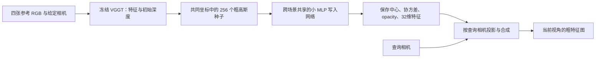

# 共享粗高斯场景记忆：第一轮原型结果

2026-11-10。**给定相机、小规模静态场景下，共享网络写入高斯记忆、保存后按多个视角读取的闭环已得到初步实验支持。** 学习几何组在三个训练场景的留出视角和六个未参与本次优化的场景上，都优于固定初始几何组；空间打乱、场景交换及错误查询相机明显损害结果。此结论覆盖可学习的粗特征记忆，不代表完整三维重建、未知相机、长序列或几何 PE 优势已成立。

## 1. 实际实现



每个四视图片段生成一份记忆；同一份记忆服务该片段的全部查询。三个训练场景各取四个片段，共享同一个网络，没有逐场景可训练参数表或逐场景优化。这里的记忆覆盖参考视图观测到的局部场景，不是整栋建筑或完整房间的全局地图。

VGGT 只对四张参考图像执行多视图聚合。利用四个参考相机的两两基线对齐预测深度尺度，再以给定相机反投影；不读取传感器深度。参考 patch 的三维均值、协方差和特征经固定 FPS/KNN 合并成 256 个种子。共享 MLP 从种子上下文预测中心修正、正定协方差修正、opacity 和特征修正。大的初始几何结构来自冻结 VGGT，本轮学习的是记忆的写入和修正。

写入网络为两个 128 维隐藏层及一个输出层，共 **289,066** 参数。实际状态为

\[
M=\{(\mu_j,\Sigma_j,\alpha_j,f_j)\}_{j=1}^{256},\quad f_j\in\mathbb R^{32}.
\]

协方差通过正对角的三角因子构造，中心是有界残差；没有新增姿态预测、循环更新或多分支模块。读取器使用 gsplat 的可微投影和 alpha 合成，读取器本身固定。float32 状态共 **46,080 bytes，约 45 KiB**，不包括文件元数据、查询相机和共享网络权重。

查询图像只进入独立的教师编码或监督，不进入参考特征计算、种子构建或写入网络。教师为 VGGT 内的冻结 DINO patch 编码器，逐图编码；32 维 PCA 和各维尺度只在训练参考图像上拟合，保留约 **80.70%** 的训练参考特征方差。输出为 `15×20×32` 特征图，不是 RGB 图像。

## 2. 数据、训练和固定比较

复用九个历史上已经使用过的 SUN3D 场景，不能称为新的独立确认数据。三个旧 fit 场景用于此次写入网络训练；另六个场景没有参与此次优化。它们是否出现在 VGGT 的预训练数据中未作判定。

每段 13 帧，参考序号 `0,4,8,12`，训练查询 `1,3,5,7,9,11`，留出查询 `2,6,10`；训练片段的三个集合在原始图像文件层面互斥。共 12 个训练片段、6 个未优化场景片段，包含 72 个训练查询、36 个同场景留出查询、54 个未优化场景查询。原始帧及哈希见 [data_manifest.json](data_manifest.json)，压缩数据身份见 [cache_identity.json](cache_identity.json)。

两次训练均为同一初始化种子 `20261110`、相同采样顺序、AdamW `3e-4`、2,000 步，每步一个片段和两个训练查询。使用预定最后一步，不据留出结果挑选模型。固定几何控制只禁止中心和协方差更新，仍学习特征与 opacity；未训练的直接提升作为额外参照。全部训练正常完成，最终权重和 18 份实际记忆分别保存在 [学习几何组](learned_geometry/) 和 [固定几何组](fixed_geometry/)。

主目标为标准化教师特征 MSE，越低越好。下列平均数来自全部预定查询，没有排除困难片段。

| 查询范围 | 查询数 | 未训练直接提升 | 固定几何写入 | 学习几何写入 | 相对固定几何的误差降低 |
|---|---:|---:|---:|---:|---:|
| 训练查询 | 72 | 0.54160 | 0.46237 | **0.40673** | 12.03% |
| 同场景留出视角 | 36 | 0.54819 | 0.47139 | **0.41795** | **11.34%** |
| 未参与本次优化的六个场景 | 54 | 0.48000 | 0.45112 | **0.42546** | **5.69%** |

三个训练场景的留出视角和六个未优化场景均为同方向；12 个训练片段的留出视角也均改善。六场景逐项结果如下，体现收益幅度的差别。

| 未优化场景 | 固定几何 MSE | 学习几何 MSE | 误差降低 |
|---|---:|---:|---:|
| harvard_c8/hv_c8_3 | 0.49461 | 0.44600 | 9.83% |
| harvard_c11/hv_c11_2 | 0.44323 | 0.41374 | 6.65% |
| hotel_umd/maryland_hotel3 | 0.53577 | 0.51264 | 4.32% |
| mit_76_studyroom/76-1studyroom2 | 0.51190 | 0.50695 | 0.97% |
| mit_dorm_next_sj/dorm_next_sj_oct_30_2012_scan1_erika | 0.31737 | 0.28186 | 11.19% |
| mit_lab_hj/lab_hj_tea_nov_2_2012_scan1_erika | 0.40383 | 0.39155 | 3.04% |

这是一个种子的小规模开发结果，不作统计显著性或一般性领先的声明。六场景的余弦相似度从未训练提升的 0.7401 到学习几何组的 0.7467，幅度较小；MSE 降低不能直接解释为同幅度的语义能力提高。

## 3. 是否真正使用了有空间组织的记忆

以下固定诊断均直接操作保存后的状态，不重新训练。场景交换同时改变内容和几何，只能检查场景依赖；特征打乱、中心扰动和相机替换进一步检查空间绑定与视角依赖。

| 学习几何组的读取条件 | 同场景留出 MSE | 六个未优化场景 MSE |
|---|---:|---:|
| 正常读取 | **0.41795** | **0.42546** |
| 移除记忆 | 0.98904 | 0.93807 |
| 换成另一场景的记忆 | 1.45212 | 1.41414 |
| 打乱特征与高斯的绑定 | 1.13470 | 0.98779 |
| 中心加入固定 0.15 场景单位扰动 | 0.82076 | 0.69140 |
| 所有基元使用同一个场景平均特征 | 0.93264 | 0.80624 |
| 查询始终使用第一参考相机 | 0.91214 | 0.75132 |

再用独立命令仅加载一份保存的高斯状态与相机文件，读取未优化的 c8 场景九个视角；不加载图像、VGGT 或写入网络权重。其输出与正式评估逐值一致，见 [独立读取核对](evaluation/standalone_check.json)。结合留出视角与场景结果，这些证据支持共享网络确实写入了可重复读取、依赖场景和空间绑定的状态；单独的打乱实验不能承担这一整套结论。

## 4. 可视化触发的补充诊断

实际查看特征图后发现，前三个 PCA 通道有跨场景的平滑空间色带。为辨别二维位置先验或直接复制解释，先记录[诊断计划](template_diagnostic1/plan.json)，再计算三种零训练控制，没有更换模型、训练目标或 checkpoint。最近参考依据给定相机在单位深度处的射线端点距离选择，不使用查询图像。该控制保存四张完整二维特征图，未匹配记忆容量。

| 控制 | 同场景留出 MSE | 六个未优化场景 MSE |
|---|---:|---:|
| 训练查询的逐像素平均模板 | 0.84879 | 0.83695 |
| 当前片段四张参考的逐像素平均 | 0.67351 | 0.56299 |
| 复制最近参考视图 | 0.82206 | 0.62405 |
| 学习几何记忆 | **0.41795** | **0.42546** |

九个场景逐项都保留该方向，见[完整补充结果](template_diagnostic1/scores.json)。因此，所检验的固定二维模板和复制方式不足以解释当前结果；这并未穷尽所有二维模型或所有视图选择方法。该诊断在主结果开放后进行，明确属于开发诊断。

## 5. 实际看到的效果与局限

已查看五个片段的多视角图、三个实际记忆的几何投影及完整训练曲线，见 [review.json](review.json)。同一记忆能随查询视角改变读取的粗区域结构；学习几何组减少了一些不连续空洞和偏暗区域，打乱后区域结构明显破坏。酒店片段仍有明显错位和缺失，studyroom 的额外收益很小，不能把图中的伪彩色当作准确 RGB 重建或精确三维模型。

可直接查看：

- [训练场景的三个留出视角](evaluation/fit_00.png)
- [未优化 c8 场景的三个视角](evaluation/val_12.png)
- [收益较小的 studyroom](evaluation/old_eval_15.png)
- [误差较大的酒店片段](evaluation/old_eval_14.png)
- [c8 的实际保存记忆与初始几何](evaluation/val_12_memory.png)
- [完整训练曲线](evaluation/training.png)

学习后基元中心位移中位数约为初始深度归一化单位的 0.027–0.051，各片段平均协方差 trace 比约 0.96–1.84；实际发生了几何更新，并非只改变名称。与此同时，六场景平均 alpha 从直接提升的 0.691 提高到 0.862，读取覆盖与幅值校准可能贡献了部分 MSE 改善。本轮没有把中心修正、形状修正和覆盖效应单独归因，也没有证明物理几何更准确或各向异性不可替代。

studyroom 的参考尺度比最大/最小约 60.3，dorm 约 7.36，均完整保留。前者收益小、后者仍有较大收益，不能把尺度诊断直接当作收益预测器或断言它解释了全部失败。

当前证据边界是：冻结 VGGT、给定相机、一次性四视图写入、静态局部场景、256 个高斯、低分辨率压缩教师特征。没有验证未知相机、增量记忆、长期保持、多场景长期管理、完整 VGGT 下游精度或相对点/体素记忆的优势，也没有开始 attention 中的几何 PE 对照。

## 6. 后续研究的起点

这轮先保留精炼结构，后续固定这份可工作的写入与保存机制，再检验**高斯参数怎样帮助 Transformer 从记忆中读出当前视图需要的信息**。同记忆、同输入、同目标下比较现有投影读取、内容 attention 与高斯几何位置项，才能把“记忆可学习”推进到“参数化用于 PE 有额外价值”。本轮正结果不会自动转移成后一个结论。

## 7. 实现与复现入口

- [写入与读取模型](../../../models/gaussian_memory.py)
- [参考特征与数据边界](../../../experiments/gaussian_memory_data.py)
- [共享写入训练](../../../experiments/gaussian_memory_train.py)
- [固定评估与可视化](../../../experiments/gaussian_memory_evaluate.py)
- [无图像依赖的独立读取](../../../experiments/gaussian_memory_read.py)
- [首轮计划](../../../docs/gaussian_memory_prototype_plan.md)、[实现预检](preflight.json)、[官方依赖校验](dependency_validation.json)

在 `/home/liwt/GRoPE` 中，下面是已实测的独立读取命令。启动器会检查共享卡条件，等待符合条件后才启动，并限制本进程显存为 12 GiB：

```bash
/home/liwt/miniColmap/.venv/bin/python -m experiments.gaussian_memory_launch \
  --gpu 1 --allow-shared --wait-for-gpu experiments.gaussian_memory_read \
  --memory results/gaussian_memory/prototype1/learned_geometry/memories/val_12.pt \
  --cameras results/gaussian_memory/prototype1/evaluation/val_12_cameras.npz \
  --output results/gaussian_memory/prototype1/evaluation/standalone_val12.npz
```

相机文件已表示在记忆的第一参考相机坐标和深度归一化单位中。写入数据与官方权重位于 `/mnt/f70f6709-366e-49a0-861f-497645d98975/users/liwt/data/GRoPE/gaussian_memory`。VGGT [官方固定源码](https://github.com/facebookresearch/vggt/tree/a288dd0f14786c93483e45524328726ab7b1b4ce)与官方权重身份已记录；下载通过 hf-mirror.com，未使用代理。源代码采用用户态现有运行时，未修改系统 GLIBC。

参考提取的 PyTorch 峰值分配约 4.66 GiB；写入训练约 0.055 GiB，不含 CUDA 上下文及此前离线提取。两次训练分别约 21.4 秒、13.3 秒，包含该次共享卡运行条件，不能作为严格速度比较。全部预定实验已完成，没有继续排队的本原型训练。
