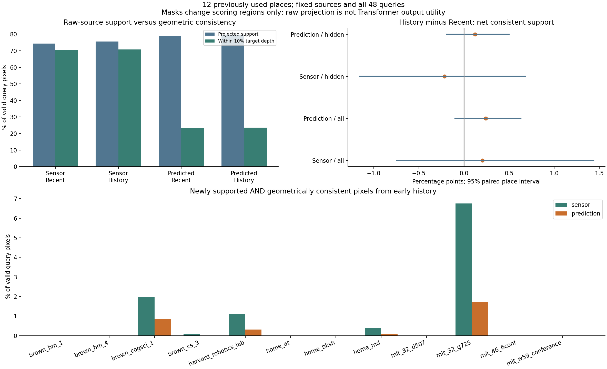
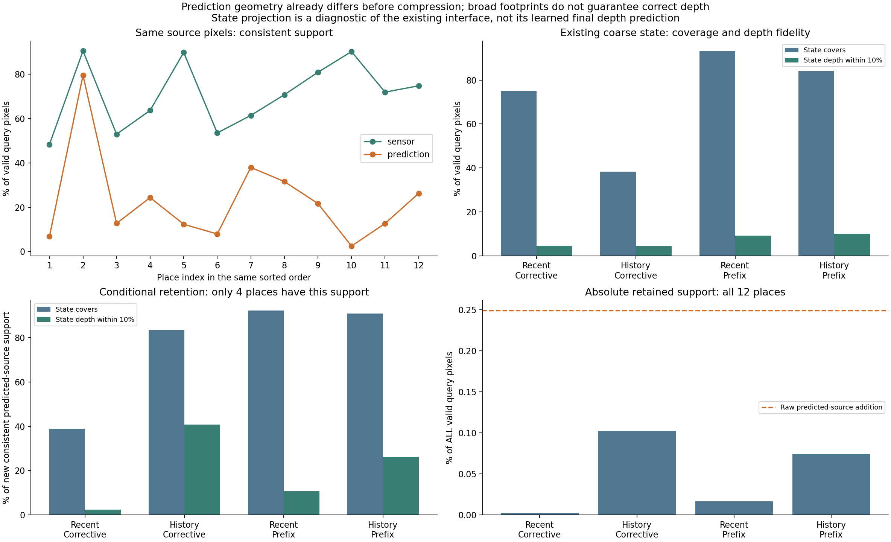
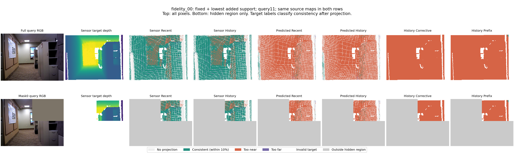
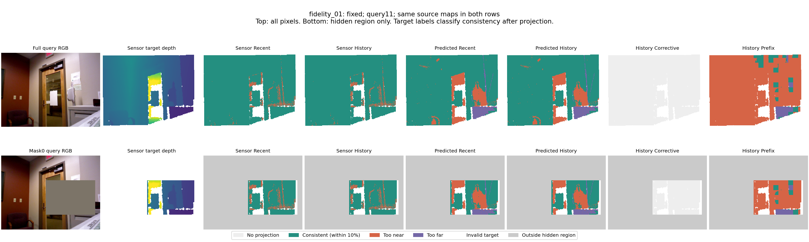
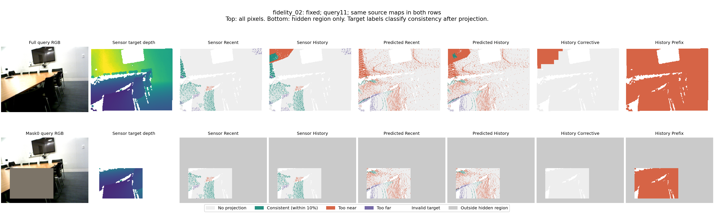

# raw_history_information1：历史补充量有限，预测几何在压缩前已有明显误差

2026-11-11。有限输入信息诊断已完成，全部旧地点保留。**下一步优先改变能够检验历史作用的任务条件；暂不继续修PE公式、扩大记忆或追求更精确的静态投影。**

## 这轮回答了什么

在现有12对稀疏窗口里，早期历史新增、且与目标深度相差不超过10%的支持，平均仅占查询有效像素的0.858%，六个地点完全没有这种新增支持；预测几何下只有0.249%，八个地点为零。近期观测已经提供大量相关信息。

同样的来源像素、相机和投影规则下，传感器来源与预测来源的历史一致支持率为70.768%/23.028%，差47.740个百分点，12个地点均为前者更高，配对95%区间[36.568,59.756]个百分点。这说明误差在进入256槽压缩之前就已明显存在，不能把全部问题归于容量或PE。尚未区分源深度结构、米制标定、时序/位姿误差各自贡献。

已有高斯状态的覆盖范围与几何一致性也不同。它是粗区域/内容记忆，投影中心的合成深度不是最终网络预测，不能以它低于稠密传感器投影来宣判PE无效。它支持保留表示损失这个竞争解释，但不足以单独定位writer。

## 假设、固定输入与边界

假设是：原始历史包含当前查询需要的补充几何，但压缩、更新或attention读取丢失了它。竞争解释包括历史与查询缺乏重叠、近期已覆盖同一区域，以及预测几何/坐标标定不够可靠。

沿用history_read1的同12对窗口、4查询、完整/两遮挡条件。Early=A的0/1/2/3/4/6/8/10；Recent=B的0/1/2/3及查询前写入帧；History为并集。Recent是晚期来源集合，不只是Native最近四帧。所有只读查询帧都不进入来源。没有模型选择、场景排除、拟合或下载。

192个来源帧传感器深度均已下载。旧缓存只保存区域摘要，因此冻结原VGGT，重放24片段×5原因果四帧窗口，补存192张来源稠密深度；原来的相机基线标定尺度保持不变。源传感器只用于诊断，未注入候选模型；查询深度仅用于投影后的评分。

固定210×280网格、像素中心+0.5、源深度(0.1,10)米、最前方正z、最近像素落点、不补洞；一致性容差10%沿用writer原值。主两组分别使用自身有效来源像素；匹配两组使用双方均有效的同一来源像素。没有改变阈值或扫描分辨率。

48个相机投影不因人工遮挡改变；遮挡只划分被评分区域。混合、完整和全像素遮挡指标因而重复同一投影，不能当作独立复现。隐藏区域另报。统计单位是12个地点，5000次地点配对重采样，无新增模型种子；以下区间不是多重比较校正后的确认。

## 原始支持和新增支持

表中前两列均以查询有效深度像素为分母。一致支持要求既有投影，又满足固定10%深度容差；不支持的像素计入分母。条件AbsRel只在有投影且有目标深度的像素计算，各查询先平均再地点等权。

| 来源 | 范围 | 投影覆盖 | 一致支持 | 有支持区域AbsRel |
|---|---|---:|---:|---:|
| sensor | early | 9.737% | 7.807% | 0.3777 |
| sensor | recent | 74.257% | 70.563% | 0.0427 |
| sensor | history | 75.517% | 70.768% | 0.0584 |
| prediction | early | 11.739% | 2.323% | 0.4225 |
| prediction | recent | 78.768% | 23.297% | 0.2474 |
| prediction | history | 79.712% | 23.538% | 0.2493 |
| sensor_matched | early | 9.737% | 7.807% | 0.3777 |
| sensor_matched | recent | 74.257% | 70.563% | 0.0427 |
| sensor_matched | history | 75.517% | 70.768% | 0.0584 |
| prediction_matched | early | 10.682% | 2.153% | 0.4208 |
| prediction_matched | recent | 74.881% | 22.685% | 0.2445 |
| prediction_matched | history | 76.191% | 23.028% | 0.2453 |

| 来源/区域 | 新增投影覆盖（全部区域像素） | 新增且一致（有效区域像素） | 其95%区间 | 有新增一致的地点 |
|---|---:|---:|---|---:|
| sensor/全图 | 1.783% | 0.858% | [0.069, 2.048] | 6/12 |
| prediction/全图 | 1.280% | 0.249% | [0.016, 0.575] | 4/12 |
| sensor/人工隐藏区 | 0.988% | 0.623% | [0.027, 1.534] | 5/12 |
| prediction/人工隐藏区 | 0.818% | 0.193% | [0.000, 0.515] | 4/12 |

新增支持并不等于总一致支持净增：早期来源也可能把近期正确表面替换成错误的更近投影。传感器来源全图净增仅0.205个百分点，区间[-0.746,1.436]；预测来源净增0.241个百分点，区间[-0.100,0.632]。人工隐藏区传感器净变为−0.217个百分点，区间同样跨零。没有建立稳定的整体几何净增量。

这不证明原始历史毫无用途：传感器新增一致支持在mit_32_g725约6.75%、brown_cogsci_1约1.97%，有明确的局部潜力。所有地点仍计入整体，不把这些地点重新挑成确认集。

## 进入粗记忆以后保留了什么

复用四组已存状态与原project_memory接口，保持3σ、0.1 patch²模糊、coverage>0.1，并把patch覆盖/合成深度展开到对应像素。状态覆盖不能充当真实表面或最终预测。

| 状态 | 有效查询像素覆盖 | 一致深度支持 | 条件AbsRel |
|---|---:|---:|---:|
| Recent / Corrective | 74.910% | 4.602% | 0.6295（12/12地点有支持） |
| History / Corrective | 38.370% | 4.395% | 0.5340（10/12地点有支持） |
| Recent / Prefix | 93.026% | 9.249% | 0.5149（12/12地点有支持） |
| History / Prefix | 84.037% | 10.054% | 0.4394（12/12地点有支持） |

History-Corrective与History-Prefix在新增且一致的原始预测支持位置上，平均覆盖83.43%/90.96%，但合成深度也一致的比例为40.82%/26.15%。**这两个条件比例只有4个地点有分母**，不能作为12地点整体性能。换算为全部有效查询像素，保留的一致新增支持仅为0.102%/0.075%，原始预测来源新增为0.249%。

Recent-Prefix在这些位置也能有很宽的高斯覆盖，说明“覆盖到某位置”不是“保存了该来源的信息”的证明。状态足迹、置信筛选、区域化、合并、更新与原始稠密点不同，本轮不把其差异唯一归因于槽数量，也不称传感器投影是PE上界。原始来源的缺测/标定和状态表示问题可同时存在。

## 核对与计算代价

- 120次冻结骨干重放全部完成，192张来源深度保存；与旧缓存的区域中位深度最大差0.0，置信筛选差异0个patch。
- 两张空闲A6000分别处理60个窗口，worker耗时20.90/21.66秒，峰值已分配4.636GiB；沿用12GiB上限，两个退出码均0。
- 全量投影与评分worker 14.29秒，峰值已分配0.149GiB；零训练/下载。共享资源计时不作独占速度基准。
- 12096行计数/连续误差/保留统计全部独立复算；2个固定地点、2查询、2种来源、3范围的24张图另用NumPy齐次坐标投影复算，支持像素不一致数均为0。
- 原始标签、RGB、缓存、状态和源代码身份保留。旧状态平均覆盖复现最大差约2.65×10⁻⁶，未扩大为新的数值审核。完整结果及条件分母见analysis.json、independent_checks.json。

## 分支决定与下一步

**当前主要限制首先是任务提供的历史补充量不足，预测几何误差又进一步减少可用信息。** 尚不能依据这一实验要求增加memory容量、重写writer或否定高斯PE。六个地点连传感器来源的新增一致支持也为零；在这批窗口继续补种子或修读取公式，难以建立强证据链。

下一项应构造一个有限的受控历史读取正对照：保留早期完整观察，遮挡当前四帧和晚期写入中的同一空间区域，使历史确实可能补充当前缺失；所有方法获得相同输入，仍比较高斯、Center、强内容和Local/Native。先验证这个任务的信息边界，再做GPU原生输出比较，既不把当前覆盖诊断当永久门禁，也不把受控任务包装成真实部署确认。

具体方案见[history_visibility_control1](../../../docs/gaussian_memory_history_visibility_plan.md)，目前仅提出，尚未执行或设为新目标。

这轮回答的是当前数据中历史支持的数量、来源几何误差和粗状态投影的限制；没有新增Transformer预测或训练。因此history_read1与native_anchor_probe1的整体用途/强C负结果原样保留。

## 固定例图与反例

固定fidelity_00/01/02、query11，另按最少传感器新增一致支持选择反例；零值并列按地点名排序，结果与fidelity_00重合，不另换地点。上行为全图，下行仅评价mask0隐藏区，源投影相同。颜色由投影完成后的查询标签判定：绿色一致、红色过近、紫色过远；浅灰无投影、白色目标无效。过近/过远表示几何差异，不单独证明真实遮挡或物体运动。

已实际查看并审阅5幅最终PNG，详见visual_review.json。
