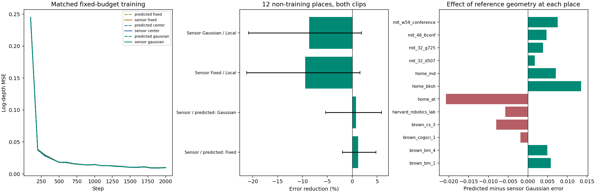

# reference_geometry1：参考几何更可靠，当前学习读写能否兑现收益

2026-11-10。**本轮已完成，单独替换参考初始几何没有建立当前联合写入—attention读取的跨地点净收益。** 九次配对训练、46个历史片段、训练/读取几何交叉对照、固定记忆干预、独立核对和八图审阅全部完成。传感器辅助Gaussian主误差仅比原版本低0.75%，种子方向混合，仍比Local高8.65%。与此同时，预定的无训练中心读取从同一几何替换中获得57.97%的改善。应继续追问当前读取接口如何利用几何，不能将这轮解释成“参考几何没有价值”或“高斯场景记忆不可行”。

[事前计划](../../../docs/gaussian_memory_reference_geometry_plan.md) · [源/输入/配置身份](plan.json) · [主分析](analysis.json) · [完整分数](evaluation/scores.json) · [无训练对照分析](baseline_analysis.json) · [独立核对](checks.json) · [实际审阅](review.json)

## 要区分的问题

surface1已表明：共享高斯写入与读取能改善训练片段留出视角，但非训练地点不及参数量匹配的Local；一致性改善也不能保证表面正确。本轮固定原结构，只改变参考侧的初始均值/协方差，检验初始几何是否足以解释这一缺口。

竞争解释包括：固定分组/内容仍限制几何表达，或者当前注意力、隐向量融合及输出头没有可靠传递几何。没有据结果更换网络、损失、种子、训练步数或主评价集合。所有旧负结果保留；这里的深度是共同场景量的可学性探针，不是把总体目标改成深度估计榜单。

## 固定干预与信息边界

沿用四参考帧0/4/8/12、给定相机及原尺度。参考传感器深度按已有时间戳关联，PIL最近邻缩至210×280；每14×14 patch中0.1–10米的有效像素至少占一半时，以其世界坐标均值及完整协方差替换原VGGT patch几何，缺测则回退原值。再用**原256槽的FPS/8邻居成员和权重**聚合。只替换`seed_mean/seed_chol`，不重新分组；原`seed_context/seed_teacher`逐值保持。

查询RGB不参与记忆建立，查询传感器深度只用于监督和评分；参考传感器输入与查询标签的文件集合隔离。相机、查询token、掩码、标签、场景划分和归一化尺度不变。新模型从旧对应模型的精确初值开始，2000步采样逐项一致；这是匹配训练后的几何对照，不是只在测试时给旧模型换输入。

这是**部分传感器辅助诊断**，不是RGB部署方案，也不是严格性能上界。主评价平均90.01%的参考patch被替换，槽内权重替换率90.06%（逐片段81.96%–94.39%）。中心平均移动0.775米；平均逐槽协方差trace比为7.04，不能把该数理解成误差降低倍数。

[预定分组限制的分解](geometry_diagnostic.json)只用参考几何：主评价平均的patch内部/patch之间散布trace由0.0421/0.0408 m²变成0.0841/0.1965 m²。逐片段“成员中心间散布占总散布”平均由51.57%升到66.77%。固定成员在新几何下更分散，但这不能独自区分真实范围扩大、混合表面、深度噪声或旧分组错误。原S4特征仍包含原VGGT先验；因此本轮没有消除全部几何与表示问题。

## 结构、数据和预算

继续使用surface1共享GaussianWriter、256槽、32维内容、64维四头单层attention和对数米制深度输出；核心场景状态45 KiB，无逐场景优化。Local宽191、435,757参数；三个记忆组均434,543参数。Fixed固定几何、学习内容/opacity及读取；Center联合写入、位置bias用中心距离；Gaussian联合写入、位置bias用投影完整协方差。Center的key仍含协方差信息，是形状位置项的控制，不是完全无形状的网络。

- 新增Fixed/Center/Gaussian×三个种子20261110/11/12，共9次2000步训练；复用surface1的Local及三个记忆组共12个旧模型。
- 十二训练地点各一片段，72训练查询、288遮挡样本；batch2、AdamW 3e-4、weight decay .01、clip5；不选checkpoint。
- 评价46个历史片段、288查询/576遮挡及完整输入。主评价十二非训练地点各两个片段，先合并地点再跨种子；这是开发诊断，无新确认、无场景排除。
- 每片段79组遮挡条件、39组完整输入，合计3634/1794评分条目；保存并读取1656份独立场景状态。各状态只来自相应参考帧。

## 主结果：几何替换未使学习模型跨过强基线

以下按十二地点等权，越低越好；“原几何”是VGGT，“辅助几何”是上述传感器与缺测回退混合输入。

| 输入 / 方法 | 全部有效patch log-MSE | 遮挡 | 可见 | 完整输入 log-MSE | RMSE (m) | AbsRel |
| --- | ---: | ---: | ---: | ---: | ---: | ---: |
| Local | 0.130624 | 0.144749 | 0.126338 | 0.128649 | 0.7233 | 0.3287 |
| 原几何 Fixed | 0.144676 | 0.157383 | 0.140786 | 0.145276 | 0.7666 | 0.3612 |
| 辅助几何 Fixed | 0.142978 | 0.158223 | 0.138214 | 0.143156 | 0.7584 | 0.3585 |
| 原几何 Center | 0.149063 | 0.164688 | 0.144236 | 0.150019 | 0.7842 | 0.3670 |
| 辅助几何 Center | 0.147542 | 0.159939 | 0.143810 | 0.148880 | 0.7695 | 0.3665 |
| 原几何 Gaussian | 0.142989 | 0.156430 | 0.138897 | 0.144002 | 0.7550 | 0.3580 |
| 辅助几何 Gaussian | 0.141918 | 0.155383 | 0.137776 | 0.142157 | 0.7463 | 0.3552 |

收益为“对照误差−候选误差”，区间是配对地点×种子bootstrap的95%描述区间。

| 候选 / 对照 | 相对误差降低 | 绝对收益及95%区间 | 种子改善 / 地点改善 |
| --- | ---: | --- | --- |
| 辅助Fixed / 原Fixed | +1.17% | +0.001699 [−0.002836, +0.006865] | 2/3；8/12 |
| 辅助Gaussian / 原Gaussian | +0.75% | +0.001071 [−0.007661, +0.008464] | 2/3；8/12 |
| 辅助Center / 原Center | +1.02% | +0.001521 [−0.002953, +0.006402] | 3/3；5/12 |
| 辅助Fixed / Local | −9.46% | −0.012353 [−0.027769, +0.002069] | 0/3；3/12 |
| 辅助Gaussian / Local | −8.65% | −0.011293 [−0.027272, +0.002469] | 0/3；3/12 |
| 辅助Center / Local | −12.95% | −0.016917 [−0.027340, −0.007527] | 0/3；1/12 |
| 辅助Gaussian / 辅助Fixed | +0.74% | +0.001060 [−0.005669, +0.007724] | 2/3；7/12 |
| 辅助Gaussian / 辅助Center | +3.81% | +0.005624 [−0.006262, +0.016225] | 2/3；9/12 |

辅助Gaussian的三个种子主误差均高于Local，但地点区间跨零，因此结论是未建立稳定净收益，不是证明所有场景都更差。其遮挡/可见/完整输入分别比Local高7.35%/9.05%/10.50%。两批片段的全图分别高9.50%/8.10%；主地点正例仍是brown_bm_4、harvard_robotics_lab、mit_w59_conference。没有根据正例重新定义适用范围。

同片段留出视角的可学性仍在：原三训练片段/新增九训练片段，辅助Gaussian比Local低41.06%/36.01%，三个种子均改善、地点分别3/3与8/9，区间为正。原三个地点的另九片段几乎持平（高0.019%、区间跨零）。这些结果不构成未见地点推广。

## 重要线索：已有几何信息，学习接口尚未可靠利用

事前计划保留了两种零训练读取：将256种子的中心投影到查询相机，以固定中心距离或投影协方差给出softmax权重，直接加权中心的对数米制深度。没有查询图像特征、学习输出头、查询标签输入或测试校准；这是粗几何传递，也没有严格的遮挡合成。

| 零训练读取 | 原几何 log-MSE | 辅助几何 log-MSE | 替换几何后的相对降低 |
| --- | ---: | ---: | ---: |
| 中心权重 | 0.255828 | 0.107512 | **57.97%** |
| 完整协方差权重 | 0.631049 | 0.533481 | 15.46% |

中心读取的绝对改善0.148316，地点区间[0.051698, 0.293370]，10/12地点改善；两批片段均为11/12地点改善。完整协方差读取的区间跨零，8/12地点改善，且绝对误差仍很高。原固定成员下的协方差变大可能影响空间混合，但本轮没有将其确定为唯一原因。

中心直接读取比Local平均低17.69%，但只有7/12地点改善，区间[−0.060945, +0.119257]；比辅助Gaussian低24.24%，9/12地点改善，区间同样跨零。**不能把平均领先当成新的可靠方案。** 确定性对照没有三个独立训练种子，分析只是把同一结果与三个训练种子配对，没有扩大独立样本量。

同一个几何替换，对直接中心读取和学习Gaussian的绝对收益之差为0.147245，配对区间[0.048992, 0.294674]。这个在固定评分后的描述性分析不改变主比较，也不提供新确认。它支持“参考几何有可读取的信息，而当前学习路径没有获得相应改善”的判断；尚不能区分attention路由、隐向量融合、输出头、训练预算或特征捷径各自的作用。

这也是后续重点应从“继续提高种子几何”转向“保持几何信息的读取结构”的原因。不能由本轮推出压缩完全失败：在同一256槽状态上，简单中心传递已经能明显受益。

## 交叉读取、写入干预与一致性

固定所有模型后交叉几何输入，主log-MSE如下。只作分布敏感性诊断，不按此表选最终接法。

| 方法 | 原训练→原读取 | 原训练→辅助读取 | 辅助训练→原读取 | 辅助训练→辅助读取 |
| --- | ---: | ---: | ---: | ---: |
| Fixed | 0.144676 | 0.147334 | 0.140928 | 0.142978 |
| Center | 0.149063 | 0.150120 | 0.146843 | 0.147542 |
| Gaussian | 0.142989 | 0.146876 | 0.137479 | 0.141918 |

直接给旧模型换辅助几何均变差，说明只看测试时替换会误导；新模型读回原几何平均反而更好，也说明几何精度、固定分组与学习到的使用方式不能简单等同。这不证明原几何物理上更准，不提升这个结果后选出的混合条件。

辅助Gaussian相对自身正常读取：

| 固定干预 | 主误差变化 | 地点与区间 |
| --- | ---: | --- |
| 移除记忆 | +6.58% | 5/12地点受损，种子混合、区间跨零 |
| 只打乱内容与空间绑定 | +26.11% | 11/12地点、三种子受损，区间为正 |
| 只改变记忆读取相机 | +24.95% | 12/12地点、三种子受损，区间为正 |
| 恢复本组初始均值/协方差 | **−4.09%** | 三种子改善、7/12地点改善，区间[−0.013194, −0.000171] |

恢复初始几何对Fixed逐值无影响，对Center反而损害2.52%；不能把Gaussian的干预结果推广为“任何几何学习都坏”。打乱与相机控制支持空间绑定确被使用，不能替代重训Local比较。

完整输入的跨视角误差不一致性，Local/原Gaussian/辅助Gaussian为0.198940/0.109904/0.112056 m²。辅助Gaussian比Local低43.67%，三个种子十二地点一致；但准确度没有同向改善。主log-MSE的均值偏差平方/去均值空间项为Local的0.106213/0.024411、辅助Gaussian的0.114123/0.027795。后者空间误差仍高13.86%，完整输入空间误差高31.66%，两个配对区间均不利，完整输入十二地点均差。此前“一致但错误”的限制仍成立，也不能只用一个整体尺度修正解释全部差距。

## 正确性、可视化与资源

九次2000步训练均有限、损失下降，最后100步平均损失约0.00928–0.01084。初始化、每步样本及相同标签配对通过；参考/查询传感器来源隔离，主地点与训练地点隔离。三片段九个patch的独立NumPy反投影矩核对，均值/协方差最大差6.82e−8/7.54e−9。原12模型评分回放差为零。1656份保存状态与现场状态差为零；删除写入器后独立CPU读出与GPU最大差3.58e−7，独立NumPy主评分差3.42e−9，预定零训练对照评分差1.57e−8。

实际查看比较图及fit_00、coverage_04、transfer_00、transfer_08、fidelity_00、fidelity_07、fidelity_11。训练片段的遮挡区改善保留；transfer_08第一查询从旧Gaussian 0.0080降至0.0055，但不能替代地点总体分数。fidelity_07第一查询从0.1494降至0.0955，仍差于Local 0.0750；fidelity_00右侧近表面没有恢复，辅助Gaussian反而更差。fidelity_11第一查询也无明显增量。正负案例都保留；6米仅为颜色显示饱和上限，评分没有裁剪预测。

GPU1启动前两次检查均为50%利用率、37,888 MiB空闲；一个共享worker，12 GiB上限，未停止其他任务。九次训练合计352.52秒（约5.88分钟），峰值0.4248 GiB；含读盘训练阶段356.65秒，参考几何准备5.93秒，评价87.90秒。复用冻结特征和现有传感器文件，没有下载或新特征提取。所有正式训练、评价与核对均正常完成，没有用额外调参处理小数值差异。

## 决定与下一步

1. 完成本轮“只替换参考初始几何”的检验。它没有挽救当前联合读写的跨地点用途；均值改善不稳定，不能推广学习几何或形状位置项。
2. 保留几何有信息的证据：预定直接中心读取从同一替换中获得明确改善。因此不将主要原因简单归结为“参考不够准”或“256高斯完全丢失信息”。缺测、固定分组和混合表面的限制仍在。
3. 下一项建议聚焦**显式几何传递与当前隐向量回归的区别**。在相同256槽和输入上，让attention直接传递中心在查询相机中的深度，至多学习一个零初始化残差，比较原读出、直接传递和参数匹配Local；中心/协方差位置项继续成对保留。先判断读取能否保住已有几何价值，再恢复联合写入，避免同时更改写入、分组和损失。传感器辅助与VGGT输入分别报告，不能拿辅助结果冒充RGB方法，也不能以复制深度证明形状PE优势。该建议尚未启动，需先固定具体可区分的比较。

总体目标仍是精炼、可信且有一般用途的共享3DGS场景记忆/Transformer位置编码。当前只完成这一有决定价值的诊断，总体目标尚未达到。

