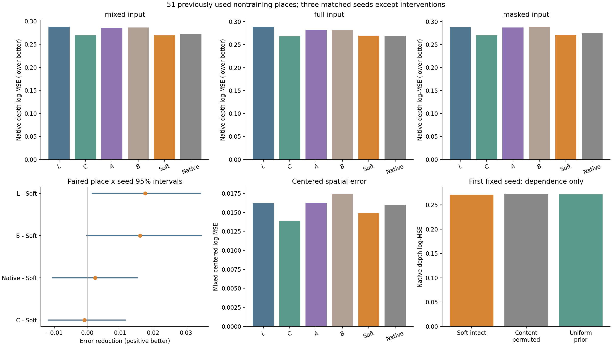
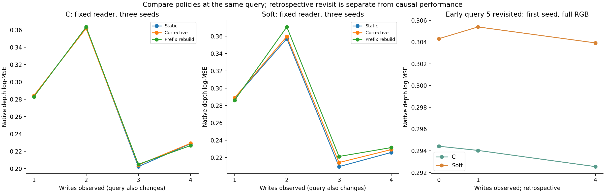
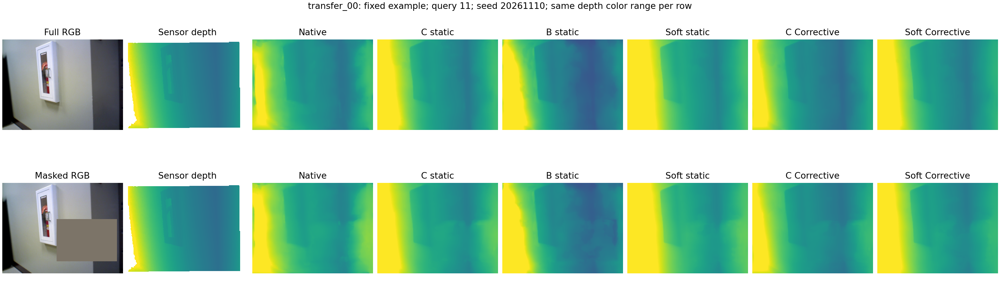
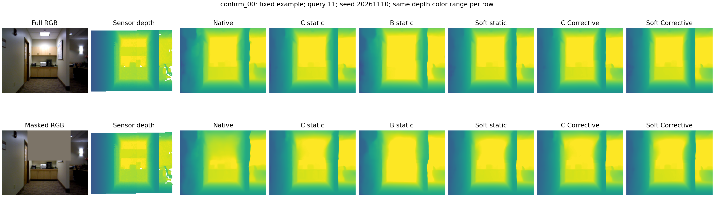
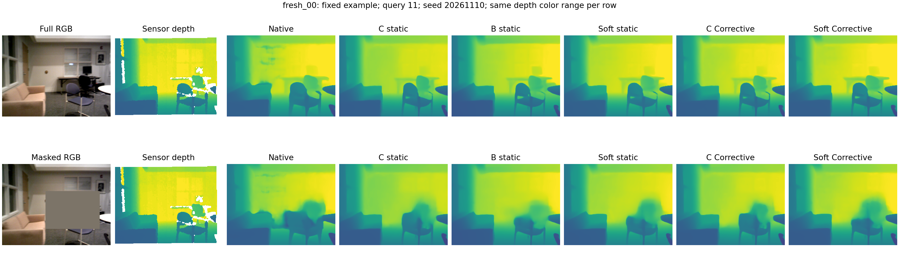
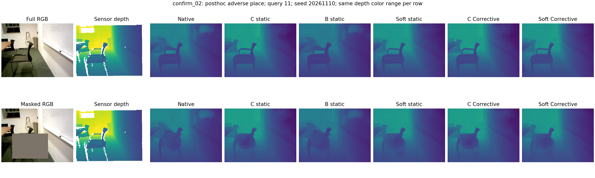

# 保留全局内容读取的高斯位置偏好

保留全局读取消除了大部分硬投影损失，但 Soft 未建立对纯内容 C 的可靠增量；更新后的退步提示应检验训练状态匹配，而非继续调节静态先验。

`soft_read1`，85 个已用片段，12 个训练片段；主评价为 51 非训练地点（63 片段），无新确认。

## 1. 改动、假设与比较

上一轮的硬投影先验在无支持处屏蔽历史信息，B 相对内容 C 未建立用途。本轮只将逐槽位置项改为 `-log(M)+log1p(M*w_ij)`，M=256；所有真实槽均可读，几何对应提供偏好，null 与 C 一样屏蔽。无覆盖时先验退回 C；均匀覆盖增加的是逐行常数。协方差表示区域范围，不当作位置预测不确定性。

沿用冻结 VGGT 的第 12 个 global block、一个 width64/4-head cross-attention 和后续原生层、DPT。所有适配器为 137,472 参数，同初值、同样例序列、同 2,000 步、最终检查点；新增 Soft 三拟合，L/C/A/B 和 Native 按身份复用。条件 Center 若触发再新增三个匹配拟合。

主要假设是硬可见性限制不适合作为历史内容相关性的边界。竞争解释包括预测几何误差、内容特征已包含关系、小训练集迁移和静态训练／动态状态不匹配。本轮固定 writer、数据、损失和公式，不扫描温度。初始化帧 0–3，写入 4/6/8/10，查询 5/7/9/11 不写回；已知相机及原有独立尺度规则不变。

## 2. 固定记忆的原生输出

| 方法 | 混合 log-MSE | 完整输入 | 遮挡输入 | 混合去均值空间误差 |
|---|---:|---:|---:|---:|
| L | 0.287893 | 0.288685 | 0.287496 | 0.016208 |
| C | 0.269446 | 0.268030 | 0.270154 | 0.013859 |
| A | 0.285197 | 0.281676 | 0.286957 | 0.016240 |
| B | 0.286362 | 0.281885 | 0.288600 | 0.017446 |
| Soft | 0.270303 | 0.269412 | 0.270749 | 0.014889 |
| Native | 0.272701 | 0.268743 | 0.274680 | 0.015995 |

正差表示后者误差更低；地点与种子配对重采样 5,000 次。

| 比较：前者误差 − 后者误差 | 相对降幅 | 配对种子差 | 地点×种子 95% 区间 | 改善地点 |
|---|---:|---|---|---:|
| content_minus_soft | -0.32% | -0.008682, 0.001168, 0.004943 | [-0.011712, 0.011550] | 21/51 |
| local_minus_soft | +6.11% | 0.023032, 0.009124, 0.020613 | [0.001556, 0.034274] | 33/51 |
| native_minus_soft | +0.88% | 0.001744, -0.002351, 0.007799 | [-0.010543, 0.015287] | 28/51 |
| bound_minus_soft | +5.61% | 0.015743, 0.012648, 0.019784 | [-0.000209, 0.034700] | 31/51 |
| coverage_minus_soft | +5.22% | 0.011058, 0.009526, 0.024096 | [-0.000285, 0.032664] | 26/51 |
| local_minus_content | +6.41% | 0.031714, 0.007956, 0.015670 | [0.002029, 0.038165] | 33/51 |
| native_minus_content | +1.19% | 0.010427, -0.003519, 0.002856 | [-0.009467, 0.016164] | 28/51 |

| 批次 | Soft 对 C 降幅 | Soft 对 Native 降幅 | Soft 对 B 降幅 |
|---|---:|---:|---:|
| old12 | +1.18% | +3.51% | +18.46% |
| used_summary20 | -4.17% | -3.35% | -0.53% |
| used_writer19 | +2.38% | +3.35% | +3.93% |
| training12 | +0.08% | +96.57% | -4.58% |

完整／遮挡、隐藏／可见区域、均值偏差、空间误差、AbsRel 和米制 RMSE 的全部配对结果见 `static_analysis.json`。整体 log-MSE 改善不自动表示空间细节恢复。

## 3. 动态状态与有限回访

C 和 Soft 各三种子读取同一批已保存的 Corrective 与 Prefix 状态，此项不以静态获胜为前提。状态和 writer 均保持原样；Prefix 重建 256 槽，没有重新联合运行全部 RGB，因此不是严格上界。

| 读取器／状态 | 混合 log-MSE | 完整输入 | 遮挡输入 | 混合空间误差 |
|---|---:|---:|---:|---:|
| content_static | 0.269446 | 0.268030 | 0.270154 | 0.013859 |
| content_corrective_clean | 0.269923 | 0.268459 | 0.270655 | 0.013773 |
| content_rebuild_clean | 0.269492 | 0.268048 | 0.270214 | 0.013280 |
| soft_static | 0.270303 | 0.269412 | 0.270749 | 0.014889 |
| soft_corrective_clean | 0.273045 | 0.271828 | 0.273653 | 0.015302 |
| soft_rebuild_clean | 0.277406 | 0.276225 | 0.277997 | 0.015678 |

| 比较：前者误差 − 后者误差 | 相对降幅 | 配对种子差 | 地点×种子 95% 区间 | 改善地点 |
|---|---:|---|---|---:|
| content_static_minus_content_corrective_clean | -0.18% | -0.000953, -0.000091, -0.000389 | [-0.002417, 0.001173] | 24/51 |
| content_static_minus_content_rebuild_clean | -0.02% | -0.000456, -0.000038, 0.000356 | [-0.004091, 0.003920] | 30/51 |
| content_rebuild_clean_minus_content_corrective_clean | -0.16% | -0.000496, -0.000053, -0.000744 | [-0.003312, 0.002444] | 22/51 |
| soft_static_minus_soft_corrective_clean | -1.01% | -0.000975, -0.002761, -0.004490 | [-0.006293, 0.000341] | 11/51 |
| soft_static_minus_soft_rebuild_clean | -2.63% | -0.005052, -0.010234, -0.006024 | [-0.015770, -0.000589] | 21/51 |
| soft_rebuild_clean_minus_soft_corrective_clean | +1.57% | 0.004077, 0.007473, 0.001534 | [-0.002446, 0.012663] | 23/51 |
| content_static_minus_soft_static | -0.32% | -0.008682, 0.001168, 0.004943 | [-0.011712, 0.011550] | 21/51 |
| content_corrective_clean_minus_soft_corrective_clean | -1.16% | -0.008704, -0.001502, 0.000842 | [-0.013965, 0.008782] | 19/51 |
| content_rebuild_clean_minus_soft_rebuild_clean | -2.94% | -0.013278, -0.009029, -0.001437 | [-0.020962, 0.005136] | 15/51 |

各时点的查询不同，只比较同一时点的策略才能隔离更新效果。覆盖增长本身不等于输出改善。

有限回访固定首种子、query5、完整输入，使用初始、首次写后和末次写后的 Corrective 状态；这是事后回访，不并入因果成绩。

| 比较：前者误差 − 后者误差 | 相对降幅 | 配对种子差 | 地点×种子 95% 区间 | 改善地点 |
|---|---:|---|---|---:|
| content_t0_minus_content_t1 | +0.13% | 0.000385 | [-0.001134, 0.002506] | 23/51 |
| content_t1_minus_content_t4 | +0.51% | 0.001492 | [-0.002920, 0.006919] | 25/51 |
| soft_t0_minus_soft_t1 | -0.36% | -0.001082 | [-0.002513, 0.000100] | 23/51 |
| soft_t1_minus_soft_t4 | +0.48% | 0.001470 | [-0.001816, 0.005088] | 29/51 |
| content_t0_minus_soft_t0 | -3.36% | -0.009889 | [-0.032254, 0.010669] | 22/51 |
| content_t1_minus_soft_t1 | -3.86% | -0.011356 | [-0.033980, 0.009458] | 23/51 |
| content_t4_minus_soft_t4 | -3.89% | -0.011378 | [-0.033505, 0.007998] | 25/51 |

**增量信息范围：** 对全部 85 片段、1,020 个查询条件的输入身份核对显示，前三个时点的新写入图像都已存在于当前 VGGT 短窗口；末次只有写入帧 4 在窗口之外。它们仍能通过另一种记忆表示影响网络，但新增记忆与原生输入的信息高度重叠。

| 查询 | VGGT 输入帧 | 已可写入的新帧 | 其中不在原生输入窗口的新帧 |
|---|---|---|---|
| 5 | [2, 3, 4, 5] | [4] | [] |
| 7 | [3, 4, 6, 7] | [4, 6] | [] |
| 9 | [4, 6, 8, 9] | [4, 6, 8] | [] |
| 11 | [6, 8, 10, 11] | [4, 6, 8, 10] | [4] |

这限制了当前动态结果对“积累原生窗口以外的历史信息”的解释范围，不推翻已观察到的 C/Soft 差异，也不证明重复图像无用。记忆更新后的分布变化仍是竞争解释；长期记忆用途需要另行设计。身份核对及事前诊断问题见 `information_accounting*.json`，未修改本轮配置。

## 4. 依赖性与条件形状控制

首个固定 Soft 模型在全 85 片段上分别置换内容槽、移除几何位置项。正的差值表示干预误差高于完整 Soft；相对降幅的分母是干预误差。它只检验依赖性，匹配训练的 C/Soft 才检验用途。

| 比较：前者误差 − 后者误差 | 相对降幅 | 配对种子差 | 地点×种子 95% 区间 | 改善地点 |
|---|---:|---|---|---:|
| content_permuted_minus_soft | +0.65% | 0.001773 | [-0.002382, 0.006315] | 28/51 |
| uniform_prior_minus_soft | +0.16% | 0.000433 | [-0.003627, 0.004763] | 21/51 |

固定训练样例的 BF16 后半网络中，联合置换的最大／平均输出差为 0.038713/0.000884836；只置换内容为 0.494301/0.0589265。CPU FP32 适配器接口测试单独通过；不宣称 BF16 完整网络逐值不变。

静态与 Corrective 均未满足事前的均值和种子方向条件，未追加 Center。本轮不产生新的形状必要性结论；详见 `conditional_decision.json`。

## 5. 实现、来源与成本

三个 CPU 接口测试及 20 步 GPU 资源／梯度试跑通过。零初始化与原生输出一致，试跑不进入正式比较；新模型逐步核对父轮 C 的全部采样和初值。

从原始标签独立 NumPy float64 复算 17,850 份新预测，另核对 13,260 行父轮评分原样复用。所有新模型、原状态、缓存和检查点有来源身份，无样本排除。最大数值差见 `independent_checks.json`。

新增正式训练 3 次、6,000 步，训练循环合计 0.707 worker 小时，峰值已分配 4.767 GiB。这是共享卡循环之和，不是墙钟或独占性能。

固定种子交错计时的共享 GPU 原生/C/Soft 后半网络中位秒数：transfer_00 0.0588/0.0593/0.0590; confirm_00 0.0611/0.0488/0.0495; fresh_00 0.0605/0.0603/0.0611。投影单独计时；不含前半网络、相机尺度校准和输入 I/O，不据此宣称完整在线速度提升。

## 6. 方法取舍与后续

三个匹配种子在 51 非训练地点上，Soft 主 log-MSE 为 0.270303，C 为 0.269446，平均高 0.32%，种子方向混合、地点×种子区间跨零。Soft 比硬投影 B 平均低 5.61%、三种子同向，但区间略跨零；它恢复了大部分硬读取损失，尚未建立高斯位置项对 C 的独立用途。Soft 对 L 低 6.11%、区间为正，对原生 VGGT 仅低 0.88%、区间跨零；L 本身弱于原生，不能把相对 L 的改善当作原生成功。

Soft 的去均值空间误差比 C 高 7.43%，三个种子均退步，但地点×种子区间跨零。完整与遮挡输入均呈相同方向。固定墙面、走廊和办公室案例没有显示 Soft 一致恢复细节；遮挡区仍有模糊，事后反例 confirm_02 的整体深度偏差在各方法中均明显。图像采用共同色阶，不替代统计，也不把小视觉差异写成稳定改善。

首个固定模型在训练 12 地点上，完整 Soft 误差为 0.006161，内容槽置换和均匀先验分别为 0.022943/0.020856，支持学到了几何与内容对应。主 51 地点相应为 0.270956/0.272729/0.271389，两个干预差的区间均跨零；依赖性尚未转成可靠迁移用途。BF16 后半网络联合置换均值差约 0.000885，只置换内容约 0.058927；保留这一数值限制，不宣称精确不变，也不因此扩张核查。

同一固定读取器接收更新状态时，C 的 Corrective/Prefix 误差相对 Static 平均高 0.18%/0.02%，基本持平。Soft 相应高 1.01%/2.63%、三个种子均退步；Prefix 配对区间支持退步，Corrective 区间跨零。Soft 对同状态 C 分别高 1.16%/2.94%，尚无增量用途。按事前条件未触发 Center，不产生新的形状必要性结论。首种子 query5 回访中，两读取器状态1到4的变化均不确定，不能称长期保持成功。

对全部 85 片段、1020 查询条件进行输入身份核对后发现，query5/7/9 的新写入帧全部也在原生四帧窗口内，query11 只有写入帧4在窗口外。这限制了当前动态测试对新增历史信息价值的回答，不能据此否定长历史记忆，也不能抹去 C/Soft 的直接负结果。初始记忆已包含部分窗口外视图，因此该重叠不能解释掉静态 PE 缺少独立增量。

下一项 state_read1 固定结构、公式、writer、样本与预算，只把训练时的 M0 替换为每个查询之前的 Corrective 状态。新增 C-dynamic/Soft-dynamic 各三种子，与父轮初值和每步采样匹配；原静态训练模型按身份复用，所有新模型无条件评价 Static/Corrective/Prefix。主问题是状态匹配后 Soft 能否超过匹配 C；若两者同时改善则归因于训练适应性，若仅修复 Soft 自身损失则不晋升方法。仍失败则结束这个读取器的状态训练修补，转向窗口外历史信息或表征质量，不再细调静态先验。

新增三次 2000 步训练全部有限，训练循环合计 0.707 worker 小时、峰值已分配 4.767 GiB。独立 NumPy 从原始标签复算 17850 份新预测，并核对 13260 行父轮评分；配对初值、逐步样本、缓存、状态和源代码身份齐备。六张最终 PNG 已实际审阅。所有数据已用、相机给定、几何与规则 writer 固定；没有新确认、学习准确几何、一般 PE 优势或长期在线记忆成功的证据。共享 GPU 后半网络短计时只作成本参照。

## 7. 图与证据入口

前三个案例事前固定；最大 Soft−C 主地点的首个片段为明确标注的事后反例，若与固定案例重复则合并。相同一行使用共同深度色阶，案例不代替整体统计。完整来源、配对区间及分条件结果保存在同目录 JSON，旧正负结果仍保留。
