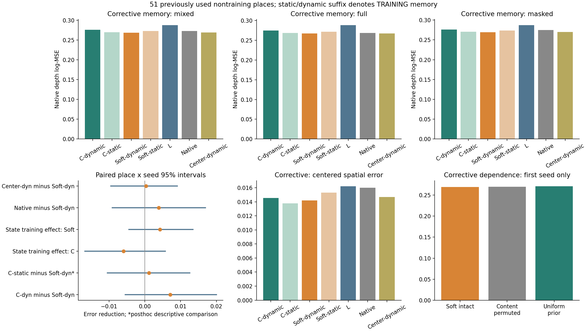
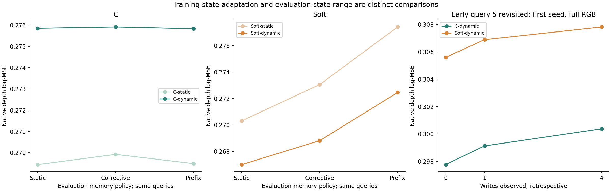
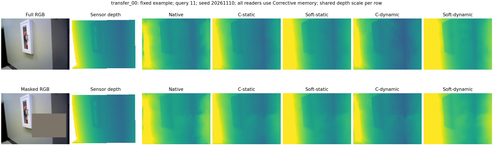
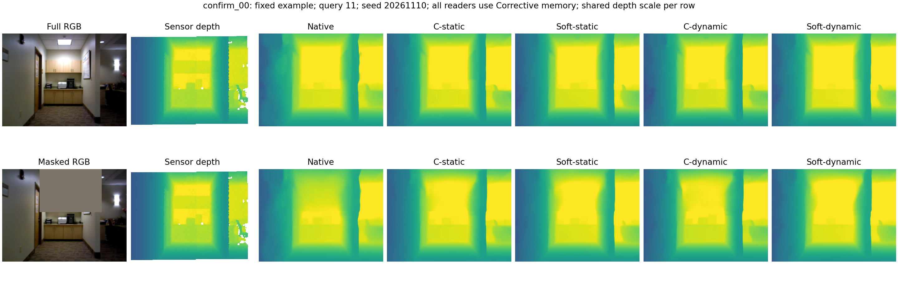
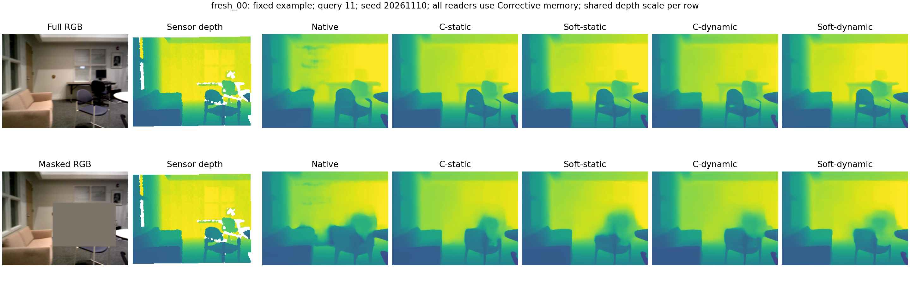
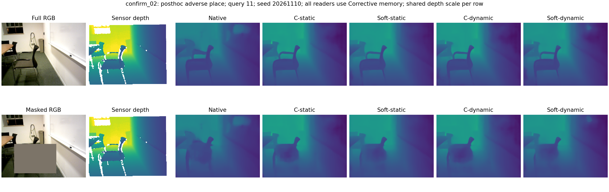

# 训练状态匹配能否改善高斯记忆读取

状态匹配改善了 Soft 自身的部分表现，但未建立对旧 C 的可靠净收益，也未确立完整高斯相对固定球形的额外用途；结束这一读取器的状态训练修补，转向明确的窗口外历史检验。

`state_read1`，85 个已用片段，12 个训练地点；主评价为 51 非训练地点（63 片段），没有新确认。

## 1. 唯一训练变化

保持 137,472 参数读取器、VGGT 内部插入层、后续原生层和 DPT、Soft 公式、规则 writer、相机与尺度规则。只将训练时的初始 M0 替换为每个查询前的 Corrective 状态；C 和 Soft 各三个同初值、同样例序列、同 2,000 步最终模型。记忆本身不参与梯度。旧静态训练模型及原生/L 按身份复用。

假设是初始状态训练与增量使用不匹配；竞争解释包括几何或更新误差、训练覆盖、位置偏好冗余，以及新写入图像已存在于原生窗口。主问题仍是匹配训练后 Soft 对 C 的独立价值，而不是只比它自己的旧版本。

初始化 0–3，写入 4/6/8/10，查询 5/7/9/11 不写回。前三个查询的新写入帧都已在原生短窗口中，末次只有帧4在窗口外；本实验不能独立确立长历史用途。

## 2. Corrective 主比较与训练适应性

| 读取器及训练状态 | 混合 log-MSE | 完整 | 遮挡 | 混合空间误差 |
|---|---:|---:|---:|---:|
| C-dynamic | 0.275911 | 0.275022 | 0.276355 | 0.014553 |
| C-static | 0.269923 | 0.268459 | 0.270655 | 0.013773 |
| Soft-dynamic | 0.268802 | 0.267451 | 0.269478 | 0.014203 |
| Soft-static | 0.273045 | 0.271828 | 0.273653 | 0.015302 |
| L | 0.287893 | 0.288685 | 0.287496 | 0.016208 |
| Native | 0.272701 | 0.268743 | 0.274680 | 0.015995 |
| Center-dynamic | 0.269153 | 0.267520 | 0.269970 | 0.014699 |

dynamic/static 后缀表示训练记忆；本节所有方法评价时均读同一 Corrective 状态。正差表示后者误差较低。旧 C 与新 Soft 的跨训练状态比较在首种子结果后明确列为描述性参照，用于避免把新 C 的退步当成方法进步；主比较和条件规则未变。

| 比较：前者误差 − 后者误差 | 相对降幅 | 配对种子差 | 地点×种子 95% 区间 | 改善地点 |
|---|---:|---|---|---:|
| content_dynamictrain_minus_soft_dynamictrain | +2.58% | 0.006946, 0.009682, 0.004698 | [-0.005461, 0.020034] | 29/51 |
| content_statictrain_minus_content_dynamictrain | -2.22% | -0.013068, -0.003039, -0.001856 | [-0.016764, 0.005771] | 24/51 |
| soft_statictrain_minus_soft_dynamictrain | +1.55% | 0.002583, 0.008146, 0.002000 | [-0.004484, 0.013476] | 23/51 |
| content_statictrain_minus_soft_statictrain | -1.16% | -0.008704, -0.001502, 0.000842 | [-0.013965, 0.008782] | 19/51 |
| content_statictrain_minus_soft_dynamictrain | +0.42% | -0.006122, 0.006643, 0.002842 | [-0.010471, 0.012570] | 24/51 |
| native_minus_content_dynamictrain | -1.18% | -0.003594, -0.006649, 0.000612 | [-0.017285, 0.011696] | 26/51 |
| native_minus_soft_dynamictrain | +1.43% | 0.003352, 0.003034, 0.005310 | [-0.009096, 0.016942] | 25/51 |
| local_minus_content_dynamictrain | +4.16% | 0.017694, 0.004826, 0.013426 | [-0.003303, 0.029690] | 30/51 |
| local_minus_soft_dynamictrain | +6.63% | 0.024640, 0.014508, 0.018123 | [0.003318, 0.034875] | 28/51 |
| soft_center_dynamictrain_minus_soft_dynamictrain | +0.13% | 0.005431, -0.005395, 0.001017 | [-0.009542, 0.009111] | 22/51 |
| content_dynamictrain_minus_soft_center_dynamictrain | +2.45% | 0.001515, 0.015077, 0.003680 | [-0.006890, 0.021180] | 29/51 |

训练状态交互量 `(C-dynamic−Soft-dynamic)−(C-static−Soft-static)` 为 0.010230，地点×种子 95% 区间 [-0.003307, 0.024664]，配对种子差为 0.015650, 0.011185, 0.003856。正值表示训练匹配更有利于 Soft 相对 C，不能单独证明 Soft 已有净优势。

| 批次 | Soft-dynamic 对 C-dynamic 降幅 | C 的训练状态收益 | Soft 的训练状态收益 |
|---|---:|---:|---:|
| old12 | +8.98% | -3.84% | +3.64% |
| used_summary20 | +0.70% | -2.06% | +3.98% |
| used_writer19 | +1.10% | -1.58% | -1.74% |
| training12 | -0.96% | +4.94% | +22.91% |

全部完整／遮挡、隐藏／可见、均值偏差、空间误差、AbsRel、米制 RMSE 和逐查询配对结果见 `analysis_*.json`。

## 3. 状态范围、依赖与回访

| 训练读取器 | Static | Corrective | Prefix |
|---|---:|---:|---:|
| C-static | 0.269446 | 0.269923 | 0.269492 |
| C-dynamic | 0.275850 | 0.275911 | 0.275829 |
| Soft-static | 0.270303 | 0.273045 | 0.277406 |
| Soft-dynamic | 0.266994 | 0.268802 | 0.272446 |

三个评价策略使用相同查询；Prefix 是保存观察的固定容量重建，未联合运行全部 RGB，不是严格性能上界。

首个 Soft-dynamic 的两个 Corrective 干预只检验依赖。正差表示干预误差更高，相对降幅以干预误差作分母。

| 比较：前者误差 − 后者误差 | 相对降幅 | 配对种子差 | 地点×种子 95% 区间 | 改善地点 |
|---|---:|---|---|---:|
| content_permuted_minus_soft | +0.22% | 0.000607 | [-0.003480, 0.004728] | 29/51 |
| uniform_prior_minus_soft | +0.64% | 0.001728 | [-0.002163, 0.005722] | 30/51 |

query5 完整输入的初始／首次／末次状态回访仅用首种子，是事后诊断，不并入因果主成绩。

| 比较：前者误差 − 后者误差 | 相对降幅 | 配对种子差 | 地点×种子 95% 区间 | 改善地点 |
|---|---:|---|---|---:|
| content_t0_minus_content_t1 | -0.46% | -0.001360 | [-0.003376, 0.000230] | 19/51 |
| content_t1_minus_content_t4 | -0.42% | -0.001247 | [-0.007606, 0.004184] | 22/51 |
| soft_t0_minus_soft_t1 | -0.42% | -0.001298 | [-0.003387, 0.000452] | 23/51 |
| soft_t1_minus_soft_t4 | -0.30% | -0.000919 | [-0.005189, 0.002353] | 27/51 |
| content_t0_minus_soft_t0 | -2.63% | -0.007825 | [-0.034231, 0.014866] | 25/51 |
| content_t1_minus_soft_t1 | -2.59% | -0.007762 | [-0.033223, 0.014527] | 24/51 |
| content_t4_minus_soft_t4 | -2.47% | -0.007434 | [-0.030492, 0.012624] | 24/51 |

## 4. 条件控制、检查与成本

主比较达到事前至少 1% 且至少两个种子改善的投入条件，追加三个 Soft-center 匹配控制；其结果见主表。这个门槛不是显著性或方法成功定义。

原模型和投影证据按源码身份复用；新输入因果检查、两组零残差回放及各两步梯度／资源检查通过。正式训练逐步对齐父轮 C 初值和样本序列。

独立 NumPy 从原始标签复算 27,030 份新预测，核对 22,440 行复用评分，无查询或片段排除。

新增 9 次正式训练，18,000 步；训练循环合计 2.101 worker 小时，峰值已分配 4.764 GiB。共享卡时间不是独占性能。算子未变，上一轮缓存后半网络成本按身份引用于 `baseline_reuse.json`，没有重复短测或声称新速度提升。

## 5. 方法取舍

在相同 Corrective 状态上，Soft-dynamic/C-dynamic 主 log-MSE 为 0.268802/0.275911，平均低 2.58%、三种子同向，但地点×种子区间跨零。新 C 相对旧 C 平均退步 2.22%、三种子均退步；Soft 对旧 C 仅低 0.42%、种子方向混合、区间跨零，空间误差还高 3.12%。旧 C 的跨训练状态比较在首种子结果后列为描述性参照，主比较未改；它揭示部分相对优势来自较弱的新 C，不能将主比较均值直接升级为可靠净收益。

三个条件 Center 控制均按同预算完成。Corrective 上完整高斯对固定球形主误差仅低 0.13%，配对种子差为 +0.005431/−0.005395/+0.001017，区间 [−0.009542,0.009111]；空间误差平均低 3.37%，种子混合、区间跨零。Static 上主误差低 0.66%，同样不确定。Center 保留了对新 C 的大部分平均优势，因此本轮没有确立完整形状的额外价值。该控制同时改变形状和投影足迹，不是纯各向异性归因。

状态匹配使 Soft 对自身旧版的 Corrective 主误差低 1.55%、空间误差低 7.19%，三个种子同向，但两项地点区间跨零。空间训练交互量为 0.001879，区间 [0.000317,0.003813]，支持两种读取方式对训练状态的响应不同；主误差交互仍不确定，不能据此认定失配是唯一病因。旧 12 地点 Soft 对新 C 低 8.98%、区间为正，而另 20/19 地点平均仅低 0.70%/1.10%、种子混合；相对 Soft 旧版，19 地点主误差反而高 1.74%、三种子同向但区间跨零。范围差异必须保留。

固定新模型读取更多观察时，C 的 Corrective/Prefix 相对 Static 基本持平；Soft 主误差仍分别高 0.68%/2.04%、三个种子均退步，但地点区间跨零。因此状态匹配未建立观察增加带来的输出用途。首种子 query5 的首次到末次状态回访中，C/Soft 主误差分别高约 0.42%/0.30%，区间跨零，不能称长期保持成功。

首个 Soft-dynamic 在训练地点的未干预／内容置换／均匀先验主误差为 0.006451/0.025253/0.022424，说明学到了对应依赖。主非训练地点为 0.269348/0.269955/0.271076，主差均不确定；移除几何偏好后空间误差反而下降，地点区间支持该首种子的方向。训练依赖不等于迁移用途。三个固定案例及一个标注反例没有显示一致的细节恢复：墙面和走廊仍平滑，遮挡椅子未可靠重建，反例仍有明显整体深度偏差。

现有新写入图像与原生短窗口大多重叠，因而下一项采用 history_read1：固定五组各三个读取器，在已有 12 对不重叠早晚窗口上比较保留旧历史与近期重置，并为两者保留累计重建参照。容量、当前图像、模型及相机规则保持配对；主问题仍是历史用途与 Soft 对强 C 的额外增量，Center、回访和依赖诊断限定解释。该子集按数据可用性确定，且当前改善更明显；所有数据已用，不作为总体或新地点确认。若历史帮助纯内容同样多，不宣称 PE 必要；若只重建有效，优先研究更新；若均无用，转向表征保留的信息，不继续细调这个先验。

九次 2000 步训练共 2.101 worker 小时，峰值已分配 4.764 GiB；初值、逐步样本和因果状态来源独立核对。27,030 份新预测从原始标签独立复算，22,440 行父轮评分按身份核对，无片段或查询排除；六幅最终 PNG 已实际审阅。共享 GPU 时间不作为独占速度结论。相机给定，几何和规则 writer 固定，本轮只学习读取器；不宣称学出了准确高斯几何、一般 PE 优势或任意长序列定长记忆。

## 6. 图与来源

前三个案例事前固定，另一个为明确标注的最大主地点退步案例（重复则合并）。各行共同深度色阶；图像不替代统计。历史负结果、源码快照、输入身份与全分条件表均保留。
