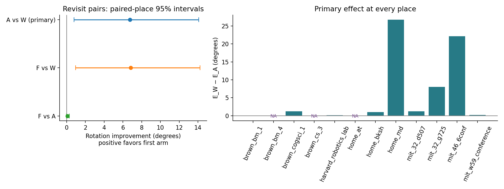
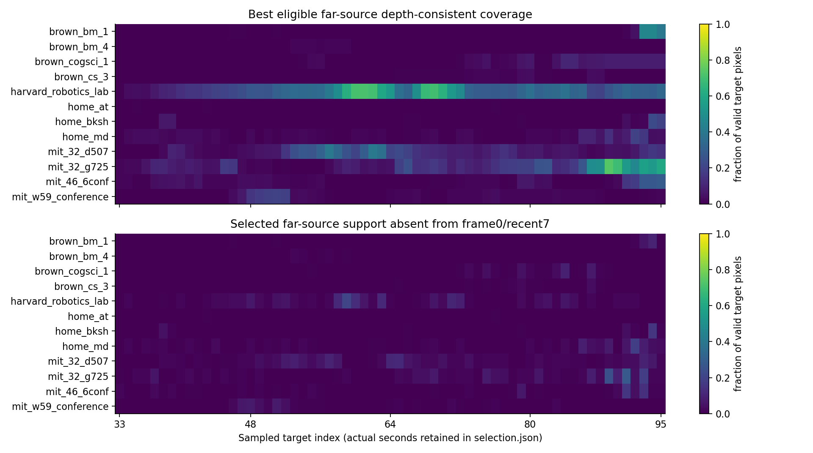
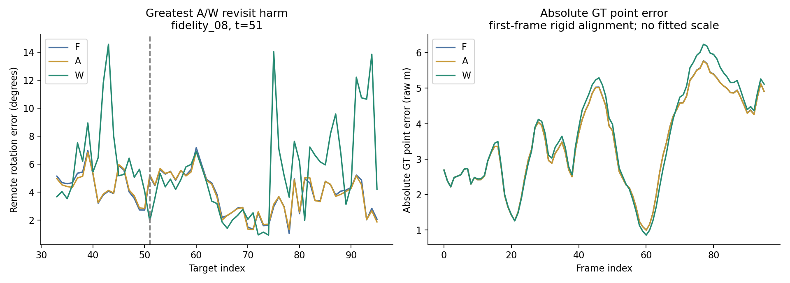
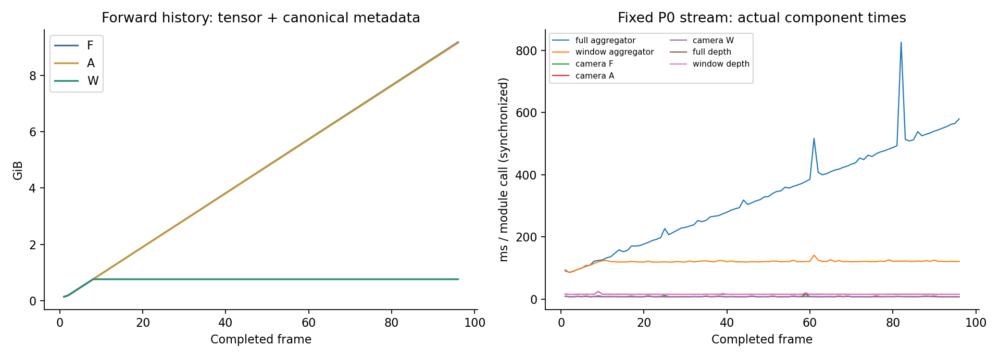

# stream_history_value1：固定原生历史价值探针实施结果

2026-11-14，round032实施已采纳的[round031唯一科学合同](/home/liwt/GRoPE/results/gaussian_memory/autonomous_research_loop/round_031/science_plan.md)（SHA256 `68d3bd4f6cf94429763076267dab69581a4790a4bea067d22762cb5251a821f8`）。**12地点×96不同RGB-D全部完成；主A/W相对旋转改善为 6.7379 [0.8066, 14.0837] 度，正数有利A。** 这是已用开发数据上的固定历史政策比较，科学分支由原Astra评价；不预先宣称高斯胜出、同字节优胜、fresh确认或总体目标完成。

主旋转收益与代价必须同时读：全帧AbsRel的W−A为-0.0227 [-0.0371, -0.0084]，即A的绝对AbsRel增加0.02272；F/A重访旋转差0.0900 [-0.0278, 0.2802]度。重访绝对GT几何与跨时点一致性的A/W区间均跨0，不能从旋转单项推定全面几何改善。三处无5%重访地点保留NA，效应地点差异明显，不作fresh或通用性结论。

## 问题、固定比较与身份

本探针检验超过首帧＋最近7帧的原生聚合器历史是否改善预定义远端几何。竞争解释包括聚合器长历史有效、仅相机头长历史有效、近期与首帧已足够、长期缓存干扰或模型没有利用较早证据。主比较A/W固定相机缓存保留规则，各自隐藏值随自身轨迹产生，是政策总效应；F/W和F/A分开报告。A/W正向是否具有材料性、是否由单一地点或全局损伤取得，以及覆盖不足或区间宽的影响，均由Astra依合同判断；没有机械跨零门禁或自动P2。

F为完整聚合器＋完整相机缓存；W两者均为首帧＋最近7个完成帧；A完整聚合器＋与W相同相机保留规则。每帧4轮相机精化全部完成后才淘汰，每帧4条相机状态和全部5个camera/register特殊token随帧保留，原始位置与全局frame index保持。W仍可能通过近期隐藏值间接携带更早上下文，不能称从未见历史。F不是精度上界。F/A真实共享同一聚合器输出和depth结果，分别运行相机头；不把共享工作重复报为实际调用。

同一冻结官方权重 `/mnt/f70f6709-366e-49a0-861f-497645d98975/users/liwt/data/GRoPE/gaussian_memory/streamvggt/checkpoints.pth`，5,026,743,569 bytes，继承SHA `3d3d914d09609fdb485e16947c4885cca0e5ea4e5557598a3b3ffb1cfe0a2f59`，不重读大权重做哈希。官方源码提交 `05682bcb05683c4c71522e9cb618fc8ca349063c`。官方518×392完整RGB，BF16 aggregator、FP32 camera/depth、原SDPA与位置，0训练/下载/方法选择。输入与配置事前锁定SHA `767f1101b15248b218afdd682b9c322b97d3dff50c02285851f8b6f47e7c1cd7`；[configuration.json](configuration.json)保存所有路径、大小、mtime、小元数据SHA及原始pose ordinal。全部12既有地点按可用匹配RGB-D时间顺序均匀取96不同帧，不看重访率或预测效果挑地点；原full pose文件提供统一坐标，没有拼接重锚clip poses。

| ID | 地点 | 可用匹配帧 | 原索引首—末 | 真实时间跨度(s) |
| --- | --- | --- | --- | --- |
| fidelity_00 | brown_bm_1 | 144 | 30—6522 | 217.75 |
| fidelity_01 | brown_bm_4 | 96 | 30—3207 | 106.78 |
| fidelity_02 | brown_cogsci_1 | 108 | 30—2921 | 96.89 |
| fidelity_03 | brown_cs_3 | 144 | 30—3362 | 111.68 |
| fidelity_04 | harvard_robotics_lab | 105 | 30—1151 | 37.57 |
| fidelity_05 | home_at | 144 | 30—14754 | 493.89 |
| fidelity_06 | home_bksh | 144 | 30—14884 | 646.96 |
| fidelity_07 | home_md | 144 | 30—13310 | 445.13 |
| fidelity_08 | mit_32_d507 | 144 | 30—5413 | 180.45 |
| fidelity_09 | mit_32_g725 | 144 | 30—3737 | 124.24 |
| fidelity_10 | mit_46_6conf | 144 | 30—3232 | 107.35 |
| fidelity_11 | mit_w59_conference | 144 | 30—4346 | 186.28 |

## P0、恢复与独立验证

[P0接口](preflight.json)：固定3帧管理Full与原官方streaming、容量覆盖全部3帧的Window，depth/pose最大差与RMS均0。全部raw K/V＋原位置、反序检索、不合并小例，同BF16/SDPA最大差0.01562500、RMS0.0001310408，参考RMS0.19297213；有限精度差明示，不增普适1e−5门槛。固定首流96帧成本在查看任何科学效果前通过[实测准入](profiling_admission.json)，该预测作为首条正式结果复用。

完整恢复采用不可变32帧full-KV delta chunks、最新W与F/W/A相机状态、精确RNG、完成输出和next-frame manifest。一次预定工程恢复在fidelity07/frame31安全退出，再从32续跑；[保存](controlled_restore_saved.json)与[验证](controlled_restore_verified.json)证明60对/120个KV tensor的shape/dtype/固定样本、三相机4轮状态与CPU/CUDA RNG一致，32份已有输出保留，没有重复query。数值step的AST与P0一致。

另一次manager24955收SIGTERM，旧handler只记录requested_own_stop，发送来源未知，不能称用户主动暂停或科学失败；owner70299实际wait75，fidelity09保存到79。唯一后继manager57577从80补缺，再完成10/11；旧终结、版本及unknown保存在[工程记录](engineering_revisions/resume002.json)。普通yield/加载/恢复全部计账；没有丢弃已有效帧或重做旧轮。以后manager记录signal编号和UTC。

所有12条GT标签均有固定首目标的独立NumPy几何投影核对，mask最大不一致0 pixels。[独立评分](scoring/summary.json)：2304份唯一F/W depth帧全部NumPy/Torch复算，指标最大差2.66e-15；FP64 resize最大差8.33e-14；全部pose的NumPy/官方Torch解码最大差8.88e-16；NumPy/SciPy相对旋转最大差1.23e-05度。0旧像素指标重算，0额外模型调用。

## 主终点、分母与地点差异

每目标t=33…95，候选s≠0且t−s≥32。GT深度在210×280网格前向min-z投影，误差≤max(0.05m,0.05目标深度)为一致；选最大目标有效像素覆盖，平局最早s。覆盖≥5%为重访，不以20%筛选。所有GT只用于离线配对、标签和评分，没有进入预测或缓存。主值先每地点重访对平均，再对已定义地点等权；全部12地点ID和NA分母保留。5000次配对地点bootstrap，seed20261114；缺失地点不填0，区间条件于有定义的重采样分母。

| 比较（前者为候选） | 旋转改善度 [95%配对区间] | 有定义地点 |
| --- | --- | --- |
| A_vs_W | 6.7379 [0.8066, 14.0837] | 9 |
| F_vs_W | 6.8280 [0.9511, 14.2233] | 9 |
| F_vs_A | 0.0900 [-0.0278, 0.2802] | 9 |

| 地点 | 重访/63 | 平均覆盖 | F误差度 | A误差度 | W误差度 | W−A度 |
| --- | --- | --- | --- | --- | --- | --- |
| brown_bm_1 | 3 | 0.022 | 0.3973 | 0.3963 | 0.3142 | -0.0821 |
| brown_bm_4 | 0 | 0.002 | NA | NA | NA | NA |
| brown_cogsci_1 | 14 | 0.021 | 15.9142 | 15.9688 | 17.1729 | 1.2041 |
| brown_cs_3 | 0 | 0.004 | NA | NA | NA | NA |
| harvard_robotics_lab | 59 | 0.328 | 3.6937 | 3.6921 | 3.8205 | 0.1284 |
| home_at | 0 | 0.001 | NA | NA | NA | NA |
| home_bksh | 4 | 0.010 | 26.2901 | 27.0590 | 28.0826 | 1.0236 |
| home_md | 8 | 0.026 | 5.6396 | 5.7450 | 32.5030 | 26.7579 |
| mit_32_d507 | 42 | 0.112 | 3.7802 | 3.7606 | 5.0181 | 1.2574 |
| mit_32_g725 | 44 | 0.163 | 3.5145 | 3.5116 | 11.5448 | 8.0331 |
| mit_46_6conf | 9 | 0.034 | 16.5448 | 16.5883 | 38.7212 | 22.1329 |
| mit_w59_conference | 6 | 0.024 | 28.4777 | 28.3404 | 28.5263 | 0.1859 |

完整756远端目标，重访189，有重访地点9/12；原共视零覆盖276，选定远端独占零支持291。主改善正向地点8/9；逐一留出地点的主均值范围4.2354至7.5904度。全部时距范围12.33–641.76秒，原索引gap与每对真实秒数完整保留。

## 全体结果、几何防塌缩、支持层与反例

| 全96帧端点（地点等权） | F | A | W | W−A及区间 |
| --- | --- | --- | --- | --- |
| trajectory_rotation_anchor_deg | 33.0852 | 33.1281 | 42.1740 | 9.0459 [4.0461, 14.9551] |
| trajectory_center_error_raw_m | 4.3272 | 4.3248 | 4.5459 | 0.2211 [0.1573, 0.2908] |
| absolute_worldpoint_GT_error_raw_m | 4.9529 | 4.9506 | 5.2002 | 0.2496 [0.1699, 0.3440] |
| absrel | 0.7481 | 0.7481 | 0.7253 | -0.0227 [-0.0371, -0.0084] |
| log_mse | 2.0791 | 2.0791 | 1.8933 | -0.1859 [-0.3689, -0.0314] |
| centered_log_mse | 0.0084 | 0.0084 | 0.0091 | 0.0006 [0.0002, 0.0011] |
| bias_squared | 2.0707 | 2.0707 | 1.8842 | -0.1865 [-0.3693, -0.0323] |
| RMSE_m | 2.0820 | 2.0820 | 2.0392 | -0.0428 [-0.0734, -0.0125] |
| failure | 0.0000 | 0.0000 | 0.0000 | 0.0000 [0.0000, 0.0000] |

| 目标集合 | 辅助端点 | F | A | W | W−A及区间 |
| --- | --- | --- | --- | --- | --- |
| all63far_targets | relative_rotation_deg | 42.1384 | 42.1867 | 56.1592 | 13.9725 [6.6507, 22.8464] |
| all63far_targets | relative_translation_direction_deg | 35.6047 | 35.2973 | 48.5890 | 13.2917 [5.6237, 20.1942] |
| all63far_targets | relative_translation_vector_error_raw_m | 4.7508 | 4.7455 | 4.9422 | 0.1967 [0.0981, 0.2922] |
| all63far_targets | cross_time_point_consistency_raw_m | 0.6470 | 0.6513 | 0.7957 | 0.1444 [0.0151, 0.2598] |
| all63far_targets | paired_absolute_GT_geometry_error_raw_m | 4.9826 | 4.9801 | 5.1720 | 0.1919 [0.1241, 0.2638] |
| all63far_targets | failure | 0.0000 | 0.0000 | 0.0000 | 0.0000 [0.0000, 0.0000] |
| revisit_coverage_ge5pct | relative_rotation_deg | 11.5836 | 11.6736 | 18.4115 | 6.7379 [0.8066, 14.0837] |
| revisit_coverage_ge5pct | relative_translation_direction_deg | 19.1246 | 18.8750 | 27.6013 | 8.7263 [-1.5512, 21.3720] |
| revisit_coverage_ge5pct | relative_translation_vector_error_raw_m | 1.8359 | 1.8339 | 1.8962 | 0.0623 [-0.0329, 0.1856] |
| revisit_coverage_ge5pct | cross_time_point_consistency_raw_m | 0.2908 | 0.2911 | 0.4402 | 0.1491 [-0.0975, 0.4897] |
| revisit_coverage_ge5pct | paired_absolute_GT_geometry_error_raw_m | 3.3558 | 3.3557 | 3.4350 | 0.0793 [-0.0295, 0.2095] |
| revisit_coverage_ge5pct | failure | 0.0000 | 0.0000 | 0.0000 | 0.0000 [0.0000, 0.0000] |
| nonrevisit_lt5pct | relative_rotation_deg | 43.5093 | 43.5367 | 57.6041 | 14.0674 [5.8283, 23.8243] |
| nonrevisit_lt5pct | relative_translation_direction_deg | 35.4602 | 35.1636 | 47.6254 | 12.4618 [4.2334, 20.1683] |
| nonrevisit_lt5pct | relative_translation_vector_error_raw_m | 5.0259 | 5.0202 | 5.2521 | 0.2319 [0.1257, 0.3337] |
| nonrevisit_lt5pct | cross_time_point_consistency_raw_m | 0.7104 | 0.7148 | 0.8737 | 0.1589 [0.0180, 0.2883] |
| nonrevisit_lt5pct | paired_absolute_GT_geometry_error_raw_m | 5.4542 | 5.4515 | 5.6654 | 0.2139 [0.1461, 0.2826] |
| nonrevisit_lt5pct | failure | 0.0000 | 0.0000 | 0.0000 | 0.0000 [0.0000, 0.0000] |

轨迹和绝对3D点误差只消除首帧刚体gauge，不对任何方法拟合尺度；m为原SUN3D GT度量坐标下的raw native量。跨时一致性使用选定GT对应，另报对应两端绝对GT点误差和GT采样投影误差，不能用缩小/塌缩伪装一致。相对平移方向仅GT范数≤1e−6m时NA，不删主旋转；非零GT的零预测平移保留180°。相机非有限保留180°旋转与failure，深度异常保留失败/非有限错误而不偷偷筛有限子集。本次全部1152正式帧pose/depth有限，逐帧、逐对failure和全部raw/log空间/偏差分解均在[全数评分表](scoring/summary.json)。

| 独占定义 | 支持层（重访子集） | 目标数 | 地点数 | F度 | A度 | W度 |
| --- | --- | --- | --- | --- | --- | --- |
| selected_pair_exclusive | 0 | 6 | 1 | 15.9482 | 16.0026 | 15.4464 |
| selected_pair_exclusive | (0,5%] | 136 | 9 | 12.2782 | 12.4157 | 19.0229 |
| selected_pair_exclusive | (5,20%] | 44 | 9 | 9.1422 | 9.1216 | 16.4006 |
| selected_pair_exclusive | >20% | 3 | 2 | 1.5983 | 1.5658 | 4.8556 |
| selected_pair_exclusive | undefined | 0 | 0 | NA | NA | NA |
| all_far_union_exclusive | 0 | 5 | 1 | 15.9456 | 15.9950 | 15.4194 |
| all_far_union_exclusive | (0,5%] | 84 | 7 | 11.0371 | 11.2136 | 15.0313 |
| all_far_union_exclusive | (5,20%] | 78 | 8 | 10.1186 | 10.1464 | 21.1105 |
| all_far_union_exclusive | >20% | 22 | 8 | 9.8519 | 9.7728 | 15.3684 |
| all_far_union_exclusive | undefined | 0 | 0 | NA | NA | NA |

选定best-pair独占量扣除首帧及W最近7帧各自一致mask的union；额外all-far-union独占量单独报告，不替换主配对。0及未定义层保留；全部远端目标、不仅重访的各层/辅助指标亦完整导出[支持分层](scoring/support_strata.csv)，每层A/W、F/W、F/A的配对地点区间及NA分母在[support_strata_paired.json](scoring/support_strata_paired.json)。分层和相关性是描述，不是单调性门槛或因果证明。

| 最大A/W反例 | t/s | 覆盖 | 独占 | 真实间隔s | W−A度 |
| --- | --- | --- | --- | --- | --- |
| fidelity_08 | 51/4 | 0.064 | 0.031 | 89.32 | -3.3102 |
| fidelity_08 | 81/48 | 0.072 | 0.026 | 62.78 | -3.0405 |
| fidelity_08 | 72/27 | 0.085 | 0.018 | 85.33 | -1.6600 |
| fidelity_09 | 60/27 | 0.078 | 0.001 | 42.20 | -1.4925 |
| fidelity_09 | 59/27 | 0.090 | 0.015 | 41.63 | -1.4718 |
| fidelity_10 | 95/61 | 0.292 | 0.008 | 38.11 | -1.4015 |
| fidelity_08 | 63/22 | 0.371 | 0.020 | 77.96 | -1.2101 |
| fidelity_08 | 54/19 | 0.273 | 0.051 | 66.33 | -0.9652 |
| fidelity_08 | 52/19 | 0.152 | 0.072 | 62.51 | -0.9256 |
| fidelity_08 | 66/26 | 0.192 | 0.051 | 75.95 | -0.9239 |

所有756目标×3比较，包括非重访、原零覆盖与正负反例均保留在[全反例](scoring/all_counterexamples.csv)，没有只报最大改善。

## 实际历史总字节、耗时与调用

| 96帧参考fidelity_11 | 实测forward GiB | 独立恢复backing GiB | 含恢复与manifest GiB | 再含可读历史RGB GiB |
| --- | --- | --- | --- | --- |
| F | 9.172884 | 9.172896 | 18.345817 | 18.365678 |
| A | 9.151400 | 9.151411 | 18.302848 | 18.322710 |
| W | 0.764438 | 0.764421 | 1.528895 | 1.548757 |

表中正常驻留总数不是保存/恢复瞬时峰：checkpoint会生成完整CPU serialization副本，并在原子提交前短暂并存旧/新bounded文件；恢复会读取CPU full chunks并构建GPU状态。各路径另给保守上界＝forward＋3份own-recovery体积＋2份manifest，覆盖CPU staging和整个原子重复副本（full不可变chunks通常不会全部重复，故为宽上界，非声称实测达到）。参考W该上界3.057774GiB，另加可读历史RGB；[history_bytes.json](history_bytes.json)同时保留各phase字段。未来同预算系统比较必须固定/计入这些工程恢复副本，不能只取最小forward payload。

B_forward8含W所有24层raw K/V、4个相机trunk层各帧4轮条目、特殊token、原位置/RoPE缓存、实际Python索引与容器元数据；逻辑估算和实际storage/metadata分别保留。运行期间独立GPU/磁盘恢复副本亦可被恢复入口读取，故B_operational额外计费；整份共享manifest保守计到每路径。完整F/A的full-KV共享storage/chunk在实际联合物理账只计一次，各路径依赖账各自计费。恢复file是暂存也不能免费。永久depth/pose评分归档与GT离线标签从不供forward读取，另报物理存储。原RGB文件仍物理可读，表中另给连同所有已见RGB的保守总数；实际forward只按严格递增t读当前RGB，没有历史重读，未来有历史重读权限的方法应以含该backing的上限比较。此阶段F/A和W预算不等，不宣称等byte优胜。

原选定RGB库存共250.621MiB，depth库存79.561MiB；旧权重/输入不复制为新DATA。单worker NVML峰39.2129GiB≤40；PyTorch allocated峰16.4018GiB，reserved峰38.9355GiB，单worker RSS峰9.9393GiB。权重、临时激活、CUDA context和allocator reserve与持久历史分列，不要求NVML与KV账差<5%。没有改精度、CPU offload或长度救资源。

所有GPU worker实际Popen到wait合计 **0.331583小时≤4**，其中P0 **0.027445小时≤0.5**，GT-only GPU标签85.761s；26个进程（含完整保存退出/恢复）均actualwait。模型进程加载合计219.460s，checkpoint I/O 198.425s。DATA采样峰12.357265GiB≤16；最终2.349401GiB，项目目前17.452MiB≤1GiB。采样峰不是连续NVML/磁盘理论上界；所有永久预测＋最大完整恢复集＋整份最大bounded/output重复保存＋一个完整预测原子暂存的保守工程上界12.735822GiB≤16，最终资源收据另在终结记录，未删除旧结果。

完整checkpoint主清单有37次、198.425s；下表永久frame_cost归档中的checkpoint_seconds只有35次，因为两次跨退出的归档先于该次计时字段追加而提交。预算与主I/O总账使用完整逐事件journal，未把缺少的两次当免费。

| 完整实际模块/CPU环节 | 合计s | 均值ms | p95ms | 条数 |
| --- | --- | --- | --- | --- |
| full_aggregator | 386.119 | 335.172 | 558.423 | 1152 |
| window_aggregator | 139.390 | 120.998 | 126.218 | 1152 |
| camera_F | 10.667 | 9.260 | 9.742 | 1152 |
| camera_A | 9.659 | 8.385 | 9.477 | 1152 |
| camera_W | 9.655 | 8.381 | 9.461 | 1152 |
| full_depth | 19.397 | 16.838 | 16.276 | 1152 |
| window_depth | 17.865 | 15.508 | 15.899 | 1152 |
| postframe_eviction | 5.071 | 4.402 | 4.957 | 1152 |
| input_RGB_seconds | 14.760 | 12.812 | 15.296 | 1152 |
| frame_wall_before_checkpoint | 613.798 | 532.811 | 758.641 | 1152 |
| checkpoint_seconds | 188.992 | 5399.764 | 6246.368 | 35 |

联合完整三路径GPU worker总wall/1152帧为1.036196s（含P0、GT标签、所有加载、恢复、I/O，非纯native逐query延迟）；逐流联合完整wall、逐帧input/聚合器/4轮相机/depth/传输淘汰及checkpoint均在[costs.json](costs.json)。每路径F/A/W的模块时间总和逐流列出，F/A共享聚合器＋depth各自作为依赖收费，但实际只算一次，不能把两份依赖和加成实际联合耗时。当前测量含模块内部read＋write和同步/输出拷贝；没有额外forward隔离纯attention读取，也未测uncached-OS冷载或稳态独立pipeline；仅读取延迟为unknown，不能冒充免费核缓存或完整querybenchmark。历史形成是本次因果逐帧aggregator写入的累积过程，无独立的免费教师/形成依赖；首帧、完整prefix、query阶段、模型载入和恢复各自可从实测记录重建。

| 实际调用 | 数量 |
| --- | --- |
| unique_formal_streams | 12 |
| unique_formal_frames | 1152 |
| duplicate_formal_queries | 0 |
| formal_aggregator_calls | 2304 |
| formal_camera_head_calls | 3456 |
| formal_camera_refinement_iterations | 13824 |
| formal_depth_head_calls | 2304 |
| preflight_native_frames | 9 |
| preflight_direct_attention_calls | 2 |
| GT_GPU_projection_calls | 30996 |
| GT_candidates | 24192 |
| GT_selected_pairs | 756 |
| GT_independent_NumPy_reference_projections | 12 |
| training_updates | 0 |
| downloads | 0 |
| finite_formal_frames | 1152 |
| model_loads | 14 |

## 资源、范围与交付索引

宿主CUDA通路验证成功后运行；restricted exec缺/dev/nvidia仅是沙箱可见性，不报驱动故障。实时观察所有8卡，实际只用安全空闲GPU4，其余卡外部忙；不把显存余量当空算力，也不为占卡增加训练/benchmark。单活跃stream由约10GiB精确恢复缓存＋原子暂存＋永久输出的16GiB DATA峰决定，而非默认两卡上限；GT标签沿同一有锁管理器接口顺序执行。所有外部PID只作占用监测，不读他人研究文件、不操作外部任务。旧GLIBC、原始数据和全部旧结果保持。

O2/O3有界历史总字节与O4原生长间隔用途得到本次探针证据；O1语义澄清保持，O5渲染/O6参数PE是可选且须独立证明的组件，本轮未比较高斯/体素/STAC/PE。C1因果流、C2raw K/V、C3官方读取、C4不增PE、C5稀疏已用12地点、C6冻结是阶段实现选择/临时范围，不升格永久要求。96稀疏采样帧不等于连续千帧；位姿尺度和模型训练域限制、重访/独占覆盖、地点异质性及所有阴性保留。旧native_history1的−0.24% ROI结果、raw_history_information1远端独占稀少、受控遮挡正例及round029等关闭决定不改变；不以新目标改写历史。没有fresh数据或确认候选。

核心产物：[产物总清单](manifest.json)、[独立评分](scoring/summary.json)、[全部逐帧](scoring/frames.csv)、[全部逐对](scoring/pairs.csv)、[GT锁定选择](scoring/selection.csv)、[逐地点](scoring/by_place.csv)、[原始候选覆盖](label_pairs)、[总字节](history_bytes.json)、[成本](costs.json)、[精确调用](call_accounting.json)、[源/配置身份](execution_identity_final.json)、[CPU评分](CPU_scoring_runtime.json)、[作业实际wait](workers)、[图审阅](figure_review.json)、[终结资源](terminal_record.json)、[唯一交接](implementation_handoff.json)。永久预测和标签路径/新文件SHA引用各自completed与label_pairs记录；不再重哈希旧大权重或复算旧分数。

