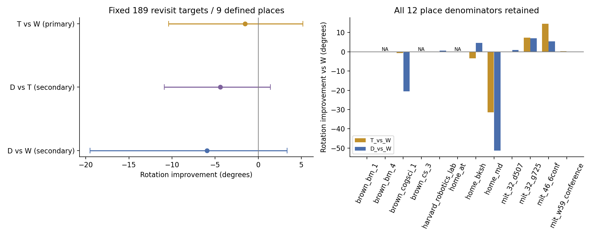
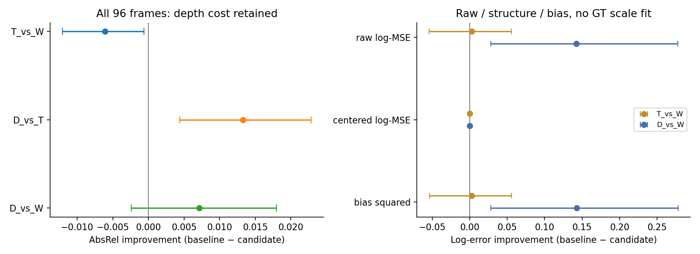
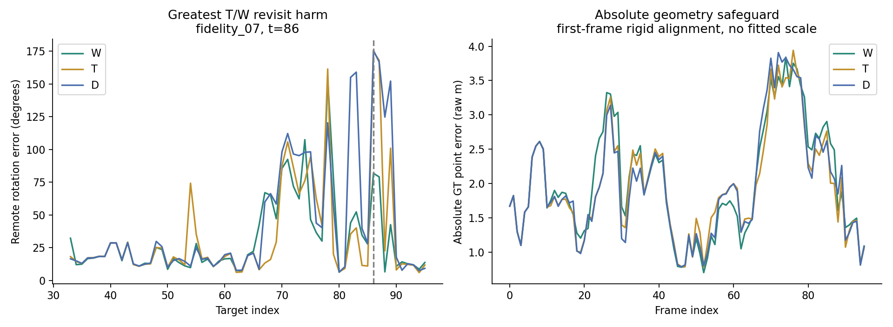
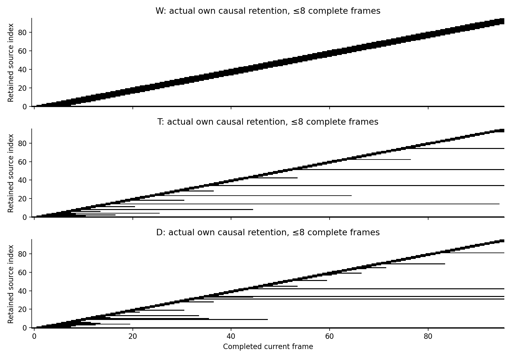

# stream_native_retention1：同总历史字节的原生保存政策

2026-11-15，round034完整执行[round033唯一科学合同](/home/liwt/GRoPE/results/gaussian_memory/autonomous_research_loop/round_033/science_plan.md)，SHA `d0ae8daeac00fe57765e8bfee27e4e470c6339357a0cf59f571190aa9c3af9cc`。**主T/W重访旋转改善 -1.5162 [-10.3813, 5.1687] 度；正数有利T。** W既有12×96评分继承，T/D各12×96新预测全部完成，0训练／下载。D/T、D/W为预定辅助，Full/A仅继承不等预算背景。全部数据used development，科学取舍归原Astra，不自动P2/P3，不宣称fresh、高斯优越性或总体成功。

| 固定比较 | 重访旋转改善度 [95%配对区间] | 全帧AbsRel改善 [95%区间] | ≥1°且下界>0 | AbsRel增加≥.01且有据 |
| --- | --- | --- | --- | --- |
| T_vs_W | -1.5162 [-10.3813, 5.1687] | -0.0061 [-0.0121, -0.0006] | False | False |
| D_vs_T | -4.4114 [-10.8829, 1.4118] | 0.0133 [0.0044, 0.0228] | False | False |
| D_vs_W | -5.9277 [-19.4927, 3.3476] | 0.0071 [-0.0024, 0.0180] | False | False |

T全帧AbsRel确有小幅退步：增加0.006119 [ 0.000616, 0.012076 ]；未达到合同均值.01明显代价线不等于没有损伤或已证安全。D相对T的AbsRel改善0.0133 [0.0044, 0.0228]，但D/W为0.0071 [-0.0024, 0.0180]且区间跨0；不把深度辅助改善追认为旋转主成功。旋转宽区间及地点差异均保留，不据均值负值证明所有少量历史保存无效。

“旋转实用线索”与“明显深度代价”是合同中的开发投入排序量，不是通用标准、非劣性证明或自动方法采用。小幅不确定负值不自动否决，区间跨0也不称等价。主T/W保持主身份，不能事后用D的最好分数追认T成功；若只能保留方向用途，也不称全面净收益。

## 固定问题、政策与匹配权限

检验同样约8个完整原生帧状态的预算下，分散旧观测能否保留旋转价值且避免长缓存的深度代价。竞争解释：近期连续性更重要；收益需要大量重复历史；保存只稳定全局上下文而非专门重访检索。相对round032，实质改变是同总byte的在线淘汰，未增加高斯、合并、教师、PE、GT选帧或学习。旧长历史旋转阳性及raw深度代价保持，未通过尺度拟合消掉。

| 政策 | 原生聚合器保留 | 相机缓存 |
| --- | --- | --- |
| W | 首帧＋最近7个完成帧（旧预测/指标继承） | 共同首帧＋最近7，4轮全部完成后淘汰 |
| T | 首帧＋最近3＋至多4远端；原近期帧退出时唯一入候选 | 同W |
| D | 同T容量/入库/5选4候选；普通内容minimax余弦选择 | 同W |

T对现有远端4个＋当前退出近期者c，枚举5选4；在连续采样序号区间[0,c]，以首帧固定为覆盖点，最小化到最近保留时间点的最大距离。使用双倍radius=max(相邻保留序号gap,2×末端gap)精确整数比较；平局按保留ID集合字典序。没有使用未来时间点、真实秒数、raw frame ordinal或GT重新优化。D描述子为本次实际原生单图patch_embed输出x_norm_patchtokens的patch均值（FP32）再L2归一；仅hook已有编码，不额外encoder。D对同5候选，最小化候选到所选远端＋首帧＋最近3的最大余弦距离；CPU FP64归约来自FP32描述子，平局同样字典序。未满4远端时全部保留，只存当前保留帧描述子；pool未用行清零，无已淘汰描述子库。

全部24层raw K/V及每帧5个特殊token随整帧保留；原patch位置和原global frame index保持，不融合、不加log-count、不重投影。各组从自己的因果隐藏状态继续写入；首帧和近期隐藏值可能间接携带更早信息。没有Full教师或他组cache输入。相机规则相同但隐藏值随自身轨迹产生，是独立在线政策总效应，非共同教师压缩机制隔离。

固定同一官方权重/提交`05682bcb05683c4c71522e9cb618fc8ca349063c`，5,026,743,569-byte旧权重，继承SHA `3d3d914d09609fdb485e16947c4885cca0e5ea4e5557598a3b3ffb1cfe0a2f59`，不重哈希大权重。518×392完整RGB，BF16聚合器、FP32相机/depth、原SDPA和4轮相机精化；所有权重冻结eval，0训练。原12×96不同RGB-D身份、原full pose坐标、顺序、GT标签/189重访/支持层直接沿用[旧配置](/home/liwt/GRoPE/results/gaussian_memory/stream_history_value1/configuration.json)，SHA `767f1101b15248b218afdd682b9c322b97d3dff50c02285851f8b6f47e7c1cd7`。新配置SHA `4c82d220180eee665f95709526b9e0a1070468e977e4de84f39a55fae195bac1`；不按效果或覆盖选数据。GT仅离线评分，未进入预测/状态/保留选择。

## 必要接口、预检与精确恢复

固定首地点W独立原生完整96帧重放，只作本轮同机成本与身份回放；与旧W全部depth/pose最大绝对差均0，没有重算旧像素指标。T00/D00前8帧容量尚覆盖全部历史，native depth/pose也与W各差0；这16帧计入各自正式96，并封完整状态，后续从8接续，不重复调用。T连续区间选择有88例独立中点覆盖核对，D有一例独立Torch FP64余弦核对，96帧保留容量检查通过；[接口证据](policy_interface_validation.json)、[原生预检](preflight.json)。这些是实现证据，不是方法收益。

原configuration中的preflight_fixed_frames=3是未被run接口读取的旧草稿计数字段；实际首次执行前的profile代码即为每组8帧并复用正式前缀。原配置SHA不改写，[计数修正记录](engineering_revisions/preflight_count001.json)与原生成器副本保留，未来生成器文字修正为8；不增加任何预测/拟合或改变科学条件。

采用共同cooperative-exit-only恢复：正常运行不保留旧周期checkpoint。完整当前帧/4轮相机/淘汰完成后，安全退出才保存当前≤8帧raw K/V、相机、共同arena、ID/远端/描述子/RNG与不可回流输出归档；恢复核对全部28对/56tensor的shape/dtype/固定样本和RNG/完成输出身份，先删消费checkpoint再推进下一query。两次预检前缀恢复有实际日志，无已淘汰帧留在可读恢复暗库。突发未保存崩溃将停止并保留失败，不能悄悄重跑有效帧。本轮所有实际保存/恢复、失败若有和I/O均计入预算；唯一队列与actualwait见[workers](workers)。

## 主终点、覆盖、逐地点与全部反例

原远端选择和mask完全继承：t=33…95；s≥1、t−s≥32；210×280源深度前向min-z投影，目标有效像素一致容差max(.05m,.05目标深度)，覆盖最大者、平局最早s。原覆盖≥5%为189重访，不改20%阈值/不重选。先每序列重访相对旋转均值，再已定义地点等权；12地点ID保留，3NA不填0。配对bootstrap5000×12地点ID，seed20261114，区间条件于有定义抽样分母；各层/留出也保留NA。

| 地点 | 重访/63 | W度 | T度 | D度 | W−T度 |
| --- | --- | --- | --- | --- | --- |
| brown_bm_1 | 3 | 0.3142 | 0.3162 | 0.3587 | -0.0019 |
| brown_bm_4 | 0 | NA | NA | NA | NA |
| brown_cogsci_1 | 14 | 17.1729 | 17.8470 | 37.7600 | -0.6741 |
| brown_cs_3 | 0 | NA | NA | NA | NA |
| harvard_robotics_lab | 59 | 3.8205 | 3.8165 | 3.2525 | 0.0039 |
| home_at | 0 | NA | NA | NA | NA |
| home_bksh | 4 | 28.0826 | 31.5414 | 23.4946 | -3.4588 |
| home_md | 8 | 32.5030 | 63.8893 | 83.7628 | -31.3863 |
| mit_32_d507 | 42 | 5.0181 | 5.1739 | 4.0163 | -0.1559 |
| mit_32_g725 | 44 | 11.5448 | 4.2820 | 4.5580 | 7.2628 |
| mit_46_6conf | 9 | 38.7212 | 24.1813 | 33.3704 | 14.5399 |
| mit_w59_conference | 6 | 28.5263 | 28.3019 | 28.4792 | 0.2244 |

原756远端目标/12地点：189重访来自9处；原共视零覆盖276、选定独占零支持291均保留。主T/W正向地点4/9，逐一留出均值范围-3.5232–2.2175度。全部远端真实时距12.33–641.76s，每对原索引gap/秒数/支持完整导出[selection.csv](scoring/selection.csv)。无GT平移方向定义的目标数0/756，只将该辅助量记NA，不删除主旋转。

## 全帧深度、几何与支持分层

| 全96帧（地点等权） | W | T | D | W−T [区间] | W−D [区间] |
| --- | --- | --- | --- | --- | --- |
| trajectory_rotation_anchor_deg | 42.1740 | 41.0983 | 42.9553 | 1.0757 [-1.8313, 4.4456] | -0.7813 [-3.8381, 2.6989] |
| trajectory_center_error_raw_m | 4.5459 | 4.4992 | 4.5431 | 0.0468 [0.0230, 0.0717] | 0.0028 [-0.0292, 0.0332] |
| absolute_worldpoint_GT_error_raw_m | 5.2002 | 5.1463 | 5.1902 | 0.0539 [0.0232, 0.0903] | 0.0101 [-0.0236, 0.0447] |
| absrel | 0.7253 | 0.7315 | 0.7182 | -0.0061 [-0.0121, -0.0006] | 0.0071 [-0.0024, 0.0180] |
| log_mse | 1.8933 | 1.8908 | 1.7508 | 0.0024 [-0.0541, 0.0558] | 0.1425 [0.0280, 0.2779] |
| centered_log_mse | 0.0091 | 0.0092 | 0.0092 | -0.0001 [-0.0003, 0.0001] | -0.0001 [-0.0004, 0.0000] |
| bias_squared | 1.8842 | 1.8817 | 1.7416 | 0.0025 [-0.0538, 0.0557] | 0.1426 [0.0281, 0.2781] |
| RMSE_m | 2.0392 | 2.0502 | 2.0193 | -0.0110 [-0.0248, 0.0023] | 0.0199 [-0.0056, 0.0497] |
| failure | 0.0000 | 0.0000 | 0.0000 | 0.0000 [0.0000, 0.0000] | 0.0000 [0.0000, 0.0000] |

raw log-MSE、去均值结构误差、偏差平方与全图AbsRel分列，不用结构项掩盖整体深度损伤；不通过GT尺度/仿射拟合修复输出。轨迹与绝对点误差只作首帧刚体gauge对齐，保留raw尺度。跨时一致性用固定GT对应，并列两端绝对GT点误差及GT投影采样差，防止缩小/塌缩伪装一致。相机非有限保留180°旋转/failure；深度坏值保留异常，不能筛有限子集得漂亮区间。全部新原生有限性及失败原数见调用/逐帧表，不推断物理场景尺度已准确。

| 目标集合 | 辅助端点 | W | T | D | W−T [区间] |
| --- | --- | --- | --- | --- | --- |
| all63far_targets | relative_rotation_deg | 56.1592 | 54.1601 | 57.8833 | 1.9992 [-1.4820, 6.0664] |
| all63far_targets | relative_translation_direction_deg | 48.5890 | 45.4725 | 49.4423 | 3.1164 [-0.3058, 6.7026] |
| all63far_targets | relative_translation_vector_error_raw_m | 4.9422 | 4.9054 | 4.9519 | 0.0368 [-0.0041, 0.0791] |
| all63far_targets | cross_time_point_consistency_raw_m | 0.7957 | 0.7287 | 0.8147 | 0.0670 [-0.0310, 0.1471] |
| all63far_targets | paired_absolute_GT_geometry_error_raw_m | 5.1720 | 5.1660 | 5.1778 | 0.0059 [-0.0636, 0.0706] |
| all63far_targets | failure | 0.0000 | 0.0000 | 0.0000 | 0.0000 [0.0000, 0.0000] |
| revisit_coverage_ge5pct | relative_rotation_deg | 18.4115 | 19.9277 | 24.3392 | -1.5162 [-10.3813, 5.1687] |
| revisit_coverage_ge5pct | relative_translation_direction_deg | 27.6013 | 23.0078 | 26.7088 | 4.5936 [1.5467, 8.0972] |
| revisit_coverage_ge5pct | relative_translation_vector_error_raw_m | 1.8962 | 1.8631 | 1.8920 | 0.0331 [0.0075, 0.0604] |
| revisit_coverage_ge5pct | cross_time_point_consistency_raw_m | 0.4402 | 0.4331 | 0.4680 | 0.0071 [-0.0433, 0.0586] |
| revisit_coverage_ge5pct | paired_absolute_GT_geometry_error_raw_m | 3.4350 | 3.4356 | 3.4830 | -0.0006 [-0.0348, 0.0309] |
| revisit_coverage_ge5pct | failure | 0.0000 | 0.0000 | 0.0000 | 0.0000 [0.0000, 0.0000] |
| nonrevisit_lt5pct | relative_rotation_deg | 57.6041 | 55.7294 | 59.4736 | 1.8747 [-2.3245, 6.9632] |
| nonrevisit_lt5pct | relative_translation_direction_deg | 47.6254 | 45.2816 | 49.5416 | 2.3437 [-1.2079, 6.2600] |
| nonrevisit_lt5pct | relative_translation_vector_error_raw_m | 5.2521 | 5.2123 | 5.2583 | 0.0398 [-0.0049, 0.0839] |
| nonrevisit_lt5pct | cross_time_point_consistency_raw_m | 0.8737 | 0.7913 | 0.8985 | 0.0824 [-0.0290, 0.1852] |
| nonrevisit_lt5pct | paired_absolute_GT_geometry_error_raw_m | 5.6654 | 5.6514 | 5.6663 | 0.0140 [-0.0592, 0.0873] |
| nonrevisit_lt5pct | failure | 0.0000 | 0.0000 | 0.0000 | 0.0000 [0.0000, 0.0000] |

| 原独占定义（重访子集） | 支持层 | 目标数 | 地点数 | W度 | T度 | D度 |
| --- | --- | --- | --- | --- | --- | --- |
| selected_pair_exclusive | 0 | 6 | 1 | 15.4464 | 15.3353 | 14.8362 |
| selected_pair_exclusive | (0,5%] | 136 | 9 | 19.0229 | 21.3969 | 30.1100 |
| selected_pair_exclusive | (5,20%] | 44 | 9 | 16.4006 | 16.7370 | 19.2776 |
| selected_pair_exclusive | >20% | 3 | 2 | 4.8556 | 2.8653 | 2.6588 |
| selected_pair_exclusive | undefined | 0 | 0 | NA | NA | NA |
| all_far_union_exclusive | 0 | 5 | 1 | 15.4194 | 15.3365 | 14.8348 |
| all_far_union_exclusive | (0,5%] | 84 | 7 | 15.0313 | 13.3870 | 11.5160 |
| all_far_union_exclusive | (5,20%] | 78 | 8 | 21.1105 | 25.2191 | 42.4293 |
| all_far_union_exclusive | >20% | 22 | 8 | 15.3684 | 10.7715 | 14.2445 |
| all_far_union_exclusive | undefined | 0 | 0 | NA | NA | NA |

两个独占定义均扣除原首帧＋最近7参考mask：selected-best-pair为主描述，all-far-union为另列诊断，不因T/D改用有利参照。未筛0/低支持；全部756目标和重访子集各层的全部指标/配对地点区间/原NA见[support_strata.csv](scoring/support_strata.csv)、[support_strata_paired.json](scoring/support_strata_paired.json)。分层不是因果或单调性证明。

| T/W最大重访反例 | t/s | 覆盖 | 独占 | 秒数 | 改善度 |
| --- | --- | --- | --- | --- | --- |
| fidelity_07 | 86/52 | 0.096 | 0.086 | 160.24 | -92.6481 |
| fidelity_07 | 87/52 | 0.097 | 0.042 | 162.25 | -88.9517 |
| fidelity_07 | 89/52 | 0.140 | 0.072 | 171.70 | -58.3672 |
| fidelity_02 | 80/40 | 0.064 | 0.017 | 40.39 | -16.6880 |
| fidelity_07 | 88/56 | 0.056 | 0.030 | 150.86 | -16.0173 |

| D/T最大重访反例 | t/s | 覆盖 | 独占 | 秒数 | 改善度 |
| --- | --- | --- | --- | --- | --- |
| fidelity_02 | 79/40 | 0.052 | 0.044 | 39.88 | -141.3749 |
| fidelity_02 | 80/40 | 0.064 | 0.017 | 40.39 | -141.1934 |
| fidelity_07 | 88/56 | 0.056 | 0.030 | 150.86 | -102.1133 |
| fidelity_07 | 89/52 | 0.140 | 0.072 | 171.70 | -51.2193 |
| fidelity_10 | 92/58 | 0.175 | 0.040 | 38.11 | -40.9637 |

| D/W最大重访反例 | t/s | 覆盖 | 独占 | 秒数 | 改善度 |
| --- | --- | --- | --- | --- | --- |
| fidelity_02 | 80/40 | 0.064 | 0.017 | 40.39 | -157.8813 |
| fidelity_02 | 79/40 | 0.052 | 0.044 | 39.88 | -134.2982 |
| fidelity_07 | 88/56 | 0.056 | 0.030 | 150.86 | -118.1306 |
| fidelity_07 | 89/52 | 0.140 | 0.072 | 171.70 | -109.5865 |
| fidelity_07 | 86/52 | 0.096 | 0.086 | 160.24 | -93.8837 |

全部756×3比较含非重访、原零覆盖和正负个例完整保存[all_counterexamples.csv](scoring/all_counterexamples.csv)。

## 同一总历史字节上限与可恢复执行

共同B在2026-11-14T16:07:13.942500+00:00、任何T/D科学评分前登记为 **2,726,555,844bytes=2.539303GiB**。W8实测raw K/V＋相机820,772,864bytes，共同128KiB元数据arena，各组相同。B=3×(raw8＋arena)＋整个12流可读RGB库存262,795,460bytes＋1MiB原生位置/RoPE/Python/RNG/ZIP/manifest与描述子临时对象余量。D描述子/时间索引不免费；W/T不靠冗余整帧副本让D额外放帧，所有组硬约束≤8完整保留帧。

| 政策 | 本轮完整流数 | 实测forward最大GiB | GPU/CPU/disk三份raw＋arena GiB | 共同总B GiB |
| --- | --- | --- | --- | --- |
| W | 1 | 0.764560 | 2.293579 | 2.539303 |
| T | 12 | 0.764560 | 2.293579 | 2.539303 |
| D | 12 | 0.764560 | 2.293579 | 2.539303 |

native当前帧追加与out-of-place淘汰会短暂并存old9/new8 raw history；用2×9/8×raw8作保守上界，小于三份8帧save/restore上界。退出save：GPU完整8＋CPU完整8＋一个磁盘8，首次原子写无另一个旧checkpoint；restore同样三份，消费后先删除磁盘文件，继续时无旧淘汰状态暗库。CPU arena、描述子选择临时复制及原生grid/RoPE/Python/文件头均在共同余量内；恢复receipt实际file bytes见[history_bytes.json](history_bytes.json)。当前normalized/RoPE attention中间量、权重、当前激活和allocator reserve另报；原raw history独立复制不藏作免费临时激活。无普适显存对账<5%门槛。

原历史RGB文件仍可读，故将整个选定batch最坏backing保守计给每政策，即使真实forward只单调读当前RGB。GT深度/pose标签、预测depth/pose和partial输出归档没有forward回流接口，不算预测历史；这些物理新增字节仍计DATA。无教师形成或免费离线cache。T/D从各自实际状态写入，缓存中的完整内容保留原始dtype/顺序/patch位置。

## 完整成本、调用与资源

本轮固定W首地点完整96帧的进程冷启动至最终输出观察wall为32.575846s；其中imports＋模型加载envelope 16.344622s，加载完成至96输出16.231224s。时间来自本机manager启动/segment UTC观察，不把OS文件cache热状态冒称物理uncached冷载。不是round032共享F/A流水线借来的独立测速。

| 固定首地点实际执行 | 预检8帧envelope s | 正式88帧含冷载/restore/output s | 合计s |
| --- | --- | --- | --- |
| T | 2.284624 | 33.862117 | 36.146741 |
| D | 2.383893 | 35.188544 | 37.572437 |

T/D首8预检在已加载同一权重上各自从空状态形成，prefix envelope含必要验证bookkeeping/原子保存；正式worker各自真实冷进程载入、restore及剩余88帧/最终输出再计。共同profile加载依赖只在真实总wall计一次并明确列出；这个人为验证分段不是最优无中断单进程部署，不能直接用不等验证开销宣称W/T/D加速。完整per-stream、per-frame原生查询、写入/选择/传输残差、加载/恢复/存储可重建账见[costs.json](costs.json)。纯attention读取延迟未另隔离，不冒充完整query或免费形成。

| 政策 | 实测环节 | 合计s | 均值ms/帧 | 帧数 |
| --- | --- | --- | --- | --- |
| W | aggregator_seconds | 11.8408 | 123.3414 | 96 |
| W | camera_depth_seconds | 2.4568 | 25.5919 | 96 |
| W | selection_eviction_seconds | 0.3852 | 4.0126 | 96 |
| W | RGB_read_seconds | 1.1689 | 12.1756 | 96 |
| W | frame_wall_seconds | 15.9381 | 166.0216 | 96 |
| T | aggregator_seconds | 141.8217 | 123.1091 | 1152 |
| T | camera_depth_seconds | 29.3001 | 25.4341 | 1152 |
| T | selection_eviction_seconds | 4.7396 | 4.1142 | 1152 |
| T | RGB_read_seconds | 14.0373 | 12.1852 | 1152 |
| T | frame_wall_seconds | 190.8580 | 165.6753 | 1152 |
| D | aggregator_seconds | 142.6355 | 123.8155 | 1152 |
| D | camera_depth_seconds | 29.2669 | 25.4053 | 1152 |
| D | selection_eviction_seconds | 6.1597 | 5.3470 | 1152 |
| D | RGB_read_seconds | 14.1306 | 12.2662 | 1152 |
| D | frame_wall_seconds | 193.1624 | 167.6757 | 1152 |

D描述子tap envelope合计3.871320s，已含在D aggregator时间；CPU拷贝会同步尚未完成的patch encoder，不能解释成纯边际描述子开销。extra encoder=0，不等于描述子计算免费。完整保存I/O 1.995359s；模型加载body合计357.416371s；各restore从model-loaded至验证/消费删除的envelope分别为[1.020423, 0.542679]s，含少量hook/setup，均计workerwall。

| 实际新调用 | 数量 |
| --- | --- |
| new_formal_T_D_frames | 2304 |
| W_fixed_cost_frames | 96 |
| total_native_frame_calls | 2400 |
| duplicated_policy_stream_frames | 0 |
| native_camera_refinement_rounds | 9600 |
| existing_encoder_descriptor_taps | 1152 |
| extra_encoder_calls | 0 |
| new_GT_projection_calls | 0 |
| old_W_metric_records_recomputed | 0 |
| training_updates | 0 |
| downloads | 0 |
| finite_native_frames | 2400 |
| model_loads | 25 |

所有GPU worker实际Popen→wait合计 **0.229590小时≤2**，其中预检/成本 **0.010728小时≤.25**；25进程均actualwait。单worker NVML峰7.578125GiB≤40，allocated峰6.513072GiB、reserved峰7.259766GiB、RSS峰9.939480GiB。DATA采样峰1.815915GiB；包含全部25输出＋两原始prefixcheckpoint＋四并发完整exit与完整output原子暂存的保守界7.000223GiB≤8，最终1.815915GiB。项目/临时与终态实数见[terminal_record.json](terminal_record.json)。没有删除旧结果、改GLIBC或下载。

执行前宿主CUDA=True/8卡；restricted sandbox不可见/dev/nvidia不报驱动坏。实时全8卡占用/外部PID准入，实际用卡逐worker记录；max4并发来自8GiB所有exit峰＋永久输出边界，不是默认两卡。其他用户忙卡不因剩余显存被当空闲算力；新安全空卡可动态接独立未完流。manager纯CPU安全等待单列，不伪装GPU有效计算时间；加载/恢复/失败/IO均已在GPU workerwall计费。

## 独立评分、边界与索引

新T/D全部2304份depth独立NumPy/Torch指标复算最大差3.11e-15；FP64 resize最大差7.97e-14；NumPy/官方Torch pose解码最大差8.88e-16；NumPy/SciPy旋转最大差1.19e-05度。旧W1152逐帧和756逐对指标直接继承，0旧像素重评分、0新GT投影/标签重算、0评分新模型调用。全部输入/标签/源/配置/旧权重继承身份见[execution_identity.json](execution_identity.json)。

Full/A的旧不等预算背景和其raw深度代价单独保留在summary.background_F_A_inherited，没有重训/重跑，也不把Full当上界或用不稳定差距比例包装恢复率。本轮只检验固定配额原生整帧时间/内容选择；失败不推出高斯或空间结构普遍无用，阳性也不证明高斯机制。O3有界保存/O4原生精度—成本服务新目标；O2高斯公共结构暂不增加，O1语义澄清、O5渲染/O6 PE及所有旧关闭保持。C1自身在线写入、C2原生整帧、C3固定政策、C4不增PE、C5旧稀疏12×96、C6冻结均为本阶段选择，非永久用户要求。没有fresh或连续千帧部署确认。

完整交付：[manifest.json](manifest.json)、[唯一实现交接](implementation_handoff.json)、[全部指标/区间与预定flags](scoring/summary.json)、[逐帧](scoring/frames.csv)、[逐对](scoring/pairs.csv)、[逐地点](scoring/by_place.csv)、[全反例](scoring/all_counterexamples.csv)、[同byte证明](history_bytes.json)、[成本](costs.json)、[调用](call_accounting.json)、[图实际审阅](figure_review.json)、[实际终态](terminal_record.json)。永久新预测路径/SHA从25份completed记录索引，旧W与标签保持原位置；不重复大权重或旧评分审计。科学分支交原Astra，本实现不自选后继。

