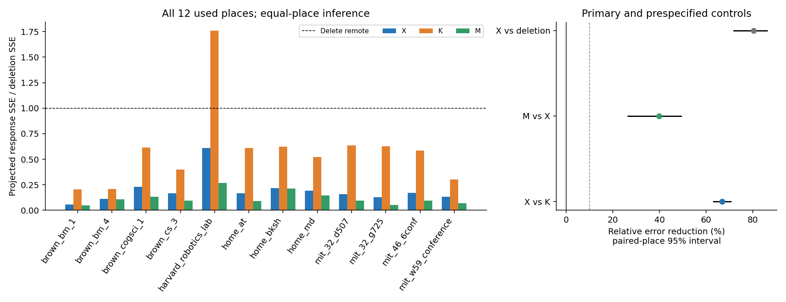
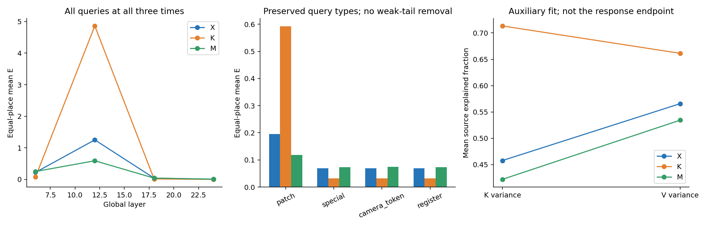
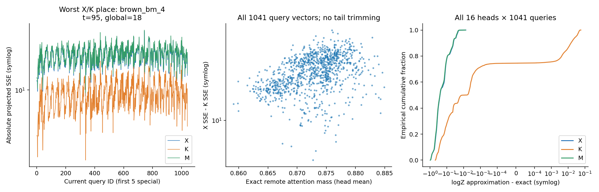
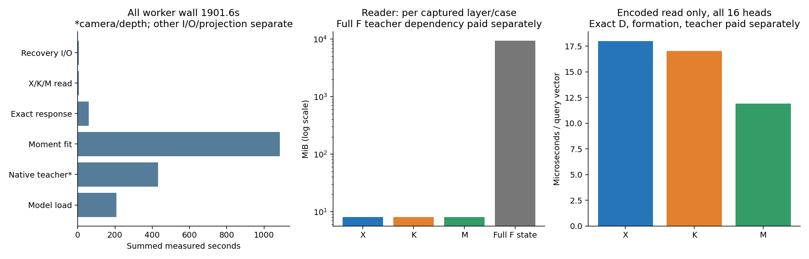

# stream_response_moment1：固定原生历史响应的同byte矩测量

12×96完整F教师、144次固定响应捕获已完成。主X/K平均E相对下降 **+66.942% [+63.203, +70.635]%**；mean E_X=0.195，E_K=0.5899，E_M=0.1174。X/K预定分项flag=True（该分项不含M控制）；M/X相对下降 **+39.787% [+26.474, +49.269]%**，简单表示材料性flag=True。本报告给出有限事实，由原Astra取舍；不自行立后继、在线用途、高斯/PE或fresh结论。

## 固定问题、身份与实际实现

唯一科学合同：[round040](../autonomous_research_loop/round_040/science_plan.md)，SHA `f08cf4156f57bec7c65f3594096e52e047dcc8299ae6d688f81b1848c5b748fc`；实施为round041。[主控制目标](../autonomous_research_loop/goal_revision_20261115/revised_goal.md)保持，总体未达。原T/D、U/C及PE家族关闭决定和全部历史正负不改。所有12地点/96帧为既用开发数据；0训练、0下载。

问题是：来源预测XYZ选择的秩≤3有效内容子空间，是否比同粗组的普通key-PCA矩，更好地保留真实后续query响应。竞争解释是key方差方向或更细均值已经足够，以及位置误差、非仿射内容、非高斯尾部使连续闭合失败。它不是有限token求和恒等式，也不主张高斯独有性。

官方冻结StreamVGGT、原预处理、BF16聚合器和FP32 camera/depth，原24层、完整F相机历史及每帧4轮均保留。每地点仅一次因果F流；零基31/63/95帧、global6/12/18/24的全部16head和1041query被捕获。实际k_norm→原source2D RoPE后key与原value用于来源拟合，q为原postnorm/RoPE结果除√64。近似响应不反馈教师。首地点96帧深度及pose与继承F输出逐元素最大差均0；未重复旧像素评分。模型大SHA继承，未重哈希权重。

仅过去frame1…t−8的有效XYZ patch进入压缩；frame0、最近7过去帧、当前token、全部历史special及无效远端XYZ共同精确保留D。XYZ由来源当时F深度/camera按既有patch中位深度与中心坐标定义一次写入，不用GT、当前或未来几何。空间树只读来源XYZ：最大坐标范围轴、稳定坐标/sourceID中位数切分；优先最大叶、nodeID破并列。X/K共享256非空粗组，M沿同树最多1022叶；不足按实际非空组。

来源统计/协方差eigh/伪逆共同FP64，编码均FP32。XYZ白化及key-PCA特征值分别以dim×eps64×maxλ判零，零方向置零；没有ridge、扫描、query选择或调参。X保存均值及K/V对XYZ白化坐标的B/C；K保存同均值及key协方差top3的B和value交叉协方差C；M只保存细组均值/count。协方差/白化基已吸收B/C，读出不保留可删的冗余几何统计；源形成审计仍计费保留。

格式预先固定64B header，每组nodeID/count各int64、两组16×64 FP32均值；X/K再含两组16×64×3 FP32斜率。每captured-layer/case，X/K各 **8,392,768B**，M最大 **8,388,640B**；第1023叶超上限。必要GPU/CPU/disk读取副本共同上界25,182,400B。全部432份状态实际写盘、重载并逐值确认后读取；除首固定case三份外，其他临时编码读完即删，SHA/bytes/成本收据保留。

## 主响应、分母与配对结果

三种连续组的logZ=logn+r·mean(a)+½||Bᵀr||²，条件value=mean(v)+CBᵀr；M省掉斜率。每个近似N/Z与完整精确D合并同一分母，未把组内归一化结果另行拼接。参照F与删除D均为共同FP32精确离散softmax求和。原WO对响应差做FP32线性投影，bias严格取消。原生fused响应继续教师原回路，只记录其与参照的数值差。

每地点先跨3时点×4层×1041query累加投影SSE，再除该地点删除D的总SSE；最后地点等权。主比较为(mean E_K−mean E_X)/mean E_K，非平均逐query相对数。配对地点5000 bootstrap、seed20261114；零分母NA、不加epsilon、不剪坏尾。原始绝对分子/分母及全部逐query向量可独立复算。

| 地点 | deletion绝对SSE | E_X | E_K | E_M | fused E |
|---|---:|---:|---:|---:|---:|
|brown_bm_1|2034022|0.0580407|0.203811|0.0457522|1.1653e-06|
|brown_bm_4|1409294|0.112694|0.207398|0.10726|2.571e-06|
|brown_cogsci_1|927879.5|0.230186|0.616155|0.134371|2.161e-06|
|brown_cs_3|1464469|0.16433|0.397762|0.0956093|2.2108e-06|
|harvard_robotics_lab|413815.6|0.608368|1.75755|0.269637|5.564e-06|
|home_at|1046788|0.168224|0.6084|0.0915929|2.2983e-06|
|home_bksh|591606.5|0.215526|0.620912|0.211308|3.8047e-06|
|home_md|966135.3|0.190166|0.519195|0.146118|2.1231e-06|
|mit_32_d507|1231824|0.158929|0.634511|0.0935573|1.5269e-06|
|mit_32_g725|1761193|0.130003|0.625221|0.0530695|1.06e-06|
|mit_46_6conf|1208624|0.16954|0.586247|0.093797|1.6284e-06|
|mit_w59_conference|2522496|0.13398|0.301275|0.0668986|9.2543e-07|

X/K正向地点12/12；全体mean E_X<1为True。M相对X的预定10%+正CI判断为True，保留其独立解释。X/D=+80.500% [+71.845, +86.158]%，K/D=+41.013% [+15.808, +58.619]%，M/D=+88.259% [+84.419, +91.462]%。删除D对应E=1，精确对应0。

零地点分母0，零逐query分母0；全部149,904个query向量/2,398,464个head-query保留。无效XYZ远端总计0，支持/零覆盖原记录见[source_support.json](source_support.json)。空remote边界以零组共同精确回退，CPU接口检验三组输出/完整分母与D逐值相同；零历史效应仍记NA。

## 预定辅助、支持与反例

| 分层 | X/K相对下降与95%CI | mean E_X | mean E_K | mean E_M |
|---|---:|---:|---:|---:|
|place  all|+66.942% [+63.203, +70.635]%|0.195|0.5899|0.1174|
|place_layer 6 all|-185.239% [-303.787, -110.211]%|0.2216|0.07767|0.2495|
|place_layer 12 all|+74.269% [+70.169, +77.664]%|1.251|4.862|0.5885|
|place_layer 18 all|-201.082% [-267.426, -178.256]%|0.03882|0.01289|0.04012|
|place_layer 24 all|-2018.486% [-2399.807, -1591.746]%|0.00376|0.0001775|0.00496|
|place_time 31 all|+72.837% [+68.618, +76.400]%|0.3347|1.232|0.15|
|place_time 63 all|+63.729% [+57.844, +69.283]%|0.266|0.7334|0.1593|
|place_time 95 all|+63.879% [+56.443, +68.597]%|0.2|0.5537|0.1666|
|place  patch|+66.985% [+63.259, +70.678]%|0.1956|0.5925|0.1176|
|place  special|-120.558% [-158.434, -92.115]%|0.06927|0.03141|0.07349|
|place  camera_token|-118.606% [-156.236, -90.181]%|0.06957|0.03182|0.07381|
|place  register|-121.056% [-159.268, -92.633]%|0.0692|0.0313|0.07341|

Leave-one-place-out主均值相对下降范围+65.754%至+67.584%；完整逐地点移除见[leave_one_out.json](leave_one_out.json)，不以该辅助替换全体结果。最大逐query X−K绝对SSE反例为mit_32_d507，t=31、global=12、query=436，X/K/D绝对SSE=1142/580.3/15.39。最大地点平均E差反例为brown_bm_4。前30反例和完整149904行CSV全部保存，不用反例删地点。

来源K/V解释率只描述拟合，不能替代响应。logZ、完整远端质量误差按全部head/query保存，非有限值另计而不截断；大尾部不用于调温度/容量。全量逐case/head统计及原向量见[logZ_mass.json](logZ_mass.json)、[explained_variance.json](explained_variance.json)、[per_case.json](per_case.json)、[strata.json](strata.json)及[全部逐query](all_query_metrics.csv)。

## 全量响应质量与支持数表

下表为全部144case×16head的来源解释率均值，以及全部head-query的完整logZ/远端质量误差范围；不删任何尾部，不以R²改主终点。统计范围与原始逐例数组在response_auxiliary_summary.json及logZ_mass.json可追溯。

| 表示 | 来源K R²均值 | 来源V R²均值 | logZ误差[min,max] | logZ均值 | 相对Z误差最大值 | 远端质量误差[min,max] | 非有限Z误差 |
|---|---:|---:|---:|---:|---:|---:|---:|
|X|0.457638|0.565737|[-5.27651,10.9782]|-0.37389|58581.1|[-0.987575,0.904663]|0|
|K|0.713364|0.661306|[-4.37006,28.8619]|-0.0627253|3.42425e+12|[-0.879843,0.937424]|0|
|M|0.421920|0.534374|[-5.40092,-0.000160217]|-0.400651|-0.000160204|[-0.988662,-2.32458e-05]|0|

有效远端来源数t31/63/95分别为[23828]/[56980]/[90132]，全部地点一致；无效XYZ共同回退数为0。实际远端head-query质量范围[0.00773826,0.996997]，不按质量筛query。X绝对响应SSE比K更差的case共106/144，global6/12/18/24分别为[34, 0, 36, 36]；地点总和12/12改善不代表逐层/逐query普遍更好。

K具有更高来源K/V解释率，但本次连续闭合的完整logZ正尾明显更大；这是观测，不据此宣称已分离失败因果。M整体比X更好且成本更低，保留这一简单控制的优先性。X/K分项达到预定条件，同时M/X也达到材料性胜出条件；按合同不能据前一项单独支持开发XYZ斜率。后续科学取舍由原Astra完成。

## 实际成本与资源边界

总GPU worker **0.528221h** /4h，含首流176.643s、所有加载/完整教师/拟合/离散参照/三组读取/传输/I/O/恢复。首流在效果汇总前给出2605.49s预估并准入，输出复用；无额外GPU benchmark。实际13个worker，退出码[0, 0, 0, 75, 0, 0, 0, 0, 0, 0, 0, 0, 0]，全部actualwait。完整原生aggregator/camera/depth各1152调用，camera4608轮；144捕获、36空间树、2304head来源矩构建；每组4752个query chunk、432次编码写/读；0训练和近似反馈。

native模型加载累计206.929s；native聚合器扣除测量callback约400.530s、完整camera/depth 29.991s；空间树7.725s、三组来源矩拟合1083.929s、编码CPU传输/写/hash 12.182s、实际重读CPU→GPU 3.065s、完整F/D离散参照58.990s。组件时间嵌套，不能全部相加；全部worker wall为预算口径。

纯编码读取X/K/M累计为[2.699, 2.556, 1.784]s，摊每完整16-head query向量为[18.006, 17.049, 11.904]µs。该纯读成本以精确D的oD/logD已形成作为输入，完整D、来源形成、教师、投影与传输均另计；不是完整native query延迟或在线加速。全链每捕获query摊销12.6854ms、每teacher帧1.6507s。

完整24层F+相机+自身XYZ state实测峰9,850,580,969B；模型权重文件5,026,743,569B为另计共同依赖。单worker CUDA allocated/reserved峰16.108/23.613GiB、NVML 24544MiB，均<40GiB。临时拟合张量保守4GiB另列，当前RGB FP32可读batch 2,436,672B，source树/XYZ/统计及读取GPU-CPU-disk副本均非免费。完整相机/原位置缓存、激活与拟合临时副本包含CUDA峰；完整教师和源拟合不称有界部署。

新增DATA最终4.1116GiB，采样实峰4.3570GiB；同时完整恢复/原子暂存/未来输出准入最大保守账23.8094GiB<24。GPU阶段项目采样峰3.09MiB；CPU交付后CSV/图/报告等实测41.39MiB，含脚本及8MiB最终metadata余量的交付上界49.47MiB<1GiB。完整KV恢复按直接逐storage GPU→序列化，不保留整份CPU镜像；恢复CPU payload转GPU后立即释放并删除已消费backing。持久评分快照与首例原始校验捕获为审计输出计费，永不回流教师。

实际GPU0/3/4均用于安全空卡任务，未触碰忙卡/他人PID。可容纳时第三卡执行固定帧31前缀后actualwait75，完整KV/相机/XYZ及RNG保存，从32恢复；1次保存、1次恢复，已完成教师帧0重复。后续三份完整checkpoint加最终产物会超24GiB，因此按完整恢复峰值动态准入，非继承两卡上限。普通外部任务保护与完整帧退出策略保留；无系统GLIBC修改。

编码容量不包含共同精确D。各case完整D token/索引/掩码字节逐项列在costs.json；最大有效FP32 D K/V内容80,314,368B，当前完整q为4,263,936B，WO为4,194,304B。实际D从付费完整F内容形成并按32query chunk读取；若先形成全query的oD/logD，其等价体积4,330,560B也非免费缓存。这些共同依赖不扩大任一组编码容量，整条流水不称8MiB在线方法。

## 独立验证、恢复和交付边界

首固定case从实际有效q/a/v独立CPU FP64离散softmax及编码闭合复算，全部16head、前6query（含全部5特殊及第1patch）保留完整D；三组最大响应相对L2误差9.47e-07，原精确F差2.86e-06。差分投影最大绝对差1.76e-06。零query完整count/加权均值恒等性按实际FP32编码披露；不设统一微差门禁。全144例全部投影向量由NumPy FP64与独立Torch FP64平方和复算，最大差7.28e-12。36份来源/树ID分区独立CPU检查，无query参与选择。

工程版本记录：初版首worker使用非空remote路径；在其首次捕获前已补空remote共同精确回退，后续worker使用该边界修复，实际各capture支持均保留。一次CPU继承输出字段读取把depth_full误写depth_F，exit1、无模型/GPU调用；同轮修正后CPU实际exit0，失败没有当科学结果。另一次仅metadata清理试图删除已由matplotlib自动移除的自有临时字体缓存，返回1；无残留缓存、模型或评分调用，最终元数据正常完成。没有GPU失败或丢弃教师训练。接口/来源/验证和owners见[engineering_revisions.json](engineering_revisions.json)、[validation.json](validation.json)、[interface_validation.json](interface_validation.json)、[source_lineage_validation.json](source_lineage_validation.json)及终端收据。

精确目录与哈希由[artifact_manifest.json](artifact_manifest.json)索引；[execution_identity.json](execution_identity.json)记录模型、代码与配置身份，[costs.json](costs.json)为完整嵌套成本/字节/调用账，[terminal_receipt.json](terminal_receipt.json)为全部owner实际终态。未暴露的token、reasoning、工具总量及后台effective配置记null，不把混合wall当纯推理时间。

O2只检验来源空间与有效内容关系，O3为表示/构建/读取成本，O4为真实原生读取组件；O5/O6无新收益证据。C1完整教师/C2有效内容矩/C3固定三控制/C4原2D RoPE/C5旧稀疏used流/C6冻结闭式拟合均为本轮临时条件。任何阳性仅支持机制投入，不能替代后续原生净用途或fresh确认；总体目标和全部旧关闭保持。
