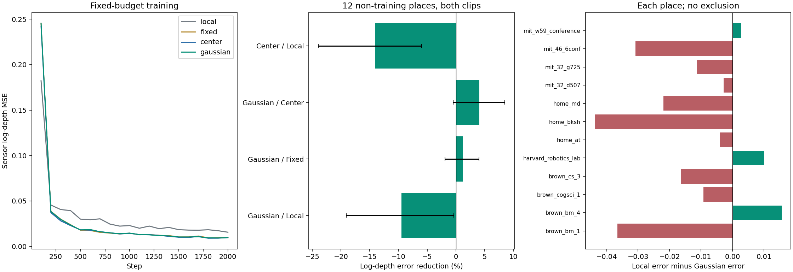

# surface1：共享高斯场景表面的联合写入与 attention 读取

2026-11-10。**本轮已完成，当前原型未建立跨地点净收益。** 十二次配对训练、46片段评价、保存记忆读取、固定干预、独立核对及八张图审阅均完成。训练片段的未优化视角有明确收益；十二个非训练地点上，高斯组的粗深度误差比无记忆组高9.47%。跨视角一致性虽改善，但追加的固定预测诊断表明，它不能单独证明正确的空间记忆。本轮不继续加损失、补种子或调整形状项。

[事前计划](../../../docs/gaussian_memory_surface_plan.md) · [源文件/输入/配置身份](plan.json) · [完整评分](evaluation/scores.json) · [场景与种子分析](analysis.json) · [独立检查](checks.json) · [可视化审阅](review.json)

## 为什么执行这一轮

此前末层 S1/S5 token 蒸馏都没有可靠的跨地点净收益。尤其上下文 token 的变化可以包含整幅图共有的通道偏移，不能直接等同共同三维状态。按照导师“网络能否记住场景几何”的方向，本轮改用有明确空间意义的监督，联合训练写入与读取，不再只调整冻结记忆上的末层恢复器。

检验的问题依次是：共享场景记忆是否有用；允许几何写入是否超过固定几何；完整协方差位置项是否超过中心项。反面解释包括单视图已足够、只有初始几何/内容有用，以及共享偏差或平滑使一致性看起来更好。旧实验的正负结果全部保留；本轮改变了任务和可学习范围，不能把与旧分数的差异归因于某一个因素。

## 实际实现与输入边界

四参考 RGB 经冻结 VGGT 得到参考专用特征及初始几何，原型 GaussianWriter 从零残差初始化写入256个高斯。每个状态只有三维均值、完整协方差、opacity和32维内容；浮点核心状态45 KiB。所有场景共用一个网络，没有逐场景优化参数。

当前视图的冻结S1 token、给定相机与参考尺度输入一个64维、4头 cross-attention。Q由查询token与相机得到，K含高斯内容与相机坐标几何，V含内容与中心的对数米制深度。读出与局部分支相加，由一个线性头预测对数米制深度；没有额外融合模块或一致性损失。这里的高斯PE是attention中的投影协方差二次型，尚非新RoPE旋转公式。

查询RGB从不进入参考编码或记忆构建；查询传感器深度只用于标签与评价。Local也得到相同相机、参考尺度信息，故它是“无空间记忆”对照，不是完全不使用参考尺度的纯单目系统。评估先保存414份状态，再只加载保存状态、查询token及相机读取；独立CPU读出删掉写入器模块后仍复现结果。

| 组别 | 可学习范围 / 位置项 | 总参数 |
| --- | --- | ---: |
| Local | 当前视图MLP，宽191，无场景状态 | 435,757 |
| Fixed | 均值/协方差固定，内容、opacity和Gaussian读取可学 | 434,543 |
| Center | 完整共享写入可学，位置bias为中心距离 | 434,543 |
| Gaussian | 完整共享写入可学，位置bias为完整投影协方差 | 434,543 |

Fixed有1,161个不活跃的几何输出参数。Center的K仍能看到协方差，是形状位置项的强对照，不能称完全不含形状。三个记忆组全部共同参数初值一致；四组初始预测均为log-depth=0，采样顺序逐步一致。

## 数据与固定预算

- 沿用coverage1的12训练地点，各1片段，72训练查询、288遮挡样本；参考为0/4/8/12，训练查询1/3/5/7/9/11，片段内留出2/6/10。
- 四组×三个种子20261110/11/12，均为2000步、batch2、AdamW 3e-4、weight decay .01、梯度裁剪5。损失是每查询有效patch等权的对数深度MSE。没有按评价结果选checkpoint或继续训练。
- 评价46历史片段、288查询/576遮挡样本及288完整查询。主评价12个非训练地点，每地两个片段，先按地点合并，再跨三个种子配对。均为历史开发数据，无新确认。
- SUN3D深度按已有最近时间戳关联，PIL最近邻缩至210×280，每14×14 patch对0.1–10米样本取中位数，覆盖至少1/2才有效。主评价两批有效patch占90.04%/90.65%；零场景排除。所有分数比较使用同一有效集合。

## 主结果：记忆可学，但迁移净收益没有成立

下表为十二非训练地点、两批片段合并、场景等权的平均。越低越好。

| 方法 | 全部有效patch log-MSE | 遮挡 | 可见 | 完整输入 log-MSE | RMSE (m) | AbsRel |
| --- | ---: | ---: | ---: | ---: | ---: | ---: |
| Local | 0.130624 | 0.144749 | 0.126338 | 0.128649 | 0.7233 | 0.3287 |
| Fixed | 0.144676 | 0.157383 | 0.140786 | 0.145276 | 0.7666 | 0.3612 |
| Center | 0.149063 | 0.164688 | 0.144236 | 0.150019 | 0.7842 | 0.3670 |
| Gaussian | 0.142989 | 0.156430 | 0.138897 | 0.144002 | 0.7550 | 0.3580 |

收益定义为“对照误差−候选误差”，区间为配对场景×种子bootstrap的95%描述区间，不是普适性保证。

| 比较 | 相对误差降低 | 绝对收益及95%区间 | 三种子方向 / 地点改善 |
| --- | ---: | --- | --- |
| Gaussian / Local | −9.47% | −0.012365 [−0.024919, −0.000428] | 全负；3/12 |
| Gaussian / Fixed | +1.17% | +0.001687 [−0.002728, +0.005839] | 全正；8/12 |
| Gaussian / Center | +4.07% | +0.006074 [−0.000739, +0.012741] | 全正；9/12 |
| Center / Local | −14.12% | −0.018438 [−0.031338, −0.007812] | 全负；1/12 |
| Fixed / Local | −10.76% | −0.014052 [−0.027428, −0.000913] | 全负；4/12 |

Gaussian比Local的遮挡、可见和完整输入误差分别高8.07%、9.94%、11.93%。主区间靠近零的一端需要谨慎解释，但三个种子与大多数地点均不利，不能称净收益。Gaussian对Center有正向线索：遮挡区低5.01%，其配对区间为正；clip80全图低5.89%，区间也为正。主合并全图仍跨零，且两者都未超过Local，不能据此确立形状PE的一般优势。

两批主片段上Gaussian对Local分别差11.14%/8.39%，不是只由其中一批决定。合并地点的正例是brown_bm_4（改善13.44%）、harvard_robotics_lab（12.40%）、mit_w59_conference（3.39%）；其余九地点负向。home_md差35.84%、mit_46_6conf差82.88%，后者分母较小，原始误差及逐种子值见analysis.json；没有按正例重新划定适用范围。

| 其他固定评价组 | Gaussian相对Local | 证据范围 |
| --- | ---: | --- |
| 原3训练地点当前片段留出视角 | 改善42.01% | 三种子、3/3地点同向，区间为正 |
| 另9训练地点当前片段留出视角 | 改善37.73% | 三种子、8/9地点改善，区间为正 |
| 原3训练地点的另9片段 | 差0.68% | 种子混合、区间跨零，1/3地点改善 |
| 剩余开发地点mit_lab_hj | 改善12.48% | 仅1地点，Center反而更好 |

初始几何的无训练Center/Gaussian读取、训练标签均值的主log-MSE分别为0.255828/0.631049/0.305337，弱于所有训练模型。这说明学习确实改善了这些简单读取，并不代替训练后的Local强对照。

## 写入、空间绑定与一致性：哪些证据成立

写入器不是摆设：中心、形状、opacity、内容均有非零梯度；Gaussian中心平均移动约0.0699个归一化单位，协方差trace平均变为初始的2.10倍。该变化本身不证明物理几何更准确。Fixed几何逐值保留。

相对Gaussian自身正常预测，主log-MSE的变化如下；正值表示干预损害预测。

| 固定干预 | 误差变化 | 解读 |
| --- | ---: | --- |
| 移除记忆 | +7.27% | 三种子平均受损，但仅5/12地点受损，区间跨零 |
| 换另一地点状态，统一单位 | +15.34% | 三种子平均受损，9/12地点，区间跨零 |
| 只打乱内容与空间的绑定 | +20.77% | 三种子、11/12地点受损，区间为正 |
| 恢复初始均值/协方差 | **−3.04%** | 三种子改善；学习的几何修改没有可靠保住迁移用途 |
| 只给记忆读取错误相机，保留当前视图局部分支 | +25.13% | 三种子、12/12地点受损，区间为正 |

这些结果支持读取确实利用空间对应，不能推导其优于重训Local。恢复初始几何是固定模型的干预，不能等同重新训练Fixed；主Fixed对照也比Local差，因此不能把全部失败归咎于几何更新。

完整输入的跨视图三维误差不一致性，Local/Fixed/Center/Gaussian分别为0.198940/0.112295/0.102210/0.109904 m²。Gaussian相对Local低44.76%，三种子、12/12地点同向。对应由固定传感器几何在相邻查询间互为最近邻得到，允许粗patch误差；衡量的是对应点的预测三维误差向量之差，不是严格同一物理点追踪或完整重建质量。

看到“一致但不准”后，先写[固定预测诊断计划](frozen_diagnostic_plan.md)，再做零训练、零改预测的[分解](frozen_diagnostic.json)：

- 主log-MSE = 每查询平均对数偏差的平方 + 去均值后的空间误差。Local为0.106213+0.024411，Gaussian为0.114576+0.028413。**两项都变差**；Gaussian空间误差高16.39%，区间支持负收益。完整输入的空间误差高35.61%，十二地点均差。因此“只校准一个整体尺度就能兑现收益”不受支持。这个去均值依赖真值，不是可部署修正。
- Gaussian的相邻patch对数深度梯度能量为0.010921，Local为0.012688，真值为0.023459；记忆输出更平滑，与损失细节相容，但这不是平滑导致全部差异的因果证明。
- 在每查询第一份固定遮挡预测上，Gaussian/移除记忆/训练均值的误差不一致性为0.160573/0.110145/0.136755。**移除记忆使一致性再改善31.40%**，训练均值也比Gaussian“更一致”，而其准确度更差。该指标确实奖励某些共同错误，不能独立用作空间记忆成功标准。
- 同一遮挡诊断中，打乱绑定和错误相机使Gaussian的不一致性高24.37%/102.35%，两者三种子、十二地点受损。正确对应有机制作用，与“输出仍可能一致地出错”可以同时成立。

## 可视化、正确性与资源

实际查看了比较图及fit_00、coverage_04、transfer_00、transfer_08、fidelity_00、fidelity_07、fidelity_11七幅案例。训练片段的遮挡恢复有正例；transfer_08第一查询也改善，却不代表该地点整体改善。fidelity_07中记忆组整体深度偏大，fidelity_00右侧近表面四组都失败且记忆更差。正负例均保留，图中仅颜色显示在6米饱和，评分未裁剪预测。

源/数据/配置身份、训练地点隔离、72查询与留出分离、初值和2000步采样配对、有限梯度均通过；360目标均来自查询标签。保存状态与现场写入差为零，删除写入器后的独立CPU读取与GPU最大log-depth差4.77e−7；独立NumPy主评分差8.22e−9；相机单位/K核对、传感器解码与中位数独立重算通过。

独立标签检查最初用实数floor公式模拟最近邻，遇到PIL边界取整差异。已[记录](label_checker_diagnostic.json)，改为显式PIL索引映射后独立解码/聚合差为零；未更改任何标签、模型或主实验源文件。无科学失败被删除，也无数值瑕疵导致追加训练。

实际启动GPU1前两次占用为37%/50%，空闲显存38,344/37,888 MiB；一个共享worker，12 GiB上限。十二次训练合计387.37秒（约6.46分钟），峰值0.4214 GiB；标签准备8.20秒、训练阶段含读盘390.97秒、评价50.30秒。参考/查询VGGT特征复用已有冻结缓存，没有新下载。未修改或停止其他任务。

## 结论与下一步边界

1. 保留给定相机下、训练片段留出视角的共享记忆可学性。状态真实参与读出，空间绑定也真实参与。
2. 关闭此固定联合深度读写原型的跨地点净收益主张；不把更低的一致性误差包装成成功。当前证据也不足以推广形状位置项或学习几何写入的优势。
3. 不再追加末层目标、权重、形状项或尺度校准模块。若继续，优先做一个有决定价值的**参考几何上限对照**：只在参考侧以传感器几何替换VGGT初始几何，保持紧凑预算、查询输入、目标与配对训练；查询真值仍只作监督。若正确参考几何仍不能带来收益，应重新评估压缩/attention读取接口；若能，则优先定位可部署参考几何与写入的损失。这将是明确标注的oracle诊断，不是最终方法，不与本轮结果混报；本轮没有提前启动它。

目标仍是结构精炼、可信且有一般用途的3DGS场景记忆/位置编码。当前证据尚未达到这个总体目标；完成一轮有边界的实验不等于完成整个研究目标。

