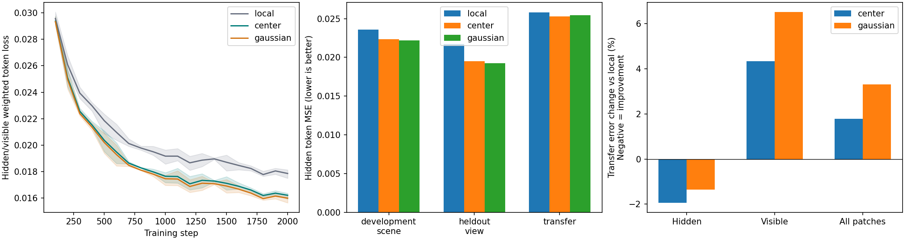

# 实际 VGGT 视图 token 读取高斯记忆：结果与边界

2026-11-10。九次固定预算 GPU 训练、18 个开发片段、12 个后续片段迁移评估、记忆干预、独立推理和实际可视化审阅均已完成。

**当前结论：高斯场景记忆可以接入实际 VGGT token，网络能学会利用其中的信息补充不完整观测；但当前接法还不是整体表示更好的方案。** 新片段上，中心记忆相对容量略大的当前视图 MLP，遮挡区误差降低 **1.94%**，三个种子同向，12 场景中 10 个改善；可见区误差增加 **4.33%**，全图按 patch 等权平均后增加 **1.78%**。额外高斯形状偏置没有超过中心偏置。保留这个可学习性证据和中心基线，不把遮挡区的局部收益称为完整 VGGT 用途成功。

## 1. 本轮回答的问题

上一轮只有相机/像素构造的 query，从保存的记忆中预测 DINO 特征。本轮的 query 来自**不完整图像经过完整冻结 VGGT 后的真实 2048 维 patch token**，读取结果以残差形式写回同一 token。因此验证的是“当前观测能否从共享场景状态中获得额外信息”。

竞争解释是：额外网络容量和当前图像上下文已经足够，或者模型只依赖场景先验、没有读取对应的记忆。为此设置实际训练过的当前视图 MLP，以及同一已训练记忆模型的移除、交换、空间对应打乱、错误相机干预。

本轮任务为教师表示恢复。没有把 RGB 渲染质量或深度精度设为主指标，也没有微调完整 VGGT。深度头运行只检查接口能否接通。

## 2. 精炼结构与输入边界

四个参考 RGB 通过上一轮冻结的共享写入器产生一份 256 个高斯的状态；每个高斯保存中心、协方差、opacity 和 32 维场景特征。已有写入器、PCA、记忆和 VGGT 均冻结。

在 VGGT 第 23 层 frame/global 拼接 token 后加入一个残差层：

1. 当前 token 经 LayerNorm，与像素/射线描述拼接，投影为 64 维 Q。
2. 保存的高斯特征与相机下几何产生 K，场景特征产生 V；一个四头 cross-attention 读取记忆。
3. 读取与同 token 的局部变换相加，经一次输出映射得到 2048 维残差；输出层零初始化。

中心读取的 attention logit 为内容相似度加 `log(opacity)`，再减去投影中心距离平方除以固定尺度。高斯对照只把该距离替换为 gsplat 投影一致的协方差二次型，Q/K/V、参数量和训练预算相同；两组 K 中都已有完整几何，不能把比较误称“有没有全部形状信息”。没有新门控、循环或多模块堆叠。

记忆组参数 **273,604**；无记忆残差 MLP 宽度 66、参数 **277,202**，略多 1.32%。后者只读取当前 token 与像素/射线；冻结 VGGT 已提供当前图像内的 self-attention 上下文。

RGB 输入 210×280，先遮住 7×10 个连续 patch，即 70/300（23.33%），填归一化均值，再进入 DINO 和全部 VGGT 层。各查询位于独立 batch 轴、S=1，不共享 query-query 全局注意力。完整查询单独前向，仅作最后一层 token 教师；不进入参考提取、记忆构建或学生特征。相机已知，参考为一次性建立的多视图记忆，不是因果长序列记忆。

## 3. 固定实验与数据身份

|角色|场景/片段|查询与遮挡样本|使用方式|
|---|---:|---:|---|
|训练|3 场景、12 片段|72 查询、288 遮挡输入|更新接入层|
|同场景留出视角|上述 12 片段|36 查询、72 输入|不参与优化|
|旧开发场景|6 场景、6 片段|54 查询、108 输入|开发判断和干预|
|后续片段迁移|12 场景、12 片段|108 查询、216 输入|模型固定后评估|

后续片段在训练前选定为各场景第 40–52 个已下载帧，与上一轮前 13 帧不重叠。它们新于此次接入设计，但场景在历史研究中使用过，**不是全新场景或完全未接触的外部测试集**。未按结果换场景，12/12 全部完成、零排除。新片段的记忆由冻结原写入器仅处理其四个参考图像生成。

三组×种子 20261110/11/12，各 2,000 步，AdamW lr=3e-4、wd=.01、每步两例、clip=5，相同种子的样本顺序逐步一致，统一最终检查点。三个种子只改变接入层；上游写入器仍是此前的一种子模型。

损失为 `0.8 × 遮挡区均值 MSE + 0.2 × 可见区均值 MSE`，比较逐 token LayerNorm 后的 2048 维表示。它明显优先补充缺失信息：每个遮挡 patch 的权重约为每个可见 patch 的 13.1 倍。本轮没有扫描权重、遮挡率或接入层号。

[事前计划](../../../docs/gaussian_memory_view_token_plan.md) · [源码、场景与配置身份](plan.json) · [开发信号和九个模型固定记录](transfer_activation.json) · [新片段缓存身份](transfer_cache_identity.json)

## 4. 主结果：信息补充成立，但迁移收益缩小

以下为遮挡区 token MSE，越低越好，先在场景内平均配对种子，再比较场景。

|模型|同场景留出视角|六开发场景|12 后续片段|
|---|---:|---:|---:|
|原始冻结 VGGT|0.043428|0.041176|0.043157|
|当前视图 MLP|0.021737|0.023581|0.025794|
|中心记忆|0.019526|0.022329|0.025294|
|形状记忆|0.019234|0.022180|0.025445|
|中心相对 MLP 降低|10.17%|5.31%|1.94%|

开发六场景均为中心改善；迁移 10/12 场景改善，三个种子分别降低绝对 MSE 0.000522/0.000348/0.000631。迁移配对场景平均差 `MLP−Center=0.0005004`，场景 bootstrap 95% 区间 `[0.0000648, 0.0009250]`，下界接近零；支持小幅条件性收益，不能解释成宽范围可靠优势。区间按场景重采样 10,000 次，不把 patch、遮挡或种子当作独立场景。

迁移反例为 brown_bm_1（中心遮挡误差反增 4.23%）和 mit_32_d507（反增 1.00%）。较明显的正例包括 mit_32_g725（降低 5.66%）和 mit_w59_conference（降低 5.80%）。全部逐场景、逐种子原始数据见 [analysis.json](analysis.json) 和 [固定迁移评分](transfer_evaluation/scores.json)。

相对原始冻结 VGGT 的大幅改善中，大部分已由当前视图 MLP 获得；不能把全部改善归给记忆。这里关心的额外收益是相对 MLP 的 1.94%。

## 5. 保真代价是实质结果

|12 后续片段|当前视图 MLP|中心记忆|中心变化|
|---|---:|---:|---:|
|遮挡区 MSE|0.025794|0.025294|−1.94%|
|可见区 MSE|0.011456|0.011953|+4.33%|
|全图按 patch 等权 MSE|0.014802|0.015066|+1.78%|
|事前加权训练目标|0.022927|0.022626|−1.31%|

全图值直接由已记录两区域误差按 70/230 个 patch 汇总，未据此改模型或选择检查点。全图 `MLP−Center` 差为 −0.0002638，区间 `[−0.0004373, −0.0000734]`；三个种子均负、12 场景中 11 个更差。可见区也有 11/12 场景更差。因此，不能只展示遮挡区指标就称整体 token 质量提升。

完整输入时，中心适配器相对原完整 token 的扰动 MSE 为 0.006042，当前视图 MLP 为 0.005304。这只量化表征改变，不证明真实深度精度下降；原始 token 在该恒等检查中误差按定义为零。当前接法不会自动在信息完整时保持原模型行为。

这个代价与偏重遮挡区的训练目标相符，但尚未用训练控制证明其唯一病因。它不是浮点瑕疵，也不需要回到静态积分核修补；下一步需要检验信息补充与已有观测保真能否同时成立。

## 6. 记忆依赖及形状对照

固定中心模型在 12 后续片段上的遮挡 MSE：

|条件|MSE|
|---|---:|
|正常对应记忆|0.025294|
|移除读取分支|0.026505|
|打乱特征与几何对应|0.027157|
|交换为其他场景记忆|0.027360|
|使用错误读取相机|0.027252|

三种子平均的正常读取优于这些干预，结合实际训练过的无记忆对照，支持网络确实利用对应场景的内容和空间组织。干预有分布偏移，不能把其损失增加量全部当作净贡献；移除后的模型甚至比专门训练的无记忆模型更差。

训练输入几何确定的投影支持度阈值为 0.75938。低/高支持组，中心相对 MLP 的遮挡 MSE 分别降低约 1.78%/2.14%。两组均有小收益，没有足够依据建立一个可靠的“只在某个覆盖条件下有效”的筛选规则；投影支持度也不是遮挡可见性真值。

形状项在开发六场景平均比中心低 0.66%，但迁移反而高 0.60%，三个种子均为中心更好，形状仅赢 3/12 场景。形状相对 MLP 的迁移收益 1.35%，场景区间跨零。保持中心为默认，不根据开发小优势更换主方案；此前形状对中心不稳定的负结果继续有效。

## 7. 可运行性、资源与实际审阅

- 四项实现检查通过：零初始化/实际 token 列表回填、记忆排列和空记忆、RGB 遮挡隔离、共同刚体坐标重表达。
- 九次训练各 2,000 步，损失和梯度有限，同种子抽样序列一致；独立 NumPy 重算示例 token 误差与 GPU 结果最大差 7.45e-9。
- [独立推理入口](../../../experiments/gaussian_memory_view_read.py)仅接受不完整图像、相机、保存记忆和适配器。修正 token 已实际回填 VGGT 输出列表，原 depth head 正常输出有限值。没有借助完整查询或教师文件完成推理。
- 单图在线前向与半精度批缓存有小的数值差异；示例遮挡 MSE 为 0.0149954 对 0.0149998，差 4.45e-6。未为这个差异重训或设置新研究门禁。深度输出确实改变，但未评估几何真值，不作深度收益主张。
- 所有 GPU 工作使用 1 卡，启动前两次占用核对，沿用共享规则与 12 GiB 上限。九次训练循环合计 174.1 秒，峰值分配 0.995 GiB；冻结 VGGT/新记忆提取峰值 4.65 GiB。未改动他人任务、系统 GLIBC 或旧结果。
- 一次 CPU 验证加载 GPU 检查点缺少 `map_location`，已保留失败日志并显式映射 CPU；只修复验证程序，训练/模型/评分未改。[修复记录](implementation_repairs.json) · [完成核对](completion_checks.json)

已实际查看九张不同图：总比较、同场景 fit_00、开发 val_12/old_eval_14/old_eval_17，以及迁移 transfer_00/08/09/11。包括两个迁移反例和正例；不能以个别效果图代替场景汇总。图中展示的是 token 误差热图，不是生成的补全 RGB。

[失败示例：brown_bm_1](transfer_evaluation/transfer_00.png) · [失败示例：d507](transfer_evaluation/transfer_08.png) · [改善示例：g725](transfer_evaluation/transfer_09.png) · [改善示例：w59](transfer_evaluation/transfer_11.png)

## 8. 阶段判断与下一步

实现已接通，可学习性和对应记忆依赖得到支持；后续片段确认了小幅缺失区域收益，同时确认当前版本的全图保真代价。**本轮有限验证已完成，广泛有效的完整方法尚未得到。** 不将该版本晋升为整体更好的 VGGT，也不宣称高斯形状或 3DGS 表示已优于其他场景记忆。

下一步应保持当前单层中心读取和冻结写入器，先检验一个明确假设：加入完整观测与可见区域的保真训练约束，能否保留补充缺失信息的收益、同时避免扰动已有信息。采用相同容量和预算，直接与本版及当前视图 MLP 比较；不先加复杂位置项，不在这批迁移片段上调参后仍称新确认。这个实验尚未启动。

相同预算的点记忆/直接参考 token 记忆仍是后续必要的形式对照。给定相机、冻结骨干、合成矩形遮挡、室内小规模与一种子写入器是当前范围；未知位姿、真实遮挡、完整 VGGT 任务、增量长期记忆以及高斯形式的必要性均尚待验证。
