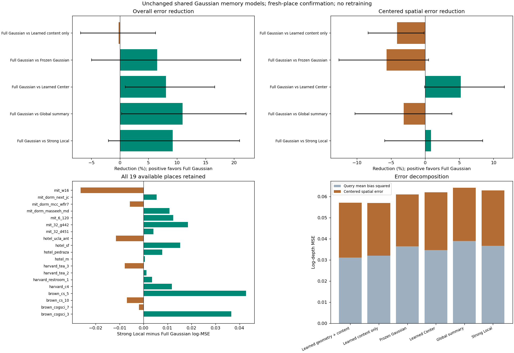

# 固定共享写入模型的新地点确认

2026-11-10。**本轮完成，结果为部分确认。** 完整 Gaussian 在19个新目录上的整体 log-MSE 比强 Local 平均低9.25%，三个种子同向，但地点×种子区间跨零；对全局摘要及同结构 Center 分别低11.00%和8.05%，区间为正。事前指定的遮挡区辅助指标比强 Local 低13.80%，是当前最清楚的用途信号。几何写入相对仅内容写入没有可靠增量，完整输入的空间误差代价仍存在。因此保留粗场景信息补充的用途，尚不能声称更精确的几何建模或普遍优于强位置编码。

## 问题与固定比较

[事前方案](../../../docs/gaussian_memory_write_confirmation_plan.md)检验两个问题：joint_write1 的整体用途能否迁移，以及去均值空间误差代价是否持续。竞争解释是旧地点开发选择、内容适配已足够、整体深度偏差改善掩盖空间细节退步。

原24个检查点全部固定，八方法各三个种子20261110/11/12，**零训练、零调参、零重新选模、零PCA重拟合**。Full Gaussian 学习共享几何、opacity及内容残差；Content Gaussian 只更新内容；Frozen Gaussian/Center 使用原冻结状态；Full Center 使用匹配的共享完整writer但以中心距离读取；GlobalSummary、小Local、强Local保留原控制。Full writer为9450参数，reader为145477参数，共154927；Content保留相同writer形状，650个几何输出参数不参与预测，不能称有效参数完全相同。

四个参考视图通过冻结VGGT及原256槽分组得到初值，共享writer一次写入、保存，九个查询视角重用同一状态。查询图像不参与写入。相机已知，沿用现有公制尺度规范化；传感器深度只生成查询监督。位置项仍为高斯投影区域引导的单层cross-attention，不是新RoPE公式，也没有训练整个VGGT。各控制的信息、参数与历史训练匹配范围沿用[joint_write1报告](../joint_write1/report.md)，不能把所有组都称作完全等价的系统。

## 新数据、缺失与可追溯性

从130个尚未保留/访问的SUN3D目录按预先固定的哈希盐和来源配额选20个：Brown4、Harvard4、hotel4、MIT8。历史76个目录、共享记忆路线45个地点及本地历史selection已核对排除。home目录已无剩余，因此本轮来源组成与旧批次不同，不用新旧绝对误差直接判断性能变化。

预定目录 `mit_gym_tohoku/gym_tohoku_oct_28_2012_scan1_erika` 的外参目录三次返回HTTP404，发生在像素下载及模型输出之前，未替换。**实际19地点全评；不能称完整20地点、零排除的确认。** 其余19个目录各取固定13帧，四参考、九查询、两个固定遮挡，共171查询、342遮挡输入。下载247张RGB、171张查询深度，共418文件、65.74MiB，无文件下载失败，直连官方源且禁用代理。数据在用户指定的 `data/GRoPE/gaussian_memory/write_confirmation_v1`。

“新”只保证相对已核对项目清单的目录身份未用，无法保证目录间没有物理地点别名，也不保证VGGT预训练未接触图像。全部20个预定目录现均标记已消耗，不能将缺失目录或这19地点再次称为未用。新批次独立统计，未与旧结果合并扩大确认样本。[目录及缺失](cohort.json) · [模型与配置身份](evaluation_lock.json) · [数据身份](cache_identity.json) · [访问记录](../../research_data_usage/gaussian_memory_write_confirmation_access_20261110.json)

## 整体用途：保留平均信号，强Local主比较仍不确定

每地点先汇总九查询、两遮挡，再对地点及种子等权；以下均为误差，越低越好。去均值空间误差从每个查询的有效深度误差中移除均值，用于分离整体偏差与空间变化，并非直接三维表面质量。

| 方法 | 整体log-MSE | 平均偏差平方 | 去均值空间MSE |
| --- | ---: | ---: | ---: |
| Full Gaussian | 0.057095 | 0.031098 | 0.025998 |
| Content Gaussian | 0.056957 | 0.031993 | 0.024963 |
| Frozen Gaussian | 0.061077 | 0.036470 | 0.024607 |
| Full Center | 0.062096 | 0.034670 | 0.027426 |
| Frozen Center | 0.065125 | 0.040008 | 0.025117 |
| GlobalSummary | 0.064149 | 0.038941 | 0.025208 |
| 小Local | 0.064476 | 0.037836 | 0.026640 |
| 强Local | 0.062918 | 0.036701 | 0.026217 |

下表差值为“对照误差−Full Gaussian误差”，正数有利于Full。95%区间来自10000次配对地点×种子bootstrap；相对降低为均值差/对照均值，区间列为原log-MSE单位，不是百分比。多项预定比较分别报告，不把辅助正结果替换为主比较成功，也不把跨零解读为等效或必然无效。

| 对照 | 相对降低 | 差值95%区间 | 三种子差值 | 改善地点 |
| --- | ---: | --- | --- | ---: |
| 强Local | 9.25% | [−0.001268, 0.013200] | +0.006016 / +0.005965 / +0.005487 | 13/19 |
| GlobalSummary | 11.00% | [0.000177, 0.014195] | +0.009061 / +0.007170 / +0.004930 | 14/19 |
| Full Center | 8.05% | [0.000583, 0.010313] | +0.004626 / +0.005965 / +0.004412 | 14/19 |
| Frozen Gaussian | 6.52% | [−0.003026, 0.012916] | +0.007509 / +0.000788 / +0.003647 | 11/19 |
| Content Gaussian | −0.24% | [−0.003923, 0.003559] | +0.002556 / −0.001522 / −0.001450 | 8/19 |

Full对全局摘要、Center的正面结果支持当前结构化空间读取，但全局比较下界接近零，不能否定所有全局表示。对强Local的平均改善并未消失，仍需承认地点差异很大。Brown两个地点贡献较大正差，mit_w16有明显负差；不删除这些地点，也不据此事后定义“只适用于某来源”的规律。Brown/Harvard/hotel/MIT的4/4/4/7地点描述分组保存在分析文件，样本量不足以作来源因果归因。

**遮挡区域是更清楚的有限用途。** Full的遮挡log-MSE为0.064348，强Local为0.074647，降低13.80%，差值区间[0.001960, 0.019283]，三个种子同向、12/19地点改善；对Global降低14.33%，区间也为正。这是事前指定的辅助指标，不等于整体主比较已可靠获胜。可见区域对强Local平均低7.31%、完整输入log-MSE平均低8.88%，但区间均跨零。RMSE对强Local低7.35%，区间为正但下界接近零；AbsRel平均低5.08%、区间跨零。全部指标、种子和每地点结果见[analysis.json](analysis.json)，原始评价见[scores.json](evaluation/scores.json)。

## 几何更新与空间细节：额外价值仍未建立

完整几何写入没有稳定超过仅内容写入：主误差反而平均高0.24%，差异极小且区间跨零，不能据此宣布Content整体更优或两者等效。Content对冻结Gaussian、强Local分别平均改善6.75%、9.48%，三个种子同向但区间跨零；也不能将Content提前晋升为已确认的强对照赢家。

空间代价更明确：

| 输入条件与对照 | Full的去均值空间误差变化 | 对照−Full差值95%区间 |
| --- | ---: | --- |
| 遮挡输入，相对Frozen Gaussian | 高5.65% | [−0.003112, 0.000126] |
| 遮挡输入，相对Content Gaussian | 高4.14% | [−0.002090, −0.000046] |
| 遮挡输入，相对强Local | 低0.84% | [−0.001559, 0.002206] |
| 完整输入，相对Frozen Gaussian | 高9.08% | [−0.003381, −0.000339] |
| 完整输入，相对Content Gaussian | 高5.31% | [−0.002044, −0.000109] |
| 完整输入，相对强Local | 高13.22% | [−0.004572, −0.000463] |

因此旧批次发现的空间代价在完整输入上迁移了；遮挡输入对冻结组只保留平均退步，未得到同样明确的区间。总体收益仍主要体现为粗深度/均值偏差降低，不能声称每项空间指标都显著变差，也不能把整体更低的MSE解释为更准确的三维形状。该代价属于实际预测行为，不是数值舍入瑕疵，不作为禁止后续研究的统一门禁。

## 学习状态确被使用，但不证明几何学习必要

Full Gaussian的固定推理干预使整体误差变化：移除记忆+65.97%、打乱内容槽+38.56%、错误相机+31.32%、恢复整份初始记忆+26.10%，四项区间均为正；仅恢复初始几何为+1.81%，区间[−0.000641, 0.003128]跨零。它们支持保存状态和空间绑定被使用，但干预可能产生分布外状态，不能替代重训对照。

Full平均中心位移0.305米、协方差相对Frobenius变化1.067、opacity绝对变化0.0377，说明参数确实学习了变化；**变化幅度不证明真实几何更准**。Content的中心和opacity变化为零，协方差约2e−8的变化为正常计算误差。写入学习与读取依赖已建立，几何参数更新的额外用途仍待证据。

## 完成情况、核对与实际图像审阅

24个模型身份不变；171份学习写入状态保存重载，另复用19份冻结初始记忆。新数据三个固定片段×八方法共24次独立CPU读取最大差1.19e−6；旧三个哨兵片段24次CPU回放最大差7.15e−7。独立NumPy评分最大差1.36e−8，偏差/空间分解账目差1.94e−16，协方差最小特征值4.89e−6，均在原有容差内。旧检查是固定哨兵回放，不是重新完整评价旧66片段。[完整核对](checks.json)

实际打开查看总览及六个固定位置案例。因实际仅19目录，计划最后第19索引取最后可用索引18；未按分数挑图。fresh_13是有用的粗深度补充案例；fresh_04和fresh_17的首查询中全局摘要更好；fresh_08的Center更好；fresh_19中强Local及Content比Full更好。多图可见深度边界模糊，局部成功不等于整个地点或方法普遍成功。展示深度在6米饱和、误差图限色范围，评分没有显示截断。[逐图记录与哈希](review.json)

元数据136.87秒，文件下载68.56秒；GPU1提取阶段含模型加载61.87秒，提取记录的计算时间50.23秒、峰值4.6354GiB，评价阶段27.45秒。本轮使用检查实时占用后启动的一个共享GPU worker，显存上限12GiB，无新训练、不占满其他用户显卡。以上为本次运行代价，不是独占速度基准。

## 决策与下一项

本轮目标完成，整体研究目标尚未完成。当前可保留的表述是：**给定相机及尺度、冻结VGGT和当前低分辨率深度任务下，粗高斯共享记忆能够补充缺失观测，并有超越本次全局摘要和中心读取的证据；可靠整体强对照优势、学习几何的必要性及精细场景恢复仍未建立。** 不扩大到未知相机、长序列、任意Transformer或一般3DGS任务。

下一项建议收敛结构，只补一个缺失的匹配控制：**Content Center**。采用与Content Gaussian完全相同的冻结初始几何、共享内容writer、读取器初始化、采样与2000步预算，三个种子，仅把高斯区域位置项改成中心距离。已有模型全部保留。直接问题是“停止更新几何后，高斯协方差PE是否仍比中心编码更有用”，而不是靠微小均值反复更换主方案。

若Content Gaussian仍保有对Center的用途且空间代价更小，可把“固定几何＋学习内容”作为精炼工作基线；这只简化当前读取验证，不能冒称学会了构造几何。若协方差增量消失，则保留Full结果，承认当前收益依赖联合配置，不扩展一般PE主张；若两者仍无法可靠超过强Local，维持缺失观测的有限用途。当前85片段均已用，下一项属于开发比较，不能再次称为新确认。该下一项尚未启动，不新增模块、损失搜索或数据下载追分。
