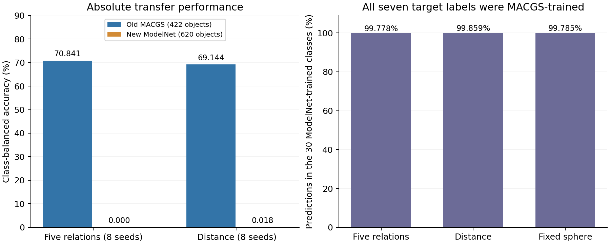

# 原始单基元模型的同类别来源迁移：结果、解释与范围

2026-11-09。全部七个归档、620个预定对象、19个固定模型及19组base512预测完成，零新增训练。

**结论：当前完整模型无法直接完成这次来源迁移，五维 PE 没有建立该用途。** F 八种子的类别均衡准确率（mCA）均为0；Distance只有种子55正确分类了一个chair对象，其八种子平均mCA为0.0179%；固定球形也为0。99.78%–99.86%的预测进入训练中属于ModelNet来源的另外30类。结果主要暴露了整个模型与新来源的兼容性边界，不能将几乎零准确率下的微小差异解释为形状关系没有信息，或各方法统计等效。

本轮按冻结决定结束原生来源推广；保留完整五维及已有观测区域匹配证据，不为本批对象追加种子、筛类别、掩码分类头、适配或修改公式。总体一般性目标仍未完成。

## 固定问题与实际完成范围

假设是同名类别从MACGS换成ModelNet对象后，F仍能超过同信息Distance，并保留相对同参数固定球形的额外价值。竞争解释是原用途依赖来源特有的实例、外观或基元统计。本轮减少了类别集合不同的混杂，但没有隔离来源、拟合方式、实例难度和外观的因果作用。模型训练中已见其他ModelNet类别，因此也不是完全未见上游数据域的检验。

- 固定模型：F和Distance各8种子11/22/33/44/55/66/77/88，固定球形3种子11/22/33；均为原单基元模型和原验证集已选权重，120 epochs/46,800更新的已有训练。
- 新对象：airplane/bottle/bowl/car/chair/guitar/table共620个，bowl20个，其余各100个。全部精确匹配原test成员；与已知历史ID和原TRAIN/TEST原始文件SHA核对后，主组仍为620个，无已知字节重复。不同ID/字节不排除近重复几何。
- 保留完整60类头、13维共同内容、原预处理和512基元输入。预测到其他53类按错误计；没有重新取七类argmax或校准分类头。
- 旧参考为同19模型、同七类的422个已用MACGS对象，类别等权；不重称未用确认，不改变原60类确认的主结论。
- 本批对象从首次读取起已经登记为已用；今后修改模型不能在同批上重新声称fresh confirmation。

[冻结方案](../../../docs/modelnet_cross_source_plan.md) · [模型/源码/数据锁](lock.json) · [对象目录](catalog.json) · [使用登记](data_access_started.json)

## 绝对表现：首先是完整任务失败

| 方法与种子组 | 旧MACGS mCA % | 新ModelNet mCA % | 新OA % | 新60类CE | 新预测落在七类之外 % |
| --- | ---: | ---: | ---: | ---: | ---: |
| 完整五维 F，8种子 | 70.841 | 0.0000 | 0.0000 | 5.6735 | 99.879 |
| Distance D，8种子 | 69.144 | 0.0179 | 0.0202 | 5.7266 | 99.940 |
| 固定球形，3种子 | 67.998 | 0.0000 | 0.0000 | 5.8130 | 99.785 |

此表为各组绝对均值。固定球形只有3种子，其配对F应取相同3种子：旧F为70.693%、新F为0；下面的形状归因差使用这3对，而非八种子F减三种子球形。共19×620次模型—对象预测只有一次正确，不把这些重复评价当成11,780个独立对象。

## 事前比较与不确定性

| 比较 | 新来源平均差 pp | 新来源配对种子×类内对象95%区间 pp | 旧同七类平均差 pp | 新减旧差 pp及95%区间 |
| --- | ---: | --- | ---: | --- |
| F−Distance D，8对 | -0.0179 | [-0.107, +0.000] | +1.698 | -1.716；[-5.443, +1.902] |
| F−固定球形，3对 | +0.0000 | [+0.000, +0.000] | +2.695 | -2.695；[-7.929, +2.734] |

新F−Distance八个配对差依次为0/0/0/0/−0.142857/0/0/0 pp；新F−球形三对均为0。未满足事前“均值至少+0.5 pp且联合区间下界>0”的有限信号标准。更关键的是三组绝对准确率都失效，因此没有实用收益可晋升。

这里的窄区间或[0,0]来自几乎所有对象在所有方法下都错的地板效应；bootstrap重抽这些失败样本无法生成未观测的成功。它们不是等效性检验，也不是对一般几何表征能力的精确否定。旧七类F−Distance本就六正两负、区间[−2.010,5.343] pp；新减旧的区间仍跨零，不能声称已严格隔离或显著证明来源使PE增益消失。

预定敏感性分析完整保留：旧三种子的F−Distance为0，新五种子为−0.0286 pp；类别重采样敏感性区间分别见原始结果。主区间条件于七个指定类别，不能推广到全部类别或所有来源。新F−Distance的CE均值差约−0.0531，但有3/8种子更差；F−球形三种子CE均值反而更差。这些读数不替代近零的主准确率。

[全部逐模型指标、比较与来源差](result.json) · [逐对象原始预测](evaluation/) · [独立复算](independent_checks.json) · [原来源差展示](source_effects.png)

## 失败诊断：标签正确，输出明显随来源分组

看到整体失效后，先记录一项只读诊断范围，再核对元数据、缓存与输出；没有再训练、改变输入、改标签或生成新的模型预测。这是已用确认数据上的事后解释，不是额外的独立确认。

原作者类别表、原TRAIN/TEST目录与新目录的七个名称和输出ID一致。七个目标输出均属于原MACGS训练类；原60类任务中0–29来自MACGS、30–59来自ModelNet，类别与来源绑定。三个模型组的输出去向为：

| 方法 | 新预测进入原ModelNet来源的30个输出 % | 正确预测数 / 模型—对象预测数 |
| --- | ---: | ---: |
| 完整五维 F | 99.778 | 0 / 4960 |
| Distance D | 99.859 | 1 / 4960 |
| 固定球形 | 99.785 | 0 / 1860 |

这与“完整网络利用了来源相关统计，而这种联系在本轮改变”的解释相容；没有由此证明模型内部存在显式来源分类器，或把原因唯一归给颜色、尺度或协方差。

输入核对也发现真实分布变化：同类别下，新来源的对象级中位协方差迹约为旧来源的7–15倍，外观的三个DC通道更接近灰度；归一化中心RMS的类别中位数都接近1。七类各选字典序首个对象，从原归档重读并使用冻结转换器构建缓存，中心、协方差、外观和采样索引均与现存缓存完全相同。全部620个已提交数组行亦与原提交摘要一致。未发现足以解释本次崩溃的标签错位或缓存转换执行错误；这些检查不证明上游数据没有语义差异。

[只读诊断计划](transfer_failure_diagnostic1/plan.json) · [诊断结果、逐类输入统计与转换核对](transfer_failure_diagnostic1/result.json) · [诊断说明](transfer_failure_diagnostic1/report.md)

## 执行质量与已修复问题

七个归档合计15.057 GiB，从用户指定镜像直连下载并通过完整LFS SHA256校验；短传输、续传速度与aria2输出名问题保留原记录。620个对象全部完成转换后，旧通用缓存程序在最后写清单时访问split字段失败；本目录已有original_split=test。恢复程序核对全部提交行与数组身份后，仅据原字段补齐清单，原数组、目录、冻结源码和模型保持不变。原加载器再次核对通过，未重新选择对象或采样。

19个模型在765个旧验证对象上的GPU回放最大logit差为0；四个旧对象的排列检查未改变预测。新19组推理在0号共享GPU上使用4 GiB分配上限完成；推理阶段约148秒，不含下载和预处理，不当作公平性能基准。全部输出有限、完整60类，零优化器更新。

独立算术路径复算全部19份新预测、19份旧预测、八项新旧比较及两项来源增益变化，最大差为1.78e-14。独立复算程序在新分数开放前已用旧数据检查并保存SHA。机器结果中的review_pending是生成时状态，最终实际审阅另见review.json；正确执行和复算通过不意味着科学假设通过。

[缓存失败记录](cache_manifest_failure1.json) · [恢复核对](cache_manifest_recovery1.json) · [最终执行阶段](pipeline_cache_recovery_state.json) · [GPU执行](export_runtime.json) · [最终实际审阅](review.json)

## 对研究主线的影响

1. **关闭这次固定模型的直接来源推广。** 当前模型不能直接用于这七类ModelNet对象。继续在同批上补种子、掩码头或适配，回答的将是不同问题，不能覆盖本次失败。
2. **保留既有证据层级。** 观测区域匹配的独立新场景优势仍是核心；原生同来源分类的形状归因仍有支持，对强Distance的稳定优势仍不充分。本轮没有推翻这些既有结果，也没有补上一般性缺口。
3. **当前收益条件仍应由已验证任务限定。** 局部区域支撑具有明确含义、在相同完整内容下学习候选对应，是目前更可靠的用途。高各向异性、灰度外观或某个来源均未成为经过验证的通用开关。
4. **总体目标保持未完成。** 若未来扩大主张，需要能区分PE作用与整个任务来源偏移的明确假设和匹配对照；本轮不自动扩张RGB、重启已关闭的区域化接法或调参重做确认。
