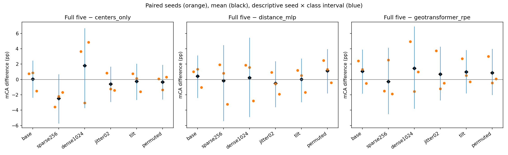
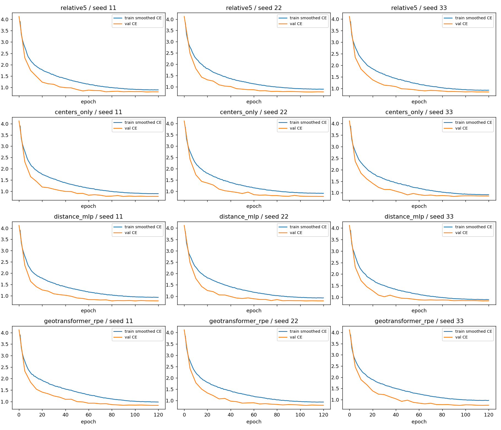

# 原生高斯区域 PE：完整结果、分析与实际审阅

2026-11-09。12次完整训练、统一选模、72组评价和独立复算均正常完成。**本轮没有建立完整五维相对两个强位置编码的稳定优势，也没有确认原生物理协方差进入区域 PE 的额外收益。按事前第三种分支结束这一固定输入接法，不晋升、不自动补种子或扫描分组/floor。** 完整五维仍是研究主候选，既有观测区域匹配证据保留；总体目标尚未达成。

本轮仅使用旧 GSModel60 的 fit/val/dev_eval，评价为765对象、60类。没有读取新的确认对象或官方 TEST，没有新数据下载。[事前方案](../../../docs/native_region_pe_plan.md) · [固定身份](lock.json) · [原始机器汇总](result.json) · [独立复算](execution_checks.json) · [实际审阅](review.json)

## 1. 主问题的答案

四组共享由512原生基元形成的64区域×32近邻、完整区域协方差与外观内容，仅改变PE。完整五维 F 使用中心散布加原生形状，中心区域控制 C0 只从PE中移除原生形状。因此 F−C0 检验的是物理协方差在这个PE中的额外用途，不是形状在整个模型中的总价值。

基础 mCA：F **78.457%**，C0 **78.413%**，Distance **78.010%**，GeoTransformer PE **77.391%**。关键配对结果如下；单位为百分点，区间是描述性的种子×类别联合bootstrap。

| 主比较 | 三个种子差（11 / 22 / 33） | 平均差 | 95%区间 |
| --- | --- | ---: | --- |
| F−Distance | +1.016 / +1.346 / −1.023 | +0.446 | [−2.338, 3.086] |
| F−GeoTransformer PE | +2.414 / +1.297 / −0.513 | +1.066 | [−1.806, 3.848] |
| F−C0 | +0.755 / +0.874 / −1.499 | +0.043 | [−2.331, 2.410] |

三个主比较均在种子33退步，区间都较宽。主要限制是方向不稳定和物理形状增益不明确；小数值算术误差不是本轮结论的原因。F−C0接近零的均值也不证明两者等效或物理形状完全无用。

正面信号仍保留：F的平均OA比两个强对照均高0.741 pp，平均CE比Distance低0.02920，但它们对Distance同样有一个种子退步；对Geo的CE只在一个种子更好。按类别均衡计，F相对Distance纠正6.772%的错误、引入6.326%的错误，净差正但小。C0对Distance/Geo的基础mCA为+0.403/+1.022 pp，三个种子均正且基础CE均改善，但联合区间仍跨零、对Distance的幅度小。本轮不据消融结果切换主方案或把C0晋升为可靠替代。

来源分组也有反例：F−Distance在MACGS/ModelNet对应类别上的均值为+1.256/−0.364 pp，F−Geo为+3.964/−1.832 pp，F−C0为+0.926/−0.840 pp。来源和类别在本数据中混杂，这些描述不能证明某种来源或拟合方式是收益原因，也不替代全60类主结果。

## 2. 最突出的适用范围限制：输入数量变化

| PE | 512输入 mCA % | 256输入 mCA % | 1024输入 mCA % |
| --- | ---: | ---: | ---: |
| F | 78.457 | 27.949 | 45.356 |
| C0 | 78.413 | 30.427 | 43.545 |
| Distance | 78.010 | 28.105 | 45.141 |
| GeoTransformer PE | 77.391 | 28.225 | 43.892 |

四组从512变为256输入均下降约48–51 pp，变为1024输入均下降约33–35 pp。这是实质性的分布变化敏感性，不能用基础条件的小幅优势掩盖。F的稀疏表现还比C0低2.478 pp，三个种子均低；该差的联合区间仍跨零。

实现读取确认：数量条件共同截取原缓存的前256/512/1024个基元，中心、协方差和外观始终配对；分组仍固定64个FPS锚点、每组32近邻。因而数量变化会改变区域成员、区域大小及所有方法共同获得的内容。所有控制也明显退化，不能把全部下降单独归因于五维PE。**“固定近邻数引起区域表示分布变化”是与代码和结果一致的解释，尚未通过独立控制变量实验确证具体病因。** 本轮没有据此调整邻域、归一化或重新训练。

在固定512输入下，F的小抖动、旋转、原基元逆序的mCA分别为77.589%、78.244%、78.453%；其相对强对照的收益仍有种子反例，不能据绝对分数接近基础条件宣称稳定优势。原基元逆序会改变FPS分组；分组后区域token排列另有实现检查，二者含义不同。完整30项联合区间均跨零，不将此解释为30个数学无效证明。

## 3. 执行、实现核对和图表审阅

全部12次训练各完成120轮、46,800更新，按原验证CE选择checkpoint，所有选择封存后才导出旧开发评价。所有阶段正常退出；三种子的实际120轮输入流及共同初始化各自配对。八项事前CPU检查和含完整训练缓存的CUDA预检记录保留。

GPU完整验证回放与保存logits完全一致；独立验证CE最大差2.22e−16，分组后排列最大logit差2.86e−6。每模型前两个验证样本的CPU复算最大logit差1.15e−3，未改变这些预测，作为跨设备小样本差异记录。评价的72组指标、30项配对比较及三种bootstrap区间、90项纠正/新增错误已从保存预测独立复算，最大算术差5.33e−15；数值核对未构成本轮用途判断的阻碍。

已实际查看全部12条训练/验证曲线与配对差图：曲线总体稳定下降、后期趋平，无崩溃或中断迹象；训练线是带标签平滑和增强的CE，验证线是另一统计条件，不直接用二者间距证明过拟合。配对差图的均值、逐种子差和宽区间与表格一致。正常训练和正确算术不等于有效性确认。

F/C0/Distance/Geo的PE参数分别为9,792/9,792/9,408/55,872；Geo是官方距离/角度算子的接入，不是完整GeoTransformer系统，也不称等容量。计入常驻训练缓存的峰值约1.446/1.446/1.445/2.057 GiB。单次训练约34.3–57.8分钟；GPU共享情况会变化，这些耗时不作为公平速度对比。控制器按启动时记录计共享作业，运行中外部任务进入会改变实际共享数量，不能声称全程只有两项实际共享。[资源观测](resource_observation1.json)

## 4. 对研究路线的决定

本轮未确认“把原生基元聚合成区域就能带来可靠强对照优势”，也未确认原生形状在区域PE中的额外用途。输入诊断曾证明物理协方差非零，这与本轮用途证据不足并不矛盾：非零特征变化不是准确率贡献。

按事前决策，结束这条固定64×32区域构造接法，不启动它的新对象确认，不自动补种子、扫描邻域/floor或增加模块来挽回结果。已有五维方法与观测区域匹配的正面确认保留；原生基元推广仍缺少相对强PE的可靠适用范围证据。本次闭环完成，总体研究目标仍在进行，不能把关闭一个实验等同于达成一般性方案。

下面保留全部条件、种子和比较。机器汇总中的review_pending字段记录自动生成时状态；实际审阅状态以review.json为准。

## 5. 完整预定结果

| 条件 | 方法 | 三种子 mCA % | 平均 mCA % | OA % | CE |
| --- | --- | --- | ---: | ---: | ---: |
| base | relative5 | 78.719 / 79.576 / 77.075 | 78.457 | 82.614 | 0.75577 |
| base | centers_only | 77.964 / 78.702 / 78.574 | 78.413 | 82.048 | 0.74382 |
| base | distance_mlp | 77.702 / 78.231 / 78.098 | 78.010 | 81.874 | 0.78497 |
| base | geotransformer_rpe | 76.305 / 78.280 / 77.588 | 77.391 | 81.874 | 0.75889 |
| sparse256 | relative5 | 27.566 / 27.386 / 28.894 | 27.949 | 28.061 | 3.08121 |
| sparse256 | centers_only | 31.148 / 29.575 / 30.557 | 30.427 | 30.937 | 3.01346 |
| sparse256 | distance_mlp | 25.637 / 26.559 / 32.119 | 28.105 | 27.582 | 3.09432 |
| sparse256 | geotransformer_rpe | 29.072 / 24.835 / 30.767 | 28.225 | 27.974 | 3.12368 |
| dense1024 | relative5 | 46.921 / 43.956 / 45.190 | 45.356 | 49.760 | 1.95588 |
| dense1024 | centers_only | 43.264 / 47.019 / 40.352 | 43.545 | 47.277 | 2.07481 |
| dense1024 | distance_mlp | 45.064 / 42.381 / 47.979 | 45.141 | 48.845 | 1.94453 |
| dense1024 | geotransformer_rpe | 41.970 / 45.508 / 44.197 | 43.892 | 46.754 | 2.00690 |
| jitter02 | relative5 | 78.831 / 77.625 / 76.311 | 77.589 | 81.917 | 0.77357 |
| jitter02 | centers_only | 77.997 / 78.862 / 77.722 | 78.194 | 82.222 | 0.76967 |
| jitter02 | distance_mlp | 77.911 / 78.199 / 78.206 | 78.105 | 81.874 | 0.78718 |
| jitter02 | geotransformer_rpe | 75.083 / 78.818 / 76.773 | 76.892 | 81.351 | 0.77649 |
| tilt | relative5 | 78.913 / 78.789 / 77.029 | 78.244 | 82.571 | 0.75683 |
| tilt | centers_only | 78.169 / 78.634 / 78.622 | 78.475 | 82.004 | 0.74582 |
| tilt | distance_mlp | 77.724 / 78.280 / 78.694 | 78.233 | 82.222 | 0.78451 |
| tilt | geotransformer_rpe | 76.197 / 78.278 / 77.322 | 77.266 | 81.786 | 0.75698 |
| permuted | relative5 | 79.101 / 78.716 / 77.542 | 78.453 | 82.571 | 0.76546 |
| permuted | centers_only | 79.022 / 80.077 / 77.237 | 78.778 | 82.309 | 0.75442 |
| permuted | distance_mlp | 76.634 / 77.393 / 77.947 | 77.325 | 81.394 | 0.79472 |
| permuted | geotransformer_rpe | 76.091 / 79.169 / 77.455 | 77.572 | 81.699 | 0.76410 |

| 比较 | 条件 | 三种子差 pp | 平均差 pp | 联合种子×类别95%区间 pp |
| --- | --- | --- | ---: | --- |
| relative5 − centers_only | base | +0.755 / +0.874 / -1.499 | +0.043 | [-2.331, +2.410] |
| relative5 − distance_mlp | base | +1.016 / +1.346 / -1.023 | +0.446 | [-2.338, +3.086] |
| relative5 − geotransformer_rpe | base | +2.414 / +1.297 / -0.513 | +1.066 | [-1.806, +3.848] |
| centers_only − distance_mlp | base | +0.261 / +0.472 / +0.476 | +0.403 | [-2.158, +2.796] |
| centers_only − geotransformer_rpe | base | +1.659 / +0.423 / +0.985 | +1.022 | [-1.291, +3.548] |
| relative5 − centers_only | sparse256 | -3.582 / -2.189 / -1.664 | -2.478 | [-5.679, +0.645] |
| relative5 − distance_mlp | sparse256 | +1.929 / +0.827 / -3.225 | -0.156 | [-5.371, +4.449] |
| relative5 − geotransformer_rpe | sparse256 | -1.506 / +2.551 / -1.873 | -0.276 | [-4.453, +4.082] |
| centers_only − distance_mlp | sparse256 | +5.510 / +3.016 / -1.561 | +2.322 | [-2.857, +7.402] |
| centers_only − geotransformer_rpe | sparse256 | +2.075 / +4.740 / -0.210 | +2.202 | [-2.396, +6.730] |
| relative5 − centers_only | dense1024 | +3.657 / -3.064 / +4.839 | +1.811 | [-3.658, +6.640] |
| relative5 − distance_mlp | dense1024 | +1.858 / +1.574 / -2.789 | +0.214 | [-4.834, +5.398] |
| relative5 − geotransformer_rpe | dense1024 | +4.952 / -1.552 / +0.993 | +1.464 | [-3.760, +6.860] |
| centers_only − distance_mlp | dense1024 | -1.799 / +4.638 / -7.628 | -1.596 | [-8.653, +5.426] |
| centers_only − geotransformer_rpe | dense1024 | +1.295 / +1.512 / -3.846 | -0.346 | [-5.438, +4.711] |
| relative5 − centers_only | jitter02 | +0.834 / -1.237 / -1.411 | -0.605 | [-2.864, +1.632] |
| relative5 − distance_mlp | jitter02 | +0.920 / -0.574 / -1.895 | -0.517 | [-3.556, +2.336] |
| relative5 − geotransformer_rpe | jitter02 | +3.748 / -1.194 / -0.463 | +0.697 | [-2.680, +4.237] |
| centers_only − distance_mlp | jitter02 | +0.086 / +0.663 / -0.484 | +0.088 | [-2.798, +2.864] |
| centers_only − geotransformer_rpe | jitter02 | +2.913 / +0.044 / +0.949 | +1.302 | [-1.348, +4.290] |
| relative5 − centers_only | tilt | +0.744 / +0.155 / -1.593 | -0.231 | [-2.617, +2.013] |
| relative5 − distance_mlp | tilt | +1.190 / +0.509 / -1.665 | +0.011 | [-2.912, +2.676] |
| relative5 − geotransformer_rpe | tilt | +2.716 / +0.511 / -0.293 | +0.978 | [-1.755, +3.798] |
| centers_only − distance_mlp | tilt | +0.445 / +0.354 / -0.072 | +0.242 | [-2.323, +2.621] |
| centers_only − geotransformer_rpe | tilt | +1.972 / +0.356 / +1.300 | +1.209 | [-1.109, +3.824] |
| relative5 − centers_only | permuted | +0.079 / -1.361 / +0.305 | -0.326 | [-2.558, +1.877] |
| relative5 − distance_mlp | permuted | +2.467 / +1.322 / -0.405 | +1.128 | [-1.757, +3.925] |
| relative5 − geotransformer_rpe | permuted | +3.010 / -0.454 / +0.086 | +0.881 | [-1.974, +3.943] |
| centers_only − distance_mlp | permuted | +2.388 / +2.683 / -0.710 | +1.454 | [-1.696, +4.791] |
| centers_only − geotransformer_rpe | permuted | +2.930 / +0.907 / -0.218 | +1.207 | [-1.629, +4.624] |

主判断使用 base 的 Ffull−Distance/Geo 及 Ffull−centers_only；辅助条件不替换主条件。
permuted 是分组前逆序，可能改变FPS区域；模型分组后的排列检查见 selected.json。
全部训练曲线、参数/显存/时间、来源、OA/CE、纠正与新增错误均保留。小差异不证明等效。
实际科学与图表审阅已完成，参见review.json；自动开发信号与本次实验闭环均不代表总体目标达成。

