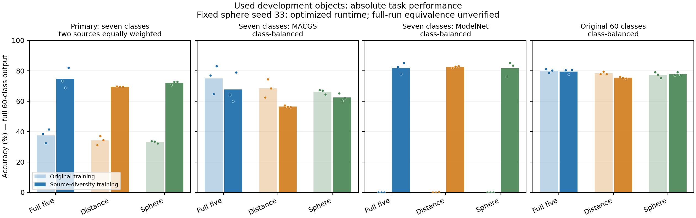
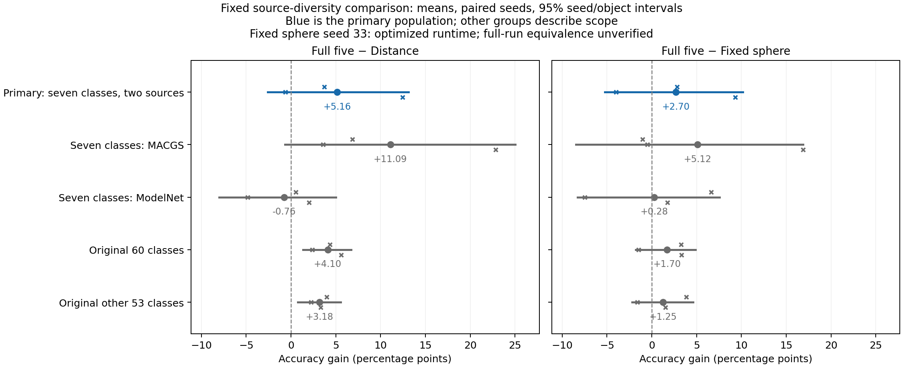

# 类内来源变化：任务恢复，五维的稳定强对照优势仍未确立

2026-11-09。九次训练、统一选模、18份预测导出、独立复算和实际图表审阅均完成。本轮全部为已用对象上的开发证据。

**主要结论：增加同类别的来源覆盖后，ModelNet七类任务从近乎全错恢复到约82%类别均衡准确率；但完整五维没有稳定领先Distance，也没有稳定的额外协方差归因。按事前决定结束这一固定训练策略的推广检验。** 保留完整五维、已有区域匹配确认及所有原生正负证据，总体一般性目标尚未达成。

## 科学问题和固定比较

此前，原模型对七类620个另一来源对象的直接迁移几乎全错，约99.8%的预测进入原ModelNet来源的其他类别。这使任务失效与PE效果混在一起。本轮检验：保持完整60类任务与类别曝光预算，在同一类别的训练槽位中加入另一来源后，五维是否仍比强Distance及同容量固定球形更值得采用？竞争解释是普通距离在获得合适训练覆盖后已经足够。

完整五维F、Distance D、固定球形S均沿用原骨干、共同13维内容、完整60类头、512基元及原优化配置。三方法×种子11/22/33，共九次120周期、46,800次更新。每周期保留原6,227个类别槽位，只对七类按固定1/2概率替换为同类ModelNet fit对象；输入、增强与来源流在各方法间配对。

原fit/val/dev为6,227/765/765；加入的2,657个历史开发对象沿用R48划分，分别2,133/262/262。验证按类别内来源等权、再60类等权CE选模。主评价为七类×两来源等权准确率，326对象（MACGS64、ModelNet262）；另报告完整1,027对象、原60类765对象及其余53类701对象。全部保留60类argmax，没有掩码或测试时适配。

该策略同时增加可抽样实例、减少原MACGS重复曝光并改变验证权重，因此旧新策略变化不能解释为纯来源变量的因果效应。原620确认对象及官方TEST没有进入训练、选模或本次评价；本轮没有新的未用对象确认。

[固定方案](../../../docs/native_source_diversity_plan.md) · [数据与完整计数](preparation_report.md) · [训练锁](lock.json) · [评价锁](evaluation_lock.json)

## 绝对表现：任务已经能学，但收益并不均匀

下表为三个种子均值，单位%。主组为类别与来源等权准确率，其余各行均为类别均衡准确率。旧模型背景使用同一批开发对象；其新增262对象只推理一次，原765预测按身份复用。

| 评价对象 | 原策略F / D / S | 本策略F / D / S |
| --- | --- | --- |
| 主七类、两来源，326对象 | 37.488 / 34.250 / 33.147 | **74.780 / 69.617 / 72.079** |
| 七类MACGS，64对象 | 74.976 / 68.446 / 66.294 | **67.653 / 56.566 / 62.530** |
| 七类ModelNet，262对象 | 0.000 / 0.054 / 0.000 | **81.908 / 82.668 / 81.627** |
| 原60类，765对象 | 80.029 / 78.426 / 77.298 | **79.579 / 75.479 / 77.880** |
| 原其余53类，701对象 | 80.697 / 79.744 / 78.751 | **81.154 / 77.977 / 79.907** |

三方法都恢复了新增ModelNet来源的分类能力，不能把这个恢复归给五维PE。该来源预测到七类之外的对象比例由约99.9%降至F/D/S的19.084%/20.483%/19.466%。这支持当前训练覆盖足以让任务学习，原直接迁移失败不等于这些高斯对象本身无法分类；它没有分离外观、拟合、实例多样性和几何因素。

恢复有代价：原七类MACGS的F/D/S分别比旧策略下降7.323/11.881/3.764 pp，三个种子都下降。原60类F下降0.451 pp、D下降2.948 pp、S上升0.582 pp。因此原60类的F−D差距扩大，主要表现为F较少受损，不能写成F整体准确率提高了4.10 pp。

## 主比较及形状归因

10,000次配对种子和类别×来源单元内对象重采样；主区间条件于既定七类和两个来源。下表区间为预定联合95%区间，增益单位pp。

| 对照 | F减对照均值 | 种子11 / 22 / 33 | 联合95%区间 | 类别重采样敏感性区间 |
| --- | ---: | --- | --- | --- |
| Distance，主比较 | **+5.164** | +3.699 / **−0.641** / +12.433 | **[−2.588, 13.128]** | [−2.015, 10.691] |
| 固定球形，归因 | **+2.701** | +2.802 / **−4.001** / +9.304 | **[−5.251, 10.161]** | [−2.640, 8.533] |

平均提升有实际幅度，但种子差异很大。F−D没有满足事前规定的三种子均正及联合区间下界大于零；F−S也没有稳定支持额外协方差用途。若只对对象重采样，F−D区间为[1.332,9.225] pp，但它忽略种子不确定性，不能替换预定主区间。

这里的问题不是微小浮点尾差：一个种子的F−D为−0.641 pp，另一个为+12.433 pp，同时来源之间表现不同。负种子本身不证明方法无用，正均值也不足以证明稳定收益。保留这个混合结果，不用补种子或改口径将其转成通过。

主组类别—来源等权CE为F0.957498、D1.083537、S1.130708；F−D的三个种子CE均改善。这是有用的次指标证据，但不能代替本轮固定的准确率用途判断。

## 来源与原任务范围

| 预定分组 | F−D均值 | 三种子差 | 联合95%区间 | F−S均值及区间 |
| --- | ---: | --- | --- | --- |
| 七类MACGS | +11.087 | +6.854 / +3.571 / +22.835 | [−0.674,25.013] | +5.123，[−8.478,16.883] |
| 七类ModelNet | **−0.760** | +0.543 / −4.853 / +2.030 | [−8.013,5.018] | +0.280，[−8.291,7.572] |
| 原60类 | +4.100 | +4.318 / +2.383 / +5.599 | [1.324,6.732] | +1.699，[−1.770,4.869] |
| 原其余53类 | +3.177 | +3.983 / +2.226 / +3.323 | [0.763,5.571] | +1.246，[−2.176,4.620] |

主组增益正好是两来源增益的等权平均：(+11.087−0.760)/2=+5.164 pp。它主要来自MACGS，不是两个来源都胜出。原60类及其他53类的正面比较应保留，但它们是预定描述性分组，不能替换本轮主问题，亦不能据此事后挑选来源晋升。

ModelNet来源上，F的普通OA/CE为80.407%/0.772320，D为79.262%/0.795629，倾向F；但类别均衡准确率81.908%<82.668%、类别均衡CE0.695867>0.683713，倾向D。指标权重不同造成的分歧应完整报告，不能择优叙述。

小单元会影响均值和区间：MACGS table仅2对象、chair6对象，ModelNet bowl6对象。例如MACGS table的F正确率为0/0/50%，D均0；ModelNet bowl的F为66.7/66.7/83.3%，D为100/83.3/100%。保留这些单元，不删难类或重新加权。逐方法、种子、类别和来源的完整读数见[class_source_metrics.csv](class_source_metrics.csv)，全部分组与20项比较见[result.json](result.json)。

## 执行、工程修复与证据身份

九次完整训练、25次验证记录、验证CE最小值选模已核对。同种子共同初始化、全程原始和实际采样摘要、每个周期的逐类来源替换都配对一致。F−D全部六项使用原实现。按照用户追加速度优化授权，只有固定球形seed33采用几何重排＋梯度融合，训练预算和输入流不变；同一权重的原评价实现回放最大logit差4.29e−6、预测变化0、选模CE差1.90e−8，其余模型最大logit差0。

**混合执行实现限制主要影响F−S归因，不能称已验证完整训练终点等价。** 主F−D比较不受该版本差异影响。独占热池配对计时的约50%训练步节时，不等于完整训练总时长减半；后段GPU3有其他用户作业，本次不以总墙钟时间估计独占加速率。

18份预测已全部导出后，原汇总脚本因`dict(**spec, **result)`重复包含相同`bootstrap_seed`而退出。修复只在单独恢复入口中合并相同元数据，保留原冻结文件与失败日志，没有重训、重推理或调整数值算法/随机种子。7项CPU检查覆盖该失败及全部20项比较接口。随后独立算术路径复算18组结果、20项比较及旧新策略差，最大误差2.66e−14。修复和核查的通过不构成方法效果通过。

完整训练曲线、绝对表现图和配对差图均实际查看，标题注明固定球形seed33的执行差异；未见数值发散，不能据训练下降提前断言泛化有效。这里的独立复算是同一代理使用独立计算路径，不是外部研究组复现。

| 证据 | 文件 |
| --- | --- |
| 完整训练、配对流和选模 | [training_completion_checks.json](training_completion_checks.json)、[selected.json](selected.json) |
| 验证回放、评分开放与导出 | [evaluation_validation_replay.json](evaluation_validation_replay.json)、[evaluation_access_started.json](evaluation_access_started.json)、[evaluation_status.json](evaluation_status.json) |
| 原失败与最小接口修复 | [report_recovery1/repair.json](report_recovery1/repair.json)、[CPU检查](report_recovery_cpu_checks.txt) |
| 完整数值与独立复算 | [result.json](result.json)、[independent_checks.json](independent_checks.json) |
| 完整曲线与实际图像审阅 | [学习曲线](final_training_curves/training_curves.png)、[曲线审阅](final_training_curves/visual_review.json)、[结果图审阅](figures/visual_review.json) |
| 速度采用范围 | [speed_transition/report.md](speed_transition/report.md) |
| 科学审阅与决定 | [review.json](review.json) |

训练锁`01ae1f53c6656e8f5038fd81114e92175bf56da440c212d8ef28b0635df574f1`，评价锁`2527bdf73a2b18fc9412d9946acf9577dde92491249bf0e206cc8dfe1e85c8a1`，结果`030648341d5603b5b02feae68e0ccafb882407b604ffd53db101b2cc03faa90b`。

## 决定与研究意义

本轮解决了“是不是整个任务都无法学”的障碍，但没有解决“高斯关系PE能否可靠胜过强距离PE”的核心缺口。训练覆盖改善是共同收益；五维在原来源上有较好的保留表现，在新来源上没有建立额外优势。这收窄了原生用途主张，也说明不能把区域匹配中的形状收益直接推广到不同来源的真实高斯基元。

按事前决定，关闭这项固定来源混合策略的推广检验，不补种子、不扫描替换比例、归一化或分类头，不在本轮事后挑MACGS子组晋升，不发起该策略的未用对象确认。完整五维仍为固定候选，观测区域匹配仍是已有最强确认用途；原生形状归因、稀疏条件等既有正面证据和全部负结果保留。后续若要扩大主张，须提出可由实验区分的新假设；本轮完成不表示完整研究目标完成。
