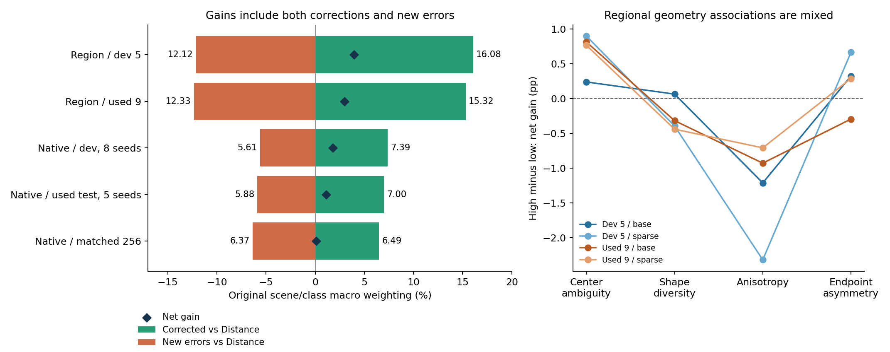

# 现有预测中的成功与失败

**主要发现：五维在区域匹配中修正的错误多于引入的错误，优势在不同场景保留；原生分类的净收益较小，受种子与对象影响更明显。尚未找到能统一解释两类任务的单一几何属性。**

范围为当前主线的区域匹配与原生 3DGS 分类。本次仅读取既有预测和缓存，不训练、不重新推理、不下载新数据。九场景及原生官方 TEST 都是已经使用的数据，本次是事后描述性诊断。分组规则与比较范围先记录在 [plan.md](plan.md)，不把这次关联作为新确认或因果证明。

## 1. 净增益来自怎样的错误交换

“纠正”表示 Distance 错、五维对；“引入错误”表示 Distance 对、五维错。下表沿用区域场景等权、原生类别等权，再对配对种子取平均，因此与原报告相同；不是把所有原始样本简单平均。区域仅含原规则允许评价的查询。

| 人群/流程 | 两者均正确 % | 五维纠正 % | 五维引入错误 % | 两者均错 % | 净增益 pp |
| --- | ---: | ---: | ---: | ---: | ---: |
| 区域旧五场景，三种子 | 24.553 | 16.076 | 12.117 | 47.255 | +3.958 |
| 区域已用九场景，三种子 | 26.069 | 15.321 | 12.333 | 46.277 | +2.988 |
| 原生旧开发对象，八种子 | 72.399 | 7.390 | 5.613 | 14.598 | +1.777 |
| 原生原确认主组，新五种子 | 72.602 | 6.999 | 5.877 | 14.522 | +1.122 |
| 原生匹配 256，三种子 | 70.254 | 6.489 | 6.365 | 16.892 | +0.123 |

区域旧五场景基础的 20,422 个有效查询×三种子中，纠正/引入错误事件为 9,833/7,468；九场景的 35,859 查询×三种子为 16,535/13,199。原生原确认主组是 3,845 对象×新五种子，纠正/引入错误事件为 1,223/1,002。事件计数含同一对象或查询的不同种子，不能当成这么多个独立对象；原始计数也不等同场景/类别宏平均差。

在九场景上，五维与 Distance 同时错误仍占宏平均 46.277%。已有收益确实存在，但主要难例仍未解决。原生匹配 256 中，纠正与引入错误约 6.489%/6.365%，相互抵消，解释了准确率净差只有 +0.123 pp；这比“整个模型完全没有作用”更准确。

原生主确认的 +1.122 pp 仍沿用原报告的联合种子×对象区间 [−0.326, 2.693] pp，证据尚不充分。本次错误分解没有增加独立证据量，也不改变这一判断。

## 2. 哪些案例跨种子重复出现

| 主读数 | 唯一查询/对象数 | 所有种子均纠正 | 所有种子均引入错误 | 不同种子出现相反方向 |
| --- | ---: | ---: | ---: | ---: |
| 区域旧五场景，三种子 | 20422 | 298 | 163 | 2035 |
| 区域已用九场景，三种子 | 35859 | 522 | 256 | 3423 |
| 原生旧开发对象，八种子 | 765 | 0 | 0 | 100 |
| 原生原确认主组，新五种子 | 3845 | 2 | 0 | 337 |
| 原生匹配 256，三种子 | 765 | 3 | 4 | 17 |

全种子一致是严格的描述条件，八种子比三种子更难满足，不用这些数量直接比较任务优劣，也不把缺少全种子一致案例等同收益纯属随机。完整的纠正/退步种子数联合分布保存在 [seed_consistency.json](seed_consistency.json)。

原生主组中，799 个对象至少被五维纠正一次，690 个至少退步一次，其中 337 个两种方向都出现。按每对象“纠正次数−退步次数”计，565 个为正、450 个为负、2,830 个相同。被纠正至少三次的有 99 个，被误判至少三次的有 62 个；全五次一致的纠正仅两个，不能用这两个成功例子代表整个机制。

## 3. 几何关联：有线索，但没有统一解释

区域前两项使用既有 fit 阈值；各向异性与两端关系差异使用旧 fit0/fit1 的中位数。分组与预测结果无关，稀疏条件沿用 base 的同一分组。下表为“高组净增益−低组净增益”；正值才表示高组更受益，单位 pp。

| 输入属性 | 旧五场景基础 | 旧五场景稀疏 | 已用九场景基础 | 已用九场景稀疏 |
| --- | ---: | ---: | ---: | ---: |
| 中心配置歧义 | +0.238 | +0.899 | +0.813 | +0.766 |
| 候选形状差异 | +0.064 | -0.394 | -0.318 | -0.440 |
| 区域各向异性 | -1.213 | -2.319 | -0.929 | -0.709 |
| 两端关系差异 | +0.323 | +0.664 | -0.295 | +0.289 |

- **中心配置歧义是较一致但幅度有限的线索。** 四个总体差均为正，九场景两条件都是 6/9 场景同向；但逐种子仍有反例，没有确证收益只属于高歧义区域。基础高/低歧义组的 Distance 准确率也相近，不能只凭组名认定这是任务最难的样本。
- **“越各向异性越有收益”未得到支持。** 区域四条件反而是较低各向异性组净增益更大。以九场景基础为例，低/高组对 Distance 的收益为 +3.491/+2.562 pp；两组在 Distance 原有错误中被纠正的比例约 24.93%/24.88%，接近。净差还受起始准确率和新错误率影响，不证明趋近球形更适合高斯 PE。
- **候选形状差异没有稳定正关联。** 保留原四分组的收益，但不能将其概括成“形状越不同越容易解决歧义”。
- **两端关系差异也没有跨场景一致关联。** 旧场景较大的关系差异有轻微额外收益，九场景基础方向反转。对称化消融失败支持分别保留两端关系，却不等同“原始两端差异越大，收益必然越大”。

原生按旧 fit 的各类别内部中位数划分，几何关联仅分析 512 流程的 base 输入。为避免高低组缺失不同类别导致混淆，下表使用同时有高低样本类别的“类内高−低差”均值。

| 原生属性 | 旧开发新五种子 pp | 原确认主组新五种子 pp | 确认主组正/负类别数 |
| --- | ---: | ---: | --- |
| 对象基元各向异性中位数 | +0.329（58 类） | +0.894（60 类） | 28/31 |
| 对象内部形状尺度离散程度 | +0.904（59 类） | -1.706（60 类） | 23/36 |
| 协方差 floor 相对占比 | -0.142（59 类） | +0.597（60 类） | 34/24 |

原生各向异性高组总体较好，但确认主组为 28 类正、31 类负、1 类持平，不能作为普遍规则；尺度离散和 floor 的关联还会在开发/确认数据间改变方向。区域支撑协方差与优化后的 GS 协方差含义不同，目前不能用同一个标量性质解释它们。

来源比较也需要保留种子范围：主确认新五组 MACGS/ModelNet 的净差为 +1.728/+0.516 pp，合并八组则为 +1.162/+1.281 pp。类别集合本来不同，加上种子依赖，不能据此认定某种来源的形状天然更有用。

## 4. 固定球形对照与中心定位

九场景五维对固定球形的纠正/引入错误率为 14.554%/12.772%，净 +1.782 pp；原生主组同旧三种子为 7.989%/5.746%，净 +2.244 pp。额外形状关系的总体证据保留，也存在真实反例。

九场景五维纠正 Distance 的 16,535 个预测事件中，固定球形也错的有 10,545 个，固定球形已正确的有 5,990 个；这说明成功事件并非全由同一个控制解释，但比例不是协方差的因果贡献率。

按区域成功/失败事件条件化后，中心误差通常同方向变化：九场景被纠正事件的 hard EPE 平均减少约 0.3855，引入错误事件增加约 0.3519。两模型都错的事件中，五维 hard/soft EPE 仍平均减少约 0.01738/0.01850。这里使用缓存的原任务归一化坐标，不能称为米或厘米；这些事件组按结果定义，也不构成独立因果验证。

## 5. 可追溯的具体案例

区域示例按预定规则：在三种子全同方向案例内按 ID 字典序取首个，成功和失败都保留。以下数值没有查看新的深度图或 RGB。

| 类型 | 查询 ID | 五维选择 / overlap | Distance 选择 / overlap |
| --- | --- | --- | --- |
| 成功 | `brown_bm_6/brown_bm_6:173:188:v0:q08` | 38/38/38 / 0.328/0.328/0.328 | 13/13/13 / 0.031/0.031/0.031 |
| 失败 | `brown_bm_6/brown_bm_6:112:127:v0:q15` | 23/23/4 / 0.188/0.188/0.250 | 30/53/53 / 0.391/0.391/0.391 |

第一个成功例中，五维三种子均选中区域 38，overlap=0.328，Distance 均选区域 13，overlap=0.031；中心误差由约 0.326 降到 0.190，但仍未达到 PCK 的 0.1 门槛。这个例子说明区域选择改善不等于每个样本都已精确定位，不能只展示“成功”标签。失败例中，Distance 三次均满足区域正确标准，五维三次都错。

原生主组五种子全部一致纠正的两个对象为：

| 对象 | 真值 / 五维五次预测 | Distance 五次预测 |
| --- | --- | --- |
| `18/18010b78.ply` | paper box | basket / bag / bag / basket / bag |
| `37/plant_0340.ply` | plant | stairs / stairs / stairs / stairs / stairs |

原生没有“五个种子全部引入错误”的对象，保留这个零值，不改规则挑另一组来替代；实际共有 690 个对象至少退步一次、450 个对象退步次数多于纠正次数。原确认主组的典型混淆方向也会同时出现于成功与失败：bowl→mug 被纠正 17 次，也被新引入 12 次；basketball→soccer 分别 16/12 次；train→car 新引入 13 次。它们是跨种子的事件数，不是独立对象数。没有据类别名称猜测具体视觉原因。

## 6. 对后续研究的影响

当前可保留的结论是：五维对区域任务形成分散于多种查询的净收益；原生收益更受种子与对象影响。数据没有支持“高各向异性”“更大形状差异”或“更大两端差异”作为统一的成功条件。中心配置歧义是可进一步检查的弱线索，幅度有限，尚不足以据此设计新的模块。

下一项控制实验若开展，应优先分离“中心邻域配置难以区分”与“形状关系能否提供可迁移的区分信息”，同时记录纠正与新错误，而不是只比较净准确率。现有四分组及本次相关性不足以建立这一因果解释。本次不立即运行该实验，也不启动跨来源下载。

## 产物与核对

读取并绑定 387 项来源/预测/缓存身份，重建 486 个原报告指标单元，最大差 3.5e-15。沿用原有效查询、类别及场景宏平均，未改变旧结论；事件分解和权重恒等式检查通过。没有增加数值门槛或重新跑模型。

- [全部汇总表](summary.csv)：10 个区域比较、72 个原生条件/种子组比较。
- [主比较全部唯一查询/对象表](primary_cases.csv.gz)：逐样本纠正/退步次数、预测索引和固定几何特征；区域预测值是目标 token 索引，原生是 taxonomy ID。
- [完整结构化结果](result.json)：逐场景/类别、来源、几何分组、对照与身份。
- [种子一致性分布](seed_consistency.json)；[逐条件事件数组](events/)。
- [分析代码](../../../experiments/prediction_success_failure.py)；[报告代码](../../../experiments/prediction_success_failure_report.py)。

