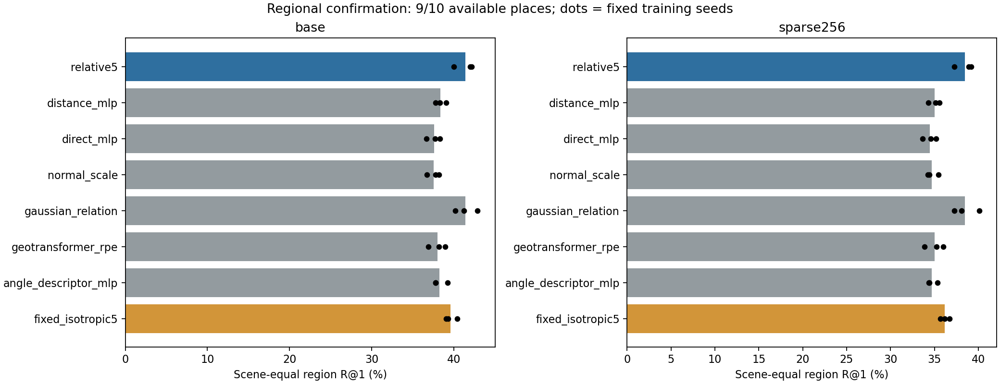
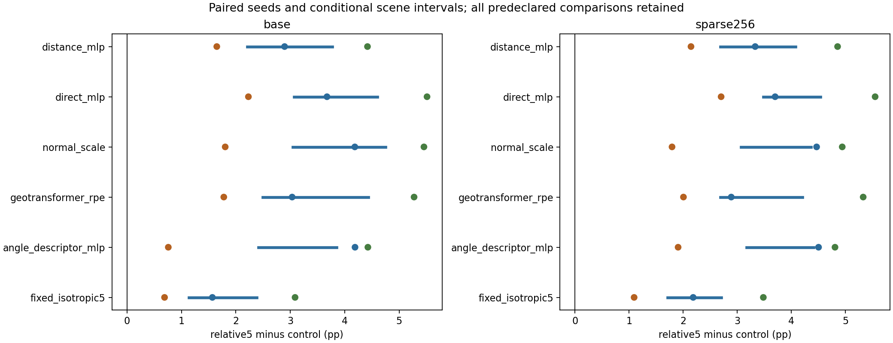

# Frozen regional confirmation

Available scenes: 9/10; 24 existing models; zero new fits.
Missing members remain missing. This is not complete ten-place confirmation or evidence of general PE effectiveness.

Unavailable: home_han/apartment_han_oct_31_2012_scan1_erika: HTTP Error 404: Not Found

| Condition | Method | Region R@1 % | Center PCK % | Soft EPE | CE |
|---|---|---:|---:|---:|---:|
| base | relative5 | 41.3894 | 15.1443 | 0.3862 | 2.9923 |
| base | distance_mlp | 38.4018 | 13.7159 | 0.4038 | 3.0776 |
| base | direct_mlp | 37.5841 | 13.4644 | 0.4072 | 3.0862 |
| base | normal_scale | 37.5746 | 13.5597 | 0.4136 | 3.0748 |
| base | gaussian_relation | 41.4381 | 15.0265 | 0.3831 | 2.9960 |
| base | geotransformer_rpe | 38.0275 | 13.5729 | 0.4033 | 3.0863 |
| base | angle_descriptor_mlp | 38.2650 | 13.8663 | 0.4102 | 3.0810 |
| base | fixed_isotropic5 | 39.6070 | 14.2677 | 0.3952 | 3.0704 |
| sparse256 | relative5 | 38.4525 | 13.4569 | 0.3974 | 3.0578 |
| sparse256 | distance_mlp | 35.0102 | 12.2587 | 0.4219 | 3.1691 |
| sparse256 | direct_mlp | 34.4703 | 11.9264 | 0.4232 | 3.1732 |
| sparse256 | normal_scale | 34.7198 | 12.1473 | 0.4259 | 3.1452 |
| sparse256 | gaussian_relation | 38.4889 | 13.5026 | 0.3955 | 3.0674 |
| sparse256 | geotransformer_rpe | 35.0465 | 12.0366 | 0.4212 | 3.1724 |
| sparse256 | angle_descriptor_mlp | 34.7150 | 12.0258 | 0.4257 | 3.1667 |
| sparse256 | fixed_isotropic5 | 36.2003 | 12.6096 | 0.4133 | 3.1673 |

| Condition | relative5 minus control | Seed differences pp | Mean pp | Scene 95% pp | PCK pp |
|---|---|---|---:|---|---:|
| base | distance_mlp | 2.895 / 1.650 / 4.418 | 2.988 | [2.209, 3.772] | 1.428 |
| base | direct_mlp | 3.674 / 2.231 / 5.511 | 3.805 | [3.067, 4.597] | 1.680 |
| base | normal_scale | 4.185 / 1.805 / 5.454 | 3.815 | [3.044, 4.747] | 1.585 |
| base | gaussian_relation | -0.884 / -0.177 / 0.915 | -0.049 | [-0.558, 0.473] | 0.118 |
| base | geotransformer_rpe | 3.034 / 1.779 / 5.273 | 3.362 | [2.494, 4.430] | 1.571 |
| base | angle_descriptor_mlp | 4.189 / 0.760 / 4.425 | 3.124 | [2.413, 3.850] | 1.278 |
| base | fixed_isotropic5 | 1.569 / 0.691 / 3.088 | 1.782 | [1.142, 2.384] | 0.877 |
| sparse256 | distance_mlp | 3.330 / 2.143 / 4.853 | 3.442 | [2.687, 4.072] | 1.198 |
| sparse256 | direct_mlp | 3.699 / 2.700 / 5.548 | 3.982 | [3.481, 4.538] | 1.531 |
| sparse256 | normal_scale | 4.466 / 1.793 / 4.939 | 3.733 | [3.065, 4.361] | 1.310 |
| sparse256 | gaussian_relation | -1.188 / -0.029 / 1.107 | -0.036 | [-0.601, 0.550] | -0.046 |
| sparse256 | geotransformer_rpe | 2.887 / 2.004 / 5.327 | 3.406 | [2.685, 4.203] | 1.420 |
| sparse256 | angle_descriptor_mlp | 4.502 / 1.905 / 4.806 | 3.738 | [3.174, 4.410] | 1.431 |
| sparse256 | fixed_isotropic5 | 2.184 / 1.092 / 3.481 | 2.252 | [1.714, 2.703] | 0.847 |

Independent micro/scene metric maximum error: 1.33e-15.
Scene intervals condition on three selected seeds. Crossed intervals, all strata, scenes, seeds and coverage are retained in result.json.
Sparse inputs retain known original regions and physical queries. Technical missingness is not silently removed from the planned population.
Scientific interpretation and actual figure review are pending.

