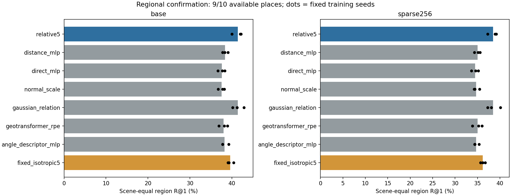
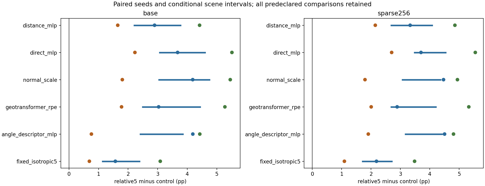

# 区域未用场景确认：固定模型在九个可用场景上的验证

**区域优势得到新的正面确认，整个研究目标仍未完成。** 24 个既有模型没有训练、适配或重选；在预先选定且可用的九个新 place 上，五维关系的基础 R@1 为 41.389%，Distance 为 38.402%，固定球形为 39.607%。相对 Distance / Direct / 法向尺度 / GeoTransformer / 角度描述符，平均分别高 +2.988 / +3.805 / +3.815 / +3.362 / +3.124 pp；所有比较的三个配对种子均为正，达到事前的基础用途规则。

**变化协方差的额外用途也保留。** 五维减固定球形的基础差为 +1.569 / +0.691 / +3.088 pp，平均 +1.782 pp；场景区间 [1.142, 2.384] pp，种子×场景重采样区间 [0.493, 3.206] pp。固定查询稀疏下平均 +2.252 pp，三个种子仍正。两条件下，对固定球形的三个种子在区域召回、中心 PCK、Soft EPE 与 CE 上都改善；中心 PCK 平均分别 +0.877/+0.847 pp。支持的是同一完整内容之上，变化区域形状参与 PE 仍有额外价值，不是所有协方差分量必要或高斯公式唯一有效。

固定球形本身对 Distance 的基础/稀疏召回也分别 +1.205/+1.190 pp，三个种子均正；更丰富的径向特征同样有贡献。不能把五维与 Distance 的全部差距都归给协方差，也不能将两个差值的比值当作因果贡献百分比。协方差优势比旧五场景开发结果小（旧基础/稀疏 +3.340/+3.363 pp），但在本次固定新场景比较中仍保留。

**区域描述与中心定位没有出现总体此消彼长。** 相对五项用途控制，基础和稀疏的三个种子 PCK 均改善，总体 Soft EPE/CE 也改善。例外保留：对 GeoTransformer，种子 11 的基础 Soft EPE 差 +0.00153；不能写成每个指标都一致胜出。

所有用途控制及固定球形的九个场景均值、四个预定分组均值的召回差均正，但细分单元仍有负项。对固定球形，基础 6/27、稀疏 3/27 个种子×场景单元为负；`mit_36_ti_lab2` 的基础场景均值仅 +0.024 pp，近似持平。没有要求这些细小单元全部通过，也不把它们隐去。全部细分值保存在 result.json，负项摘要见 review.json。

五维与 full11 基本持平：基础/稀疏平均召回差 −0.049/−0.036 pp；PCK 为 +0.118/−0.046 pp。满足既定的均值工程容差，不能称全面胜出或正式非劣性；种子 11 的稀疏召回差为 −1.188 pp，Soft EPE 也有退步。

预定十个 place 中，`home_han` 缺官方内参，保持缺失而未更换场景；结果只覆盖九个可用 place、864 对、35,859/110,592 个有效查询（约 32.42%）。没有额外配对排除；基础与稀疏使用相同物理查询、成员和标签，仍不是稀疏区域重新发现。区间条件于既定三个训练种子及有限场景；跨种子区间也不能代替更多独立训练。名称排斥不证明物理空间绝对独立，本次用过的九个场景不能再作为后续改模型的 fresh 确认。

实现方面，24 模型旧验证 GPU 回放误差为零，48 组预测身份完整，独立 Torch 微平均/逐场景指标最大差 1.33e−15。CPU 汇总读取延迟经旧数据复现；缓冲读取和分块执行原公式后，四组旧预测的 1,060 个数值单元全部一致。原汇总控制器受控退出，新汇总完成，所有预测及原生 GPU 训练保留。该实施修复未改变科学方案。两张下图已实际查看，与数字一致；配对图只画五项用途控制及固定球形，full11 在表格和总览图中保留。配对图蓝/橙/绿点分别为种子 11/22/33，横线是条件于三个种子的场景区间。

下一步继续完成原生固定球形的三个完整训练，判断真实优化基元的收益来源，再决定额外种子复现应纳入哪些强对照。这次区域确认不覆盖原生稳定性、RGB、投影新场景的既有混合结果，也不据此恢复渲染为主任务。结构、用途与成本分开解释。

[固定科学计划](../../../docs/region_confirmation_plan.md) · [评价身份](evaluation_lock.json) · [数值结果](result.json) · [审阅](review.json) · [汇总运行修复](metric_runtime_update_01/plan.json)

Available scenes: 9/10; 24 existing models; zero new fits.
Missing members remain missing. This is not complete ten-place confirmation or evidence of general PE effectiveness.

Unavailable: home_han/apartment_han_oct_31_2012_scan1_erika: HTTP Error 404: Not Found

| Condition | Method | Region R@1 % | Center PCK % | Soft EPE | CE |
|---|---|---:|---:|---:|---:|
| base | relative5 | 41.3894 | 15.1443 | 0.3862 | 2.9923 |
| base | distance_mlp | 38.4018 | 13.7159 | 0.4038 | 3.0776 |
| base | direct_mlp | 37.5841 | 13.4644 | 0.4072 | 3.0862 |
| base | normal_scale | 37.5746 | 13.5597 | 0.4136 | 3.0748 |
| base | gaussian_relation | 41.4381 | 15.0265 | 0.3831 | 2.9960 |
| base | geotransformer_rpe | 38.0275 | 13.5729 | 0.4033 | 3.0863 |
| base | angle_descriptor_mlp | 38.2650 | 13.8663 | 0.4102 | 3.0810 |
| base | fixed_isotropic5 | 39.6070 | 14.2677 | 0.3952 | 3.0704 |
| sparse256 | relative5 | 38.4525 | 13.4569 | 0.3974 | 3.0578 |
| sparse256 | distance_mlp | 35.0102 | 12.2587 | 0.4219 | 3.1691 |
| sparse256 | direct_mlp | 34.4703 | 11.9264 | 0.4232 | 3.1732 |
| sparse256 | normal_scale | 34.7198 | 12.1473 | 0.4259 | 3.1452 |
| sparse256 | gaussian_relation | 38.4889 | 13.5026 | 0.3955 | 3.0674 |
| sparse256 | geotransformer_rpe | 35.0465 | 12.0366 | 0.4212 | 3.1724 |
| sparse256 | angle_descriptor_mlp | 34.7150 | 12.0258 | 0.4257 | 3.1667 |
| sparse256 | fixed_isotropic5 | 36.2003 | 12.6096 | 0.4133 | 3.1673 |

| Condition | relative5 minus control | Seed differences pp | Mean pp | Scene 95% pp | PCK pp |
|---|---|---|---:|---|---:|
| base | distance_mlp | 2.895 / 1.650 / 4.418 | 2.988 | [2.209, 3.772] | 1.428 |
| base | direct_mlp | 3.674 / 2.231 / 5.511 | 3.805 | [3.067, 4.597] | 1.680 |
| base | normal_scale | 4.185 / 1.805 / 5.454 | 3.815 | [3.044, 4.747] | 1.585 |
| base | gaussian_relation | -0.884 / -0.177 / 0.915 | -0.049 | [-0.558, 0.473] | 0.118 |
| base | geotransformer_rpe | 3.034 / 1.779 / 5.273 | 3.362 | [2.494, 4.430] | 1.571 |
| base | angle_descriptor_mlp | 4.189 / 0.760 / 4.425 | 3.124 | [2.413, 3.850] | 1.278 |
| base | fixed_isotropic5 | 1.569 / 0.691 / 3.088 | 1.782 | [1.142, 2.384] | 0.877 |
| sparse256 | distance_mlp | 3.330 / 2.143 / 4.853 | 3.442 | [2.687, 4.072] | 1.198 |
| sparse256 | direct_mlp | 3.699 / 2.700 / 5.548 | 3.982 | [3.481, 4.538] | 1.531 |
| sparse256 | normal_scale | 4.466 / 1.793 / 4.939 | 3.733 | [3.065, 4.361] | 1.310 |
| sparse256 | gaussian_relation | -1.188 / -0.029 / 1.107 | -0.036 | [-0.601, 0.550] | -0.046 |
| sparse256 | geotransformer_rpe | 2.887 / 2.004 / 5.327 | 3.406 | [2.685, 4.203] | 1.420 |
| sparse256 | angle_descriptor_mlp | 4.502 / 1.905 / 4.806 | 3.738 | [3.174, 4.410] | 1.431 |
| sparse256 | fixed_isotropic5 | 2.184 / 1.092 / 3.481 | 2.252 | [1.714, 2.703] | 0.847 |

Independent micro/scene metric maximum error: 1.33e-15.
Scene intervals condition on three selected seeds. Crossed intervals, all strata, scenes, seeds and coverage are retained in result.json.
Sparse inputs retain known original regions and physical queries. Technical missingness is not silently removed from the planned population.
Scientific interpretation and actual figure review are complete; see review.json. The original generated report is preserved as report.generated.md.

