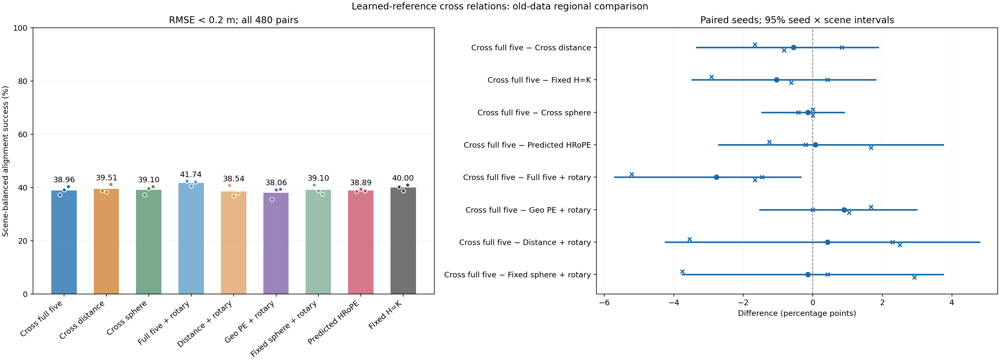
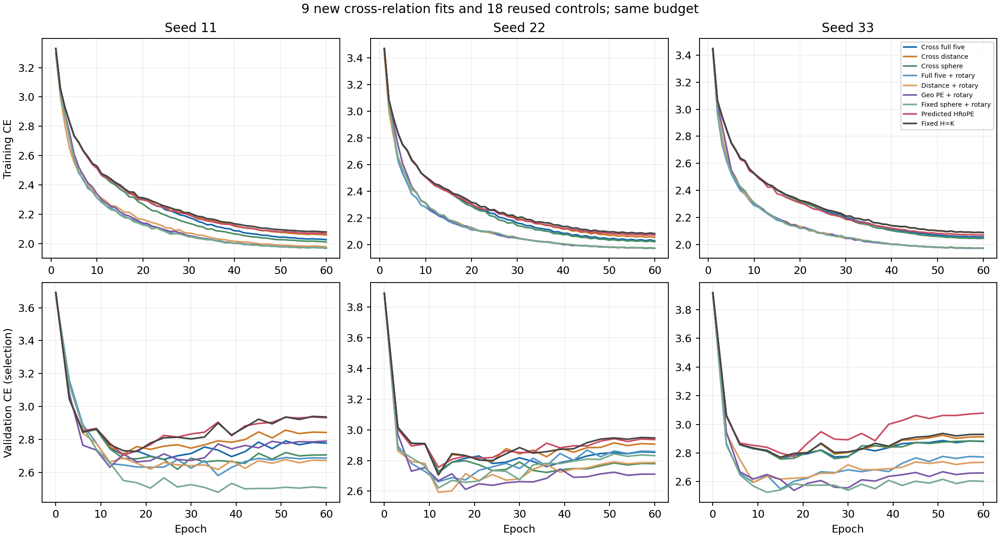

# 自预测参考的五系数跨帧关系编码：未建立额外用途

2026-11-10，正式九次训练、评价和实际科学审阅完成。**结束这个固定接法，保留原五维方案。** 新五维对齐成功率38.958%，未超过同接法Distance或固定旋转骨干；比原五维加旋转低2.778 pp，三个种子、五个场景均退步，联合95%区间完全为负。总体研究目标仍active，尚未得到具有可信一般用途的方案。

本轮按[事前计划](../../../docs/region_cross_consistency_plan.md)新增三个角色×三个种子，共9次拟合，每次60周期/1,080更新；复用18个已有学习模型、两个诊断，共29组几何结果。旧576 fit/64 val/480 eval与原损失、优化器、增强、共同输入、求解器均保持一致；全部9模型先按验证CE选定再导出eval。没有读取新确认数据、没有补种子或失败后调参。

## 回答的问题

上一轮[真值辅助关系诊断](../../region_relation_consistency/diagnostic1/report.md)的校准F−D/S区域召回为+1.117/+1.929 pp，但参考概率来自标签。这轮将参考改为当前cross层自身的 `P=softmax(QKᵀ/√d)`，梯度经过P；按两帧各自的高斯关系构造期望平方差，排除查询自己的参考行，再以5个共享系数加入cross分数。系数从0开始，只复用旧fit几何标准差，不使用oracle拟合权重。距离/球形分别有1/5个系数，所有模型共同内容含完整高斯参数和相机信息。

这里没有增加关系MLP、额外预测头、拒识器或迭代；self层保留原固定旋转骨干。它替换原9,792参数的self关系MLP，是一种新的精炼接法。与原方案相比，同时改变了位置项函数、作用位置和容量，所以差异不能单独归因于cross位置或参数数量。

## 实际对齐结果

所有64个top1对应进入同一个刚体求解器；所有480帧对保留，全部源中心RMSE<0.2米计成功，场景与种子等权。以下是三个种子的平均值；完整逐种子、逐方法与尾部误差见[全部数据表](tables.md)。

| 方法 | 对齐成功率 % |
| --- | ---: |
| 新跨帧五维 | 38.958 |
| 新跨帧Distance | 39.514 |
| 新跨帧固定球形 | 39.097 |
| 原五维＋旋转 | 41.736 |
| 原Distance＋旋转 | 38.542 |
| 原Geo PE＋旋转 | 38.056 |
| 原固定球形＋旋转 | 39.097 |
| 完整HRoPE区域适配 | 38.889 |
| 固定H=K旋转骨干 | 40.000 |

| 新五维相对对照 | 平均差 pp | 三种子差 pp | 种子×场景95%区间 pp |
| --- | ---: | --- | --- |
| 新Distance（主比较） | −0.556 | −1.667 / +0.833 / −0.833 | [−3.333,1.875] |
| 固定H（主比较） | −1.042 | −2.917 / +0.417 / −0.625 | [−3.472,1.806] |
| 新球形 | −0.139 | 0 / −0.417 / 0 | [−1.458,0.903] |
| 完整HRoPE | +0.069 | −1.250 / −0.208 / +1.667 | [−2.708,3.750] |
| 原五维＋旋转 | −2.778 | −5.208 / −1.458 / −1.667 | [−5.694,−0.347] |
| 原Geo PE＋旋转 | +0.903 | +1.667 / 0 / +1.042 | [−1.528,2.986] |
| 原Distance＋旋转 | +0.417 | −3.542 / +2.292 / +2.500 | [−4.236,4.792] |
| 原球形＋旋转 | −0.139 | −3.750 / +0.417 / +2.917 | [−3.750,3.750] |

两项主比较均未支持额外用途，区间跨零也不证明方法等效或确定有害。对原五维的退步更清楚，五场景差分别为−0.347/−4.167/−4.167/−2.083/−3.125 pp。对HRoPE仅+0.069 pp、种子混合，不能宣称超过HRoPE。新球形对照没有支持形状特有的收益；它也没有建立可推广的新用途。

所有27个学习模型的求解均数值有效，但新五维仍有61.042%的帧对未达成功标准。“有解”不等于“正确”。新五维三种子RMSE中位数为0.291/0.282/0.263米，均差于原五维的0.247/0.260/0.244米；p90为1.512/1.572/1.745米，相对原五维有改善也有退步，不概括成尾部全面恶化或全面改善。恒等20.208%、真值最近中心86.042%仅是复用诊断，后者不可部署、不是理论上界。

## 匹配和训练没有隐藏另一项成功

新F/D/S区域R@1为51.833%/52.041%/53.040%，新F三个种子均低于D/S。固定H51.933%、原五维57.023%。新F全查询正确率17.658%，固定H17.667%、原五维19.392%；新F中心PCK19.348%、soft EPE0.299米，原五维为21.887%、0.259米。这些结果与未建立实际对齐收益相符，不能用一个辅助指标代替主结果。

9次训练均完成预算、没有非有限损失/梯度或OOM。选中周期F为24/12/15，D为15/12/15，S为27/36/15；训练损失持续下降，验证CE在中前期最低、之后回升，按原规则使用最低CE模型。共同初始化和全部60条增强流与六种复用角色逐一一致；九份验证预测回放最大logit差0、argmax变化0，独立匹配指标最大差8.89e−16。没有据eval或位姿成绩重新选择checkpoint。

F选中系数如下，原五个关系的顺序不变：

| 种子 | 距离 | 双端位移1 | 双端位移2 | 协方差关系1 | 协方差关系2 |
| --- | ---: | ---: | ---: | ---: | ---: |
| 11 | 0.324514 | 0.174035 | 0.247899 | 0.014327 | 0.004333 |
| 22 | 0.096084 | 0.042536 | 0.110935 | 0.013431 | −0.005997 |
| 33 | 0.074308 | 0.122259 | 0.035117 | 0.004546 | 0.002892 |

系数确实参与学习，不能把失败解释成位置项从未启用。seed22最后一项为负，不能称所有项为非负一致性惩罚。系数幅度不能直接证明某个分量不重要；球形的重复/常量列也不可作独立机制归因。完整D/S系数保留在数据表中。

F总参数316,086，PE仅5个；训练峰值0.655 GiB，原五维0.651 GiB、固定H0.172 GiB。参数更少没有带来相应的显存缩减。各次训练用时62.7–68.6秒，但没有同卡隔离配对计时，不能宣称速度优势。FP64关系收缩为O(C*N³)，当前只验证N=64，不外推原生512基元或完整RGB系统。

## 独立核对与科学判断

冻结身份为`664149ba2b594f5520f5fab3c48905d6a92a718e6e8adfd6c8d5e3ad6630b167`，结果身份为`9609b695005a214542e5f94e95f3da59c5dad85615a40e7e28f8a6742159f617`。前期三个CPU检查与GPU两步预检均通过且预检权重丢弃。所有19个队列阶段正常退出；9个新求解组、20个复用组均完成。

SciPy独立恢复真值并重算29×480评分，RMSE最大差7.33e−15米、旋转差2.26e−11度、平移差8.55e−15米；成功判定变化0、一致性计数差0。种子×场景bootstrap另以绝对准确率重采样后相减复算，未改变结论。[独立检查](independent_checks.json)记录实现核对；[实际审阅](review.json)记录科学解释，两者不是同一种证明。两张图已实际查看，学习与验证趋势、全部差值及区间可读。

上一轮证明的只是**良好参考下，关系具有可用信息**。当前结果表明，这一信息没有通过本轮的自预测参考与五标量接法转成稳定优势。两轮的参考有效性、优化方式和任务输出不同，不能把成绩差定量归因于P的误差，也不能证明整个跨帧关系思想不可能。

按事前规则结束这项固定构造：不补种子、不扫描系数/温度/频率、不叠加旧MLP挽救、不消耗未用场景确认。继续保留原五维及其区域用途证据、HRoPE与固定旋转强对照、原生和泛化边界。下一项研究需要重新给出有辨别价值的假设，当前不自动排队另一个变体；总体自主目标保持active。

