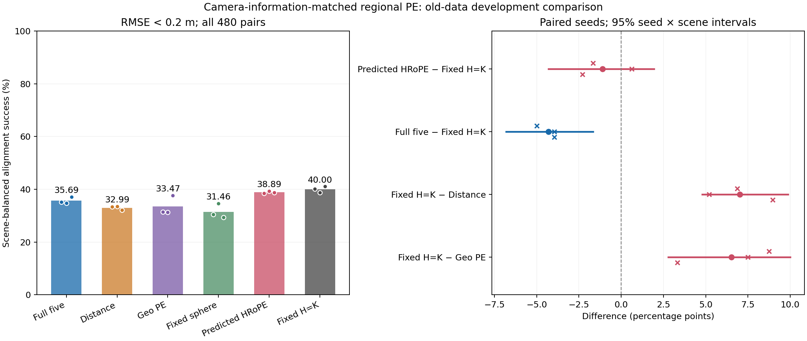
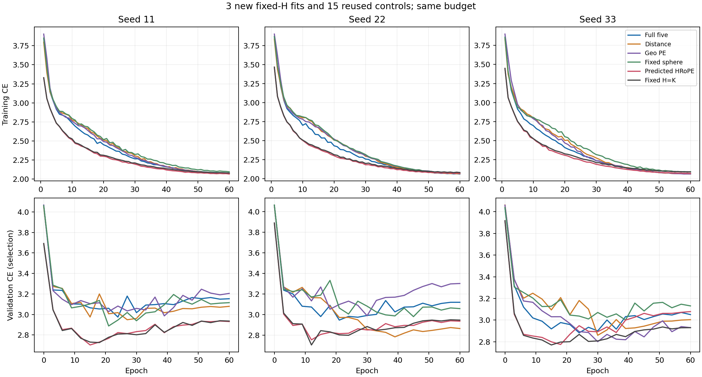

# 固定 H=K 控制：学习单应变换的额外对齐收益未确立

2026-11-10。三次新增训练、预测、几何评分、独立复算及图表审阅全部完成。本轮新增训练与评价仅使用最初五场景的旧开发数据，不访问刚完成十地点确认的缓存；上一轮已完成的结论是提出此控制的背景。完整五维 F 保持不变，总体研究目标尚未完成。

**固定 H=K 的对齐成功率为 40.000%，完整预测版 HRoPE 为 38.889%。二者差异方向混合且区间跨零，不能宣称等效或固定版更好。** 固定版相对 F、Distance、Geo PE 分别高 4.306、7.014、6.528 个百分点，三个种子与五个场景均同向，联合区间均支持正差。当前领先因此不能直接归因于逐区域学习单应几何；保留二维旋转及原注意力接法，已经能得到有竞争力的开发结果。

## 问题与固定比较

假设是：在相同二维旋转、self/cross 位置和 Q/K/V/输出变换下，逐区域学习的 H 仍提供有幅度的对齐收益。竞争解释是：固定变换与其余旋转接法已足以产生主要用途。完整 HRoPE 与固定版的比较为主，F 与固定版、固定版与 Distance/Geo 为次比较。若主比较达到事前规定的平均至少 +1 pp、三个种子均正且种子×场景区间下界为正，才支持进一步研究学习型局部变换；反向采用对称条件，其余结果保留不确定性。

唯一新增模型将原 96→13 预测头替换为常量 R=I、t=0、n=z、κ=0.25，因此 H=K。其余继承完整 HRoPE 前向：24 维几何块、24 维二维旋转、原频率与坐标尺度、两层 self 和两层 cross、Q/K/V 及聚合输出的变换。**它不是通常只旋转 Q/K 的二维 RoPE。** 总参数 316,081，比完整 HRoPE 少 1,261 个预测头参数，没有容量补偿；公共内容仍含高斯参数、图像位置与内参。

新增种子 11/22/33 三次拟合，复用此前五方法的十五个模型。576 fit / 64 val / 480 eval、每次 60 周期和 1,080 更新、batch32、验证 batch16、优化器和学习率、按验证 CE 选模均沿用原计划。公共初始化及全部 60 条增强样本顺序一致。统一使用全部 64 个 top1 对应、41,664 个三点假设、0.1 一致性半径及最多五次非恶化重估；成功为所有源区域中心的对齐 RMSE<0.2 米。旧 17 组几何结果原样复用，只新增三组，共 20×480 个估计。每次求解不使用真值筛选对应。

## 主结果与反例

| 方法 | 对齐成功率 % | 三个种子 % |
| --- | ---: | --- |
| 固定 H=K | 40.000 | 40.208 / 38.750 / 41.042 |
| 完整 HRoPE | 38.889 | 38.542 / 39.375 / 38.750 |
| 完整五维 F | 35.694 | 35.208 / 34.792 / 37.083 |
| Distance | 32.986 | 33.333 / 33.542 / 32.083 |
| Geo PE | 33.472 | 31.458 / 31.250 / 37.708 |
| 固定球形 | 31.458 | 30.417 / 34.583 / 29.375 |

| 固定比较 | 平均差 pp | 三种子差 pp | 种子×场景 95% 区间 pp |
| --- | ---: | --- | --- |
| HRoPE−固定 H | −1.111 | −1.667 / +0.625 / −2.292 | [−4.306, 1.944] |
| F−固定 H | −4.306 | −5.000 / −3.958 / −3.958 | [−6.806, −1.667] |
| 固定 H−Distance | +7.014 | +6.875 / +5.208 / +8.958 | [4.792, 9.861] |
| 固定 H−Geo PE | +6.528 | +8.750 / +7.500 / +3.333 | [2.778, 10.000] |

采用事前固定的 10,000 次配对种子×整场景 bootstrap。主比较在五场景的差为 −5.208 / +0.694 / −3.125 / −0.694 / +2.778 pp，地区方向同样混合。只有三个种子和五个旧场景，不能把区间跨零解释为学习变换毫无价值，也不能据均值把固定版晋升为普遍更好的替代。

完整 HRoPE 在辅助匹配指标上仍有一致的小幅优势：HRoPE/固定 H 的区域 R@1 为 52.877%/51.933%，全查询正确率 17.989%/17.667%，中心 PCK 19.915%/19.343%，soft EPE 0.2967/0.3007 米；四项在三个种子均偏向完整 HRoPE。它的 RMSE p90 为 1.6225/1.6421/1.7259 米，也均低于固定版的 1.6336/1.6570/1.7905 米。排序、尾部与阈值成功率回答不同问题，不能挑选其中一项宣布全面胜出。

固定版的 RMSE 中位数为 0.2617/0.3109/0.2603 米，平均仍有 60% 帧对未达成功标准；它的 p90 在种子 22/33 差于 Distance，不能称为可靠完整配准系统。恒等参照为 20.208%，不可部署的真值最近中心参照为 86.042%，后者不是理论上界。所有学习模型的估计均数值有效，数值有效不等于对齐成功。完整逐种子辅助指标、尾部和训练表见 [tables.md](tables.md)。

## 机制解释与研究决定

旧 fit0、fit1、val、eval 的每个帧对都具有完全相同的两端 K，最大差为零。对固定版，几何 Q/K 块满足 K K⁻¹=I，V 与输出的固定几何变换也代数抵消；剩余的显式位置作用来自原半头二维旋转，包括 V 与输出旋转。内参仍进入公共内容，不能称整个模型不依赖 K。[输入结构记录](fixed_camera_structure.json)

这排除了“没有逐区域学习单应变换就无法得到当前对齐收益”的强说法，但未区分二维旋转频率、self/cross 作用范围、V/输出传输各自的贡献。完整 HRoPE 的辅助指标改善也保留。移除预测头同时改变容量与训练路径，本轮不能单独归因于物理几何、容量或正则化。所有方法共同内容都包含高斯信息，固定版领先不证明高斯参数无用。

**按事前规则结束这项控制。** 保留完整 HRoPE 作为已经有十地点确认的强对照，同时将固定 H 作为旧数据上更简单的必要参照。固定版尚无独立地点确认，不能借用完整 HRoPE 的确认结论。F 保持固定并收窄当前含图像坐标任务下的强对照主张；既有无相机条件的正面结果与原生、RGB 等负结果均保留。

本结果没有提供重新启动高斯局部框架的正面依据：R50/R53 已有相关失败，不能换名重试。后续设计应先明确在同等二维位置与跨帧交互条件下，高斯区域参数究竟增加哪一种可检验的信息；单纯将 F 与 HRoPE 叠加不能回答这一点。本轮不追加种子、不扫描频率、不自动开启新地点确认。

## 执行与检查

CPU 初始前向、公共梯度和 H=K 检查通过；GPU 初始输出差为零，丢弃的两步预检保持常量头不变。三次训练均正常完成，训练 CE 平稳下降，验证 CE 较早到达最小值后回升，没有用评价集调整预算；选中周期分别为 18/12/15。三份验证预测回放完全一致，独立匹配指标最大差 5.55e−17。20 组评分的独立 SciPy 复算最大 RMSE 差 8.88e−15 米、旋转差 1.57e−11 度、成功判定差 0；这些小误差不影响结论。

两张图已实际查看，数值、符号和曲线与完整表一致，标签可读。初始控制器仅支持空闲卡，在尚无工作进程时停止；依照用户已有授权改为最多一个共享工作进程，启动前连续确认剩余显存至少 12 GiB、利用率不超过 60%，并检查 CUDA。仅改变调度，科学源码和固定方案未改；所有正式阶段正常退出，未干预其他用户任务。共享运行耗时不用于公平速度结论。[资源调整](execution_spare_adjustment1/adjustment.json)

固定方案 SHA256：`029ec3d56bc68466a2f1373a64636a9345a0e7cdc167d60e8ab75fc49fa282da`。本报告对应原始结果 SHA256：`7d25a1dc31982f9178f45684a9bb306a34ae82bf795a35e2c5c21b9ab0c48c27`。原始结果中的审阅待办字段保留生成时状态，最终状态见 [status.json](status.json) 与 [review.json](review.json)。

