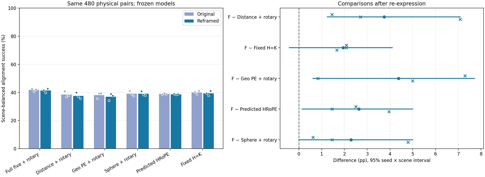
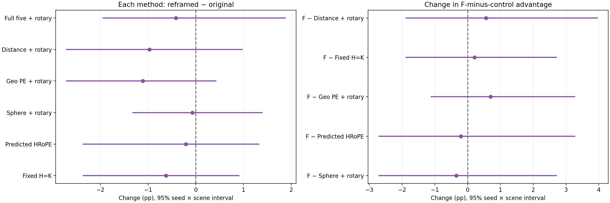

# 同一观测换局部三维坐标：五维用途保留，额外稳健性优势未确立

2026-11-10，18个已有模型的推理、18组新几何求解、38组新旧评分复核及实际科学审阅完成，零训练。**原五维＋二维旋转的对齐率41.736%→41.319%，这一次坐标变化的平均影响较小；对Distance、Geo PE、HRoPE的用途信号保留，对固定H的稳定优势仍不确定。** 不据此添加不变性模块，也不把完整网络的非严格不变当成方法失效。总体一般性目标尚未完成。

## 这次究竟改变了什么

按照[事前计划](../../../docs/region_frame_robustness_plan.md)，18个原checkpoint全部固定，每个旧帧对的两端各施加一套由ID预定的独立SO(3)旋转与U(−0.5,0.5)平移；各方法及模型种子共用同样变换。中心变成Rμ+t，协方差变成RΣRᵀ，模型的二维旋转位置编码保持原样。原11维谱/径向特征、区域成员、相机内参、图像位置、对应标签与全部480帧对保留。

这是同一物理观测的局部三维表示变化，没有改变相机视角、重划区域或引入新像素。变换范围沿用已有训练增强，不扫描角度、平移或变换随机种子，不进行集成。对应预测仍进入同一个64-query刚体求解器；评分在原坐标进行，以保持所有方法的物理评价完全相同。原坐标是已有输入，用它求解不等于向模型输入真实外参。

该检验区分关系量的不变性与完整模型的实际稳健性。GeoTransformer使用距离/角度组织刚体不变关系，RoITr讨论了学习旋转增强和架构内建不变性的区别；这些提供问题背景，不是本轮复现或击败其完整系统的证据。[GeoTransformer作者原文](https://arxiv.org/abs/2202.06688) · [RoITr作者原文](https://arxiv.org/abs/2303.08231)

## 对齐用途与变化

| 方法 | 原成功率 % | 重表达后 % | 变化 pp | 变化的95%区间 pp |
| --- | ---: | ---: | ---: | --- |
| 五维＋旋转 | 41.736 | 41.319 | −0.417 | [−1.944,1.875] |
| Distance＋旋转 | 38.542 | 37.569 | −0.972 | [−2.708,0.972] |
| Geo PE＋旋转 | 38.056 | 36.944 | −1.111 | [−2.708,0.417] |
| 固定球形＋旋转 | 39.097 | 39.028 | −0.069 | [−1.319,1.389] |
| 完整HRoPE区域适配 | 38.889 | 38.681 | −0.208 | [−2.361,1.319] |
| 固定H=K | 40.000 | 39.375 | −0.625 | [−2.361,0.905] |

六个变化区间均跨零，不证明精确等效或没有影响。五维三个种子的变化为−1.042/−0.833/+0.625 pp，新成功数199/191/205（各480）；合计少6/1,440次成功，但仍有58.681%的对齐失败。所有求解数值有效，不代表所有对齐正确。

| 重表达后的五维相对对照 | 差 pp | 三个模型种子差 pp | 种子×场景95%区间 pp |
| --- | ---: | --- | --- |
| Distance（主比较） | +3.750 | +1.458/+2.708/+7.083 | [1.250,7.083] |
| 固定H（主比较） | +1.944 | +2.083/+2.083/+1.667 | [−0.417,4.097] |
| Geo PE | +4.375 | +7.292/+0.833/+5.000 | [0.625,7.708] |
| 完整HRoPE | +2.639 | +2.500/+1.458/+3.958 | [0.139,5.000] |
| 固定球形 | +2.292 | +0.625/+1.458/+4.792 | [0.000,5.000] |

对Distance/Geo PE的差在三个种子和五个场景均正；对HRoPE三个种子正、四个场景正，联合区间下界接近零。固定H仍是最重要的未决对照：三个种子均正，但五场景有一个负差，联合不确定性跨零。本轮保留其平均正面信号，不叫无效，也不宣布稳定领先。

对球形同样三个种子、五场景均正，是支持性形状证据；离散重采样区间下界恰为0。它没有满足事前严格正下界信号，不应把这个端点写成形状无效的证明，更不据此反复调参。

**收益是否因为换坐标而更大？没有明确证据。** 五维相对Distance/固定H/Geo/HRoPE/球形的优势变化依次为+0.556/+0.208/+0.694/−0.208/−0.347 pp，五项联合区间均跨零；相对固定H为[−1.875,2.708] pp。不能把当前绝对优势说成“五维特别擅长对抗坐标变换”，也不能用某个控制下降更多就宣称新的机制成立。

## 完整网络不是严格不变，但匹配变化不等于失败

五维双向top1改变比例为全部查询14.011%、原有效查询12.271%；Distance/Geo/球形/HRoPE/固定H的全部查询改变比例分别为16.849%/17.146%/16.289%/19.611%/19.723%。五维的比例描述性更低，但这里不是配准成功率，也不是严格不变性证明。

五维区域R@1仅57.023%→56.752%，各方法的原/新R@1、全查询正确、PCK、soft EPE和各种子尾部误差都见[完整数据表](tables.md)。五维新RMSE中位数0.253/0.258/0.247米、p90为1.622/1.630/1.492米，变化混合；不将一个指标的轻微变化无限放大。关系项本身几乎保持相同，共同内容中的三维中心与log协方差却随坐标变化，故关系不变性并不自动传递到整个网络。

这项敏感性检查没有设置“逐logit必须相等”的用途门槛。仅在原输入回放时要求预测一致，以核对checkpoint与执行路径；重表达后的匹配改变是测量对象，不是软件错误判据。

## 复核、范围与决定

三个CPU检查分别验证ID确定性、独立patch矩与谱/径向/五维关系、双帧已知变换下的位姿复合。旧fit8对及旧eval480对的坐标往返最大误差分别约1.02e−7/1.35e−7 pair单位，协方差约2.78e−16/4.00e−15；前8对的float32五维关系差约2.27e−6。其余缓存字段逐项完全相同。没有把无关尾数当作研究障碍。

18份原预测回放最大logit差0、argmax变化0；所有模型state前后摘要相同，无权重更新。全部10个队列阶段正常退出。38×480评分使用SciPy独立恢复真值并重算，成功判定变化0、一致性计数差0，RMSE最大差7.33e−15米、旋转差3.57e−11度。主比较、六项方法变化及五项交互均进行独立重采样算术核对，两张图已实际查看。[独立评分检查](independent_checks.json) · [实际科学审阅](review.json)

冻结身份`7b0ce5b555558b55f83aeb1321dd6d53826199282f44d7b3aad13e934aa21243`，结果身份`7560c10b652ea2c5abdc67177809ac46f286d25e06d68ed4c0f45618dab362d3`。18组新预测/求解与20组复用评分属于同一批已反复使用的物理帧对，不能计作独立确认。每对一套固定变换不能保证所有SO(3)稳健，也不覆盖新视角、遮挡、区域重构、原生优化3DGS或新场景。

**决定：保留原五维的正面用途，结束本次坐标检验；没有依据将“更耐坐标变化”作为已确立的特有贡献。** 不添加不变性模块，不扫描变换或改变模型来挽救本批成绩，不因本轮结果自动开启新确认。前一轮五系数cross方案仍关闭。下一项研究继续面对F相对固定旋转强基线的可靠收益缺口，而不是围绕约0.4 pp的平均坐标变化展开修补；总体目标保持active。

