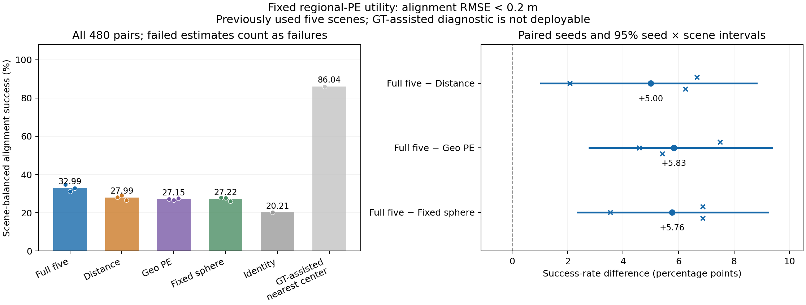

# 固定区域PE的几何对齐用途：旧数据开发信号成立

2026-11-09。全部14组、每组480帧对的刚体求解、独立CPU评分及实际图表审阅已完成。零训练、零新网络推理、零新数据下载。

**五维关系的区域排序收益在本次固定接法中转成了更高的几何对齐成功率。** 五维F为32.986%，Distance为27.986%，GeoTransformer位置算子为27.153%，同容量固定球形为27.222%。F对三者分别高5.000/5.833/5.764 pp，三个配对种子均改善，联合种子×场景区间均大于零。有限开发用途信号及支持性形状归因成立，可进入相同条件下未用场景确认的可行性评估。

这不是完整一般性目标达成：数据是反复使用过的旧五场景；约三分之二帧对仍未达到误差标准，尾部错误很大，也没有验证完整配准系统或原生3DGS/RGB的普遍收益。

## 固定问题与接法

已有区域确认支持对应排序与中心定位，但最高置信少量匹配缺少可靠优势；重叠区域的中心也不一定是精确对应点。本轮问：固定模型和所有预测，给不同PE相同的几何求解器，五维是否仍有实际对齐收益？竞争解释是区域级召回不足以形成一致中心对应，或普通距离/点配置编码已足够。

F、Distance、GeoTransformer PE和固定球形各使用既有种子11/22/33的原验证已选模型，共12份预测。只用R68旧五场景base的480帧对，每场景96对；每视图64个区域，保留全部查询与所有帧对，不用真值、有效查询标签或置信度筛选匹配。完整五维、模型权重、共同内容与原训练不变；求解器是共享的评价接法，无新增学习模块。

每个源区域取logit最高的一个目标，共64对。统一枚举C(64,3)=41,664个三点刚体假设，排除重复目标与数值退化三角形，proper rotation不允许反射或缩放。以0.1原pair归一化单位为一致性半径，先最大化内点数，再最小化截断平方残差，按既定顺序打破精确并列；最多5次共同的内点最小二乘重估。没有随机RANSAC样本差异，没有ICP或精匹配搜索。

模型与求解器均使用两视图各自的局部坐标，没有预先对齐。真实位姿对应的世界中心只进入独立评分器及明确不可部署的真值辅助诊断。局部—世界映射复现最大误差6.42e−7；评分使用所有64个源区域中心在估计与真实变换下的RMSE，乘原pair scale恢复米制。**RMSE<0.2米**记成功，场景等权，再三种子等权。旋转与中心化输入坐标系的平移误差另列，后者不是原始相机原点的平移误差。

0.2米标准参考[GeoTransformer固定提交的公开配置](https://github.com/qinzheng93/GeoTransformer/blob/e7a135af4c318ff3b8d7f6c963df094d7e4ea540/experiments/geotransformer.3dmatch.stage4.gse.k3.max.oacl.stage2.sinkhorn/config.py)，但本轮仅评估64区域中心接法，不等同于完整3DMatch协议，也不比较原论文配准成绩。0.1归一化一致性半径与0.2米评分阈值单位不同，未混用或扫描。

[事前完整方案](../../../docs/region_pose_utility_plan.md) · [输入/源码锁](lock.json) · [统计锁与普通修复记录](analysis_lock.json)

## 结果及不确定性

| 方法 | 种子11 / 22 / 33成功率% | 平均成功率% |
| --- | --- | ---: |
| 完整五维F | 34.792 / 31.250 / 32.917 | **32.986** |
| Distance | 28.125 / 29.167 / 26.667 | 27.986 |
| GeoTransformer PE | 27.292 / 26.667 / 27.500 | 27.153 |
| 同容量固定球形 | 27.917 / 27.708 / 26.042 | 27.222 |
| 恒等变换，诊断参照 | 单一参照，97/480对成功 | 20.208 |
| 真值辅助中心最近邻，不可部署 | 单一参照，413/480对成功 | 86.042 |

五维三种子成功数为167/150/158，对Distance的135/140/128分别多32/10/30帧对。全部14组都给出了有限的刚体变换，没有退化无解的帧对；大量变换仍未达到0.2米成功标准，不能把“能给出变换”当作对齐正确。

| F减对照 | 平均pp | 种子11 / 22 / 33，pp | 联合95%区间，pp |
| --- | ---: | --- | --- |
| Distance | **+5.000** | +6.667 / +2.083 / +6.250 | **[1.042,8.819]** |
| GeoTransformer PE | **+5.833** | +7.500 / +4.583 / +5.417 | **[2.778,9.375]** |
| 固定球形 | **+5.764** | +6.875 / +3.542 / +6.875 | **[2.359,9.236]** |

三项比较均满足预定幅度、配对方向和区间要求。区间为10,000次配对种子×整场景重采样；同一场景的96帧对没有被当作96个独立场景。仅五场景、三训练种子，仍限制总体不确定性解释，不能代替未用场景确认。

各场景三种子均值的F减对照如下，单位pp。它们完整保留局部反例，不另加“所有单元都要正”的门槛。

| 场景 | F−Distance | F−Geo PE | F−固定球形 |
| --- | ---: | ---: | ---: |
| harvard_c11/hv_c11_2 | +7.986 | +9.375 | +6.597 |
| hotel_umd/maryland_hotel3 | +3.472 | +4.514 | +0.347 |
| mit_76_studyroom/76-1studyroom2 | **−0.347** | +6.250 | +4.514 |
| mit_dorm_next_sj/dorm_next_sj_oct_30_2012_scan1_erika | +8.681 | +7.986 | +8.681 |
| mit_lab_hj/lab_hj_tea_nov_2_2012_scan1_erika | +5.208 | +1.042 | +8.681 |

五维三个种子的全帧对RMSE中位数为0.374/0.366/0.371米，三个对照的配对中位数均更高。尾部改善并不全面：五维seed11的90%分位RMSE为2.166米，略高于Distance的2.140米；seed33的2.171米高于固定球形的2.119米。五维旋转误差90%分位约142°–150°，保留明显大错。完整逐种子、场景及误差记录见[result.json](result.json)，逐帧变换和评分在`estimates/`。

## 这给主线增加了什么证据

同一个固定几何求解器、同样的完整输入内容下，F不仅区域召回更高，也产生了更多满足物理误差标准的对齐结果。相对固定球形的额外收益说明，更丰富的径向距离输入没有重现本次完整区域关系用途；没有据此证明某一个协方差分量唯一必要。

该结果与此前“最高置信少量输出未领先”并不冲突：本轮使用全部top1对应，由共同的几何一致性求解器处理，而不是只保留最大softmax最高的一小部分。它验证了这个具体使用方式，未证明置信度已校准、拒识能力已提高或几何一致性是唯一机制。

恒等参照只有20.208%，五维32.986%，收益不是所有帧对天然无需估计即可达标。真值辅助参照为86.042%，说明区域中心与共同求解器有能力达到明显更高的对齐率，但该参照使用真实变换，不能部署，也不是理论最优上界。当前绝对成功率和尾部错误仍不足以称为可靠的完整配准系统。

本轮填补的是“区域对应排序能否产生一个实际几何输出”的开发证据，不是原生拟合高斯的泛化缺口。原生来源混合检验仍关闭，RGB、重构鲁棒性和直接来源迁移的历史负结果不被覆盖；所有本轮场景此前已用，新的指标不赋予它们fresh身份。

## 实现核对与普通失败修复

三个CPU检查覆盖刚体恢复、反射排除、退化与离群匹配、真值组合及米制评分。生成64点上的CPU/GPU求解对40内点判定一致，旋转/平移最大差8.88e−16/2.22e−16。2卡启动时空闲，采用FP64与2GiB分配上限；累计求解约904秒，峰值PyTorch分配约20.8MiB，数字不含CUDA上下文，且不是完整匹配网络吞吐测量。

独立CPU路径以SciPy恢复各视图变换，再用齐次矩阵逆组合真值，逐一复算全部6,720个结果。最大RMSE差6.00e−15米、旋转差4.39e−11度，成功判定变化0、共识内点数差异0；配对不确定性另以分别重采样两方法绝对成功率再相减复算，最大差1.60e−14 pp。图已实际查看，绝对参照、种子点及联合区间清晰，无截断或遗漏。

首次汇总已通过数值断言并生成结果，但核对文件的NumPy整数计数无法JSON序列化。保留原源码、统计锁、原结果和失败记录后，仅把计数增量转为Python int；原估计器、输入、阈值、比较和重采样完全不变。恢复后结果逐项相同，仅完成时间与执行身份元数据改变，没有重新求解GPU任务。[原错误](analysis_serialization_repair1/failure.json) · [恢复一致性记录](analysis_serialization_repair1/recovery.json)

| 证据 | 入口 |
| --- | --- |
| 原则与科学规则 | [固定计划](../../../docs/region_pose_utility_plan.md)、[预先登记](../preparation/plan.json) |
| 旧输入、12份预测及源码身份 | [lock.json](lock.json) |
| 生成几何的执行检查 | [CPU检查](../preparation/cpu_checks.txt)、[GPU检查](cuda_preflight.json) |
| 全部输出和资源记录 | [status.json](status.json)、[estimates/](estimates/) |
| 数值与独立复算 | [result.json](result.json)、[independent_checks.json](independent_checks.json) |
| 实际科学与图像审阅 | [review.json](review.json)、[图像审阅](figures/visual_review.json) |

研究锁`4e97517488e25beb62551a613137dbd5ffb728d7bb58878846b7ac9702c9e28c`；结果`e05429bd7e2934e5f782896cbe16dd57c8b50fdb04306ebd61b386f865683b92`。

## 决定

固定接法的有限开发信号成立，保持五维、现有权重、共同求解器与全部比较不变。下一步先核对相同条件的真正未用场景是否可获得，再在读取新像素或几何之前固定确认对象与规则；不把此前两个九场景批次重新称未用确认。确认中还须报告绝对错误与形状归因，不能只追踪平均提升。总体研究目标保持active，尚未完成。
