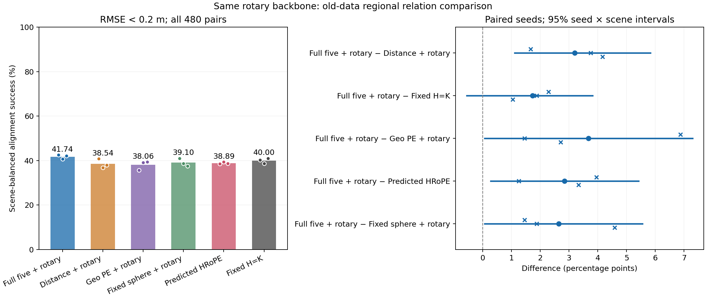
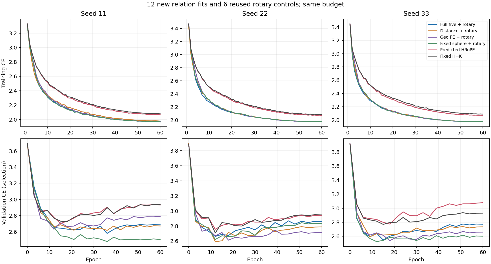

# 相同二维旋转骨干：五维关系有开发收益，超过简单骨干仍不确定

2026-11-10。十二次新增训练、统一选模、预测导出、几何评分、独立复算及两张图的实际审阅均完成。只使用最初576 fit / 64 val / 480旧开发帧对，没有访问刚完成十地点确认的缓存。本轮是固定五维的适用范围检验，总体研究目标尚未完成。

**五维关系在共同旋转骨干中达到41.736%的对齐成功率，超过同骨干Distance、Geo PE、完整HRoPE和固定球形；这些比较三个种子均为正。相对不含关系分支的固定H=K，平均提高1.736 pp，但种子×场景区间为[−0.556,3.819] pp，额外用途仍不确定。** 这是一项混合开发结果，不能压成“全部失败”，也不能只选正比较宣布普遍有效。

## 问题与固定设计

假设是：共同二维位置与跨帧旋转已经提供强线索时，原五维高斯区域关系仍能增加对齐用途。竞争解释是：此前关系收益与二维线索重叠，或关系分支只是改变训练偏好，不能可靠超过更简单的固定旋转骨干。主比较事先固定为F−同骨干Distance及F−固定H；Geo PE、完整HRoPE与固定球形为预定补充比较。

F、Distance、Geo PE和固定球形各训练种子11/22/33，共12次，沿用各自原关系公式、参数量和self层作用。共同骨干采用既有固定H=K：每头24维几何块与24维二维旋转、原频率和xy×8、两层self及两层cross、Q/K/V与输出变换。固定旋转不增加学习参数，不引入预测H头、门控或新损失。

self层分数为`(Tq(q)·Tk(k) + q·r_ij)/sqrt(48)`，关系项使用旋转前的q，保持原关系定义。cross层使用共同固定旋转，不在未经对齐的坐标间计算三维距离。旧数据每对两端K相同，固定几何块代数抵消；二维Q/K/V/输出传输仍保留，不能将它简称为通常的Q/K-only RoPE。完整HRoPE及固定H的六模型与两个诊断参照直接复用，没有重复计作新拟合。

所有新模型完成60周期/1,080更新，保持原batch32、验证batch16、优化器和学习率，仅按验证CE选模。公共初始化、各自关系初值与全部60条增强流匹配原角色；所有12模型选定后才导出评价预测。F/Distance/Geo/球形的PE参数为9,792/9,408/37,248/9,792，完整HRoPE为1,261，固定H为0；共同内容均包含完整高斯、图像位置与内参。

统一使用全部64个top1对应、41,664个三点假设、0.1一致性半径、最多五次非恶化重估；求解时不用真值筛选对应。成功标准为所有源区域中心的对齐RMSE<0.2米，先场景等权再种子等权。新增12×480组求解，复用8×480组，共20组评分，480个帧对不是20份独立数据。每项采用事前固定的10,000次种子×整场景配对bootstrap。

## 完整结果

| 方法 | 成功率 % | 三种子成功率 % |
| --- | ---: | --- |
| 五维＋共同旋转 | 41.736 | 42.500 / 40.625 / 42.083 |
| Distance＋共同旋转 | 38.542 | 40.833 / 36.875 / 37.917 |
| Geo PE＋共同旋转 | 38.056 | 35.625 / 39.167 / 39.375 |
| 固定球形＋共同旋转 | 39.097 | 41.042 / 38.750 / 37.500 |
| 完整预测HRoPE | 38.889 | 38.542 / 39.375 / 38.750 |
| 固定H=K | 40.000 | 40.208 / 38.750 / 41.042 |

| 五维比较对象 | 平均差 pp | 三种子差 pp | 种子×场景95%区间 pp |
| --- | ---: | --- | --- |
| 同骨干Distance（主） | +3.194 | +1.667 / +3.750 / +4.167 | [1.111,5.833] |
| 固定H（主） | +1.736 | +2.292 / +1.875 / +1.042 | [−0.556,3.819] |
| 同骨干Geo PE | +3.681 | +6.875 / +1.458 / +2.708 | [0.069,7.292] |
| 完整HRoPE | +2.847 | +3.958 / +1.250 / +3.333 | [0.278,5.417] |
| 同骨干固定球形 | +2.639 | +1.458 / +1.875 / +4.583 | [0.069,5.556] |

F−Distance和F−Geo在五个场景的种子均值均为正；对完整HRoPE为四正一精确持平，浮点运算产生的约4e−15 pp不算第五个正场景。F−固定H为四正一负（宿舍场景−0.694 pp），F−球形同样四正一负（−1.042 pp）。Geo和球形区间下界都接近零，须保留有限场景与种子下的不确定性。上述配对区间是开发证据，不是对反复使用数据的选择过程作了校正，也不提供未用场景保证。

这次不满足“两个主比较均正”的完整晋升条件，原因是对固定H的额外收益区间仍跨零。该项三个种子都提高、均值也超过预定1 pp幅度，不能将它写成零收益、等效或已经证伪；缺口来自有限样本对场景变化的辨别力，不是微小数值误差。

## 辅助指标与实际限制

五维/Distance/Geo/固定球形/完整HRoPE/固定H的区域R@1均值为57.023%/54.926%/55.323%/55.570%/52.877%/51.933%。五维中心PCK为21.887%，soft EPE为0.2591米，全查询正确为19.392%。对Distance，四项辅助指标在三个种子均改善；对Geo和固定球形存在个别种子的反向表现。辅助匹配指标与实际位姿成功率不能相互替代，完整逐种子结果见[tables.md](tables.md)。

五维的RMSE中位数为0.2473/0.2595/0.2439米，三个种子均低于其余五组。RMSE p90为1.7009/1.7050/1.4553米，未在三个种子中一致改善：前两个种子均高于Geo、球形、完整HRoPE及固定H，对Distance种子11较差、种子22近乎持平；种子33才在全部这些参照上更低。成功率与中位数的提高不代表大错误已经受控。

五维仍有58.264%的帧对未达成功标准，不能称为可靠的完整配准系统。恒等参照为20.208%，不可部署的真值辅助最近中心为86.042%，后者不是理论上界。所有学习模型估计都数值有效，这与任务成功是不同概念。

本轮等待期间只对旧fit输入做了区域标签与中心几何核对：有效区域查询中，仅49.987%存在距离≤0.1 pair单位的候选中心，最大重叠候选的中心PCK为41.722%。它说明区域对应与中心对应不同，不证明标签错误、任何PE差异的病因或位姿成功率上界；本轮没有据此改变监督、求解器或成功标准。[完整诊断](label_geometry_diagnostic1/report.md)

## 对HRoPE比较及研究方向的解释

HRoPE应保留为强对照。预测版本无需真实相对位姿，使用共同区域内容预测结构化变换、保留self/cross作用，可以公平检验当前PE接法；这是区域任务适配，不是论文RGB系统的完整复现。此前相同相机信息下，它在旧数据和十个新地点都超过原接法F，不能用本轮旧数据结果改写那份已完成确认。

固定H控制与本轮进一步说明，需要把两件事分开：相同旋转骨干中的关系编码优劣，以及相对不含关系分支的骨干究竟增加多少。五维对同骨干Distance的+3.194 pp支持第一件事；对固定H的+1.736 pp尚未充分回答第二件事。超过完整HRoPE并不自动解决更简单控制上的缺口。F对同容量固定球形的正差提供变化形状参与关系项的条件性证据，但共同内容仍含全部形状，不能解释成形状的总价值或唯一机制。

**决定：结束本轮固定接法的开发检验，保留这些正面比较和未解决的固定H缺口，不自动启动新地点确认。** 不通过补种子、扫描频率或权重、替换主比较来使本轮“过关”。完整五维、完整HRoPE和固定H都保留；本轮不新增预测头或堆叠模块。下一份研究说明应明确“同骨干关系选择有收益”与“添加高斯关系普遍值得”之间的证据差别；后者仍需具有独立辨别力的依据，不能由本轮均值补写成事实。原生、RGB、区域重构及R50/R53/R56等历史负结果不变。

## 执行与实际检查

三个CPU公式/恢复检查与四组GPU前后向预检已通过。十二次训练均正常结束，训练CE稳定下降；验证CE较早达到最小值后大多回升，仍使用原验证选模，不按评价结果改变预算。实际查看完整学习曲线后未发现训练失效。五维选中周期36/12/15，其余选择见完整表。

12份验证预测回放最大logit差0、argmax变化0，独立匹配指标最大差4.44e−16。20组几何结果的独立SciPy与齐次矩阵复算最大RMSE差7.33e−15米、旋转差2.26e−11度，成功判定与一致性计数差均为0。配对bootstrap的独立绝对精度重采样复算最大差1.78e−14 pp；这些误差不影响科学结论。

结果图与训练曲线均已实际查看，数值、种子点和区间方向与数据表一致，标签可读。队列全部阶段退出0；显卡查询超时只推迟新启动，没有终止正在推进的任务。优先空闲卡，否则最多一个与外部任务共享的工作进程；共享环境耗时不用于速度优势结论。训练、选模和数据身份均保持固定。

方案SHA256：`07d9b7a1240021b5e5eeeb9f4a58a8237723beb4465efdaabe15967c8cc8e285`。原始结果SHA256：`f21e2ddc3e4f9605b3009a3278b85978ba46ba8457ec84b96fa87d0154e8bb46`。原始生成文件保留当时的审阅待办标记，最终状态见[review.json](review.json)与[status.json](status.json)。

