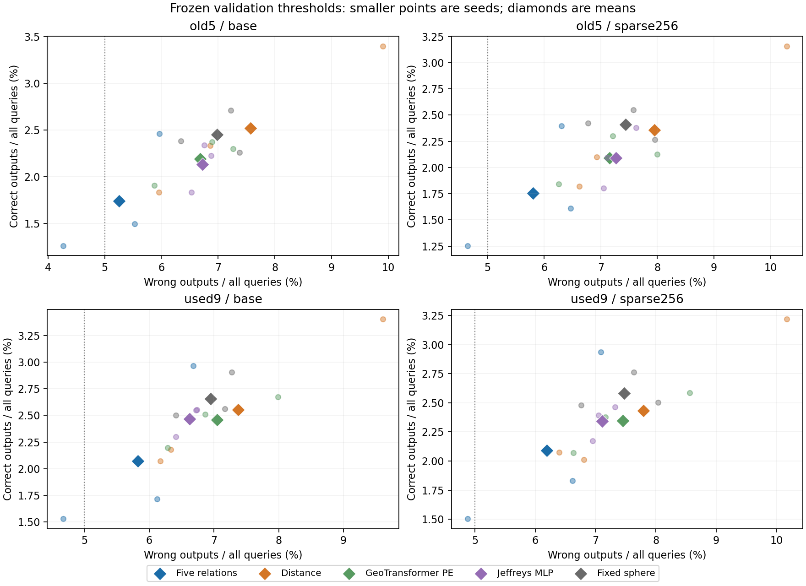
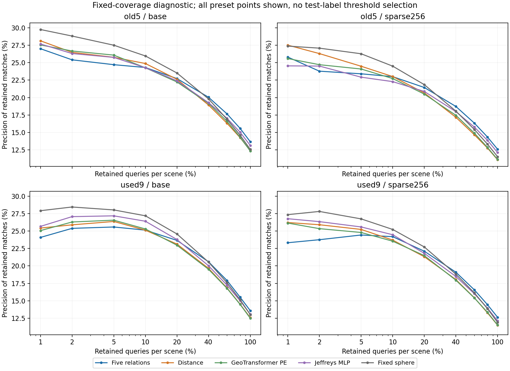

# 全查询区域匹配：收益没有自动转成更可靠的输出

2026-11-08。固定方案、阈值确定、60 组评价、独立复算和两张图的实际审阅均已完成。完整五维及全部控制保持原公式、权重和共同内容；复用 75 份预测，没有新训练、GPU 推理或下载。

**结论：现有五维的区域对应排序优势得到保留，但“原模型＋最大 softmax 置信度”没有建立更强的可靠输出能力。** 固定旧验证阈值后，它比 Distance 少输出错误，也少输出正确匹配；在固定保留比例下，最有信心的少量匹配没有领先，保留较多候选时的平均收益仍在。本轮不启动拒识模块、置信度公式搜索或新的数据确认，也不因此抹去原区域用途证据。

## 检验的问题与范围

假设：五维改善区域关系后，在包含无有效对应查询的集合中仍能保留更多正确匹配，而不依赖输出更多错误。竞争解释：它主要改善存在对应查询上的排序，缺少对不可靠输出的识别能力。

固定比较 F（relative5）、Distance、GeoTransformer 位置算子、可学习 Jeffreys 散度和固定球形，种子 11/22/33。所有模型原来就对全部查询产生预测；旧 R@1 在评分时只取有有效对应的查询，并非推理时读取真值过滤输入。

阈值只用旧 val 的 64 对、8,192 个双向查询。每个模型以相同规则选取最大接受集合，使错误接受数 / 全部查询数不超过 5%；1%/10% 为固定补充读数。阈值在评价开始前写入，原样用于 base/sparse256，没有评价标签调参。**5% 是全部查询中的错误输出预算，不是 95% precision。** 置信度固定为每个方向的最大 softmax 概率，不改变温度或添加互选规则。

旧五场景有 480 对、61,440 查询，其中 20,422 有有效对应；已用九场景有 864 对、110,592 查询，其中 35,859 有有效对应。“无对应”仅指当前 64 个候选中没有 overlap≥0.3 的有效区域，不等同于空间完全无重叠。缺标定场景 home_han 保持缺失。两批数据此前均已使用，本次全部是开发诊断；固定稀疏条件不涉及重新发现查询区域，也不是完整配准任务。

## 旧验证阈值下：减少错误，也减少了正确输出

下表为已用九场景主诊断，场景等权、再对三个种子平均。正确输出、错误输出和保留率均以全部查询为分母；precision 单列为逐场景接受匹配的准确率均值，因此不等于表中两项均值的简单比值。

| 条件 | 方法 | 正确输出 % | 错误输出 % | 保留率 % | precision % |
| --- | --- | ---: | ---: | ---: | ---: |
| base | 五维 F | 2.071 | 5.827 | 7.898 | 24.888 |
| base | Distance | 2.551 | 7.374 | 9.925 | 25.010 |
| base | GeoTransformer PE | 2.460 | 7.047 | 9.507 | 25.386 |
| base | Jeffreys MLP | 2.469 | 6.623 | 9.092 | 26.536 |
| base | 固定球形 | 2.656 | 6.951 | 9.606 | 27.168 |
| sparse256 | 五维 F | 2.091 | 6.192 | 8.282 | 24.314 |
| sparse256 | Distance | 2.434 | 7.791 | 10.226 | 23.377 |
| sparse256 | GeoTransformer PE | 2.344 | 7.452 | 9.797 | 23.675 |
| sparse256 | Jeffreys MLP | 2.342 | 7.107 | 9.449 | 24.417 |
| sparse256 | 固定球形 | 2.582 | 7.476 | 10.058 | 25.404 |

base 下，F−Distance 的正确输出差为 **−0.480 pp**，三个种子均负，交叉种子×场景 95% 区间 **[−0.677,−0.260] pp**；错误输出差为 **−1.547 pp**，区间 **[−2.882,−0.263] pp**。sparse256 对应为正确 −0.343 pp、区间 [−0.557,−0.090]，错误 −1.600 pp、区间 [−3.090,+0.064]。这是一种输出数量与错误的交换，不能只取错误下降一列宣称五维更好；也不能在评价错误率不同的情况下把正确输出下降解释成等风险下更差。

所有方法的平均评价错误输出率均高于原 5% 验证预算，说明阈值的风险水平没有直接迁移。五维的漂移较小，但可接受匹配的 precision 也未形成稳定优势。无有效对应查询的误接受率在九场景 base 中，F / Distance 为 6.951% / 8.361%；有对应却选错的错误同样计入主读数。

预定 1%/10% 敏感性读数没有改变 F 与 Distance 的均值方向：九场景 base 的正确输出差依次 −0.261/−0.438 pp，错误输出差 −0.614/−2.011 pp；sparse256 的正确差 −0.242/−0.278 pp，错误差 −0.590/−1.741 pp。旧五场景的主操作点也呈现同类交换（base 正确 −0.782 pp、错误 −2.320 pp）。没有在预算中选择有利点晋升。

图中小点为种子，大菱形为均值；左移是错误减少，上移是正确增加。五维均值主要位于左下侧，显示交换关系。灰线是验证集的 5% 预算参考，不是评价数据被强制匹配的错误水平。四面板轴范围不同，区间见表格和原始对比。

## 固定保留比例：高置信少量输出没有领先

此补充不再依赖验证阈值迁移：每个场景按置信度保留事前指定比例，标签仅用于评分。边界同分按随机打破同分的期望计算，不利用真值挑选。完整九个预定比例全部报告。

| 已用九场景 base 的保留比例 | F precision % | Distance % | GeoTransformer PE % | Jeffreys MLP % | 固定球形 % |
| --- | ---: | ---: | ---: | ---: | ---: |
| 1% | 24.084 | 25.428 | 25.063 | 25.666 | 27.915 |
| 2% | 25.383 | 25.889 | 26.295 | 27.064 | 28.448 |
| 5% | 25.580 | 26.371 | 26.556 | 27.180 | 28.026 |
| 10% | 25.130 | 25.120 | 25.298 | 26.405 | 27.186 |
| 20% | 23.658 | 23.129 | 22.966 | 23.780 | 24.582 |
| 40% | 20.594 | 19.652 | 19.517 | 20.023 | 20.546 |
| 60% | 17.916 | 16.845 | 16.789 | 17.243 | 17.589 |
| 80% | 15.514 | 14.514 | 14.484 | 15.009 | 15.158 |
| 100% | 13.588 | 12.583 | 12.499 | 13.060 | 13.011 |

在 1%–5% 的最高置信输出中，F 的均值低于四个控制；10% 时与 Distance 基本持平，仍低于固定球形和 Jeffreys。九场景 sparse256 的 1%–5% 同样没有领先，10% 则相对 Distance / GeoTransformer 有小幅正差，对另外两项控制仍负。40% 及以上预定点的均值保留了 F 的候选排序收益；这不能事后变成“40% 是验证过的通用适用阈值”，更不代表这些低 precision 输出可以直接部署。曲线是描述性分析，不替代预定主操作点。

100% 保留时，九场景 F−Distance 的正确输出率平均差为 base +1.005 pp、sparse256 +1.140 pp；它与旧有有效查询 R@1 改善一致，使用了不同分母。这不是新的独立效果证据。原所有 R@1 已精确复现。

横轴为对数尺度，覆盖全部预定保留比例；纵轴共享。五维的优势主要出现在较高保留比例的均值，最高置信少量匹配没有相应优势。曲线未绘制区间，不据均值交叉点提出新的成功规则。

## 训练目标解释与结论边界

代码显示，[原训练损失](../../../experiments/round58_data.py:112)在两个方向仅对有有效对应查询累加 CE，没有直接的无对应拒识监督；[原匹配头](../../../models/round68_fixed_region.py:27)输出候选间相似度，没有单独的“无对应”类别。softmax 对整行加常数不变，因此最大 softmax 值不是“这里存在有效对应”的概率。训练目标与本次拒识评价之间确有差距。

这是解释性证据，不能证明弱拒识完全由训练目标造成，也不能推断改损失一定会使五维胜出。全部方法受到相同限制；本轮检验的是原已训练模型配合一种固定置信度规则，不是对所有匹配置信度或完整管线的否定。

**现阶段的用途应描述为区域对应候选的排序改善。可靠输出与无对应识别仍是未补上的能力。** 变化形状关系在已用和原未用场景上的额外区域收益、中心定位改善继续保留；原生基础分类对强对照不确定，RGB/投影混合结果、跨域失败也保持原结论。本轮没有支持晋升新的可靠匹配用途，按固定决定不自动启动新确认、不搜索温度/margin/互选或增加拒识头。

这一发现值得保留为后续问题：如果未来明确要完成可拒识的匹配任务，应以共同任务目标和对照重建方案，而不是把最高 softmax 直接当成已校准的存在性概率。但这属于新的明确实验问题，本轮没有实施，不用它回避当前负结果。

## 实施和实际审阅

冻结身份 `11ac3f61dde30cf07f415a27ef8b1f71395168745a6a17e1626cca6f950a1137`；7 项新增评价测试通过，131 项已有文件身份绑定，15 个旧模型的 checkpoint/验证预测身份核对通过。验证与评价 pair ID 分离，45 个阈值读数在评价开始前写入。60 份评价预测覆盖全部查询，零拟合、零新推理；CPU 处理有限数组足够，无 GPU 训练需求。

独立 SciPy softmax、逐文件标量查询核对、独立事件计数和阈值选择覆盖全部 75 份预测、16 个主对比；原 R@1 最大差为零，阈值最大差为零，主配对差最大差为零。完整分数权重曲线计数最大差约 2.18e−11，不影响结论。独立复算脚本修正过布尔 dot 计数和方向堆叠造成的浮点归约差，版本记录保留，主评价及原始结果未改动。没有重跑或重选 bootstrap 区间。

已实际查看两张图，数字、颜色、均值与种子点对应正确；图的轴范围、对数尺度和未显示区间的限制已说明。审阅是同一研究代理使用不同计算路径的核对，不是外部复现。原结果生成时的 pending 标记保留，最终状态见 [review.json](review.json)。

[固定方案](../../../docs/region_selective_matching_plan.md) · [全部结果](result.json) · [阈值](calibration.json) · [完整自动表格](actual_review1/automatic_report.md) · [独立复算](actual_review1/checks.json) · [核心方法与证据](../../../docs/research_core.md)
