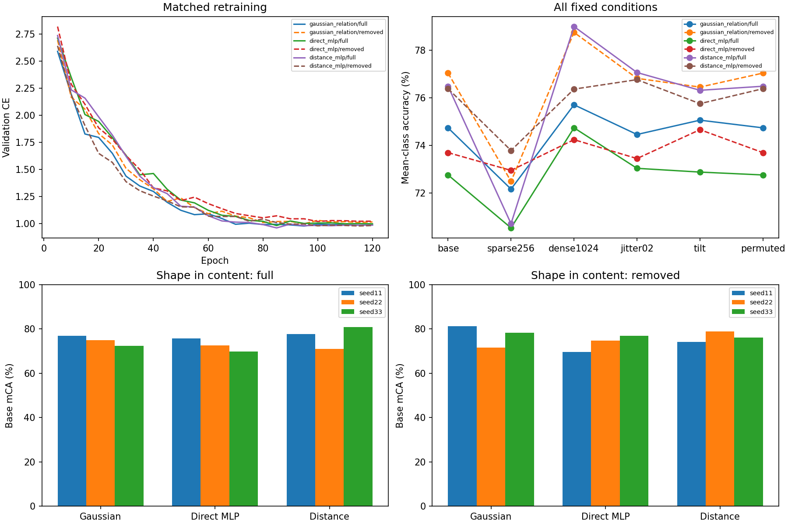

# Native-GS content-routing ablation

Covariance is removed only from common token content during retraining and evaluation. The three explicit PEs are unchanged. Nine new fits are paired with nine completed pilot3 fits. Same25-class development objects, seeds11/22/33,120epochs and six conditions. This diagnoses information routing; it is not fresh confirmation or a proposed superior PE.

| PE | Content | Base mCA seeds11/22/33 (%) | Mean (%) |
|---|---|---:|---:|
| gaussian_relation | full | 76.87 / 74.89 / 72.44 | 74.73 |
| gaussian_relation | removed | 81.32 / 71.51 / 78.29 | 77.04 |
| direct_mlp | full | 75.81 / 72.64 / 69.81 | 72.75 |
| direct_mlp | removed | 69.56 / 74.70 / 76.82 | 73.69 |
| distance_mlp | full | 77.63 / 70.96 / 80.87 | 76.48 |
| distance_mlp | removed | 74.20 / 78.83 / 76.11 | 76.38 |

| Contrast | Role/control | Paired gains (pp) | Mean (pp) | Paired-class95% interval |
|---|---|---:|---:|---:|
| content_full_minus_removed | gaussian_relation | -4.45 / +3.39 / -5.85 | -2.30 | [-5.55, +1.14] |
| content_full_minus_removed | direct_mlp | +6.25 / -2.06 / -7.01 | -0.94 | [-4.25, +2.21] |
| content_full_minus_removed | distance_mlp | +3.43 / -7.87 / +4.76 | +0.10 | [-3.10, +3.32] |
| gaussian_minus_control_full | direct_mlp | +1.06 / +2.25 / +2.63 | +1.98 | [-1.23, +5.10] |
| gaussian_minus_control_removed | direct_mlp | +11.77 / -3.19 / +1.47 | +3.35 | [+0.96, +5.73] |
| gaussian_gap_removed_minus_full | direct_mlp | +10.70 / -5.45 / -1.16 | +1.36 | [-2.39, +4.95] |
| gaussian_minus_control_full | distance_mlp | -0.76 / +3.94 / -8.43 | -1.75 | [-4.58, +1.18] |
| gaussian_minus_control_removed | distance_mlp | +7.12 / -7.33 / +2.18 | +0.66 | [-2.44, +3.72] |
| gaussian_gap_removed_minus_full | distance_mlp | +7.87 / -11.26 / +10.61 | +2.41 | [-1.52, +6.35] |

| PE/content | base | sparse256 | dense1024 | jitter02 | tilt | permuted |
|---|---:|---:|---:|---:|---:|---:|
| gaussian_relation/full | 74.73 | 72.16 | 75.71 | 74.46 | 75.06 | 74.73 |
| gaussian_relation/removed | 77.04 | 72.49 | 78.75 | 76.82 | 76.45 | 77.04 |
| direct_mlp/full | 72.75 | 70.53 | 74.74 | 73.03 | 72.87 | 72.75 |
| direct_mlp/removed | 73.69 | 72.94 | 74.24 | 73.44 | 74.66 | 73.69 |
| distance_mlp/full | 76.48 | 70.70 | 79.00 | 77.06 | 76.31 | 76.48 |
| distance_mlp/removed | 76.38 | 73.78 | 76.36 | 76.76 | 75.75 | 76.38 |

The shape-free distance model deliberately has less geometric information; beating it alone does not establish special Gaussian structure. DirectMLP retains the same shape information in PE. Class bootstrap intervals describe this used development cohort. No new evaluation result changes the prior pilot3 conclusion or historical RGB/transfer failures.

