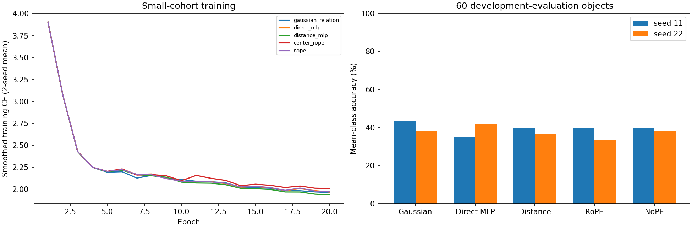

# R65 small-cohort pilot

No consistent lead over all controls in both seeds; this pilot does not establish a Gaussian-structure advantage.

Data: 5 availability-selected MACGS classes (bag, bottle, train, telephone, pistol); 240 fit / 60 validation / 60 development evaluation. Original partitions retained. All five unchanged models, seeds11/22, 20epochs, 512tokens. The 60-output classifier is unchanged. All inputs include center, covariance, opacity and DC appearance; these are full-attribute classification results.

| Method | Base mCA seed11 / seed22 (%) | Base CE mean | Sparse256 mCA mean (%) | Tilt mCA mean (%) |
|---|---:|---:|---:|---:|
| gaussian_relation | 43.33 / 38.33 | 1.5147 | 33.33 | 39.17 |
| direct_mlp | 35.00 / 41.67 | 1.5205 | 38.33 | 39.17 |
| distance_mlp | 40.00 / 36.67 | 1.4798 | 42.50 | 40.00 |
| center_rope | 40.00 / 33.33 | 1.5358 | 35.00 | 36.67 |
| nope | 40.00 / 38.33 | 1.5237 | 45.83 | 40.00 |

Gaussian minus control, base mCA percentage points (seed11 / seed22):

- direct_mlp: +8.33 / -3.33
- distance_mlp: +3.33 / +1.67
- center_rope: +3.33 / +5.00
- nope: +3.33 / +0.00

All ten fits completed the same budget and paired input streams; initialization and checkpoint selection were checked. Selected validation logits were replayed and classification metrics recomputed independently. These checks establish implementation consistency, not general efficacy.

Limits: two seeds, five classes, one reconstruction source, only 60 evaluation objects and a short training budget. No hypothesis test or universal pass is claimed. Nonidentical MACGS physical-instance grouping remains unknown. No fresh confirmation was accessed. This pilot does not erase RGB, transfer or other historical negative results, modify full R65 settings, or resume its controller.

Scientific and visual review completed. Gaussian mean base mCA is 40.83%, versus 38.33% for direct MLP, 38.33% for distance MLP, 36.67% for center RoPE and 39.17% for NoPE. The Gaussian/direct-MLP difference changes sign across seeds (+8.33/-3.33 percentage points). With 256 tokens, Gaussian mean mCA is 33.33%, below every control (NoPE45.83%); there is no support here for sampling-density robustness. Nine of ten validation selections are at epoch20, and training curves still improve near the end; convergence has not been established. The exploratory mean gain therefore supports neither a success claim nor a conclusion of infeasibility. Keep the full R65 design fixed and evaluate its planned complete cohort/budget when authorized.
