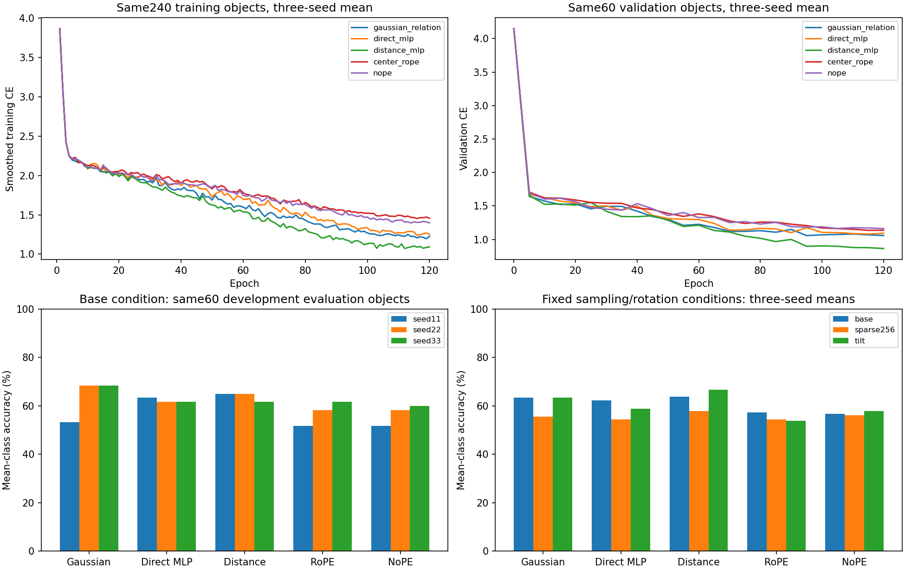

# R65 fixed-cohort training-budget verification

No consistent base-condition Gaussian lead over every control across allthree seeds.

The same five MACGS classes and exact240/60/60 input arrays from pilot1 were used. Allfive models were trained from scratch for120epochs, seeds11/22/33, with512tokens. The20epoch cosine schedule was replaced by the original120epoch schedule; this is a joint duration/schedule intervention. No architecture, attributes, data split, optimizer, augmentation or checkpoint-selection rule changed. These evaluation objects were already used in pilot1.

| Method | Base mCA seeds11 /22 /33 (%) | Base mean (%) | Base CE mean | Sparse256 mean (%) | Tilt mean (%) |
|---|---:|---:|---:|---:|---:|
| gaussian_relation | 53.33 / 68.33 / 68.33 | 63.33 | 1.1390 | 55.56 | 63.33 |
| direct_mlp | 63.33 / 61.67 / 61.67 | 62.22 | 1.1854 | 54.44 | 58.89 |
| distance_mlp | 65.00 / 65.00 / 61.67 | 63.89 | 1.1486 | 57.78 | 66.67 |
| center_rope | 51.67 / 58.33 / 61.67 | 57.22 | 1.2472 | 54.44 | 53.89 |
| nope | 51.67 / 58.33 / 60.00 | 56.67 | 1.2505 | 56.11 | 57.78 |

Paired20-to120epoch comparison uses only the same seeds11/22:

| Method | 20epoch base mean (%) | 120epoch base mean (%) | Change (pp) |
|---|---:|---:|---:|
| gaussian_relation | 40.83 | 60.83 | +20.00 |
| direct_mlp | 38.33 | 62.50 | +24.17 |
| distance_mlp | 38.33 | 65.00 | +26.67 |
| center_rope | 36.67 | 55.00 | +18.33 |
| nope | 39.17 | 55.00 | +15.83 |

Gaussian minus each control, base mCA (percentage points, seeds11/22/33):

- direct_mlp: -10.00 / +6.67 / +6.67
- distance_mlp: -11.67 / +3.33 / +6.67
- center_rope: +1.67 / +10.00 / +6.67
- nope: +1.67 / +10.00 / +8.33

Selected validation epochs:

- gaussian_relation: [65, 95, 120]
- direct_mlp: [70, 115, 115]
- distance_mlp: [120, 110, 95]
- center_rope: [120, 115, 120]
- nope: [100, 120, 115]

All15 fits completed equal budgets, with paired initialization and actual data streams. For shared seeds11/22, the initial weights and first20epoch sampling/augmentation streams match pilot1. Selected validation outputs were replayed, and metrics were independently recomputed. The main comparison is against direct MLP with identical native attributes; secondary conditions must not replace a negative primary result.

Scope: five classes, one source,60 previously used development-evaluation objects. No unused confirmation was accessed, and no population-level significance or general effectiveness is claimed. Historical RGB/transfer/robustness negatives remain. The original full R65 experiment is unchanged.

