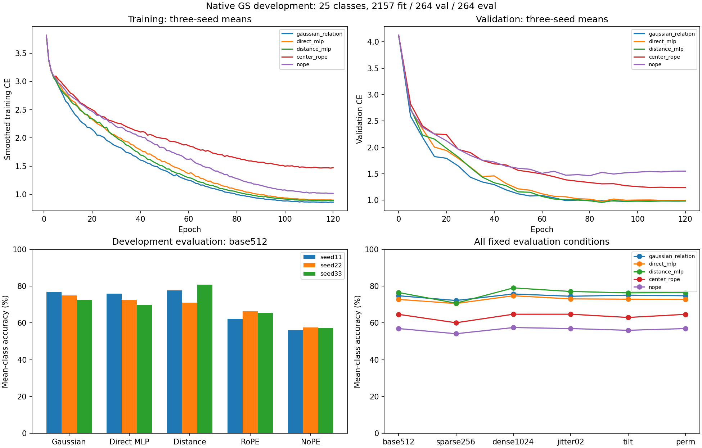

# R65 expanded-cohort development verification

The predeclared broader-development Gaussian lead criterion is not established against allfour controls.

All 25 complete categories from the availability snapshot were retained, with 2157 fit / 264 validation / 264 evaluation objects. Original partitions and all objects within each selected category were retained. Allfive unchanged models, seeds11/22/33,120epochs,512tokens, and the same13D attributes. This is a MACGS-only development experiment, not the full60class/two-source R65 study.

| Method | Base mCA seeds11/22/33 (%) | Base mCA mean (%) | OA mean (%) | CE mean |
|---|---:|---:|---:|---:|
| gaussian_relation | 76.87 / 74.89 / 72.44 | 74.73 | 77.90 | 0.8870 |
| direct_mlp | 75.81 / 72.64 / 69.81 | 72.75 | 75.13 | 0.9569 |
| distance_mlp | 77.63 / 70.96 / 80.87 | 76.48 | 79.29 | 0.8633 |
| center_rope | 62.20 / 66.37 / 65.33 | 64.63 | 67.42 | 1.2214 |
| nope | 55.86 / 57.57 / 57.30 | 56.91 | 59.34 | 1.5554 |

Gaussian minus control, primary mean-class accuracy:

| Control | Paired seed gains (pp) | Mean gain (pp) | Paired-class95% interval (pp) | Development lead |
|---|---:|---:|---:|---|
| direct_mlp | +1.06 / +2.25 / +2.63 | +1.98 | [-1.23, +5.10] | False |
| distance_mlp | -0.76 / +3.94 / -8.43 | -1.75 | [-4.58, +1.18] | False |
| center_rope | +14.67 / +8.53 / +7.11 | +10.10 | [+4.96, +15.48] | True |
| nope | +21.01 / +17.33 / +15.14 | +17.83 | [+11.63, +24.54] | True |

| Method | base | sparse256 | dense1024 | jitter02 | tilt | permuted |
|---|---:|---:|---:|---:|---:|---:|
| gaussian_relation | 74.73 | 72.16 | 75.71 | 74.46 | 75.06 | 74.73 |
| direct_mlp | 72.75 | 70.53 | 74.74 | 73.03 | 72.87 | 72.75 |
| distance_mlp | 76.48 | 70.70 | 79.00 | 77.06 | 76.31 | 76.48 |
| center_rope | 64.63 | 60.06 | 64.70 | 64.71 | 62.94 | 64.63 |
| nope | 56.91 | 54.10 | 57.45 | 56.91 | 55.97 | 56.91 |

All15 selections precede evaluation. Training budgets, actual input streams, common initialization, source/data identities and validation checkpoint selection were checked. Selected validation predictions were replayed, and classification metrics independently recomputed. Permutation discrepancy records are in result.json.

The interval resamples the selected classes after averaging paired seeds within class. It describes uncertainty within this development cohort, not independent confirmation. Class sizes vary; the smallest evaluation class has only two objects. The earlier five-class objects overlap prior development work, and nonidentical MACGS physical-instance grouping remains unknown. Raw accuracy cannot be treated as a paired improvement over the easier five-class task. Historical RGB/transfer/sampling failures remain.

