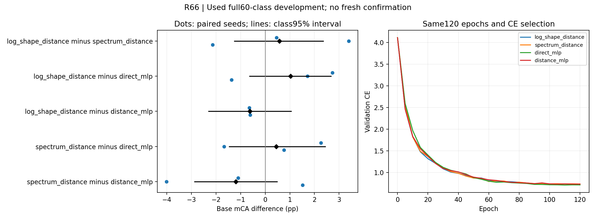

# R66: center distance plus one log-shape distance

Full60-class used development data. Six new120-epoch fits; five original CE-selected baselines reused. No officialTEST or fresh confirmation. Scientific interpretation and actual plot review completed; see review.json.

| Method | Base mCA seeds11/22/33 % | Mean % | CE |
| --- | --- | ---: | ---: |
| log_shape_distance | 77.188 / 78.920 / 77.290 | 77.799 | 0.72196 |
| spectrum_distance | 76.727 / 75.523 / 79.428 | 77.226 | 0.74854 |
| gaussian_relation | 77.875 / 76.013 / 77.387 | 77.092 | 0.70246 |
| direct_mlp | 74.463 / 77.200 / 78.664 | 76.776 | 0.75136 |
| distance_mlp | 77.831 / 79.542 / 77.907 | 78.426 | 0.73671 |
| center_rope | 72.032 / 68.985 / 72.471 | 71.163 | 0.86051 |
| nope | 69.903 / 70.562 / 69.021 | 69.829 | 1.03220 |

Primary development criterion met: **False**. This does not establish the global research goal.

| Condition | Candidate minus control | Seed differences pp | Mean pp | Paired-class95% pp | Criterion |
| --- | --- | --- | ---: | --- | --- |
| base | log_shape_distance - spectrum_distance | +0.461 / +3.397 / -2.138 | +0.573 | [-1.257, +2.358] | False |
| base | log_shape_distance - gaussian_relation | -0.687 / +2.907 / -0.097 | +0.707 | [-1.618, +3.283] | False |
| base | log_shape_distance - direct_mlp | +2.725 / +1.720 / -1.374 | +1.024 | [-0.641, +2.671] | False |
| base | log_shape_distance - distance_mlp | -0.643 / -0.621 / -0.617 | -0.627 | [-2.304, +1.046] | False |
| base | log_shape_distance - center_rope | +5.156 / +9.936 / +4.819 | +6.637 | [+4.505, +8.945] | True |
| base | log_shape_distance - nope | +7.285 / +8.358 / +8.269 | +7.971 | [+5.433, +10.601] | True |
| base | spectrum_distance - direct_mlp | +2.265 / -1.677 / +0.764 | +0.450 | [-1.462, +2.438] | False |
| base | spectrum_distance - distance_mlp | -1.104 / -4.019 / +1.522 | -1.200 | [-2.878, +0.483] | False |
| sparse256 | log_shape_distance - spectrum_distance | +3.451 / +4.728 / -1.299 | +2.293 | [+0.476, +4.146] | False |
| sparse256 | log_shape_distance - gaussian_relation | +1.976 / +3.975 / +0.285 | +2.079 | [-0.584, +4.753] | False |
| sparse256 | log_shape_distance - direct_mlp | +4.027 / +3.932 / -2.951 | +1.669 | [-0.455, +3.748] | False |
| sparse256 | log_shape_distance - distance_mlp | +1.920 / -0.199 / -1.238 | +0.161 | [-2.085, +2.354] | False |
| sparse256 | log_shape_distance - center_rope | +9.394 / +9.287 / +2.549 | +7.076 | [+4.623, +9.856] | True |
| sparse256 | log_shape_distance - nope | +10.813 / +10.625 / +8.083 | +9.840 | [+6.872, +12.962] | True |
| sparse256 | spectrum_distance - direct_mlp | +0.576 / -0.796 / -1.652 | -0.624 | [-2.853, +1.581] | False |
| sparse256 | spectrum_distance - distance_mlp | -1.531 / -4.927 / +0.061 | -2.132 | [-4.255, -0.044] | False |
| dense1024 | log_shape_distance - spectrum_distance | -1.317 / +4.131 / -1.221 | +0.531 | [-1.183, +2.485] | False |
| dense1024 | log_shape_distance - gaussian_relation | -1.187 / +0.280 / -0.369 | -0.425 | [-2.459, +1.791] | False |
| dense1024 | log_shape_distance - direct_mlp | -1.188 / +1.638 / -1.984 | -0.512 | [-2.144, +1.114] | False |
| dense1024 | log_shape_distance - distance_mlp | -1.885 / -0.392 / -2.113 | -1.463 | [-2.951, +0.044] | False |
| dense1024 | log_shape_distance - center_rope | +2.030 / +9.037 / +2.427 | +4.498 | [+2.324, +6.782] | True |
| dense1024 | log_shape_distance - nope | +6.734 / +7.493 / +6.202 | +6.810 | [+4.159, +9.545] | True |
| dense1024 | spectrum_distance - direct_mlp | +0.129 / -2.493 / -0.763 | -1.043 | [-2.556, +0.467] | False |
| dense1024 | spectrum_distance - distance_mlp | -0.569 / -4.523 / -0.892 | -1.994 | [-3.524, -0.530] | False |
| jitter02 | log_shape_distance - spectrum_distance | +0.391 / +3.179 / -3.027 | +0.181 | [-1.751, +1.973] | False |
| jitter02 | log_shape_distance - gaussian_relation | -1.094 / +3.271 / -0.262 | +0.639 | [-1.558, +2.974] | False |
| jitter02 | log_shape_distance - direct_mlp | +2.318 / +1.805 / -2.165 | +0.653 | [-1.052, +2.345] | False |
| jitter02 | log_shape_distance - distance_mlp | -0.860 / -0.366 / -1.484 | -0.903 | [-2.583, +0.783] | False |
| jitter02 | log_shape_distance - center_rope | +4.895 / +9.601 / +3.322 | +5.939 | [+4.037, +7.969] | True |
| jitter02 | log_shape_distance - nope | +7.341 / +8.211 / +7.849 | +7.800 | [+5.316, +10.365] | True |
| jitter02 | spectrum_distance - direct_mlp | +1.927 / -1.375 / +0.863 | +0.472 | [-1.323, +2.361] | False |
| jitter02 | spectrum_distance - distance_mlp | -1.251 / -3.545 / +1.543 | -1.084 | [-2.657, +0.518] | False |
| tilt | log_shape_distance - spectrum_distance | +0.136 / +4.086 / -2.759 | +0.488 | [-1.264, +2.222] | False |
| tilt | log_shape_distance - gaussian_relation | -0.955 / +3.234 / -0.699 | +0.526 | [-1.590, +2.803] | False |
| tilt | log_shape_distance - direct_mlp | +3.219 / +2.612 / -2.027 | +1.268 | [-0.228, +2.861] | False |
| tilt | log_shape_distance - distance_mlp | -1.612 / +0.550 / -1.777 | -0.947 | [-2.632, +0.663] | False |
| tilt | log_shape_distance - center_rope | +4.209 / +9.695 / +4.407 | +6.104 | [+3.876, +8.475] | True |
| tilt | log_shape_distance - nope | +8.491 / +9.786 / +7.324 | +8.534 | [+5.970, +11.183] | True |
| tilt | spectrum_distance - direct_mlp | +3.083 / -1.474 / +0.732 | +0.780 | [-1.005, +2.648] | False |
| tilt | spectrum_distance - distance_mlp | -1.749 / -3.536 / +0.981 | -1.434 | [-3.042, +0.119] | False |
| permuted | log_shape_distance - spectrum_distance | +0.461 / +3.397 / -2.138 | +0.573 | [-1.257, +2.358] | False |
| permuted | log_shape_distance - gaussian_relation | -0.687 / +2.907 / -0.097 | +0.707 | [-1.618, +3.283] | False |
| permuted | log_shape_distance - direct_mlp | +2.725 / +1.720 / -1.374 | +1.024 | [-0.641, +2.671] | False |
| permuted | log_shape_distance - distance_mlp | -0.643 / -0.621 / -0.617 | -0.627 | [-2.304, +1.046] | False |
| permuted | log_shape_distance - center_rope | +5.156 / +9.936 / +4.819 | +6.637 | [+4.505, +8.945] | True |
| permuted | log_shape_distance - nope | +7.285 / +8.358 / +8.269 | +7.971 | [+5.433, +10.601] | True |
| permuted | spectrum_distance - direct_mlp | +2.265 / -1.677 / +0.764 | +0.450 | [-1.462, +2.438] | False |
| permuted | spectrum_distance - distance_mlp | -1.104 / -4.019 / +1.522 | -1.200 | [-2.878, +0.483] | False |

All common content still contains full covariance. The full/spectrum control isolates orientation information in this PE, not in the whole network. Class intervals average paired seeds before resampling and are not seed-population intervals. Small class counts, unknown physical-instance grouping and the earlier geometry/transfer/RGB failures remain. Tilt is within the training rotation distribution.

Independent metric maximum error: 4.441e-16. All per-source/class metrics are in result.json.

## Reviewed interpretation

Stop this version: base full-minus-distance is -0.627pp with allthree seeds negative; full-minus-direct is +1.024pp with mixed seed signs. All24 new-role versus strong-control condition comparisons fail the declared lead criterion. Neither full shape nor the spectrum control is promoted to unused-data confirmation.

Full-minus-spectrum is +0.573pp on base with mixed signs. On sparse256, +2.293pp has a positive class interval but a negative seed33; it does not establish stable orientation-specific utility. Lower CE than both strong MLPs is retained as a secondary observation, not an accuracy or calibration claim.

The source contrast below is descriptive: the two sources have disjoint class sets. Full-minus-distance is -2.396pp for MACGS (allthree negative) and +1.143pp for ModelNet (allthree positive). This does not establish source transfer or justify selecting a favorable subgroup.

| Method | MACGS mean mCA % | ModelNet mean mCA % |
| --- | ---: | ---: |
| log_shape_distance | 73.470 | 82.128 |
| spectrum_distance | 72.346 | 82.106 |
| gaussian_relation | 74.019 | 80.165 |
| direct_mlp | 73.176 | 80.375 |
| distance_mlp | 75.867 | 80.986 |
| center_rope | 66.022 | 76.304 |
| nope | 64.961 | 74.696 |

All126 prediction groups and all60-class/source metrics remain in result.json. The12 child tasks all exited0. GPU selection replay was exact; CPU two-object checks and permutation produced no prediction changes. The maximum permutation logit difference6.80e-6 is harmless at this scope. Actual figure review is complete. No scientific source, checkpoint or prediction was changed during review.

The general research goal remains unmet. Further design work must identify a distinct, task-relevant use of native Gaussian parameters before another experiment. Historical negative geometry/transfer/RGB results and the used-data status remain in force.
