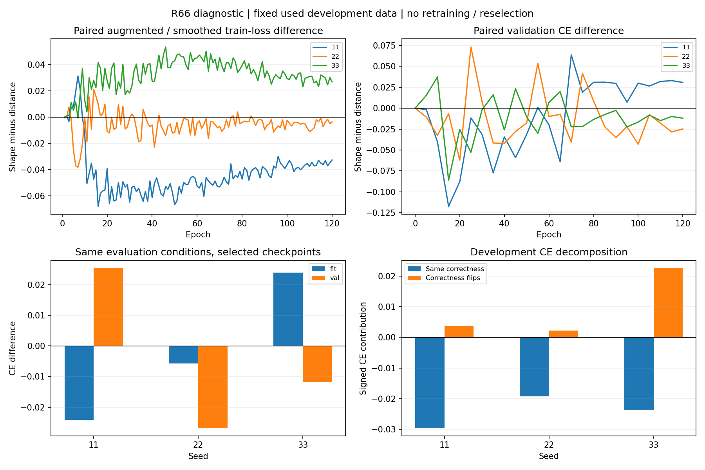

# R66 classification diagnostic

Original selected predictions and fixed selected/terminal fit–val forward checks. Used development data; original R66 conclusion and model selection unchanged.

| Split | Seed | CE difference | Class-average CE difference | OA pp | mCA pp |
|---|---:|---:|---:|---:|---:|
| val | 11 | +0.02528 | +0.03749 | -0.784 | -0.310 |
| dev_eval | 11 | -0.02590 | -0.01604 | -0.523 | -0.643 |
| val | 22 | -0.02674 | -0.02728 | +0.131 | -0.254 |
| dev_eval | 22 | -0.01708 | -0.02471 | -0.784 | -0.621 |
| val | 33 | -0.01193 | -0.02701 | +1.046 | +1.985 |
| dev_eval | 33 | -0.00125 | -0.00316 | -0.915 | -0.617 |

Candidate minus distance; all contributions use the full sample/class denominator.

| Dev seed | Group | Count | CE contribution | Class-CE contribution | mCA contribution pp |
|---|---|---:|---:|---:|---:|
| 11 | both_correct | 595 | -0.03352 | -0.02941 | +0.000 |
| 11 | both_wrong | 102 | +0.00398 | +0.00755 | +0.000 |
| 11 | corrected | 32 | -0.05397 | -0.06222 | +4.612 |
| 11 | harmed | 36 | +0.05760 | +0.06803 | -5.255 |
| 22 | both_correct | 601 | -0.00102 | -0.00403 | +0.000 |
| 22 | both_wrong | 82 | -0.01831 | -0.01951 | +0.000 |
| 22 | corrected | 38 | -0.06732 | -0.07910 | +6.117 |
| 22 | harmed | 44 | +0.06957 | +0.07794 | -6.739 |
| 33 | both_correct | 603 | -0.01408 | -0.01084 | +0.000 |
| 33 | both_wrong | 93 | -0.00967 | -0.00984 | +0.000 |
| 33 | corrected | 31 | -0.04188 | -0.05113 | +4.980 |
| 33 | harmed | 38 | +0.06438 | +0.06866 | -5.597 |

Aligned eval mode, canonical512 tokens, no augmentation or label smoothing.

| Policy | Seed | Fit CE difference | Val CE difference | Fit mCA pp | Val mCA pp |
|---|---:|---:|---:|---:|---:|
| selected | 11 | -0.02413 | +0.02528 | +0.600 | -0.310 |
| terminal120 | 11 | -0.02004 | +0.03082 | +0.682 | -0.818 |
| selected | 22 | -0.00578 | -0.02674 | +0.099 | -0.254 |
| terminal120 | 22 | -0.00629 | -0.02479 | +0.337 | -1.789 |
| selected | 33 | +0.02393 | -0.01193 | -0.697 | +1.985 |
| terminal120 | 33 | +0.02393 | -0.01193 | -0.697 | +1.985 |

All seeds, classes, sources, six original conditions and full training/validation curves are retained in JSON. Interpretation pending. These descriptive checks do not identify a unique cause.

## Reviewed interpretation

All three base dev_eval seeds improve both object- and class-average CE, while
both OA and mCA decrease. Class weighting alone does not explain the sign
reversal. Corrected/harmed counts are32/36,38/44,31/38; the extra harmed objects
are4/6/7. In every seed the combined correctness-flip groups make a positive
CE contribution, offset by lower CE on unchanged-correctness objects. This
explains the aggregate probability/decision discrepancy; it is not a calibration
claim or a classification benefit.

The matched fit/val checks do not show one uniform optimization or overfitting
pattern. Seed11 improves fit CE and worsens val CE; seed22 improves both; seed33
worsens fit CE and improves val CE. The same directional pattern appears at
fixed terminal120. The original training loss differences are also mixed.
A descriptive gap cannot identify a unique optimization or data-quality cause.

Decision: conduct the already planned single matched late-shape experiment,
starting from each trained distance model, with equal20-epoch budgets. This
asks an actionable training-path question; it does not rewrite R66 or require
fully explaining all failures before cross-view mechanism work. No additional
checkpoint search, loss change, temperature fit or held-out-data use occurred.

Independent metrics on all24 forward groups agree within6.67e-16. All six
selected validation replays preserve predictions. The plot was actually opened
and reviewed; differences and negative cases are shown. Review used independent
calculations by the same agent, not an independent researcher.

