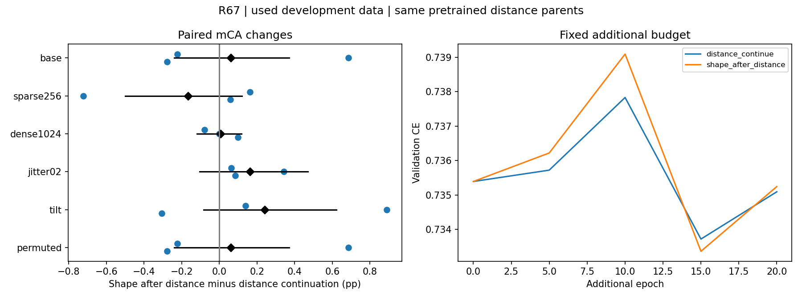

# R67: late introduction of Gaussian shape

Matched terminal120 distance parents; two roles each get the same20 additional epochs. Used full60-class development data. This does not replace the original R66 result.

| Method | Base mCA seeds11/22/33 % | Mean % | CE | Class-average CE | Selected added epochs |
|---|---|---:|---:|---:|---|
| distance_continue | 79.203 / 77.894 / 78.643 | 78.580 | 0.73785 | 0.89155 | [20, 5, 15] |
| shape_after_distance | 78.981 / 78.579 / 78.365 | 78.642 | 0.73778 | 0.89126 | [20, 5, 15] |

| Condition | Paired mCA changes pp | Mean pp | Paired-class95% pp | Lead |
|---|---|---:|---|---|
| base | -0.222 / +0.685 / -0.278 | +0.062 | [-0.241, +0.370] | False |
| sparse256 | +0.163 / -0.722 / +0.060 | -0.167 | [-0.500, +0.120] | False |
| dense1024 | -0.079 / +0.000 / +0.098 | +0.006 | [-0.119, +0.118] | False |
| jitter02 | +0.064 / +0.343 / +0.083 | +0.164 | [-0.105, +0.469] | False |
| tilt | +0.139 / +0.889 / -0.306 | +0.241 | [-0.083, +0.620] | False |
| permuted | -0.222 / +0.685 / -0.278 | +0.062 | [-0.241, +0.370] | False |

All classes, sources and secondary scores are retained in result.json. Bootstrap is over classes after seed averaging, not a seed-population interval. Source categories are disjoint. Stage0 selection means no accepted adaptation. Scientific and actual visual review completed; see review.json.

## Reviewed interpretation (2026-11-04)

延后加入形状后，基础mCA为78.642%，配对距离续训78.580%；差+0.062pp，
三个种子−0.222/+0.685/−0.278，类别条件区间[−0.241,+0.370]pp。
这是近似持平，不是一个应继续修补的微小数值失败，也没有稳定实用收益。
CE的均值差约−0.000071，OA三种子平均差为0，均不足以改写此结论。
所有原定扰动条件也未建立稳定领先；jitter三种子微增但均值仅+0.164pp，
区间仍跨零。继续保留全部指标，不选择有利子组替代整体结果。

六次训练均20epochs/7800updates，配对共同初值及原Adam状态一致；新增
形状参数状态从零开始。三个种子的20轮输入流完全相同，两组分别选20/5/15
轮，无模型选原始parent。验证重放logit差为0，36组独立指标最大差6.66e-16；
置换最大logit差5.36e-6、预测不变，无需额外数值修补。12个子任务退出0，
实际查看了比较图。平均验证CE曲线接近，不代表已证明全局收敛。

结束这一次训练路径检验，不增加学习率或训练预算。它限制“简单延后加入
形状便能挽救分类收益”的解释，不能排除所有优化策略。也不能把140轮的
结果与原120轮结果作没有训练时长混杂的主比较。R65/R66分类负结果、
观测区域匹配正结果和旧RGB失败分别保留；整体目标尚未达成。
